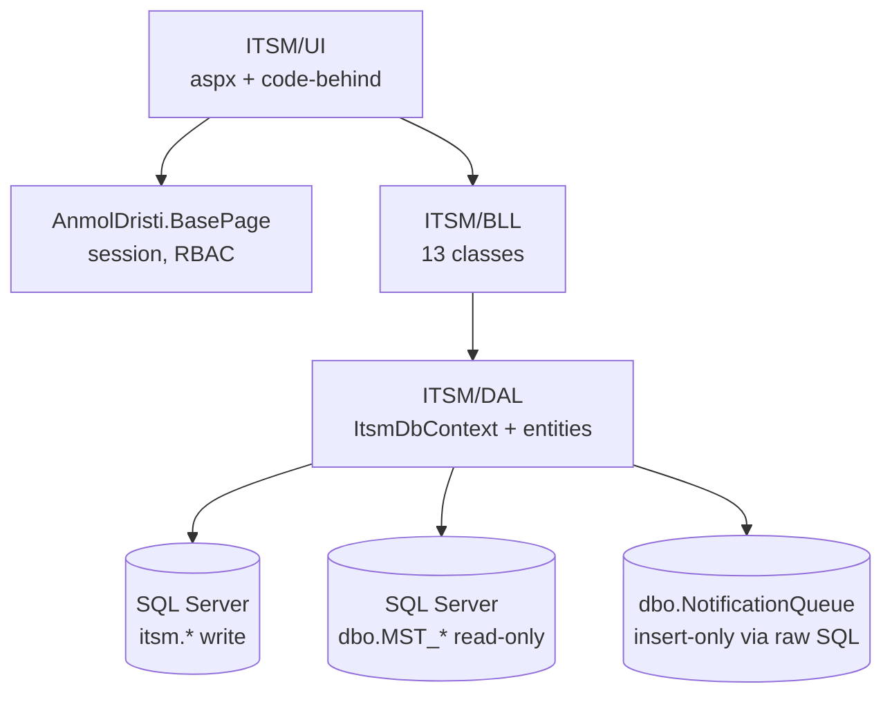
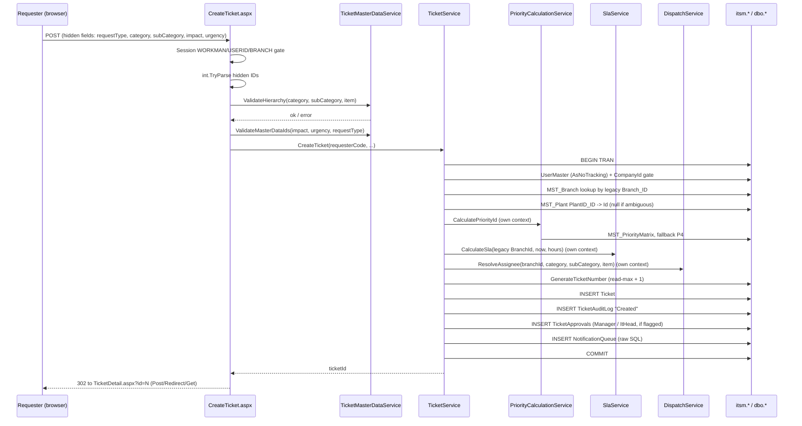

# ITSM AS-IS Architecture Review

**Document:** 1 of 6 — Architecture
**Module:** ITSM (`AnmolDristi/ITSM`)
**Review type:** Independent Enterprise Solutions Architecture Review, AS-IS only
**Mode:** Strict read-only. No file, SQL object, or database was modified.
**Repository HEAD at review:** `9c0c037` on branch `Aug26_AILWorks_AmimnrupSupport`
**Date:** 2026-11-12

---

## 1. Executive Summary

The ITSM module is a **genuine three-layer vertical slice inside the existing ASP.NET
Web Forms monolith**. It is not a stub: 66 files implement a working ticket lifecycle
across presentation (`ITSM/UI`), business logic (`ITSM/BLL`), and an EF6 data layer
(`ITSM/DAL` + Code First migrations) writing to a dedicated `itsm` SQL schema that
sits alongside the legacy `dbo` masters.

The architecture is **more disciplined than the rest of the application**:

- The BLL is free of `System.Web` references; authorization inputs are passed in as
  parameters, not read from `HttpContext`.
- Every read path observed uses `AsNoTracking()` with explicit DTO projections.
- A hard guard in `ItsmDbContext.SaveChanges()` refuses any write to legacy `dbo`
  master entities.
- Tenant ownership is an immutable snapshot (`Tickets.CompanyId`) rather than a live
  join to mutable HRMS data — a deliberate and defensible choice.

However, the module is **functionally narrower than its own design documentation**.
Several capabilities described in `docs/05-data-architecture/phase-1-schema.md` do
not exist in code: `TicketNumberService`, `ApprovalWorkflowService`,
`TicketClosureService`, `AttachmentValidationService`, `ApproveTicket.aspx`, and
`~/ITSM/UI/DownloadAttachment.ashx`. Several database columns are declared and
rendered but never written (`CsatScore`, `CsatFeedback`).

**Bottom line for the reviewer feedback:** of the eleven requested capabilities,
**one is fully present**, **four are partially present**, and **six are absent**.
No capability the reviewer raised is fully implemented end-to-end in the form
described. Details are in `ITSM_Requirements_Gap_Analysis.md`.

Three findings are architectural rather than cosmetic and shape everything else:

1. **The workflow transition map and the terminal-status gate can contradict each
   other** (`WF-04`). A status flagged `IsTerminal` can never transition, regardless
   of what `TicketWorkflow.Transitions` permits. This makes the modelled
   `Resolved → Closed` and `Resolved → In Progress` edges conditionally unreachable.
2. **SLA dates are calculated and then discarded** (`WF-08`). `SlaService` computes a
   start and due time, but no column stores them; the values are used only to
   populate one email body. There is no SLA state in the data model.
3. **Resolution and closure are not a two-step controlled process** as documented.
   There is no CSAT write path and no auto-close job, so `Closed` is reachable only
   as a manual status change (`WF-07`).

These are AS-IS observations. No remediation is proposed in this document.

---

## 2. Scope, Method, and Evidence Standard

### 2.1 In scope

- Repository and project structure **as it pertains to ITSM**
- ITSM UI, BLL, DAL boundaries
- `itsm` schema tables, keys, indexes, relationships, migrations
- Ticket creation/submission, approval, assignment, status lifecycle
- Resolution, rejection, audit log, transaction boundaries
- Session validation, CompanyID isolation, authorization
- `TicketList.aspx`, `TicketDetail.aspx`, `CreateTicket.aspx`
- BLL services relevant to the reviewer's Phase 1B questions

### 2.2 Explicitly out of scope

Claims/HRMS stored procedures (`usp_ProcessApprovalAction`,
`usp_MarkRequestReadyForPayment`), VMS, HRMS import, and the shared `dbo` master
tables except where ITSM reads them as foreign keys. The VMS/HRMS procedures were
**not** re-reviewed; the prior Stage 1 report's H-04 finding about them is outside
this module and is not carried forward here.

### 2.3 Evidence rules applied

- A claim is **Verified** only when the implementing line was read in this review.
- A claim resting on a repository file that does not exist is labelled **Absent**.
- A claim about the **deployed** database is labelled **Unverified** — no SQL was
  executed and no server was contacted.
- Prior audits (`ITSM_STAGE_1_*`, `ITSM_STAGE_2_*`) are treated as *claims*, not
  evidence. One of their findings (M-03, RowVersion) is **refuted** by direct
  reading; see `ITSM_AS_IS_Security.md` §7.
- Documentation (`docs/05-data-architecture/phase-1-schema.md`) is treated as
  **intent**, not implementation. Where it disagrees with code, code wins and the
  divergence is recorded.

---

## 3. Repository and Module Inventory

### 3.1 Solution structure

```
AnmolDristi.sln
├── AnmolDristi/                 ASP.NET Web Forms, .NET Framework 4.8, IIS
│   ├── ITSM/                    ← this review
│   │   ├── UI/                  4 pages (aspx + code-behind + designer)
│   │   ├── BLL/                 13 classes
│   │   ├── DAL/                 DbContext, 21 entities, 5 migrations
│   │   └── MENU_INTEGRATION.md
│   ├── Database/                6 ITSM-related SQL scripts (permissions only)
│   ├── BasePage.cs              session + RBAC base class
│   └── Web.config               security boundary — NOT read
├── Database/                    Claims/HRMS/VMS T-SQL (no ITSM objects)
├── docs/                        specifications, ADRs, reviews
└── packages/                    NuGet (EF6)
```

### 3.2 ITSM file inventory (66 files, all verified present)

| Layer | File | Responsibility |
|---|---|---|
| UI | `ITSM/UI/CreateTicket.aspx` (+`.cs`,`.designer.cs`) | New ticket form, client-side cascade |
| UI | `ITSM/UI/TicketList.aspx` (+`.cs`,`.designer.cs`) | 4 queue tabs, filters, grid |
| UI | `ITSM/UI/TicketDetail.aspx` (+`.cs`,`.designer.cs`) | Detail, actions, comments, audit |
| UI | `ITSM/UI/ApprovalConfig.aspx` (+`.cs`,`.designer.cs`) | IT Head + request-type approval flags |
| BLL | `TicketService.cs` | Orchestrates creation end-to-end |
| BLL | `TicketUpdateService.cs` | Six mutations + audit + rowversion |
| BLL | `TicketDetailService.cs` | Detail projection + authorization gate |
| BLL | `TicketListService.cs` | Queue queries, lookups |
| BLL | `TicketMasterDataService.cs` | Category/impact/urgency/request-type reads, hierarchy validation |
| BLL | `TicketWorkflow.cs` | Static status transition map |
| BLL | `ItsmTicketAccess.cs` | Operation-specific authorization predicates |
| BLL | `ItsmTenantContext.cs` | Live `UserMaster.CompanyId` resolution |
| BLL | `DispatchService.cs` | Category-based assignment cascade |
| BLL | `PriorityCalculationService.cs` | Impact × Urgency → Priority |
| BLL | `SlaService.cs` | Business-hours SLA calculation (not persisted) |
| BLL | `ApprovalConfigurationService.cs` | IT Head configuration |
| BLL | `CreateTicketDiagnostics.cs` | Stage timing/correlation diagnostics |
| DAL | `ItsmDbContext.cs` | EF6 context, `dbo` write guard |
| DAL | `Entities/*.cs` (21) | Mapping for `itsm` tables + read-only `dbo` masters |
| DAL | `Migrations/*` (5) | Code First schema + audit log + CompanyId + ApprovalConfig |

### 3.3 Documentation/intent artefacts present but not implemented

| Referenced artefact | Where claimed | Actual state |
|---|---|---|
| `~/ITSM/BLL/TicketNumberService.cs` | `phase-1-schema.md` §4.1 | **Absent**; numbering is private in `TicketService` |
| `~/ITSM/BLL/ApprovalWorkflowService.cs` | `phase-1-schema.md` §5.8 | **Absent** |
| `~/ITSM/BLL/TicketClosureService.cs` | `phase-1-schema.md` §5.5 | **Absent**; no auto-close job |
| `~/ITSM/BLL/AttachmentValidationService` | `compliance-and-security.md` §1 | **Absent** |
| `~/ITSM/UI/ApproveTicket.aspx` | `phase-1-schema.md` §5.3 | **Absent**; approval is on TicketDetail |
| `~/ITSM/UI/DownloadAttachment.ashx` | `compliance-and-security.md` §1 | **Absent** |
| `itsm.TicketNumberSequence` | `phase-1-schema.md` §4.1 ("optional") | **Absent** from migrations |
| `itsm_phase1b_migration.sql` (repo root) | present in tree | **0 bytes — empty file** |

These absences are verified negative evidence, established by directory listing and
repository-wide search, not by reading a single file.

---

## 4. Layering and Boundary Assessment

### 4.1 Dependency direction



Verified properties:

| Property | Result | Evidence |
|---|---|---|
| UI contains no inline SQL | **Verified** | No `SqlCommand`/`SqlConnection` in any `ITSM/UI/*.cs` |
| BLL is `System.Web`-agnostic | **Verified** | All BLL files read; only `System.Net.WebUtility` (email body) and `System.Data.Entity` |
| BLL uses DTO projections, not entities, for reads | **Verified** | `AsNoTracking().Select(...)` in every BLL read path |
| DAL forbids legacy `dbo` writes | **Verified** | `ItsmDbContext.AssertNoLegacyMasterWrites()`, throws `InvalidOperationException` |
| UI calls concrete BLL classes (no interface/DI) | **Verified** | `new TicketService()`, `new TicketUpdateService()` per handler |
| BLL classes open their own `DbContext` per call | **Verified** | Every method: `using (var context = new ItsmDbContext())` |
| Single unit of work per user action | **Partially** | `TicketService.CreateTicket` composes three other services, each with its **own** context (see `ARC-03`) |

### 4.2 One exception to the "no SQL in BLL" rule

`TicketService.EnqueueTicketCreatedNotification` issues raw SQL:

```
INSERT INTO dbo.NotificationQueue
    (FormSubmissionId, EscalationLevel, RecipientEmail, RecipientName,
     Subject, Body, NotificationType, Status, SourceModule)
VALUES (@FormSubmissionId, 0, ..., 'Email', 'Pending', 'ITSM')
```

Parameters are bound (`SqlParameter`), so there is no injection exposure. The
observation is architectural: ITSM writes to a shared messaging table owned by
another module, using a schema shaped for the Claims workflow (`FormSubmissionId`,
`EscalationLevel`). This is a deliberate reuse documented in
`phase-1-schema.md` §2, and it is the **only** place ITSM crosses into another
module's write surface.

---

## 5. Request Lifecycle (verified code path)



Two properties matter for the rest of this review:

- **The transaction is opened before the spin-up of `PriorityCalculationService`,
  `SlaService`, and `DispatchService`, but those services are not enlisted in it.**
  Each constructs its own `ItsmDbContext` with its own connection. They are
  read-only, so no write escapes the transaction, but the reads are not covered by
  its isolation. See `ARC-03`.
- **`GenerateTicketNumber` runs inside the same READ COMMITTED transaction** as the
  insert. It is a read-modify-write with no lock and no uniqueness constraint. See
  `DB-03` and `WF-02`.

---

## 6. Architectural Findings

| ID | Component | Observation | Classification |
|---|---|---|---|
| ARC-01 | Layer boundaries | BLL is `System.Web`-free; UI carries all session/permission concerns; DAL owns persistence. Boundaries hold. | Already Exists |
| ARC-02 | `ItsmDbContext` | `AssertNoLegacyMasterWrites()` blocks any `Added/Modified/Deleted` legacy master entity. A real, enforced module boundary. | Already Exists |
| ARC-03 | `TicketService.CreateTicket` | Orchestrates `PriorityCalculationService`, `SlaService`, `DispatchService`, each opening its **own** `ItsmDbContext`. The creation transaction does not span these reads. | Architectural Gap |
| ARC-04 | `TicketService.GenerateTicketNumber` | Private method inside `TicketService`, despite documentation naming a `TicketNumberService`. Number allocation is coupled to the ticket service and not reusable. | Architectural Gap |
| ARC-05 | `TicketMasterDataService.GetCategoryHierarchy(int companyId)` | Accepts `companyId` and **never uses it** in the query. Category/subcategory/item data is global; no tenant scoping exists. The call site does resolve a company ID and passes it, implying intent. | Architectural Gap |
| ARC-06 | `SlaService` + `Ticket` entity | SLA start/due are computed but not persisted: `Ticket` has no SLA columns, and the values are consumed only by the notification email body. | Architectural Gap |
| ARC-07 | `TicketMasterDataService` + `CreateTicket.aspx` | Category→SubCategory→Item selection is client-side only (JSON in `hfCategoryData`, no postbacks). Server re-validates the hierarchy, so the client is not trusted. Sound, but the entire hierarchy is serialized to the browser on every GET. | Already Exists |
| ARC-08 | `TicketListService` + `ItsmTicketAccess` | Shared-service queues are intentionally tenant-agnostic while detail access is tenant-scoped. This is a documented design choice, not an oversight — but it means ticket metadata is visible across tenants in queue screens. | Configuration Required (policy) |
| ARC-09 | `ITSM/UI` | No `ITSM` assembly separation: UI, BLL, DAL are namespaces in the single `AnmolDristi` web project. "Modular monolith" is by namespace and schema, not by project boundary. | Already Exists (documented intent) |
| ARC-10 | Deployment artifacts | `itsm_phase1b_migration.sql` at repository root is an **empty (0-byte)** file. Its intended content is unavailable in the repository. | Clarification Required |

### ARC-03 — detail

`CreateTicket` opens `context.Database.BeginTransaction()`, then calls:
`_priorityService.CalculatePriorityId(...)`, `_slaService.CalculateSla(...)`,
`_dispatchService.ResolveAssignee(...)`. Each of those constructs a fresh
`ItsmDbContext` internally. The consequence is three extra connections and three
short-lived contexts per ticket, outside the transaction. Because they are
read-only this is not a correctness defect for data written; it is a consistency
window (matrix/dispatch edits committed during creation are seen unpredictably) and
a unit-of-work boundary that the code's shape implies but does not deliver.

### ARC-05 — detail

```csharp
public List<TicketCategoryDto> GetCategoryHierarchy(int companyId)
{
    using (var context = new ItsmDbContext())
    {
        var query = context.Categories.AsNoTracking().Where(c => c.IsActive);
        return query.OrderBy(c => c.Name).Select(...)
```

`companyId` is unused. `itsm.MST_Category`, `MST_SubCategory`, and `MST_Item` have
no company column at all (confirmed in the initial migration), so tenant-specific
taxonomy is not representable today.

### ARC-06 — detail

`SlaService.CalculateSla` returns `SlaResult { SlaStartTime, DueDate }`. In
`TicketService.CreateTicket` the only consumer is
`EnqueueTicketCreatedNotification(context, ticket, requester, assigneeCode,
sla.SlaStartTime, sla.DueDate)`. No `Ticket` property receives either value, and the
`Tickets` table has no SLA column in any migration. SLA breach cannot be queried,
reported, or enforced from the ITSM schema.

---

## 7. Component Dependency Map

| BLL class | Depends on | Called from |
|---|---|---|
| `TicketService` | `PriorityCalculationService`, `SlaService`, `DispatchService`, `ItsmDbContext` | `CreateTicket.aspx.cs` |
| `TicketUpdateService` | `ItsmTicketAccess`, `TicketWorkflow`, `ItsmDbContext` | `TicketDetail.aspx.cs` |
| `TicketDetailService` | `ItsmTicketAccess`, `TicketWorkflow`, `ItsmDbContext` | `TicketDetail.aspx.cs` |
| `TicketListService` | `ItsmDbContext` | `TicketList.aspx.cs`, `TicketDetail.aspx.cs` (agent/priority dropdowns) |
| `TicketMasterDataService` | `ItsmTenantContext`, `ItsmDbContext` | `CreateTicket.aspx.cs` |
| `ApprovalConfigurationService` | `ItsmDbContext` | `ApprovalConfig.aspx.cs` |
| `ItsmTicketAccess` | `ItsmDbContext` | `TicketDetailService`, `TicketUpdateService` |
| `ItsmTenantContext` | `ItsmDbContext` | `TicketDetail.aspx.cs`, `TicketMasterDataService` |
| `TicketWorkflow` | `ItsmDbContext` | `TicketDetailService`, `TicketUpdateService` |
| `DispatchService` | `ItsmDbContext` | `TicketService` |
| `PriorityCalculationService` | `ItsmDbContext` | `TicketService` |
| `SlaService` | `ItsmDbContext` (`dbo.VMS_PlantTimings`, `dbo.MST_Calendar`) | `TicketService` |

Notable coupling: `SlaService` reads `dbo.VMS_PlantTimings` — a **VMS-owned** table —
for ITSM business hours. ITSM therefore has a read dependency on another module's
operational table, not just on static `MST_*` masters. This is documented as
intentional (`SlaService` class comment: "plant working hours (`dbo.VMS_PlantTimings`)")
but it is a cross-module data dependency that is not represented in
`phase-1-schema.md` §1's master table list.

---

## 8. Technology Observations

| Item | Observed | Note |
|---|---|---|
| .NET Framework | 4.8-compatible code (`SlaResult` class instead of `ValueTuple`, C# 6 syntax) | Consistent with the stated platform |
| ORM | EF6 Code First migrations against `itsm` schema | 5 migrations present |
| Data access | LINQ projections; two raw SQL uses (notification insert, filtered unique index DDL) | Bounded |
| Connection string | `base("name=DbConn")` — the shared monolith connection | Single database, both schemas |
| Client script | Inline JS module per page; no bundler, no framework | Consistent with repo constraints |
| Stored procedures | **None owned by ITSM** (see `DB-12`) | All ITSM logic is in C#/EF |
| Configuration | `Web.config` not read (declared security boundary) | Upload limits cannot be verified |

---

## 9. Assumptions and Unavailable Evidence

| # | Item | Status |
|---|---|---|
| A1 | `AnmolDristi/Web.config` connection target, `maxRequestLength`, `httpRuntime` | **Not read** — declared security boundary in `AGENTS.md` §3.4 |
| A2 | Deployed `itsm` schema (indexes, seed rows, actual status `IsTerminal` flags) | **Unverified** — no SQL executed |
| A3 | `MST_TicketStatus` seed contents (which statuses exist, their `IsTerminal`) | **Unverified** — no seed script in repo; fallback logic in code implies names may vary |
| A4 | `MST_RequestType` seed rows (Prefix values, approval flags) | **Unverified** — no seed script located |
| A5 | `MST_SupportMapping` contents (whether any rows exist per branch) | **Unverified** |
| A6 | Whether migrations have been applied to UAT/Production | **Unverified** |
| A7 | IIS virtual directory layout for uploads | **Unverified** — no upload code exists to constrain it |
| A8 | `dbo.VMS_PlantTimings.Branch_ID` key space (legacy `Branch_ID` vs `MST_Branch.Id`) | **Unverified** — see `WF-09` |
| A9 | Whether `ITSM.Ticket.View`/`Queue.View`/`Approval.View` are actually assigned in UAT | **Unverified** — scripts exist, execution not evidenced |

Assumption used for classification: where a capability has code but no reachable
write path (CSAT), it is classified **Partially Exists**, not **Already Exists**.

---

## 10. Unresolved Architectural Questions for the Reviewer

1. **Is `Resolved` intended to be terminal?** The entity comment implies yes; the
   transition map implies no. This single seed decision changes whether tickets can
   be closed and whether CSAT is reachable (`WF-04`).
2. **Is ticket metadata intentionally visible across companies in queues?** The code
   says yes and documents it; whether that is accepted risk is an owner decision
   (`ARC-08`).
3. **Should the category taxonomy be tenant-scoped?** The API signature implies yes;
   the schema cannot represent it (`ARC-05`).
4. **Is SLA tracking in scope for ITSM at all?** Calculation exists; persistence does
   not (`ARC-06`).
5. **Is `dbo.VMS_PlantTimings` the approved source of ITSM working hours?** It is a
   cross-module dependency not listed in the schema design's master inventory.
6. **What is the intended content of the empty `itsm_phase1b_migration.sql`?**
