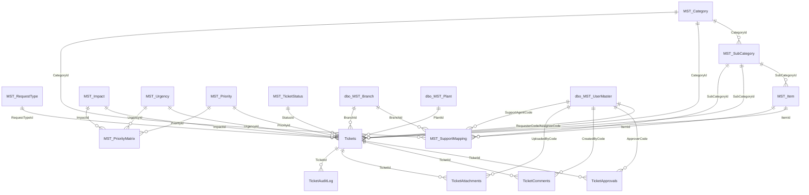

# ITSM AS-IS Database Review

**Document:** 2 of 6 — Database
**Schema under review:** `itsm` (plus read-only `dbo` dependencies)
**Mode:** Read-only. No SQL was executed; no database object was altered.
**Date:** 2026-11-12

---

## 1. Executive Summary

The ITSM schema is defined **entirely by EF6 Code First migrations** in
`AnmolDristi/ITSM/DAL/Migrations/`. It comprises **15 tables** (14 in the initial
migration plus `MST_ApprovalConfiguration`), **one** filtered unique index, and a
large set of foreign keys that point *into the legacy `dbo` schema*.

The single most important database fact for this review:

> **The ITSM module owns no stored procedures, no views, and no triggers.**
> A repository-wide search for `itsm.` inside every `.sql` file (excluding the EF
> migration `.cs` files) returns **zero matches**. All ITSM behaviour lives in C#.

This is a material architectural contrast with the Claims/HRMS half of the same
database, where workflow state is procedure-owned. It means the guarantees the
application relies on (ticket-number uniqueness, status transition validity, audit
immutability, tenant isolation) are **application-enforced only**. What the database
enforces is limited to primary keys, foreign keys, one filtered unique index, and
`rowversion` on `Tickets`.

Three specific integrity gaps follow directly from that:

1. **No uniqueness on ticket numbers** — `DB-03`. `TicketNumber` is
   `varchar(10) NOT NULL` with no unique index, and the generating code is a
   read-modify-write (`WF-02`).
2. **No uniqueness on natural keys of masters** — `DB-05`. `MST_RequestType.Code`
   and `.Prefix`, `MST_Priority.Code`, `MST_Impact.Code`, `MST_Urgency.Code` are
   all unindexed and unconstrained, despite the design document describing them as
   unique.
3. **Audit log is not immutable at the database level** — `DB-09`. The entity is
   documented as an "immutable ITGC audit trail"; nothing in the schema enforces it.

---

## 2. Table Inventory

All tables below are in schema `itsm` unless stated. Column facts are taken from the
migration that created them.

| # | Table | Created by | Purpose |
|---|---|---|---|
| 1 | `MST_RequestType` | `202608120550515_InitialItsmSchema` | IR/SR/CR families, prefix, approval flags |
| 2 | `MST_Category` | same | Tier-1 taxonomy |
| 3 | `MST_SubCategory` | same | Tier-2 taxonomy |
| 4 | `MST_Item` | same | Tier-3 taxonomy |
| 5 | `MST_Impact` | same | Impact lookup |
| 6 | `MST_Urgency` | same | Urgency lookup |
| 7 | `MST_Priority` | same | Priority + SLA hours |
| 8 | `MST_PriorityMatrix` | same | Impact × Urgency → Priority |
| 9 | `MST_TicketStatus` | same | Status lookup + `IsTerminal` |
| 10 | `MST_SupportMapping` | same | Branch + taxonomy → default agent |
| 11 | `Tickets` | same | Central transactional record |
| 12 | `TicketApprovals` | same | Manager/ITHead approval rows |
| 13 | `TicketComments` | same | Requester/IT communication |
| 14 | `TicketAttachments` | same | File metadata (no upload code exists) |
| 15 | `TicketAuditLog` | `202608201200000_AddTicketAuditLog` | Workflow audit trail |
| — | `MST_ApprovalConfiguration` | `202608240451107_AddApprovalConfiguration` | Active IT Head approver |

Read-only `dbo` tables mapped for ITSM: `MST_UserMaster`, `MST_Plant`, `MST_Branch`,
`MST_Department`, `MST_Company`, `MST_Calendar`, `VMS_PlantTimings`.

---

## 3. Core Table Detail

### 3.1 `itsm.Tickets`

| Column | Type | Null | Notes |
|---|---|---|---|
| `Id` | `int identity` | no | PK |
| `TicketNumber` | `varchar(10)` | no | **No unique index** |
| `RequestTypeId` | `int` | no | FK → `MST_RequestType.Id` |
| `Title` | `nvarchar(200)` | no | Required |
| `Description` | `nvarchar(max)` | yes | Unbounded |
| `RequesterCode` | `varchar(50)` | no | FK → `dbo.MST_UserMaster.EmployeeCode` |
| `AssigneeCode` | `varchar(50)` | yes | FK → `dbo.MST_UserMaster.EmployeeCode` |
| `PlantId` | `int` | yes | FK → `dbo.MST_Plant.Id` |
| `BranchId` | `int` | no | FK → `dbo.MST_Branch.Id` |
| `CompanyId` | `int` | **yes** | Added later; **no FK**; immutable tenant snapshot |
| `CategoryId` | `int` | no | FK → `MST_Category.Id` |
| `SubCategoryId` | `int` | no | FK → `MST_SubCategory.Id` |
| `ItemId` | `int` | yes | FK → `MST_Item.Id` |
| `ImpactId` | `int` | no | FK → `MST_Impact.Id` |
| `UrgencyId` | `int` | no | FK → `MST_Urgency.Id` |
| `PriorityId` | `int` | no | FK → `MST_Priority.Id` (derived) |
| `StatusId` | `int` | no | FK → `MST_TicketStatus.Id` |
| `ResolutionText` | `nvarchar(max)` | yes | Required by code when target = Resolved |
| `CsatScore` | `tinyint` | yes | **Never written by any code path** |
| `CsatFeedback` | `nvarchar(500)` | yes | **Never written by any code path** |
| `CreatedOn` | `datetime` | no | Local time (`DateTime.Now`) |
| `ResolvedOn` | `datetime` | yes | Set on transition to Resolved |
| `ClosedOn` | `datetime` | yes | Set on transition to Closed |
| `CreatedByCode` | `varchar(50)` | no | |
| `ModifiedOn` | `datetime` | yes | |
| `ModifiedByCode` | `varchar(50)` | yes | |
| `RowVersion` | `rowversion` | no | EF6 optimistic concurrency token |

**Not present (notable absences):** `SlaStartTime`, `SlaDueDate`, `SlaBreached`,
`RejectedOn`, `RejectionReason`, `ResolutionImpact`, `ResolutionCode`,
`ReopenCount`, `AssigneeGroupCode`, `RootCategoryId`.

### 3.2 Indexes on `Tickets`

Created by the initial migration, one per FK plus the PK:

`RequestTypeId`, `RequesterCode`, `AssigneeCode`, `PlantId`, `BranchId`,
`CategoryId`, `SubCategoryId`, `ItemId`, `ImpactId`, `UrgencyId`, `PriorityId`,
`StatusId`; plus `CompanyId` (added by `202608210700000_AddTicketCompanyId`).

**Absent:** any index on `TicketNumber`; any index on `CreatedOn`; any composite
queue index (e.g. `StatusId, CreatedOn`); any unique index. Queue queries
(`TicketListService.BuildQueueQuery`) filter on `Status`, `RequestTypeId`,
`BranchId`, `AssigneeCode`, `PriorityId` and sort by
`Priority.SlaResolutionHours` then `CreatedOn` — the sort key is not indexed and
lives on a joined table, so sorting is done in the plan, not by a seek.

### 3.3 `itsm.TicketAuditLog`

| Column | Type | Null |
|---|---|---|
| `Id` | `int identity` | no |
| `TicketId` | `int` | no (FK → `Tickets.Id`) |
| `CompanyId` | `int` | no — copies `Ticket.CompanyId` |
| `ActionType` | `nvarchar(50)` | no |
| `OldValue` | `nvarchar(200)` | yes |
| `NewValue` | `nvarchar(200)` | yes |
| `Detail` | `nvarchar(1000)` | yes |
| `ActorCode` | `varchar(50)` | no |
| `ActionedOn` | `datetime` | no |

Indexes: `TicketId`, `CompanyId`, `(TicketId, CompanyId)`, `ActionedOn`.

`CompanyId` is `NOT NULL` while `Tickets.CompanyId` is nullable. This is consistent
only because every write path calls `RequireRecordedTenant` first (`WF-06`); a
ticket with `NULL` tenant cannot produce an audit row at all.

### 3.4 `itsm.TicketApprovals`

`Id`, `TicketId` (FK), `ApprovalLevel nvarchar(20)`, `ApproverCode varchar(50)` (FK →
`dbo.MST_UserMaster`), `ApprovalStatus nvarchar(20)`, `Comments nvarchar(500)`,
`ActionedOn datetime`, `CreatedOn datetime`. Indexes on `TicketId`, `ApproverCode`.

No unique constraint on `(TicketId, ApproverCode, ApprovalLevel)` or
`(TicketId, ApprovalLevel)`. Consequences:

- Two pending rows can exist for the same approver on the same ticket (possible when
  the reporting manager is also the configured IT Head). `ApproveTicket` uses
  `FirstOrDefault`, so which row is actioned is not deterministic (`WF-05`).
- Nothing prevents duplicate approval rows for the same level.

### 3.5 `itsm.MST_SupportMapping` (the assignment matrix)

`Id`, `BranchId int NOT NULL` (FK → `dbo.MST_Branch`), `CategoryId int NULL`,
`SubCategoryId int NULL`, `ItemId int NULL`, `SupportAgentCode varchar(50) NOT NULL`
(FK → `dbo.MST_UserMaster`), `IsBranchDefault bit`, `IsActive bit`, `CreatedOn`,
`ModifiedOn`. Indexes on every column above except the flags.

This is the **only** assignment configuration in the module. Properties that matter
for the reviewer feedback:

- `BranchId` is **NOT NULL**. There is no global/PAN-India mapping row; every mapping
  is anchored to one branch.
- The agent is a single `EmployeeCode`. There is no group, queue, team, pool, shift,
  SAP/Non-SAP classification, or hierarchy column.
- No unique constraint on the natural key `(BranchId, CategoryId, SubCategoryId,
  ItemId, IsBranchDefault)`, so duplicate active mappings can coexist; dispatch takes
  `FirstOrDefault` with **no `OrderBy`**, making the winner arbitrary (`WF-03`).

### 3.6 `itsm.MST_RequestType`

`Id`, `Code nvarchar(10) NOT NULL`, `Name nvarchar(100) NOT NULL`,
`Prefix char(2) NOT NULL`, `RequiresManagerApproval bit`,
`RequiresItHeadApproval bit`, `IsActive bit`.

Request Type carries **only approval flags**. It has no relationship to categories,
to `MST_SupportMapping`, or to any agent. Ticket numbering derives its prefix from
here (`WF-02`).

### 3.7 `itsm.MST_ApprovalConfiguration`

`Id`, `ItHeadApproverCode varchar(50) NOT NULL` (FK → `dbo.MST_UserMaster`),
`IsActive bit`, `CreatedOn`, `ModifiedOn`. Plus a raw-SQL index:

```sql
CREATE UNIQUE INDEX UIX_MST_ApprovalConfiguration_IsActive
ON itsm.MST_ApprovalConfiguration (IsActive)
WHERE IsActive = 1;
```

This is the **only** filtered unique index in the schema, and the only place a
database constraint enforces a business invariant ("exactly one active IT Head").
It is a good precedent; it is not applied to ticket numbers or mapping natural keys.

---

## 4. Entity Relationship Diagram (as implemented)



**Not modelled, and this is the key structural observation for requester feedback:**
there is no relationship between `MST_RequestType` and `MST_SupportMapping`, and no
entity represents an agent, an agent group, a team, or an agent hierarchy. The
assignment matrix is keyed by **branch + taxonomy**, not by request type. That is
why changing an assignment does not require touching Request Type — the coupling the
reviewer asked about simply does not exist in either direction.

---

## 5. Database Findings

| ID | Object | Finding | Classification |
|---|---|---|---|
| DB-01 | `itsm` schema (all) | 15 tables created solely by EF6 Code First migrations; migration list is the authoritative schema record in-repo. | Already Exists |
| DB-02 | `Tickets.TicketNumber` | `varchar(10) NOT NULL`, **no unique index**, no index at all. Design doc calls it "Unique"; nothing enforces it. | Architectural Gap |
| DB-03 | `Tickets` | Number generation reads `TicketNumber LIKE prefix%` per `RequestTypeId`, parses the last 4 chars, increments. No sequence table, no constraint, READ COMMITTED. | Architectural Gap |
| DB-04 | `Tickets` | No SLA columns. `SlaService` output is discarded except in an email body. | Architectural Gap |
| DB-05 | `MST_RequestType`, `MST_Priority`, `MST_Impact`, `MST_Urgency` | Natural keys (`Code`, `Prefix`) have no unique constraint or index, though documentation describes them as unique. | Architectural Gap |
| DB-06 | `MST_SupportMapping` | `BranchId` is `NOT NULL`; no global/no-branch mapping is representable. Assignment is branch-anchored only. | Architectural Gap |
| DB-07 | `MST_SupportMapping` | No unique constraint on the mapping natural key; dispatch uses unordered `FirstOrDefault`. | Architectural Gap |
| DB-08 | `TicketApprovals` | No unique constraint on `(TicketId, ApprovalLevel)` or `(TicketId, ApproverCode, ApprovalLevel)`; `FirstOrDefault` selects the row to action. | Architectural Gap |
| DB-09 | `TicketAuditLog` | Documented as immutable, but no trigger, no `DENY UPDATE/DELETE`, no append-only enforcement. EF can update/delete rows. | Architectural Gap |
| DB-10 | `MST_Category` / `MST_SubCategory` / `MST_Item` | Fixed three-tier shape; no `ParentId`, `Level`, `IsRoot`, or `CompanyId`. An "IT root category" node is not representable. | Architectural Gap |
| DB-11 | `Tickets.CsatScore` / `CsatFeedback` | Columns exist and are read for display, but no code path writes them. | Partially Exists |
| DB-12 | Whole `Database/` tree | **Zero** ITSM stored procedures, views, or triggers. All ITSM logic is in C#. Contrast with Claims, where procs own workflow state. | Verified Absence |
| DB-13 | `itsm_phase1b_migration.sql` (repo root) | **0 bytes.** Named like a migration artefact, contains nothing. | Clarification Required |
| DB-14 | `Tickets.CompanyId` | Nullable, **no FK** to `MST_Company` (deliberate: `CompanyId` stores `Company_ID`, not `Id`). Display name resolved by an explicit LINQ join, not navigation. | Already Exists (documented) |
| DB-15 | `TicketAttachments` | Table and entity are complete and correct for file metadata; no writer exists. `FilePath nvarchar(500)`, `FileName nvarchar(255)`. | Partially Exists |
| DB-16 | `Tickets.Description` / `ResolutionText` | `nvarchar(max)` with no length bound; no server-side length validation in BLL. | Architectural Gap |
| DB-17 | Cascade behaviour | `OneToManyCascadeDeleteConvention` removed in `OnModelCreating`; migrations emit no `ON DELETE CASCADE`. Deleting a ticket with children fails rather than orphaning — safe by default, but no soft-delete exists either. | Already Exists |

---

## 6. Referential Integrity Notes

- All `itsm` FKs to `dbo` tables mean **ITSM cannot exist independently of the
  legacy masters**. A `Tickets` row requires a valid `MST_UserMaster` requester,
  a valid `MST_Branch`, and (if set) a valid `MST_Plant`.
- `Tickets.CompanyId` is intentionally **not** an FK. Referential integrity for the
  tenant therefore does not exist: a `CompanyId` value can be inserted that has no
  matching `MST_Company.Company_ID`, and the detail join uses `DefaultIfEmpty()`, so
  the UI degrades to "Company N" rather than failing (`Security` §4).
- `MST_SupportMapping.SupportAgentCode` has an FK to `MST_UserMaster`, so an agent
  code must exist, but nothing requires the employee to be `Active` at dispatch time
  — `DispatchService` does not filter on `EmployeeStatus`.
- `TicketAuditLog.CompanyId NOT NULL` + `Tickets.CompanyId NULL` is a latent
  asymmetry: any future write path that bypasses `RequireRecordedTenant` will throw
  on `ticket.CompanyId.Value`, not silently insert `0`.

---

## 7. Schema-vs-Documentation Divergence Register

The design document `docs/05-data-architecture/phase-1-schema.md` is a specification,
not a description of the deployed schema. Where it differs, the migration is AS-IS.

| Documented | Actual | Impact |
|---|---|---|
| Ticket numbers allocated by `TicketNumberService.cs` | Private method in `TicketService.cs` | Service does not exist |
| "`TicketNumberSequence` (optional helper table)" | Not created by any migration | No counter table |
| `TicketNumber` "Unique" | No unique index | `DB-02` |
| `Code` / `Prefix` unique | No unique constraint | `DB-05` |
| `MST_ApprovalConfiguration` described as unique-active | Enforced by filtered unique index | **Matches** |
| IT Head "configured per branch/plant" (§4.2) | Single **global** active IT Head (`ApprovalConfiguration`) | Branch-level approver configuration does not exist |
| "Overrides are logged in `TicketComments` (`IsInternal = 1`)" (§5.7) | Reassignment writes `TicketAuditLog`, not a comment | Divergent audit channel |
| 72-hour auto-close via `TicketClosureService` | No closure service, no scheduler entry point | `WF-07` |
| Attachments via `AttachmentValidationService` + `DownloadAttachment.ashx` | Neither file exists | `GAP-03` |
| `MST_Calendar` used for analytics grouping and maintenance tickets | Only used for weekend detection in `SlaService` | Only one of three uses implemented |

---

## 8. Unavailable Database Evidence

| # | Item | Why unavailable |
|---|---|---|
| D1 | Deployed `itsm` schema vs migrations | No SQL executed (read-only mandate) |
| D2 | Presence of duplicate `TicketNumber` rows in UAT/Production | Requires data query |
| D3 | `MST_TicketStatus` seed rows and `IsTerminal` flags | No seed script in repository |
| D4 | `MST_RequestType` seed rows (Prefix, approval flags) | No seed script in repository |
| D5 | `MST_SupportMapping` population per branch | No seed script in repository |
| D6 | Whether `IX` names match deployment (manual DDL drift) | Requires catalog query |
| D7 | SQL Server version / compatibility level | Not in repository |

Nothing in this document should be read as a statement about the **live** database
beyond what the migrations imply. Migrations describe what *should* exist.
