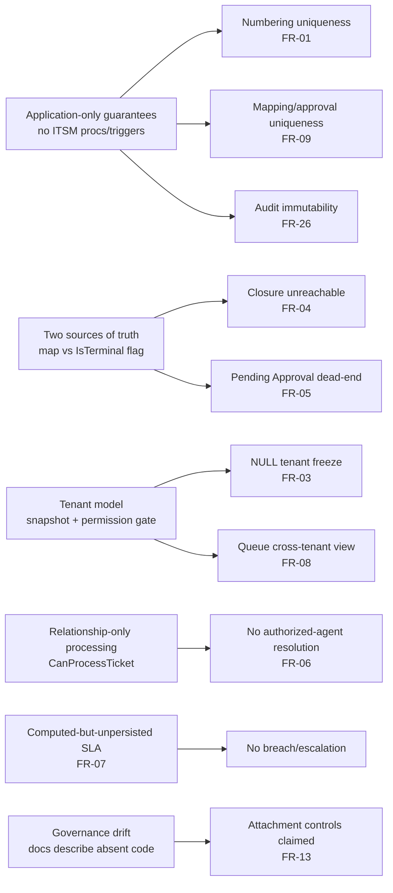

# ITSM AS-IS Findings and Risks

**Document:** 6 of 6 — Consolidated Register
**Mode:** Read-only. No code, SQL, configuration, or data was changed.
**Date:** 2026-11-12
**Repository HEAD:** `9c0c037` (`Aug26_AILWorks_AmimnrupSupport`)

---

## 1. How to Read This Register

Each finding carries:

- **ID** — stable reference (`FR-nn`)
- **Severity** — Critical / High / Medium / Low, based on impact **if the condition
  is reached in the deployed system**
- **Evidence** — exact file and member
- **Confidence** — *Verified* (line read), *Conditional* (depends on seed/config/data
  not readable here), *Unverified* (needs a database or runtime check)
- **Classification** — per the review's taxonomy

Severity reflects architectural consequence, **not** a release recommendation. No
remediation is proposed; ordering is descriptive.

---

## 2. Critical Findings

### FR-01 — Ticket numbers can collide; the database does not prevent it

**Severity:** Critical · **Confidence:** Verified · **Classification:** Architectural Gap

| | |
|---|---|
| Component | `AnmolDristi/ITSM/BLL/TicketService.cs` → `GenerateTicketNumber` (~L359–L410); `itsm.Tickets.TicketNumber` |
| Observed | Number is `prefix + yy + mm + D4(sequence)`. Sequence = max parsed last-4-digits of existing numbers for the same `RequestTypeId` **plus one**. Runs inside the creation `DbTransaction` at EF6 default **READ COMMITTED**. No `SERIALIZABLE`, no `sp_getapplock`, no sequence table, no retry, and **no unique index** on `TicketNumber` or `(RequestTypeId, TicketNumber)`. |
| Implication | Two concurrent creations for the same request type in the same month read the same maximum and both emit the same number. There is no layer at which this is caught. Ticket number is used as the human key in emails (`"ITSM Ticket Created: " + ticket.TicketNumber`), on the queue grid, and in the detail header. |
| Aggravating | Sequence parsing requires `n.Length >= 10`. A one-character prefix yields 9-character numbers, which are skipped entirely, so the sequence resets to `0001` on every creation (Conditional on data). Sequence can exceed 9999 and overflow the `varchar(10)` column (Conditional). |

Related: `DB-02`, `DB-03`, `WF-02`.

---

### FR-02 — Stored XSS via ticket title, description and resolution text

**Severity:** Critical · **Confidence:** Verified · **Classification:** Architectural Gap

| | |
|---|---|
| Component | `AnmolDristi/ITSM/UI/TicketDetail.aspx.cs` → `LoadTicket` |
| Observed | `lblDescription.Text = dto.Description;` and equivalently `lblTitle`, `lblResolution`, `lblCsatFeedback`, plus requester/assignee/branch/category/impact/urgency labels. `Label` writes `Text` to the response **without HTML encoding**. In the same page, `rptComments` and `rptApprovals` correctly call `System.Web.HttpUtility.HtmlEncode`. |
| Implication | Any authenticated employee can submit a description containing markup that executes in the browser of an IT agent or approver viewing the ticket. `Description` is `nvarchar(max)` with no server-side length limit. The presence of correct encoding in two repeater templates shows the control is applied inconsistently rather than unknown. |
| Note | The prior Stage 2 plan states that `Label` "auto-encodes `<` and `>` only". That is factually wrong — it encodes nothing. The severity conclusion is unchanged, but the rationale must not be reused. |

Related: `SEC-01`.

---

### FR-03 — Tickets with `NULL CompanyId` are permanently unprocessable

**Severity:** Critical (operational) · **Confidence:** Verified · **Classification:** Architectural Gap

| | |
|---|---|
| Component | `TicketUpdateService.RequireRecordedTenant`; `Tickets.CompanyId` |
| Observed | All six mutations call `LoadForProcess`/`LoadForApprove`, both of which end in `RequireRecordedTenant`. If `ticket.CompanyId` is `NULL` the call fails with "Mutations are blocked until tenant ownership is remediated." `CompanyId` was added on 2026-08-21 as **nullable**, deliberately not backfilled, because current requester company is not provable historical ownership. |
| Implication | Every ticket created before the migration is frozen: no status change, reassignment, priority override, comment, approval, or rejection. This is a **correct fail-closed implementation of a deliberate policy**; the risk is operational, not a coding defect. |
| Constraint | Backfilling from `Requester.CompanyId` is explicitly excluded by `AGENTS.md` and the prior Stage 2 plan. This register records the condition only; it does **not** recommend a backfill. |

Related: `SEC-05`, `DB-14`, `WF-06`.

---

## 3. High Findings

### FR-04 — The status model can strand tickets in `Resolved`

**Severity:** High · **Confidence:** Conditional on `MST_TicketStatus.IsTerminal` · **Classification:** Architectural Gap

| | |
|---|---|
| Component | `TicketUpdateService.ChangeStatus`; `TicketWorkflow.GetAvailableStatuses`; `TicketWorkflow.Transitions` |
| Observed | `if (currentStatus.IsTerminal) return Fail(...)` executes **before** `IsValidTransition`. `GetAvailableStatuses` returns an empty list when `isTerminal` is true. The map nevertheless declares `Resolved → {Closed, In Progress}`. |
| Implication | If `Resolved` is seeded `IsTerminal = 1` — which the `TicketStatus` entity comment implies ("e.g. Resolved / Closed / Rejected") — then two declared transitions are dead code and no ticket can ever reach `Closed`. If it is `0`, both work. The map and the flag are two sources of truth that can contradict. |

Related: `WF-04`, `GAP-11`.

---

### FR-05 — `Pending Approval` has no exit except an approver

**Severity:** High · **Confidence:** Verified · **Classification:** Architectural Gap

`Pending Approval` is absent from `TicketWorkflow.Transitions`. In the UI,
`pnlWorkActions.Visible` is false whenever `StatusName == "Pending Approval"`, so the
status dropdown is not rendered. Only `ApproveTicket` / `RejectTicket` can move the
ticket. If the configured approver is inactive, has left, or is the requester
themselves (creation guards against the last case), the ticket has no path forward and
no administrative override exists in code.

Related: `WF-05`.

---

### FR-06 — A permission-holding agent cannot process; a requester can

**Severity:** High · **Confidence:** Verified · **Classification:** Architectural Gap

`CanProcessTicket(actorCode, requesterCode, assigneeCode)` accepts no permission
parameter and returns `requester || assignee`. `ITSM.Ticket.View` grants *view* only
(and only within the actor's company). Therefore:

- An agent who can see a colleague's ticket cannot change its status, reassign it,
  override priority, or comment — `LoadForProcess` returns "not found or access
  denied".
- A requester **can** move their own ticket to `In Progress`, resolve it with their
  own resolution text, and override its priority with a justification.

This is a coherent (if narrow) design, but it means "resolution by authorized agent"
is unsupported, and it creates an authorization asymmetry with no explicit owner
decision recorded in the repository.

Related: `SEC-02`, `GAP-10`.

---

### FR-07 — SLA dates are computed and discarded

**Severity:** High · **Confidence:** Verified · **Classification:** Architectural Gap

`SlaService.CalculateSla` returns `SlaStartTime` and `DueDate` using
`dbo.VMS_PlantTimings` (working hours) and `dbo.MST_Calendar` (weekends). Within
`CreateTicket` the only consumer is `EnqueueTicketCreatedNotification(...)`, which
places both values in an email body. `Tickets` has **no SLA column** in any migration,
and no query, report, or BLL method reads an SLA value.

Consequences: no breach detection, no SLA dashboard, no escalation, and the SLA is not
reconstructable after the email is sent. The impact/urgency → priority → SLA chain
terminates without persistence — which directly undercuts reviewer item `GAP-05`'s
value proposition.

Related: `ARC-06`, `DB-04`, `WF-08`.

---

### FR-08 — Cross-company ticket metadata is listed in every queue

**Severity:** High (policy-dependent) · **Confidence:** Verified · **Classification:** Configuration Required (owner risk acceptance)

`TicketListService.BuildQueueQuery` applies no `CompanyId` predicate;
`GetAgentQueue`, `GetOpenQueue`, `GetApprovalQueue`, and `GetMyTickets` all use it.
The grid renders Ticket #, Title, Request Type, Priority, Status, **Requester**,
**Assignee**, Category and Branch.

Detail access is separately protected: `ItsmTicketAccess.CanViewTicket` requires
`ticket.CompanyId == authorizedCompanyId` for the permission path, so a listed ticket
cannot be opened. But the *listing itself* discloses titles and names across tenants.

The code states this is intentional ("shared-service queues"). Whether a shared-service
IT desk may see all companies' ticket titles is a **business risk decision**, not a
defect this review can settle.

Related: `SEC-03`, `ARC-08`.

---

### FR-09 — Assignment resolution is non-deterministic on duplicate mappings

**Severity:** High · **Confidence:** Verified (code) / Unverified (data) · **Classification:** Architectural Gap

`DispatchService` resolves each cascade step with
`.Select(m => m.SupportAgentCode).FirstOrDefault()` — no `OrderBy`. `MST_SupportMapping`
has **no unique constraint** on `(BranchId, CategoryId, SubCategoryId, ItemId,
IsBranchDefault)`. Two active rows matching the same granularity produce an arbitrary
winner that can change with a plan or data change. The same pattern applies to
`TicketApprovals` (no uniqueness on level/approver), where `FirstOrDefault` picks which
row is actioned.

Related: `DB-07`, `DB-08`, `WF-03`.

---

## 4. Medium Findings

### FR-10 — Resolution content is not in the audit trail

**Severity:** Medium · **Confidence:** Verified · **Classification:** Architectural Gap

`AddAudit(context, ticket, "StatusChange", oldStatusName, targetStatus.Name, null, actorCode)`
passes `detail: null`. The `Resolved` transition sets `ResolutionText` and
`ResolvedOn`, but neither appears in `TicketAuditLog`. `ResolutionText` is mutable and
untracked, so an ITGC reviewer cannot reconstruct what resolution was recorded at the
moment of resolution, nor detect a later edit (no subsequent audit row is written
unless another status change occurs). Priority changes *are* audited with names and
reason; resolution — arguably the more significant event — is not.

Related: `WF-10`, `GAP-09`.

---

### FR-11 — No agent concept: reassignment targets any active employee

**Severity:** Medium · **Confidence:** Verified · **Classification:** Architectural Gap

`ReassignTicket` validates only `EmployeeStatus == 'Active'`.
`TicketListService.GetActiveAgents()` returns **all** active employees, and
`TicketDetail.BindAgentDropdown` binds it directly. There is no ITSM agent role check,
no membership check, no workload check, and no notification to the new assignee.
`DispatchService` likewise does not filter the resolved agent by status.

Related: `WF-03d`, `GAP-06`, `GAP-08`.

---

### FR-12 — No CSAT capture and no closure automation

**Severity:** Medium · **Confidence:** Verified · **Classification:** Architectural Gap

`Tickets.CsatScore` / `CsatFeedback` exist and are read for display
(`pnlCsat`), but **no code path writes them** anywhere in the repository.
`TicketClosureService` (mentioned in design §5.5) does not exist, and there is no
scheduled job hook. `Closed` is reachable only through a manual `ChangeStatus`
transition, and only if `Resolved` is non-terminal (`FR-04`).

Related: `WF-07`, `DB-11`, `GAP-03`-adjacent governance drift.

---

### FR-13 — Attachments are modelled but unimplemented, while governance claims controls

**Severity:** Medium · **Confidence:** Verified · **Classification:** Architectural Gap

`itsm.TicketAttachments` and `TicketAttachment.cs` are complete. There is no upload
control, no BLL writer, no download handler, and no validation service anywhere in
ITSM. `docs/05-data-architecture/compliance-and-security.md` §1 nonetheless describes
a 20 MB limit, an extension whitelist enforced by `AttachmentValidationService`,
storage outside the web root, and an authorization-gated `DownloadAttachment.ashx`.

The risk is **documentary**: a reader would conclude these controls are in force. They
are not. (There is also no attachment attack surface today, because no upload exists.)

Related: `GAP-03`, `SEC-14`.

---

### FR-14 — No anti-CSRF control on any ITSM mutation

**Severity:** Medium · **Confidence:** Verified absence · **Classification:** Architectural Gap

No `ViewStateUserKey`, no anti-forgery token, no `Origin`/`Referer` validation on
`CreateTicket`, `TicketDetail` actions, or `ApprovalConfig`. Web Forms `ViewState` MAC
and event validation raise the bar but are not an anti-CSRF mechanism for an
authenticated session. Exploitability depends on deployment (intranet vs broader) and
was **not tested**.

Related: `SEC-09`.

---

### FR-15 — `CreateTicket` has no ITSM permission check

**Severity:** Medium · **Confidence:** Verified · **Classification:** Architectural Gap

`CreateTicket.aspx.cs` guards only on session keys (`WORKMAN`, `USERID`, `BRANCH`).
It never calls `HasPermission` or `RequirePermission`, unlike `TicketDetail`
(`ITSM.Ticket.View`), `TicketList` (`ITSM.Queue.View` / `ITSM.Approval.View`), and
`ApprovalConfig` (`ITSM.ApprovalConfig.Manage`). `UI.ITSM_CreateTicket.View` exists as
a permission key but is used for navigation only. Any authenticated employee with the
URL can open and submit the form.

Related: `SEC-04`.

---

### FR-16 — Permission cache is stale for the life of the session

**Severity:** Medium · **Confidence:** Verified · **Classification:** Architectural Gap

`BasePage.UserPermissionSet` caches `Session["PH_UserPermSet"]` and rebuilds only when
the key is absent. `RefreshUserPermissions()` must be called explicitly; no ITSM page
calls it. A revoked `ITSM.Ticket.View` therefore remains effective until the session
ends — relevant because `TicketDetail` resolves the permission on every load but reads
the cached set.

Related: `SEC-06`.

---

## 5. Low Findings

| ID | Finding | Evidence | Classification |
|---|---|---|---|
| FR-17 | Emails enqueue only on creation. Approval, rejection, reassignment, resolution, and closure notify nobody, despite `phase-1-schema.md` §5.3 promising rejection notification. | `TicketService.EnqueueTicketCreatedNotification`; no other `NotificationQueue` write | Architectural Gap |
| FR-18 | Notification link is relative: `"~/ITSM/UI/TicketDetail.aspx?id=" + ticket.Id`. In a mail client this is not a resolvable URL. | `TicketService.EnqueueTicketCreatedNotification` | Architectural Gap |
| FR-19 | Exception text reaches the browser: `ShowMessage("Error loading ticket queue: " + ex.Message, false)`. | `TicketList.aspx.cs` `BindQueue` catch | Architectural Gap |
| FR-20 | Queue search uses `ToLower().Contains(...)` over `Title`, `TicketNumber`, and `Description nvarchar(max)`, which is non-sargable and scans. | `TicketListService.BuildQueueQuery` | Architectural Gap |
| FR-21 | `TicketMasterDataService.GetCategoryHierarchy(int companyId)` never uses `companyId`; categories are global and have no company column. | method body; migration 1 | Architectural Gap |
| FR-22 | Impact/urgency severity styling is inferred client-side from display-name substrings (`"high"`, `"medium"`, `"low"`) with positional fallback, while `SortOrder` exists in the database but is not sent to the client (`TicketLookupItemDto` has only `Id`, `Name`). | `CreateTicket.aspx` `semanticLevel`; `TicketLookupItemDto` | Architectural Gap |
| FR-23 | Two branch key spaces in one creation flow: SLA receives the legacy `requester.BranchId`, dispatch receives the resolved `MST_Branch.Id`. | `TicketService.CreateTicket` | Clarification Required |
| FR-24 | `ITSM.Ticket.View` script references a "General Employee role" that receives no permission, and a code comment refers to an `ITSM Manager` role that no script creates. | `ITSM_TicketView_Permission.sql`; `itsm_role_permissions.sql` | Clarification Required |
| FR-25 | `itsm_phase1b_migration.sql` at the repository root is a **0-byte** file. | file size check | Clarification Required |
| FR-26 | Audit log is documented as immutable but nothing enforces it (no trigger, `DENY`, or append-only grant). Current BLL never updates it. | `TicketAuditLog.cs`; migration 2 | Architectural Gap |
| FR-27 | `Tickets.Description` and `ResolutionText` are `nvarchar(max)` with no server-side length limit; comment length is client-only. | entity + migration | Architectural Gap |
| FR-28 | No soft delete and no cascade: deleting a ticket with children fails at the FK. No archival path exists. | migration FKs; cascade convention removed in `OnModelCreating` | Already Exists (safe default) |

---

## 6. Refuted Prior Findings

Recorded so the register is not re-opened on the same ground.

| Prior ID | Claim | Outcome |
|---|---|---|
| Stage 1 **M-03** | `rowversion` check is ineffective; lost update possible | **Refuted.** `LoadMutableTicket` assigns the submitted token to `OriginalValue`; EF6 emits `WHERE [RowVersion] = @OriginalValue`; mismatch throws `DbUpdateConcurrencyException`, caught and rolled back in all six methods. Mechanism is correct. |
| Stage 1 **C-01** | Number generation racy inside a transaction | **Confirmed** — see `FR-01`. |
| Stage 1 **C-02** | Raw description output | **Confirmed** — see `FR-02`. |
| Stage 1 **C-03** | `NULL CompanyId` blocks mutations | **Confirmed** — see `FR-03`. |
| Stage 1 **H-04** | `usp_ProcessApprovalAction` / `usp_MarkRequestReadyForPayment` conflict | **Out of scope / not carried forward.** Those are Claims procedures operating on `dbo.SalesApprovalRequest*`; ITSM uses `itsm.TicketApprovals` and never calls them. Verified by searching ITSM code for those names (zero references) and by the absence of any `itsm.` reference in `Database/**/*.sql`. |
| Stage 2 plan | `Label` auto-encodes `<` and `>` | **Refuted.** `Label` performs no encoding. Severity of `FR-02` stands. |

---

## 7. Risk Themes

**Theme 1 — guarantees live only in C#.** With no ITSM database objects, every
invariant (unique number, valid transition, immutable audit, single active IT Head) is
application-enforced, and only the last of those has a database constraint. The code is
generally careful, but there is no second line of defence.

**Theme 2 — duplicate truth about status.** The transition map and the `IsTerminal`
flag overlap without a stated precedence. `ChangeStatus` gives precedence to the flag;
the map is documentation that can silently be wrong.

**Theme 3 — the tenant model is strong but brittle at its edges.** The snapshot
principle is correct and consistently implemented for create/view/mutate/audit. Its
two costs are the permanent freeze on pre-migration tickets and the unbounded queue
listing.

**Theme 4 — the documentation describes a larger product than the code.** Ticket
numbering service, closure service, attachment validation, download handler, approval
page, per-branch IT Head, supervisor queue, notification on approval/rejection — none
exist. Any assessment that cites the design document as evidence of implementation
will be wrong.

---

## 8. What This Review Did Not Do

Stated explicitly so the baseline is not over-claimed.

| Not done | Reason |
|---|---|
| Execute any SQL, connect to UAT/Production | Read-only mandate |
| Build the solution / run MSBuild | Not required to establish AS-IS behaviour; no runtime claim is made |
| Run the application, log in, click through pages | No runtime claim is made; findings are source-level |
| Read `AnmolDristi/Web.config` | Declared security boundary (`AGENTS.md` §3.4) |
| Review Claims/HRMS/VMS procedures | Out of scope; `H-04` deliberately not carried forward |
| Verify seed data (`MST_TicketStatus`, `MST_RequestType`, `MST_SupportMapping`) | No seed scripts in repository; no DB access |
| Verify deployed schema vs migrations | No DB access |
| Test XSS, CSRF, or authorization bypass | Source-level findings only; no exploit was executed |
| Recommend, design, or plan any TO-BE state | Excluded by the review brief |

---

## 9. Working-Tree Integrity

The review was read-only. Confirmed before and after:

| Path | State | Note |
|---|---|---|
| `AnmolDristi/Web.config` | `M` (pre-existing) | Not read, not touched |
| `.gitignore` | `M` (pre-existing) | Not touched |
| `ITSM_STAGE_1_BASELINE_AUDIT.md` | `??` (pre-existing untracked) | Not modified |
| `ITSM_STAGE_1_VERIFICATION_REPORT.md` | `??` (pre-existing untracked) | Not modified |
| `ITSM_STAGE_2_INDEPENDENT_REVIEW_PLAN.md` | `??` (pre-existing untracked) | Not modified |
| `.cloud-attachments/` | `??` (pre-existing untracked) | Not touched |
| `ITSM_AS_IS_*.md` (6 files) | **New** | The only files this review created |

No source file, SQL script, migration, or database object was modified. No commit,
tag, or push was performed.

---

## 10. Ownership Decisions Required

The following cannot be resolved by inference from code and must be answered by the
owner before any TO-BE design begins.

| # | Decision | Blocks |
|---|---|---|
| D-1 | Is `Resolved` terminal? | `FR-04`, closure, CSAT, `GAP-11` |
| D-2 | Is `New → Resolved` intended to be permitted? | `GAP-11` |
| D-3 | Is cross-company queue visibility accepted? | `FR-08` |
| D-4 | May a requester resolve/close/override on their own ticket? | `FR-06` |
| D-5 | What is an "authorized agent"? | `FR-06`, `GAP-10`, `GAP-06` |
| D-6 | What does "agent hierarchy" mean concretely? | `GAP-06`, `GAP-08` |
| D-7 | Is SLA persistence in scope? | `FR-07` |
| D-8 | Are attachments and CSAT in Phase 1B? | `FR-12`, `FR-13`, `GAP-03` |
| D-9 | Must the assignment matrix be administratively maintainable? | `GAP-07` |
| D-10 | Is the pre-2026-08-21 `NULL CompanyId` population in scope for any treatment? | `FR-03` |

---

## 11. Review Verdict

**The AS-IS baseline is established and defensible.**

- The module is a real, layered implementation, not a scaffold.
- Its boundary discipline and tenant model are sound and consistently applied.
- Its workflow is narrower than its documentation, and its guarantees are
  application-only.
- Of the eleven reviewer items: **1 Exists, 4 Partial, 6 Missing**, with two items
  requiring a requirements clarification before a verdict is possible (`GAP-01`,
  `GAP-02`).

**No TO-BE architecture, remediation plan, or implementation sequencing is proposed
here.** This register is submitted for architectural review and approval.
