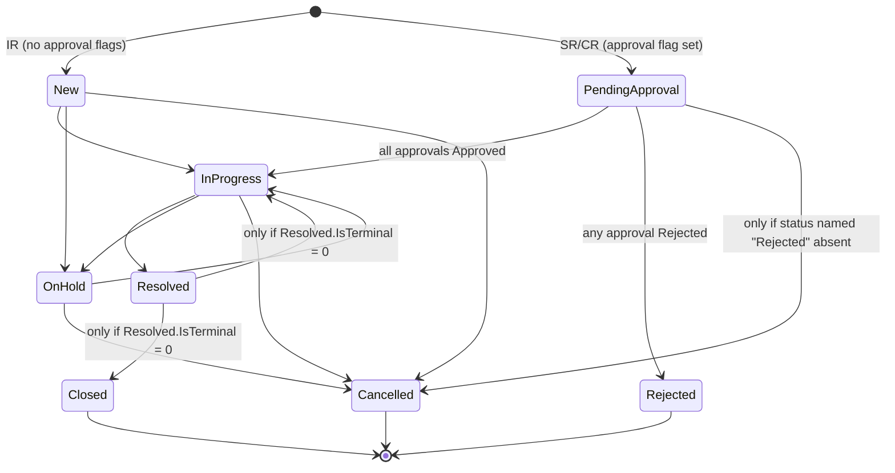

# ITSM AS-IS Workflow Review

**Document:** 3 of 6 — Workflows
**Mode:** Read-only. No workflow was executed; no database was contacted.
**Date:** 2026-11-12

---

## 1. Executive Summary

The ITSM workflow is implemented in **C#**, not in SQL. `TicketUpdateService` owns
six mutation paths, each wrapped in a `DbContextTransaction` with an audit row and a
`rowversion` check. `TicketWorkflow` holds a **hard-coded status transition map** of
four status names. `TicketService` owns creation and approval-row seeding.

Read as a state machine, the implementation is coherent but **incomplete at its
edges**. Four structural problems dominate:

1. **The transition map and the terminal gate can contradict each other.** A status
   with `IsTerminal = 1` is refused *before* the transition map is consulted, so
   `Resolved → Closed` is reachable only if `Resolved` is flagged non-terminal. The
   same flag makes `GetAvailableStatuses` return an empty list. One seed decision
   silently disables the documented two-step closure (`WF-04`).
2. **`Pending Approval` is not in the transition map at all.** Tickets awaiting
   approval cannot be moved by `ChangeStatus`; they can only be advanced through
   `ApproveTicket`/`RejectTicket`. If an approver leaves the company, the ticket has
   no exit (`WF-05`).
3. **`New → Resolved` is not permitted.** The map requires `In Progress` first
   (`New → {In Progress, On Hold, Cancelled}`), which is precisely the reviewer's
   concern. This is a verified, deliberate-looking constraint, not a missing file
   (`GAP-11`).
4. **Nothing writes `CsatScore`/`CsatFeedback` and no job closes tickets.** `Closed`
   is only reachable as a manual transition from `Resolved`, and only if `Resolved`
   is non-terminal (`WF-07`).

Additionally, expiry of the ticket's `ResolutionText` is **not audited**: the audit
row records only `StatusChange` with old/new status names, and `Detail` is `null`.
Resolution content changes are therefore not reconstructable from the audit trail
(`WF-10`).

---

## 2. Ticket Creation and Submission (verified)

### 2.1 Two-stage validation, then one orchestrated write

**Stage A — UI (`CreateTicket.aspx.cs`, `btnSubmit_Click`)**

| Step | Implementation | Evidence |
|---|---|---|
| Session gate | `Session["WORKMAN"]`, `["USERID"]`, `["BRANCH"]` all non-null | `Page_Load`, `btnSubmit_Click` |
| Field parse | 4 hidden fields must parse: category, subCategory, impact, urgency | `int.TryParse` block |
| Hierarchy validation | `TicketMasterDataService.ValidateHierarchy(category, subCategory, item)` | One query for subcategory ownership + active; one for item ownership |
| Master-data validation | `ValidateMasterDataIds(impact, urgency, requestType)` — all must exist and be `IsActive` | three `Any()` queries |
| Delegate | `TicketService.CreateTicket(...)` | returns `int` |
| Redirect | `302` to `TicketDetail.aspx?id=N` via `Response.Redirect(url, false)` + `CompleteRequest()` | Post/Redirect/Get |

Client-side pre-validation duplicates part of this (`onSubmit()` checks the five
hidden fields and runs `Page_ClientValidate('CreateTicket')`). The server repeats it,
so the client is not trusted. This is sound.

**Stage B — `TicketService.CreateTicket` (transactional)**

| # | Step | Failure behaviour |
|---|---|---|
| 1 | `BeginTransaction()` | — |
| 2 | Load requester `AsNoTracking` | throws if missing |
| 3 | **Tenant gate**: requester `CompanyId` must be non-null and > 0 | throws "ticket creation is blocked for tenant isolation" |
| 4 | Resolve branch by legacy `Branch_ID` → `MST_Branch.Id` | throws if unresolved |
| 5 | Resolve plant `PlantID_ID` → `MST_Plant.Id`; returns `NULL` on 0 or >1 matches | never throws |
| 6 | Load `RequestType` where `IsActive` | throws if missing/inactive |
| 7 | Priority via `PriorityCalculationService` | falls back P4, then longest-SLA |
| 8 | SLA via `SlaService` (legacy `BranchId`) | result used only for email |
| 9 | Assignee via `DispatchService` (resolved branch Id) | `NULL` = unassigned |
| 10 | `GenerateTicketNumber` | see `WF-02` |
| 11 | Initial status: `Pending Approval` if either approval flag, else `New` | falls back to first active non-terminal |
| 12 | `SaveChanges()` — INSERT ticket | — |
| 13 | `SaveChanges()` — INSERT audit `"Created"` | — |
| 14 | If `RequiresManagerApproval`: INSERT Manager row | throws if no `ReportingManagerCode`, or if manager == requester |
| 15 | If `RequiresItHeadApproval`: resolve active IT Head; INSERT ItHead row | throws if none configured |
| 16 | INSERT `NotificationQueue` via raw SQL | silent no-op if no email |
| 17 | `Commit()` | any exception → `Rollback()` and rethrow |

Steps 12–16 are **five separate `SaveChanges()` calls inside one transaction**. This
is functionally atomic; the intermediate saves matter only because `ticket.Id` is
needed for the dependent rows.

### 2.2 Observation: two different branch key spaces in one flow

`_slaService.CalculateSla(requester.BranchId, ...)` passes the **legacy** `Branch_ID`.
`_dispatchService.ResolveAssignee(resolvedBranchId, ...)` passes the **resolved**
`MST_Branch.Id`. `SlaService.GetPlantTiming` compares `t.Branch_ID == branchId`.

So the design assumes `dbo.VMS_PlantTimings.Branch_ID` holds the legacy business key
while `MST_SupportMapping.BranchId` holds the identity PK. Both may be correct; the
repository does not prove it. If `VMS_PlantTimings.Branch_ID` were populated with
`MST_Branch.Id` instead, SLA would silently resolve to "always open" (no timing row
found → `requestTiming == null` → SLA starts immediately).

**Classification: Clarification Required** (`WF-09`). This cannot be settled without
reading the two table populations, which the read-only mandate forbids.

---

## 3. Ticket Numbering

Format: `{Prefix}{YY}{MM}{0000}` — e.g. `CR26080001`.

```csharp
var prefix = (requestType.Prefix ?? requestType.Code ?? "XX").Trim();
if (prefix.Length > 2) prefix = prefix.Substring(0, 2);
var numberPrefix = prefix + yy + mm;           // e.g. CR2608
var maxExisting = context.Tickets.AsNoTracking()
    .Where(t => t.RequestTypeId == requestType.Id
             && t.TicketNumber.StartsWith(numberPrefix))
    .Select(t => t.TicketNumber).ToList();
// parse last 4 chars where n.Length >= 10, take max, +1
return numberPrefix + nextSequence.ToString("D4");
```

Verified properties:

| Property | Result |
|---|---|
| Transaction-scoped | Yes — inside the creation transaction |
| Isolation | READ COMMITTED (EF6 default); no `SERIALIZABLE`, no `sp_getapplock` |
| Database uniqueness | **None** (`DB-02`) |
| Retry on duplicate | None; no `catch` for unique violation (none could occur today) |
| Sequence parse guard | `n.Length >= 10` |
| Overflow guard | None; sequence can exceed 9999 and the number becomes 11 chars |

**Data-dependent defect:** if `Prefix` (after `Trim()`) is a **single character**,
the generated number is `1 + 2 + 2 + 4 = 9` characters. On the next creation the
guard `n.Length >= 10` fails for every prior number, `Max()` evaluates to `0`, and
`nextSequence` resets to `1`. Every such ticket would receive sequence `0001`. `Prefix`
is declared `char(2)`, so this requires a 1-char or whitespace-padded value — a data
condition, not a code path under normal seed. It is recorded as
`Clarification Required` rather than a confirmed defect.

**Confirmed defect (independent of data):** two concurrent creations for the same
request type in the same month both read the same max and both compute the same next
sequence. Nothing at any layer prevents the duplicate. This was independently
reported in the prior Stage 1 review and is **confirmed here** by direct reading.

---

## 4. Status Lifecycle and Transition Rules

### 4.1 Declared map (`TicketWorkflow`, static, `IReadOnlyDictionary`)

| From | Allowed to |
|---|---|
| `New` | `In Progress`, `On Hold`, `Cancelled` |
| `In Progress` | `Resolved`, `On Hold`, `Cancelled` |
| `On Hold` | `In Progress`, `Cancelled` |
| `Resolved` | `Closed`, `In Progress` |

Statuses **absent from the map**: `Pending Approval`, `Rejected`, `Closed`.
`Closed` is absent as a *from*-state, consistent with it being terminal.

### 4.2 Effective enforcement in `ChangeStatus`

Order of checks is decisive:

```csharp
if (currentStatus.IsTerminal)                     // (1) hard stop
    return Fail("Cannot modify a ticket in terminal status: " + name);
if (!TicketWorkflow.IsValidTransition(current, target)) // (2) map check
    return Fail("Invalid transition ...");
if (targetStatus.Name == "Resolved" && string.IsNullOrWhiteSpace(resolutionText))
    return Fail("Resolution text is required ...");     // (3)
```

Because (1) precedes (2), **any status flagged `IsTerminal` is a dead end** — the map
is never consulted. `TicketWorkflow.GetAvailableStatuses` independently returns an
empty list when `isTerminal` is true, so the UI dropdown is empty too.

The consequence is a **seed-dependent contradiction**:

| If `MST_TicketStatus` has… | Then |
|---|---|
| `Resolved.IsTerminal = 1` | `Resolved → Closed` and `Resolved → In Progress` are unreachable, although the map declares them. Tickets stop at `Resolved` forever. |
| `Resolved.IsTerminal = 0` | Both edges work; `Closed` is reachable manually. |

The entity comment on `IsTerminal` says: *"When true, the ticket is complete for SLA
polling (e.g. Resolved / Closed / Rejected)"* — which indicates the first case is the
intended seed, i.e. the map's `Resolved` row is **dead code** under intended seed.

This is the single highest-impact workflow finding and it cannot be resolved without
reading the seed data (`A3`).

### 4.3 Statuses that can strand a ticket

| Situation | Consequence |
|---|---|
| Ticket in `Pending Approval`, approver is inactive/left | No `ChangeStatus` path: `Pending Approval` is not a key in the map, and `pnlWorkActions` is hidden in the UI when status == `Pending Approval`. Only an approver can act. |
| Ticket in `On Hold` | Cannot go directly to `Resolved`; must return to `In Progress` first. |
| Ticket `Rejected` | No resubmission path exists in code or UI. |
| Ticket `Resolved` with `IsTerminal = 1` | Cannot be closed or reopened. |

### 4.4 Reachability diagram (under either `IsTerminal` seed)



Note `New --> Resolved` is **absent**, as is `OnHold --> Resolved`. These are the
gaps behind reviewer item `GAP-11`.

---

## 5. Approval Workflow

### 5.1 Row seeding at creation

| Request type flag | Rows created |
|---|---|
| neither | `Status = New`; no approval rows |
| `RequiresManagerApproval` only | one `ApprovalLevel = "Manager"`, `Pending` |
| both | two rows: `Manager` and `ItHead`, both `Pending` |
| `RequiresItHeadApproval` only | one `ItHead` row |

The level string is the authority. Manager approver = `MST_UserMaster.ReportingManagerCode`.
IT Head = the single active `itsm.MST_ApprovalConfiguration` row (global, not
branch/plant as the design document states).

### 5.2 Approval action (`ApproveTicket`)

Order of guards:

1. `LoadForApprove` → `CanApproveTicket` (actor must have a `Pending` row and must
   not be the requester)
2. `RequireRecordedTenant` (blocks `NULL CompanyId`)
3. requester ≠ approver (redundant with `CanApproveTicket`, defense in depth)
4. current status must be exactly `"Pending Approval"`
5. a `Pending` row for this approver must exist
6. **sequencing**: if acting row is `ITHead` and any `Manager` row is still
   `Pending` → refuse
7. mark approved; if no other pending row remains → status becomes `In Progress`

Sequencing is enforced **only when the IT Head tries to act early**. There is no
reciprocal rule for a Manager acting after the IT Head (which cannot happen if the
rule above holds, unless the IT Head row was actioned by a different path).

### 5.3 Rejection (`RejectTicket`)

Mandatory non-blank reason → reject own row → **cascade all other `Pending` rows to
`Rejected`** with an explanatory comment → set ticket status to `Rejected` if such an
active status exists, else `Cancelled` → audit.

Rejection is therefore terminal by design. The cascade is a genuine multi-level
termination, not a partial one.

### 5.4 Approval findings

| ID | Finding | Classification |
|---|---|---|
| WF-05a | `Pending Approval` absent from the transition map; no administrative escape from a stranded approval | Architectural Gap |
| WF-05b | `TicketApprovals` has no uniqueness on `(TicketId, ApproverCode, ApprovalLevel)`; `FirstOrDefault` picks the row to action when one person holds both roles | Architectural Gap |
| WF-05c | IT Head resolution is **global** (`IsActive = 1` single row), while design §4.2 describes per-branch/plant IT Head | Configuration divergence |
| WF-05d | Approval completion hard-codes the target status name `"In Progress"` and looks it up by name | Already Exists (name-coupled) |

---

## 6. Assignment and Reassignment

### 6.1 Automatic (create-time) — `DispatchService`

Cascade, most specific first, all on `itsm.MST_SupportMapping` and all filtered by
`IsActive`:

| Priority | Match |
|---|---|
| 1 | `BranchId + CategoryId + SubCategoryId + ItemId` (only when item supplied) |
| 2 | `BranchId + CategoryId + SubCategoryId`, `ItemId IS NULL` |
| 3 | `BranchId + CategoryId`, `SubCategoryId IS NULL`, `ItemId IS NULL` |
| 4 | `BranchId + IsBranchDefault = 1`, all taxonomy `NULL` |
| — | no match → `NULL` (unassigned) |

Every query is `.Select(m => m.SupportAgentCode).FirstOrDefault()` with **no
`OrderBy`** and **no uniqueness constraint** on the mapping. If two active mappings
tie, the winner is whatever the storage engine returns first — non-deterministic
across plans and data changes (`DB-07`).

`DispatchService` does **not** verify that the resolved agent is currently
`Active`; the FK guarantees existence, not status.

### 6.2 Manual reassignment — `ReassignTicket`

- Authorization: `CanProcessTicket` = requester **or** current assignee.
- Target validation: any `MST_UserMaster` with `EmployeeStatus == 'Active'`. There is
  **no check that the target is an ITSM agent or holds any ITSM permission**. The
  dropdown in `TicketDetail.aspx.cs` (`BindAgentDropdown`) likewise lists
  `TicketListService.GetActiveAgents()`, which is *all* active employees.
- Blocked on terminal status.
- Writes audit `"Reassignment"` old → new (or `"Unassigned"`).
- Does **not** create a comment (contradicting design §5.7), does **not** notify the
  new assignee, does **not** reset SLA, and does **not** recalculate priority.

### 6.3 Assignment findings

| ID | Finding | Classification |
|---|---|---|
| WF-03a | Assignment matrix is branch-anchored only; no global/PAN-India mapping | Architectural Gap |
| WF-03b | No agent group, team, pool, SAP/Non-SAP classification, or hierarchy anywhere in schema | Verified Absence |
| WF-03c | No ordering or uniqueness on mapping lookup → arbitrary winner on ties | Architectural Gap |
| WF-03d | Reassignment target need only be an active employee, not an agent | Architectural Gap |
| WF-11 | Assignment is **decoupled from Request Type** by construction: `MST_SupportMapping` has no `RequestTypeId` | Already Exists (supports reviewer intent structurally) |

`WF-11` is worth stating plainly: the reviewer asked whether the agent hierarchy can
be changed without changing Request Type. The answer is **yes by design** — Request
Type carries only approval flags and a number prefix. But what can be changed is a
*branch + category → single employee* mapping, not a hierarchy, because no hierarchy
exists.

---

## 7. Resolution and Rejection Handling

### 7.1 Resolution (verified)

`ChangeStatus` with target `Resolved`:

1. `IsTerminal` check on current status
2. transition check (requires `In Progress` or `On Hold`… actually `On Hold → Resolved`
   is **not** in the map, so only `In Progress → Resolved` or `Resolved → Resolved`)
3. `ResolutionText` mandatory (whitespace-trimmed, then stored)
4. `ResolvedOn = DateTime.Now`
5. audit `StatusChange`, old → `Resolved`, `Detail = null`

What is **not** captured at resolution:

- resolution *impact* (reviewer item `GAP-09`) — no column, no field, no DTO
- resolution category/code
- who resolved it as a distinct actor (only `ModifiedByCode` on the ticket and
  `ActorCode` on the audit row)
- the resolution text in the audit trail (`Detail` is null — `WF-10`)

Who may resolve: `CanProcessTicket` = **requester or assignee**. A requester can
therefore mark their own ticket `Resolved` and supply the resolution text. There is
no separate "resolved by authorized agent" concept (`GAP-10`).

### 7.2 Rejection (verified)

`RejectTicket` is approval-driven, not resolution-driven. It exists only for tickets
in `Pending Approval`. There is no rejection path for an already-`In Progress`
ticket, and no "reject resolution" / rework loop.

Terminal effect: status → `Rejected` (or `Cancelled`), all pending approvals
rejected, reason stored on the approval row and in the audit `Detail`.

### 7.3 Closure and CSAT (verified absence)

| Element | State |
|---|---|
| `Resolved → Closed` transition in map | Present |
| Reachable when `Resolved.IsTerminal = 1` | **No** (`WF-04`) |
| CSAT write UI | **None** — `pnlCsat` is display-only |
| `CsatScore`/`CsatFeedback` writers | **None** anywhere in the repository |
| 72-hour auto-close | **None** — no `TicketClosureService`, no scheduler hook |
| `ClosedOn` writer | `ChangeStatus` on transition to `Closed` only |

The CSAT panel in `TicketDetail.aspx` can never become populated through the
application, because nothing sets the score.

---

## 8. Audit and Transaction Management

### 8.1 Audit coverage

| Action | `ActionType` | `OldValue` | `NewValue` | `Detail` |
|---|---|---|---|---|
| Create | `Created` | null | `New` / `Pending Approval` | ticket number |
| Status change | `StatusChange` | from-status name | to-status name | **null** |
| Reassignment | `Reassignment` | old assignee | new assignee | null |
| Priority override | `PriorityOverride` | old priority name | new priority name | reason |
| Approve | `Approval` | `Pending` | `Approved` / `Approved (partial)` | comments |
| Reject | `Rejection` | `Pending Approval` | resulting status name | reason |
| Comment | `Comment` | null | null | comment text (truncated 1000) |

**Not audited at all:** approval-row creation at ticket creation (only the aggregate
`Created` row), notification enqueueing, CSAT, any read/export/download, and the
`ResolutionText` content.

### 8.2 Immutability

`TicketAuditLog` is described as an "immutable ITGC audit trail". In practice:

- No trigger, `DENY`, or append-only grant exists in the schema.
- `ItsmDbContext` exposes `DbSet<TicketAuditLog>` and `SaveChanges` only guards
  **legacy `dbo` masters**, not audit rows.
- No BLL method updates or deletes audit rows (verified), so the current application
  is well-behaved — but the *database* does not enforce the property.

**Classification: Architectural Gap** (`DB-09`).

### 8.3 Transaction pattern

Every mutation uses:

```csharp
using (var context = new ItsmDbContext())
using (var transaction = context.Database.BeginTransaction())
{
    try { ... return Commit(context, transaction); }   // SaveChanges + Commit
    catch (DbUpdateConcurrencyException) { Rollback(); return ConcurrencyFail(); }
    catch (Exception) { Rollback(); throw; }
}
```

Verified properties:

- Audit row and ticket mutation commit **together** (`AddAudit` before `Commit`).
- Early `TicketUpdateResult.Fail(...)` returns exit the `using` block, disposing the
  transaction, which rolls back — so a failed guard cannot leave a partial write.
- `DbUpdateConcurrencyException` is caught, rolled back, and surfaced as a friendly
  message in all six methods.
- No `TransactionScope`, no nested transaction, no retry.

### 8.4 Concurrency (correction to the prior Stage 1 report)

The prior Stage 1 audit's finding **M-03** claimed the `rowversion` check was
ineffective. That is **refuted**. `LoadMutableTicket` loads the tracked entity, then:

```csharp
context.Entry(ticket).Property(x => x.RowVersion).OriginalValue = rowVersion;
```

EF6 emits `UPDATE ... WHERE [RowVersion] = @OriginalValue`; a mismatch yields
`DbUpdateConcurrencyException`, which each method catches. The null/empty guard is an
early refusal when the client posted no token. The mechanism is correct.

One residual limitation worth recording: because the entity is loaded **tracked**
before `OriginalValue` is overwritten, the `WHERE` predicate uses the *client's*
token — which is exactly the intent, but it also means a client can only ever
overwrite the version it was shown. That is correct optimistic concurrency, not a
defect. It does, however, mean a stale browser tab fails permanently rather than
merging.

---

## 9. Workflow Findings Register

| ID | Area | Finding | Classification |
|---|---|---|---|
| WF-01 | Creation | Two-stage validation (UI + BLL) with server re-validation of hierarchy and master IDs; single transactional write; PRG redirect | Already Exists |
| WF-02 | Numbering | Read-modify-write number allocation at READ COMMITTED, no lock, no unique constraint; duplicates possible under concurrency; 1-char prefix resets sequence | Architectural Gap |
| WF-03 | Assignment | Branch-anchored cascade only; unordered `FirstOrDefault`; no agent group/hierarchy | Architectural Gap |
| WF-04 | Lifecycle | `IsTerminal` gate precedes transition map; `Resolved` row of the map may be unreachable | Architectural Gap |
| WF-05 | Approval | `Pending Approval` missing from map; no escape from stranded approvals; no approval-row uniqueness | Architectural Gap |
| WF-06 | Tenant | `NULL CompanyId` blocks all six mutations; no remediation path in code | Architectural Gap |
| WF-07 | Resolution/Closure | No CSAT write path, no auto-close, no two-step enforcement; `Closed` manual only | Architectural Gap |
| WF-08 | SLA | SLA start/due computed but never persisted; no breach tracking | Architectural Gap |
| WF-09 | SLA | Create flow uses two branch key spaces (legacy `Branch_ID` for SLA, resolved `Id` for dispatch) | Clarification Required |
| WF-10 | Audit | `ResolutionText` and priority changes' text not reconstructable from audit; `StatusChange.Detail` is null | Architectural Gap |
| WF-11 | Assignment | Assignment matrix is structurally independent of Request Type | Already Exists |
| WF-12 | Notifications | Only creation enqueues email; approval, rejection, reassignment, resolution notify nobody. Email link is a relative `~/` path, unusable in a mail client | Architectural Gap |
| WF-13 | Rejection | Rejection is terminal with full cascade; no resubmission or rework path | Already Exists (by design) |

---

## 10. Workflow Questions That Require Owner Input

1. Is `Resolved` seeded as terminal? (`WF-04`)
2. Is `New → Resolved` intentionally forbidden, or an omission in the map?
3. Should a requester be able to change status / resolve / override priority on their
   own ticket? `CanProcessTicket` currently permits it.
4. Is `Pending Approval` meant to be administratively escapable?
5. Should reassignment be restricted to agents holding an ITSM role?
6. Is SLA tracking in scope, given it is computed but not stored?
7. Should closure and CSAT be part of Phase 1B at all, given neither is implemented?
