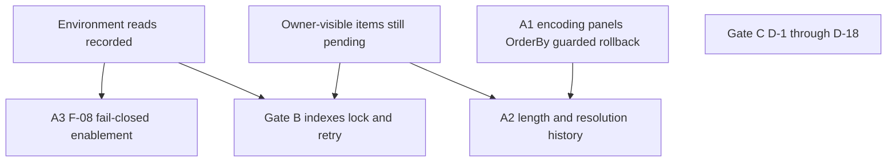

# ITSM FreeBuff remediation reconciliation

**Document:** ITSM_FREEBUFF_REMEDIATION_RECONCILIATION.md
**Role:** Reconciliation of the remediation review against the working-tree source. Not an approval, not a design revision, and not an implementation authorisation.
**Date:** 24 November 2026
**Inputs, unchanged by this document:**

1. `ITSM_SOURCE_TO_FINDING_TRACEABILITY.md` (R-01)
2. `ITSM_TECHNICAL_REMEDIATION_DESIGN.md` (R-02)
3. `ITSM_FREEBUFF_REMEDIATION_REVIEW.md` (FreeBuff review)

**Evidence classes**

| Class | Meaning |
|---|---|
| Source-verified | The behaviour is in the cited working-tree lines, read on 24 November 2026. Line numbers are locations, not a certified baseline. |
| Design-text | The defect is in the cited sentences of R-02. |
| Engine-contract | EF6 / ADO.NET / SQL Server documented call behaviour. Not executed in this pass. |
| Environment-unread | A deployed row, grant, collation, or edition was not queried. |

The Sales TA/DA tags in `docs/INDEX.md` §10 are not an ITSM baseline. This reconciliation does not use them. `AnmolDristi/Web.config` was not read. No SQL was executed. No UAT or LIVE connection was opened.

---

## 1. Executive verdict

**R-02 stays NOT READY FOR IMPLEMENTATION.**

FreeBuff's verdict, Accepted with Corrections, is confirmed. The five blocking defects (X-1 through X-5) are real. Each one is grounded in the working-tree source or in the design text that a later implementer would follow. The corrections below are prerequisites for a future revision of the design. They are not authorisation to build, deploy, or enable anything.

Gate A in R-02 §2 bundles F-08's fail-closed status lookup with the other application changes and names no status-row precondition. Enabling that lookup while `In Progress`, `Rejected`, or `Cancelled` is absent or inactive would turn today's silent partial commit into a hard approval or rejection failure. The reconciliation therefore removes F-08 from the unconditional Gate A bundle. F-08 may be enabled only after a named environment's status read has been recorded and shows the rows the fail-closed branches require. Until that read exists, the fail-closed branches stay specified and disabled. This sequencing correction is what keeps a Gate A change from causing an outage on an unverified status row.

D-1 through D-18 remain pending. No business approval is granted or inferred. Three owner-visible product effects already identified by FreeBuff — shared numbering namespace, a 1000-character resolution maximum, and the comment-capacity reduction — stay pending acknowledgements. This document does not register them as closed decisions and does not assign them new decision IDs.

One FreeBuff description is adjusted against the markup, and the underlying correction is kept. In `TicketDetail.aspx` the approval-status **class** attribute emits the fixed tokens `success`, `danger`, or `warning`. The unencoded sink beside it is the text node `Eval("ApprovalStatus")`. Encoding that text node remains required. The finding is not dropped.

No test in this document was executed. Every test disposition is **NOT RUN**.

---

## 2. Five blocking defects and their disposition

### X-1 — F-01 sequence parsing of legacy values of 6–9 characters

**Disposition:** Confirmed. The design rule is unsafe. The required correction narrows which stored values may advance the sequence. It adds no feature and does not rewrite stored numbers.

**FreeBuff's finding.** R-02 §4.3 step 5 says to parse a trailing integer when the stored value is at least as long as the namespace. The namespace is six characters. FreeBuff states that a six-, seven-, eight-, or nine-character value sharing that namespace would then be parsed, and that a nine-character `CR2608001` yields `8001` if the last four characters are taken, which can exhaust the month. The required rule is length exactly `namespace.Length + 4`, with the four sequence characters taken at offset `namespace.Length`.

**Independently verified source evidence.**

- `GenerateTicketNumber` is `TicketService.cs` lines 359–401. The prefix is trimmed at line 364 and cut to two characters only when longer than two (lines 366–368). `numberPrefix` is `prefix + yy + mm` (line 372).
- The current parse, lines 389–390, accepts a value only when `n.Length >= 10` and then takes `n.Substring(n.Length - 4)`. A stored value of length 6, 7, 8, or 9 contributes 0.
- `itsm.Tickets.TicketNumber` is `varchar(10)` (`202608120550515_InitialItsmSchema.cs` line 78). The index list at lines 117–128 has no `TicketNumber` index. A value longer than 10 cannot be stored in that column, so the source's `>= 10` test and an `== 10` test accept the same stored population.
- R-02 §4.3 step 5 replaces that guard with "at least as long as the namespace" and says "trailing integer" without requiring the four characters to start at offset 6. R-02 §4.4 says a nine-character number has a different string prefix when its historical prefix was one character. A two-character prefix plus a short suffix (`CR2608001`, nine characters) shares the six-character namespace `CR2608`.

**Whether the finding is correct.** Yes. The design text does not literally say "take the last four characters", and the source does. An implementer who keeps the source slice and applies the weakened length test parses `CR2608` as 2608, `CR26080` as 6080, `CR260800` as 800, and `CR2608001` as 8001. An implementer who instead parses whatever digits follow the six-character namespace still lets a non-canonical 6–9 character value move the monthly maximum (`CR2608001` becomes sequence 1). Both readings are wrong relative to the source guard the design is replacing. The exact ten-character rule is the correction.

**Exact correction required in the remediation design.** Replace §4.3 step 5 with all of the following:

1. Let `namespace` be the six-character value from step 3, already normalised (see C-01).
2. Parse a stored `TicketNumber` only when `value.Length == namespace.Length + 4` (10) and `value` starts with that namespace under the collation assumption stated in the design.
3. Take the sequence with `value.Substring(namespace.Length, 4)` and `int.TryParse`. On failure, ignore the value.
4. Do not use `value.Length >= namespace.Length`. Do not use `Substring(value.Length - 4)` as the rule.
5. Values of length 6, 7, 8, or 9 that share the namespace contribute nothing. They stay stored and are not rewritten (§4.4 remains).

**Additional tests or preconditions.** Extend TC-22 so one fixture contains a 6-character, a 7-character, an 8-character, and a 9-character number that each start with the same six-character namespace, plus one valid ten-character number. The next create emits a ten-character number whose sequence comes only from the ten-character value. TC-50 still requires the short historical number to remain openable and unchanged. No new environment read is required for the rule itself. The existing §4.6 length-not-10 read still records those rows and does not rewrite them.

**Whether the correction changes the proposed scope.** It stays inside F-01 and Gate B. New allocation still emits ten-character numbers. Historical numbers are still left as stored. The set of values that may advance the sequence becomes exactly the ten-character namespace members, which is the source's own population for a `varchar(10)` column. No schema object is added by this correction.

---

### X-2 — F-01 `ExecuteSqlCommand` and the `sp_getapplock` return code

**Disposition:** Confirmed. The design's "timeout throws" behaviour is not implemented by the call it names. The correction specifies the batch. It does not choose the timeout duration.

**FreeBuff's finding.** R-02 §4.3 step 4 executes `sp_getapplock` with `ExecuteSqlCommand` and says a timeout or a negative return code throws `InvalidOperationException`. EF6 `ExecuteSqlCommand` returns the rows-affected result of the batch, not a procedure return code. Without a batch that reads `@rc` and fails the batch on `@rc < 0`, a timeout is ignored and allocation continues without the lock. The design must state the batch, the timeout in milliseconds, and the failure codes `-1`, `-2`, `-3`, and `-999`.

**Independently verified source evidence.**

- The only `ExecuteSqlCommand` under `AnmolDristi/ITSM` is `TicketService.EnqueueTicketCreatedNotification`, lines 491–503. It runs an `INSERT` and does not read a procedure return code. A search of `AnmolDristi/ITSM` finds no `sp_getapplock`, no `ParameterDirection.ReturnValue`, and no `SqlQuery` used to read a return code.
- `CreateTicket` opens `BeginTransaction()` with no isolation argument (line 91) and has no application lock.
- R-02 §4.3 step 4 names `ExecuteSqlCommand`, `@LockOwner = 'Transaction'`, `@LockMode = 'Exclusive'`, and "a short timeout". It does not show a batch, a millisecond value, or the return codes.

**Engine-contract, not executed.** `Database.ExecuteSqlCommand` surfaces `SqlCommand.ExecuteNonQuery`. That integer is rows affected. `sp_getapplock` reports its outcome through its return code: `0` granted immediately, `1` granted after waiting, `-1` timeout, `-2` cancelled, `-3` deadlock victim, `-999` parameter or other call error. A timeout does not raise by itself. A procedure that changes no rows commonly produces an `ExecuteNonQuery` result of `-1`, which is the ADO.NET "no rowcount" sentinel and is not the applock code. Checking that integer for a negative value would treat a granted lock as failure. Ignoring the integer would treat a timeout as success. Either result leaves the design's sentence unimplemented.

**Whether the finding is correct.** Yes.

**Exact correction required in the remediation design.** Replace the `ExecuteSqlCommand` sentence in §4.3 step 4 with a batch on the create context, inside the create transaction, of this shape:

```sql
DECLARE @rc int;
EXEC @rc = sys.sp_getapplock
    @Resource = @resource,
    @LockMode = 'Exclusive',
    @LockOwner = 'Transaction',
    @LockTimeout = @timeoutMs;
IF @rc < 0
    THROW 50000, 'ITSM ticket-number lock was not acquired.', 1;
```

`@resource` is `ITSM.TicketNumber.` plus the single normalised prefix plus `.` plus `yyMM` (C-01). `@timeoutMs` is one named millisecond value. This reconciliation does not choose that value; a later IT authorisation does. The revised design treats `@rc` of `-1`, `-2`, `-3`, and `-999` as failure. `0` and `1` are success. The `THROW` becomes `InvalidOperationException` (or is caught and rethrown as that type) with a controlled message, the transaction rolls back through the guarded rollback (X-2 depends on AR-6), and no ticket, audit, approval, or notification row is committed. The design states that the lock is held by the transaction on that database only (C-08).

**Additional tests or preconditions.** TC-23, extended: a second session holds the same resource; the create returns the controlled message, commits nothing, and returns within the configured timeout. Separate disposable-database cases inject `@rc` of `-2`, `-3`, and `-999` and expect the same controlled failure. A granted lock (`0` or `1`) must not be treated as failure. Precondition 9 in §7: the `DbConn` identity can execute `sys.sp_getapplock`. That grant was not checked.

**Whether the correction changes the proposed scope.** The lock remains one transaction-scoped exclusive application lock on the create context, still Gate B, still an alternative to a counter table. The correction makes the failure path the design already claimed actually happen. It adds no numbering store and no page-level SQL.

---

### X-3 — F-05 internal audit prefix is 11 characters

**Disposition:** Confirmed. The user-text limit is 989. TC-08 as written in R-02 would accept the wrong implementation.

**FreeBuff's finding.** `"[Internal] "` is eleven characters, not ten. The 1000-character `Detail` column therefore allows 989 characters of user text, not 990. R-02 §8 and TC-08 both say 990.

**Independently verified source evidence.**

- `AddComment` builds the audit detail as `(isInternal ? "[Internal] " : "") + commentText.Trim()` at `TicketUpdateService.cs` lines 501–503.
- The literal `"[Internal] "` is eleven characters: `[`, `I`, `n`, `t`, `e`, `r`, `n`, `a`, `l`, `]`, space.
- `TicketAuditLog.Detail` is `maxLength: 1000` in `202608201200000_AddTicketAuditLog.cs` line 19 and `[StringLength(1000)]` on the entity.
- `txtComment` declares `MaxLength="2000"` (`TicketDetail.aspx` line 339).
- R-02 §8 says "ten-character prefix" and "990 characters of user text". The same section also says to refuse when the built detail's length is greater than 1000. Those two sentences disagree: the built-string check yields 989 user characters, and the prose yields 990.

**Whether the finding is correct.** Yes. 1000 − 11 = 989. A 990-character internal note produces a 1001-character detail. If `Truncate` remains (X-4), that note can be stored cut. If an implementer codes the prose limit of 990 and skips the built-string check, the column reject or the silent cut is the result. TC-08's "990 when marked internal" would fail a correct 989 implementation, or pass an implementation that is one character over.

**Exact correction required in the remediation design.** In §8, replace "ten-character" and "990" with: the prefix `"[Internal] "` is 11 characters; an internal note is refused when the trimmed user text is longer than 989 characters; a public comment is refused when the trimmed text is longer than 1000 characters. The check is performed on the built detail before `ModifiedOn` is assigned (C-23, AR-8). The message for an internal refusal says why 989 applies. `MaxLength="1000"` cannot express 989; the revised design states that the checkbox and the message carry the internal limit, or that client script adjusts the hint, and that the server check is the rule.

**Additional tests or preconditions.** Correct TC-08 in place. Add TC-36: 989 internal succeeds with `Detail` length 1000; 990 internal is refused; 1000 public succeeds; 1001 public is refused; a refusal commits neither the comment nor the audit row and leaves `ModifiedOn` unchanged. No database migration is required for the limit. Historical comments longer than 1000 characters are left as they are (C-23).

**Whether the correction changes the proposed scope.** The finding stays F-05. The column stays 1000 characters. The user-visible internal limit is one character tighter than R-02 stated, on top of the 2000-to-1000 reduction that is already an owner-visible product change (C-23). That acknowledgement remains pending. This correction does not authorise the reduction.

---

### X-4 — F-05 `Truncate` remains in `AddAudit`

**Disposition:** Confirmed. Silent truncation remains reachable while `Truncate` stays. The correction deletes it from the audit writer and makes an over-length value fail closed.

**FreeBuff's finding.** R-02 §8 retains `Truncate` inside `AddAudit` as a last-resort guard for values the design has already bounded. `Truncate` cuts with `Substring` and does not signal. `ActionType`, `OldValue`, `NewValue`, and `Detail` can still be shortened in silence. The requirement that no silent truncation remain on any audit path is unmet. A guard that remains must raise. R-02 §8's closing sentence, that silent truncation is not reintroduced, contradicts the retained call.

**Independently verified source evidence.**

- `AddAudit` (`TicketUpdateService.cs` lines 602–622) assigns `Truncate(actionType, 50)`, `Truncate(oldValue, 200)`, `Truncate(newValue, 200)`, and `Truncate(detail, 1000)`.
- `Truncate` (lines 624–632) returns `value.Substring(0, maxLength)` when the value is longer.
- Callers that pass caller-controlled text: `AddComment` (detail, lines 501–504), `RejectTicket` (detail = trimmed reason, lines 437–440), `OverridePriority` (detail = trimmed reason, lines 244–245), `ApproveTicket` (detail = `comments`, lines 338–340). `ChangeStatus` passes `detail: null` (line 109). `ReassignTicket` passes assignee codes or `"Unassigned"` (lines 173–176).
- Column limits in the migrations: `ActionType` 50, `OldValue` 200, `NewValue` 200, `Detail` 1000. `MST_TicketStatus.Name` is `maxLength: 100` (initial migration line 255). `MST_Priority.Name` is `maxLength: 100` (line 218). Assignee codes used in reassignment are `maxLength: 50`. `"Approved (partial)"` is 18 characters. Those 200-character fields are inside their columns only because of those limits. R-02 does not state the limits.
- `CreateTicket` writes the `Created` audit row directly (lines 198–209) and does not call `Truncate`. That path must not gain a truncate.

**Whether the finding is correct.** Yes. Retaining `Truncate` means any caller that forgets its own bound, and any future action name or status name that exceeds the column, is stored short with no failure. The two 200-character fields are safe today only because the name columns are 100 characters and the current tokens are short. The design does not rely on that fact in writing.

**Exact correction required in the remediation design.**

1. Delete the use of `Truncate` in `AddAudit`. Delete the method if nothing else calls it.
2. `AddAudit` fails closed when `ActionType` exceeds 50, `OldValue` or `NewValue` exceeds 200, or `Detail` exceeds 1000. The failure is a thrown exception or a `TicketUpdateResult.Fail` returned before `SaveChanges`. It is not a `Substring`.
3. Each caller bounds its own input before it mutates the ticket and before it calls `AddAudit`: comment (989 / 1000), rejection reason (500), override reason (500), resolution text (1000), approval comments (500, C-16).
4. State the source limits that make current status names, priority names, and assignee codes fit `OldValue` / `NewValue`: `MST_TicketStatus.Name` and `MST_Priority.Name` are 100 characters in the initial migration; reassignment values are employee codes of at most 50 characters or the literal `Unassigned`.
5. The direct `Created` insert in `CreateTicket` stays untruncated and is included in the "no silent truncation" sentence.
6. Remove the "last-resort guard" paragraph. The closing sentence then agrees with the section.

**Additional tests or preconditions.** TC-36 covers comment refusal before `ModifiedOn`. TC-37: a status name and a priority name of 100 characters are stored in full in `OldValue` and `NewValue`. TC-31: a 501-character override reason is refused by the service and writes no priority audit row. TC-30 covers a 501-character approval comment. No column is widened.

**Whether the correction changes the proposed scope.** The finding stays F-05, in the same application release as the caller bounds (Gate A2 in §5). The failure surface grows: a value that today would be stored short will fail the operation instead. No column, workflow state, or audit table is added. Gate B widening of `Detail` remains unauthorised, as R-02 already says.

---

### X-5 — Gate A fail-closed status lookup depends on an F-10 read that is not a Gate A precondition

**Disposition:** Confirmed. F-08 leaves the unconditional Gate A bundle. It is not enabled until the target environment's status read is recorded and passes. The fail-closed code is not switched on to "discover" a missing row.

**FreeBuff's finding.** R-02 §2 places F-08 in Gate A with no schema change and no precondition. The correction returns `Fail` when `In Progress` is missing or inactive on the final approval, and when neither `Rejected` nor `Cancelled` is present and active on rejection. Those rows are what §13 read 1 describes, and that read has no gate. Shipping Gate A into an environment where `In Progress` is inactive stops final approval. The read has to be a Gate A precondition. This is sequencing, not a different fix.

**Independently verified source evidence.**

- `ApproveTicket` lines 325–332: when no other pending row remains, it loads `Name == "In Progress" && IsActive`. If that row is null, it still marks the current approval `Approved`, still writes `ModifiedOn`, and still calls `AddAudit` and `Commit`. The ticket status stays `Pending Approval` with no pending row left.
- `RejectTicket` lines 407–432: approval rows are set to `Rejected` before the status lookup. If neither active `Rejected` nor active `Cancelled` exists, `ticket.StatusId` is left unchanged and `Commit` still runs.
- R-02 §2 Gate A includes "F-08 fail-closed status lookup" and says "No schema change." §11 specifies the two `Fail` returns and names no read. §13 read 1 is the status-name / `IsActive` / `IsTerminal` / duplicate-name read, labelled not run, with no gate.
- The seed in `Migrations/Configuration.cs` lines 26–38 inserts those names only when `TicketStatuses` is empty, and it does not update an existing table. A repository search of `*.sql` for `MST_TicketStatus` returned no matches. The seed is not evidence that the target environment has active rows.

**Whether the finding is correct.** Yes. The fail-closed branches are the right fix for the partial commit, and they are unsafe to enable on an unread status table. A missing or inactive `In Progress` row would refuse every final approval. A missing or inactive `Rejected` and `Cancelled` pair would refuse every rejection. Operators would see a configuration message on the day of the release.

**Exact correction required in the remediation design.** In §2, §11, and §13:

1. Remove F-08 from the list of Gate A items that may be enabled with no environment read.
2. State that the fail-closed branches are enabled in a named environment only after read 1 for that environment is attached, and the attachment shows active rows named `In Progress` and at least one of `Rejected` or `Cancelled`, plus the duplicate-name result.
3. If the read shows a required row missing or inactive, the fail-closed branch stays disabled. Repair of the status row is a separate data authorisation. This design does not insert a status.
4. Application items that do not consult those rows (encoding, panel visibility, `OrderBy`, guarded rollback, length checks) are not held behind this read. They are also not an authorisation; see §5.
5. Do not satisfy this defect by making `ResolveInitialStatusId` fail closed in the same gate. That method's fallback is AR-1. Changing it without the same read, and without an owner decision, would stop creation of approval-required tickets when `Pending Approval` is absent or inactive.

**Additional tests or preconditions.** TC-43 and TC-44 run only on a disposable database where the inactive-status condition is created for the test. They are not a production enablement step. Precondition 1 and 2 in §7 are mandatory before F-08 is enabled in any shared environment. Both are environment-unread.

**Whether the correction changes the proposed scope.** The code intent of F-08 is unchanged: refuse, and leave approval rows unchanged, when the required status row is missing. The deployment scope changes. F-08 is no longer an unconditional member of Gate A. Enabling it waits on a read this document does not run and does not authorise. No status row is added, deactivated, or repaired.

---

## 3. Additional material observations

Every correction FreeBuff numbered is kept. None is downgraded to a note that can be skipped. "Blocking for a future design revision" means a later revision of R-02 has to contain the correction before implementation can be considered. It does not mean this reconciliation authorises that implementation.

| Ref | Disposition | Where it lands |
|---|---|---|
| C-01 | Required in the F-01 design. One normalised prefix — trimmed, length exactly 2, one stated case — is used for the namespace, the lock resource, and the parse. The `TicketNumber` collation is an assumption confirmed by a read, not a known fact. The duplicate read includes case-variant groups (`UPPER(TicketNumber)` or the column collation), not only exact duplicates. The case itself is not selected here; D-4 stays pending. If the read finds both cases, a separate data authorisation collapses them before the unique index. | Gate B precondition |
| C-02 | Required. `CreateTicket` (lines 62–85) constructs `ItsmDbContext` inside the method and takes no context argument. A caller cannot retry "the whole method on a new context" unless the seam is inside `TicketService`. The revised design names a private single-attempt method and a public `CreateTicket` that loops at most 3 times, each attempt on a new context. The page (`CreateTicket.aspx.cs` lines 203–222) does not own the retry. The retry predicate is a `DbUpdateException` whose innermost `SqlException.Number` is 2601 or 2627 **and** whose index name is the ticket-number unique index. 2627 from another constraint is not retried. A rolled-back insert consumes an identity value under SQL Server's identity behaviour (engine-contract, not observed here). A retry is not an idempotent replay. | Gate B, with AR-6 |
| C-03 | Required text. Each attempt re-reads requester, branch, plant, priority, request type, SLA inputs, and dispatch, and takes a new `createdOn` (lines 99–154 run inside every attempt). The first attempt has committed nothing, so a different SLA window or assignee on the successful attempt is the committed result. `Created` audit `ActionedOn` and ticket `CreatedOn` come from that successful attempt only. Diagnostic callbacks may run more than once and must not persist. | Gate B design text |
| C-04 | Required. In addition to refusing a sequence above 9999, refuse when `(namespace + nextSequence.ToString("D4")).Length != 10`. With a six-character namespace the two checks coincide. The length check is what stops a later namespace-width change from emitting 11 characters into `varchar(10)`. | Gate B |
| C-05 | Required sequencing. `Prefix` is `char(2)` (migration line 243). Trim of a stored `' C'` is one character, and step 2 then refuses every create for that request type. The prefix read runs and is recorded before the exact-2 rule is enabled. Any type it would block is corrected under a separate data authorisation or explicitly accepted by the owner. Padding, substring, and falling back to `Code` stay forbidden. | Before Gate B enablement. Owner acceptance pending |
| C-06 | Required design text. `TicketNumber` is `NOT NULL`, so the unique index does not have a one-NULL duplicate problem. The index is nonclustered, unique, and not filtered. Creating it blocks writes on `itsm.Tickets` unless the target edition supports `ONLINE = ON` and the script uses it. `DROP INDEX` rolls the index back and keeps the rows. The precondition read also counts values with trailing whitespace or other non-printing characters. | Gate B |
| C-07 | Required precondition. The `DbConn` identity used by `ItsmDbContext` can execute `sys.sp_getapplock`, including under any `EXECUTE AS` on the connection path. Grant check only. Not run. | Gate B precondition |
| C-08 | Required sentence. The lock is scoped to the database that holds it. Two application instances on that database are serialised. Two databases are not one namespace. | Gate B design text |
| C-09 | Confirmed and required. `lblMessage.Text` is assigned at `TicketDetail.aspx.cs` line 393, `TicketList.aspx.cs` line 336, `CreateTicket.aspx.cs` line 454, and `ApprovalConfig.aspx.cs` line 155. `Label` writes `Text` unencoded. The revised design lists all four and encodes the string at that assignment. A shared helper is acceptable. The current messages are fixed text plus stored names such as status names; the boundary is still encoded. | Gate A1, with F-02 |
| C-10 | Confirmed in substance, with the markup reading in the subsection below. The revised design corrects the CSS-class sentence, encodes the approval-status text node, and whitelists the status-badge class on both detail and list. | Gate A1 |
| C-11 | Confirmed. The description container (`TicketDetail.aspx` lines 225–227) and the resolution container (lines 231–233) are anonymous divs. Nothing in the page can be selected by the sentence "the existing description container". | Gate A1 |
| C-12 | Required record. `ddlTargetStatus`, `ddlReassignTo`, and `ddlOverridePriority` receive `ListItem` text from master data (`TicketDetail.aspx.cs` lines 267–272 and 319–336). `ListItem` text is encoded by the framework on render. No change to those bindings. | Design record |
| C-13 | Required record. The creation mail encodes the title (`TicketService.cs` line 479) and appends `ticket.TicketNumber` raw in the body (line 478) and the subject (line 503). After F-01 the number is the normalised ten-character value, and that is what makes the raw insertion safe. The revised design says so. The link remains `~/ITSM/UI/TicketDetail.aspx?id=` plus an integer (line 475). D-8 stays pending. | Design record, depends on F-01 |
| C-14 | Confirmed and extended. `RenderCategoryCards` and `RenderRequestTypeCards` use `InnerText` for the visible name and `Attributes` for `aria-label`. `BindImpacts` and `BindUrgencies` (lines 320–355) do the same. `icon.InnerHtml` is the constant `"<i class='fa fa-folder'></i>"`. This page's master-data markup is already encoded. The revised design records that, including the impact and urgency binders. | Design record |
| C-15 | Required placement. The 500-character rejection check sits with the blank check at `RejectTicket` lines 363–367, before `using (var context = ...)`. An over-long reason opens no transaction. | Gate A2 |
| C-16 | Required. `ApproveTicket` assigns `approval.Comments = comments` at line 318 with no length check. The page passes null today. The BLL check is unconditional in the same change: a non-null comment longer than 500 returns `Fail` before any approval row is modified. | Gate A2 |
| C-17 | Required gate content. The decision to keep the rethrow, and to add no page-level catch-all, holds only when F-05's comment bound and `OverridePriority`'s server-side reason bound ship in the same release. `OverridePriority` checks that the reason is non-blank (lines 200–204) and does not check length. `txtOverrideReason` is `MaxLength="500"` only. `btnOverridePriority_Click` has no catch that turns `DbEntityValidationException` into `Fail`. F-03 alone would leave that path unhandled. | Gate A2 is one slice |
| C-18 | Required owner-visible item. `ResolutionText` is `c.String()` with no max length (initial migration line 93). `txtResolution` has no `MaxLength`. R-02 §7.1 makes a trimmed resolution longer than 1000 characters a hard failure. D-17 is the minimum length and stays pending. The maximum is a separate pending owner-visible consequence. The UI states the maximum before the user types. The cap is not enabled on the strength of this document. | Pending acknowledgement. Gate A2 waits on it |
| C-19 | Required. `NewValue` is specified for every `Resolution` audit row. First resolve: `NewValue` is `Current`. The row that copies a previous resolution before it is replaced: `NewValue` is `Superseded`. `OldValue` continues to carry the timestamp identity from §7.1 / §7.3. A reader can separate the current row from a superseded row without parsing `Detail`. | Gate A2 design text |
| C-20 | Required. `ChangeStatus` calls `DateTime.Now` separately for `ModifiedOn` (line 95), `ResolvedOn` (line 101), `ClosedOn` (line 106), and `AddAudit` calls `DateTime.Now` again (line 620). The revised design captures one `now` per transition and passes it into the audit writer, including the new resolution rows. | Gate A2 |
| C-21 | Required. (a) `ResolutionText` set with `ResolvedOn` null, or the reverse, is treated as already resolved: the text is preserved, and `OldValue` records the half-populated pair. (b) Resolutions written before the change have ticket text and no `Resolution` audit row. No backfill is proposed. Reopening such a ticket does not insert a `Resolution` row that claims to be that history. | Gate A2 |
| C-22 | Required reconciliation of the audit shape. R-01 §4 records `StatusChange` with `Detail` null, which matches `ChangeStatus` line 109. R-02 §7.2 writes the fixed sentence `Resolution text retained on the ticket.` on that row. The revised design keeps `Detail` null on `StatusChange` and records retention in `OldValue` of the status row (`Resolution retained`). R-01's table then stays true. The fixed sentence is not introduced as a silent change of audit meaning. | Gate A2 |
| C-23 | Required. The 2000-to-1000 public limit, and the 989-character internal limit, are an owner-visible capacity reduction adjacent to D-5 and D-17. Both decisions stay pending. The client hint cannot enforce 989 and 1000 at once. The failure return in `AddComment` happens before lines 498–499 assign `ModifiedOn` and `ModifiedByCode`. Historical rows where `CommentText` and audit `Detail` disagree are left as stored. | Pending acknowledgement. Gate A2 waits on it |
| C-24 | Required. `TicketDetailDto` has `CanApprove` only (`TicketDetailService.cs` lines 176–180). The revised design names the new members and the bindings: `pnlApprovalActions` (line 281) visible when either flag is true; `btnApprove` only when May-approve is true; `txtRejectionReason` and `btnReject` when May-reject is true; `pnlWorkActions` (line 282) also requires `CanProcessTicket`; `pnlActions` (line 283) visible when either panel is visible; `chkInternal` unchanged. One helper in the BLL implements May-approve and May-reject. `GetTicketDetail`, `ApproveTicket`, and `RejectTicket` call that helper. Inline copies that can drift are removed. The helper preserves current server behaviour, including IT Head rejection while a manager row is `Pending`. D-2 and D-10 stay pending. | Gate A1 |
| C-25 | Confirmed. See AR-3. The query shape is `OrderBy(m => m.Id).Select(m => m.SupportAgentCode).FirstOrDefault()`. Empty or whitespace `SupportAgentCode` is no match and the cascade continues. The blank-row read is a precondition before that fall-through is enabled. | Gate A1 after the read |
| C-26 | Confirmed. The four filtered unique indexes, as specified, overlap. See the subsection below. | Gate B. IT/DBA. The predicate table is required before any script is written |
| C-27 | Required sentence. `OrderBy(Id)` makes two calls against the same rows agree. A mapping inserted or deactivated between two creates may legitimately change the assignee. Acceptance tests do not assert stability across a data change. | Design text |
| C-28 | Confirmed. See AR-6. Unguarded `transaction.Rollback()` inside the catch is replaced by a guarded rollback that rethrows the original exception. | Gate A1 for the six update methods; Gate B for `CreateTicket` |
| C-29 | All four parts are kept. (a) Duplicate pending approval rows: AR-5, and a precondition read. (b) The fault-injection trigger is test-only, requires `ALTER` on `itsm.TicketAuditLog`, is dropped in the same procedure, and is never a production object. (c) Identity gaps after a rolled-back insert are expected and are not an audit-order defect; audit order remains `ActionedOn`. (d) F-08's new `Fail` returns stay after `RequireRecordedTenant` (lines 589–599), so `AddAudit`'s `ticket.CompanyId.Value` is unchanged. | (a) read before F-08 enablement; (b)(c)(d) design text |
| C-30 | Confirmed. See AR-1. The read set gains the status `ResolveInitialStatusId` would return for each active request type. The fallback stays in the source until an owner decides. This reconciliation does not decide. | Read now. Code change not in any open gate |
| C-31 | Confirmed in the name-based lookups, with the citation adjustment in AR-2. The read either proves `MST_TicketStatus.Name` is unique per environment or the later design makes those lookups deterministic. No winner is chosen here. | Read is a precondition. Code change waits on the read |
| C-32 | Required. `BasePage.HasPermission` (`BasePage.cs` lines 182–186) tests the session set built by `RebuildSessionPermissions` (lines 153–179). That query is `dbo.UserRole` joined to `dbo.RolePermission` joined to `dbo.Permission`, filtered by `ur.UserId` and `p.IsObsolete = 0`, returning `p.PermissionKey`. Read 3 names this path so a grant result can be compared with the keys the pages request: `ITSM.Queue.View`, `ITSM.Ticket.View`, `ITSM.Approval.View`, `ITSM.ApprovalConfig.Manage`, `UI.ITSM_CreateTicket.View`. | F-10 read. Not run |
| R-01a | Required pending acknowledgement. Removing the `RequestTypeId` filter makes two request types that share a prefix share one monthly sequence and one 9999 ceiling. D-9 and D-4 stay pending. The owner acknowledgement is not supplied here. | Pending. Gate B waits on it for enablement |
| R-01b | Required before any Gate B object is written. Every ITSM table in this repository is created by an EF6 migration. The approval-configuration unique index is raw SQL inside a migration (`202608240451107_AddApprovalConfiguration.cs` lines 25–27). R-02 §4.5 and §10 propose standalone scripts. The revised design names which mechanism owns future ITSM indexes and why. This reconciliation does not choose. | IT/DBA decision, pending |
| R-01c | Folded into X-4. The "no silent truncation" sentence and the retained `Truncate` cannot both stand. | X-4 |

### F-07 overlapping filtered indexes (C-26)

R-02 §10 describes four logical keys and then says the index is filtered to `IsActive = 1`. It does not give four mutually exclusive `WHERE` clauses. A category-level row (`SubCategoryId` NULL, `ItemId` NULL, `IsBranchDefault = 0`, `IsActive = 1`) satisfies a filter of only `IsActive = 1 AND IsBranchDefault = 0`. An item-level unique index with that filter would also constrain category rows. That is the defect.

SQL Server will create overlapping filtered indexes. The second `CREATE INDEX` is not rejected merely because the predicates overlap. The harm is the wrong uniqueness rule, not a syntax failure. FreeBuff's "invalid" alternative is the weaker half of the sentence; the coverage defect is the part the design must fix.

The revised design replaces the §10 table with these predicates. They partition the active rows the cascade actually matches (`DispatchService.cs` lines 70–123):

| Step | Filter | Key |
|---|---|---|
| Item | `IsActive = 1 AND IsBranchDefault = 0 AND ItemId IS NOT NULL` | `(BranchId, CategoryId, SubCategoryId, ItemId)` |
| Subcategory | `IsActive = 1 AND IsBranchDefault = 0 AND ItemId IS NULL AND SubCategoryId IS NOT NULL` | `(BranchId, CategoryId, SubCategoryId)` |
| Category | `IsActive = 1 AND IsBranchDefault = 0 AND SubCategoryId IS NULL AND ItemId IS NULL AND CategoryId IS NOT NULL` | `(BranchId, CategoryId)` |
| Branch default | `IsActive = 1 AND IsBranchDefault = 1 AND CategoryId IS NULL AND SubCategoryId IS NULL AND ItemId IS NULL` | `(BranchId)` |

An active row with `IsBranchDefault = 0` and `CategoryId`, `SubCategoryId`, and `ItemId` all NULL matches no cascade step and matches none of these filters. It can repeat. The revised design states that residual, adds the orphan count to the precondition read, and does not add a fifth index. Constraining those orphans is a later IT/DBA decision and is not made here.

### F-01 retry and context ownership inside `CreateTicket` (C-02, C-03, AR-6, AR-13)

`CreateTicket` owns the context. SLA (`SlaService.CalculateSla`) and dispatch (`DispatchService.ResolveAssignee`) each open a second context and are called at lines 151–154, before the insert, from inside the transaction block. They are not enlisted in it. A retry that reused the failed context would keep the failed `Ticket` in the tracker. The seam is therefore a new context per attempt, inside `TicketService`, with a bound of 3.

The page already shows `InvalidOperationException.Message` (lines 203–208) and, for any other exception, `diag.GetUserFacingMessage()` (lines 217–222). A unique-index failure that escapes as a raw `DbUpdateException` becomes the generic message. The final attempt therefore throws `InvalidOperationException` with the controlled text. Intermediate attempts retry only when the guarded rollback has preserved the unique-index exception and the index name matches. The retry is not idempotent and may leave identity gaps.

### Resolution length and comment length are owner-visible product changes (C-18, C-23, X-3)

Today a resolution of any length is stored on the ticket, and the audit detail is null. A comment of up to the client hint of 2000 characters is stored in full on `TicketComments.CommentText` (`nvarchar(max)`, no `[StringLength]`). R-02 introduces a 1000-character resolution maximum and a 1000-character public comment maximum so the existing audit column can hold the same text. X-3 makes the internal maximum 989 user characters.

These are capability limits on fields the application currently accepts above those sizes. D-17 (minimum resolution length) and D-5 (one pause status, and any future On Hold reason) stay pending. The maximums are recorded here as pending owner-visible consequences. They are not enabled, and they are not given decision IDs. The UI copy that states the limit is part of the same pending item. Gate A2 in §5 waits on that acknowledgement.

### Missed encoding sinks

**`lblMessage` (C-09, AR-7).** All four ITSM pages assign `Label.Text` from message strings. The revised F-02 table includes them. Encode at the assignment.

**Approval-status binding (C-10).** The markup at `TicketDetail.aspx` lines 383–386 is:

```aspx
<span class="label label-<%# Eval("ApprovalStatus").ToString() == "Approved"
    ? "success" : Eval("ApprovalStatus").ToString() == "Rejected"
    ? "danger" : "warning" %>">
    <%# Eval("ApprovalStatus") %>
```

The class attribute compares `ApprovalStatus` and emits `success`, `danger`, or `warning`. It does not write the stored status into the attribute. The text node on line 386 writes `ApprovalStatus` with no encode. A stored value containing `<` is markup in that text node. The required correction is to encode the text node, and to keep the class expression as a closed set of those three tokens (a whitelist map is the same behaviour, written as a map if the revised design prefers that form).

`lblStatusBadge.CssClass` is a different control. `TicketDetail.aspx.cs` lines 252–253 set it from `dto.StatusName.ToLower().Replace(" ", "-")`. The `Label` renderer encodes the attribute, so this assignment is not an unencoded markup breakout. The transform does not remove `"`, `<`, or other characters, and R-02's sentence that the transform is what makes the class safe is incorrect. `TicketList.aspx.cs` lines 163–168 derive the same class from `lblStatus.Text` after the unencoded name has been assigned. Encoding the label text and then reading it back would put encoded text into the class. The revised design whitelists known status names to class tokens from the raw DTO name, on both pages, and encodes only the visible text.

Also unencoded, and already in R-02, confirmed here: `CreatedByName` (line 361), `ApprovalLevel` (line 381), `ApproverName` (line 382). Comment text and approval comments are already passed through `HtmlEncode` (lines 367 and 394). `gvAudit` uses `BoundField` (lines 407–413), which the framework encodes. The `IsInternal` colour and the "(Internal)" span are constant strings selected by a boolean (lines 358–364), not stored text.

### The pre-wrap instruction has no addressable container (C-11)

`TicketDetail.aspx` line 15 opens a page `<style>` block. The description div at lines 225–227 and the resolution div at lines 231–233 have inline style and no `id` or `class`. The revised design names the edit: add the class `itsm-prewrap` to each of those two divs, and add `.itsm-prewrap { white-space: pre-wrap; }` to the existing style block. The property is on the container. `Label` renders a span and inherits it. `HtmlEncode` preserves `\r` and `\n`, which is why the line breaks survive encoding. The class name is the identifier a future design revision must use. This reconciliation does not edit the page.

### Other observations, kept

- **C-12, C-13, C-14** are recorded above so the encoding survey is closed by enumeration.
- **C-15, C-16, C-17** stay in the F-03 correction. F-03, the comment bound, and the override-reason bound are one release slice.
- **C-19 through C-22** stay in the F-04 correction. `StatusChange.Detail` stays null.
- **C-24** is a structural requirement for F-06. The shared helper is the way the page and the service stay on one predicate.
- **C-27, C-32, R-01b** stay as design or read requirements.
- **Approval-configuration transactions.** `ApprovalConfigurationService.UpdateRequestTypeApproval` (lines 102–106) and `SetActiveItHead` (lines 243–247) use the same unguarded `Rollback()` inside a bare `catch`. R-01 places those methods outside the ticket-transition set. They are recorded here so the pattern is visible. They are not pulled into the F-08 ticket scope and no change to them is authorised.
- **Anti-forgery (AR-9).** A search of `AnmolDristi/ITSM` for `AntiForgery`, `RequestVerificationToken`, and `ViewStateUserKey` returned no matches. FreeBuff had left this as not re-verified. It is now source-verified as absence in that tree. `Web.config` was not read, so ViewState MAC is still unknown. The deferral still has no owner and no date. This document assigns neither.
- **No request-type or status seed in SQL.** A search of `*.sql` for `MST_RequestType`, `MST_TicketStatus`, and `MST_SupportMapping` returned no matches. The EF seed remains the only status seed in the tree, and it runs only on an empty table.

---

## 4. Reconciliation of all 16 additional risks

Each risk is kept. Proposed remediation is design text for a future revision. Nothing in this section is authorised to build.

### AR-1 — `ResolveInitialStatusId` fails open

| Field | Content |
|---|---|
| Risk ID | AR-1 |
| Exact source location | `AnmolDristi/ITSM/BLL/TicketService.cs` `ResolveInitialStatusId` lines 404–432. Called from `CreateTicket` line 166, before approval rows are inserted at lines 215–276. |
| Root cause | When `requiresApproval` is true the method looks up active `Pending Approval` with `FirstOrDefault` and no `OrderBy`. When that returns null it returns the lowest `Id` among active non-terminal statuses. The approval inserts still run when the request-type flags are set. |
| Impact | A ticket that required approval can be created in `In Progress`, `New`, `On Hold`, or whichever active non-terminal row has the lowest id, while `TicketApprovals` rows sit at `Pending`. `ApproveTicket` and `RejectTicket` both require the current status name `Pending Approval` (lines 288–291 and 389–392), so those pending rows cannot be actioned through those methods. Approval is skipped at create, and the pending rows are stranded by the status check. When `requiresApproval` is false the same fallback applies to a missing `New` row; that path does not insert approval rows. |
| Proposed remediation | Add the resolved initial status, per active request type, to the F-10 read. Record the fallback's result per environment. Leave the code as it is until an owner decides whether creation should fail closed when `Pending Approval` (or `New`) is missing or inactive. Do not put a fail-closed version in Gate A. Enabling it while the row is absent would stop creation of approval-required tickets. |
| Required test | TC-48, on a disposable database only. |
| Gate assignment | Read with the Gate A status precondition set. Code change is in no open gate. |
| Approval | Business owner for any later change from fail-open to fail-closed. IT for the read. DBA is not required for the read. No approval is granted here. |

### AR-2 — Status name lookups are unordered

| Field | Content |
|---|---|
| Risk ID | AR-2 |
| Exact source location | Name lookup with `FirstOrDefault` and no `OrderBy`: `ApproveTicket` line 328 (`In Progress`); `RejectTicket` lines 424–427 (`Rejected`, then `Cancelled`); `ResolveInitialStatusId` lines 407–411 (preferred name). `GetAvailableStatuses` (`TicketWorkflow.cs` lines 48–56) uses `Where` and `ToList`, not `FirstOrDefault`. `ChangeStatus` lines 63–66 load by `Id`. |
| Root cause | Several transitions resolve `MST_TicketStatus` by `Name` and take an arbitrary first row. There is no unique constraint on `Name` in the initial migration (lines 250–259; the primary key is `Id` only). The transition map is also keyed by name, so two rows with one name are the same edge. |
| Impact | If duplicate names exist, final approval, rejection, and the initial-status choice can attach to different rows on different calls. `GetAvailableStatuses` would show both rows in the dropdown; `ChangeStatus` would then apply the id the user selected. FreeBuff's inclusion of `ChangeStatus` and `GetAvailableStatuses` as unordered `FirstOrDefault` calls is imprecise. The risk for the three name-based `FirstOrDefault` calls is confirmed, and duplicate names still make the map ambiguous. |
| Proposed remediation | Read 1 reports duplicate names. If the read shows none, a later `OrderBy(s => s.Id)` on those three lookups is hardening and does not change outcomes. If the read shows duplicates, choosing a row is a data decision. This document does not add the `OrderBy` and does not pick a survivor. |
| Required test | TC-49. The read is the test until duplicates are known to exist. |
| Gate assignment | F-10 read, before F-08 enablement. Deterministic code waits on the read. |
| Approval | IT for the read and for a no-duplicate hardening change. Business and IT together if duplicates exist and a survivor must be chosen. Not granted. |

### AR-3 — Blank `SupportAgentCode` wins the cascade

| Field | Content |
|---|---|
| Risk ID | AR-3 |
| Exact source location | `DispatchService.FindMapping` lines 88–90, `FindCategoryMapping` lines 107–108, `FindBranchDefault` lines 122–123. The caller treats any non-null return as a winner (`ResolveAssignee` lines 31–33, 40–42, 48–50, 54–56). `SupportAgentCode` is `nullable: false, maxLength: 50` (migration lines 19). `Ticket.AssigneeCode` is nullable `maxLength: 50` (line 83) and is assigned at `TicketService.cs` line 177. |
| Root cause | `FirstOrDefault` on a non-null string column returns `""` when the matched row's agent code is empty. `""` is not null, so the cascade stops. A whitespace-only code takes the same path, because the check is null and not `IsNullOrWhiteSpace`. The column forbids NULL and allows `''`. |
| Impact | Create stores an empty assignee even when a later cascade step, including the branch default, has an agent. The ticket looks unassigned and the default is never consulted. |
| Proposed remediation | Specify the query as `OrderBy(m => m.Id).Select(m => m.SupportAgentCode).FirstOrDefault()`, then treat null, empty, and whitespace as no match and continue. Count those rows in the precondition read. Enable the fall-through only after that count is known. `OrderBy` alone may ship as stability (C-27) and does not fix the empty string. No check constraint is added. |
| Required test | TC-41. |
| Gate assignment | Application change after the blank-row read. The unique indexes stay in Gate B. |
| Approval | IT before enablement. If the read finds blank rows, business awareness is required because the assignee on new tickets changes, and D-14 stays pending either way. No approval is granted. |

### AR-4 — Orphan support-mapping rows sit outside the indexes

| Field | Content |
|---|---|
| Risk ID | AR-4 |
| Exact source location | `DispatchService.cs` filters at lines 70–123 require a category match, a subcategory match, or `IsBranchDefault`. R-02 §10's proposed keys, even after C-26's predicates, do not include `IsBranchDefault = 0` with all three taxonomy keys NULL. |
| Root cause | The cascade and the corrected filters both ignore that shape. Nothing in the current schema makes it unique (migration lines 31–35 are separate non-unique indexes). |
| Impact | Those rows never assign a ticket, and they can be inserted repeatedly. A design that implies every active row is covered by one of the four indexes overstates the coverage. |
| Proposed remediation | State the residual in §10. Add the orphan count to the Gate B read. Do not add a fifth filtered index in this design. A later decision may constrain them. |
| Required test | TC-51. |
| Gate assignment | Gate B design text and precondition. No index is created for the residual. |
| Approval | IT/DBA before any later fifth index. The decision to leave them unconstrained is pending, not taken. Business approval is not required for the count. |

### AR-5 — Duplicate pending approval rows can strand a ticket

| Field | Content |
|---|---|
| Risk ID | AR-5 |
| Exact source location | `ApproveTicket` selects the pending row with `FirstOrDefault` at lines 294–298, with no `OrderBy`. `stillPending` at lines 320–323 excludes only `approval.Id`. `TicketApprovals` indexes are `TicketId` and `ApproverCode` separately (migration lines 146–147). There is no unique key on `(TicketId, ApproverCode, ApprovalLevel)`. |
| Root cause | Two `Pending` rows for one ticket can exist. Approving one leaves the other `Pending`, so `stillPending` stays true and the ticket stays in `Pending Approval`. `RejectTicket` marks every other pending row `Rejected` (lines 411–422), so the stranding path is approval, not rejection. |
| Impact | The ticket does not reach `In Progress` while any extra `Pending` row remains. The same approver can clear their own second row with another approve, because `CanApprove` is any pending row for that actor. A remaining row whose approver cannot or will not post `Approve` (inactive employee, requester, or a row the panel no longer offers) leaves the ticket in `Pending Approval` with no final approval. That is the stranding case. "Permanently unapprovable" holds for that remaining row, not for every duplicate automatically. |
| Proposed remediation | Precondition read: more than one `Pending` row for the same `(TicketId, ApproverCode)`, and more than one `Pending` row per ticket. Report them. Do not add a unique index in this design. A later key needs its own IT/DBA authorisation and a data repair authorisation. F-08's fail-closed change does not create these rows and does not remove them. |
| Required test | TC-53, on data that already contains the duplicate or on a disposable copy where the duplicate is inserted for the test. |
| Gate assignment | Read before F-08 is enabled, so stranded tickets are visible. The key is not in Gate B. |
| Approval | IT/DBA for any later unique key. Business if repairing existing rows changes who has approved. Not granted. |

### AR-6 — `Rollback()` inside the catch can mask the unique-violation exception

| Field | Content |
|---|---|
| Risk ID | AR-6 |
| Exact source location | `catch (Exception) { transaction.Rollback(); throw; }` in `ChangeStatus` lines 119–122, `ReassignTicket` lines 185–188, `OverridePriority` lines 254–257, `ApproveTicket` lines 349–352, `RejectTicket` lines 449–452, `AddComment` lines 513–516. `CreateTicket` lines 292–295 is a bare `catch` with the same `Rollback()` then `throw`. |
| Root cause | If `Rollback()` throws, the `throw` of the original exception is never reached. The caller observes the rollback failure. A unique-index violation is a `DbUpdateException` wrapping `SqlException` 2601 or 2627 only when `Rollback()` completes and the original is rethrown. When the transaction is already aborted, the connection is broken, or `Rollback()` itself fails, the retry predicate in C-02 cannot see the violation. |
| Impact | F-01's bounded retry either fails to retry, or surfaces the wrong error to `CreateTicket.aspx.cs`, which then shows the generic message (lines 217–222) instead of the controlled `InvalidOperationException`. Diagnosis of the six update methods has the same masking. |
| Proposed remediation | Capture the original exception, attempt `Rollback()`, swallow only a failure of that rollback, and rethrow the original. State that `Dispose` on the transaction may roll back again and that a second rollback of an already completed transaction is ignored. Apply this on all six update methods and on `CreateTicket`. The approval-configuration methods noted in §3 stay out of scope. |
| Required test | TC-52, on a disposable database: force a ticket-number unique violation and assert the retry predicate observes 2601 or 2627 and the index name. A second case forces `Rollback()` to throw and asserts the original exception is still the one observed. |
| Gate assignment | Gate A1 for the six update methods (no status-row dependency). Gate B for `CreateTicket`, in the same change as the retry. |
| Approval | IT review of the exception contract. No business approval. No DBA approval. Not granted as implementation authority. |

### AR-7 — `lblMessage` is an unencoded sink on four pages

| Field | Content |
|---|---|
| Risk ID | AR-7 |
| Exact source location | `TicketDetail.aspx.cs` line 393; `TicketList.aspx.cs` line 336; `CreateTicket.aspx.cs` line 454; `ApprovalConfig.aspx.cs` line 155. |
| Root cause | Each assignment writes a `Label.Text`. The control renders `Text` without HTML encoding. |
| Impact | Today the strings are application messages plus stored names (status names among them). A name containing markup is rendered as markup. This is the output boundary F-02 says it encodes, and it was absent from R-02's table. |
| Proposed remediation | C-09. Encode at each of the four assignments, or in one helper used by all four. |
| Required test | TC-27. |
| Gate assignment | Gate A1 with F-02. |
| Approval | IT application change. No business approval. No DBA approval. Not granted. |

### AR-8 — `AddComment` updates the ticket before the audit write

| Field | Content |
|---|---|
| Risk ID | AR-8 |
| Exact source location | `TicketUpdateService.AddComment` lines 489–504. The comment entity is added, then `ticket.ModifiedOn` and `ticket.ModifiedByCode` are set, then `AddAudit` is called. |
| Root cause | The length refusal, and any fail-closed failure inside `AddAudit`, has to run before those assignments if a refusal must not depend on rollback to keep the ticket row unchanged. A return before `Commit` does not persist the in-memory change, because `SaveChanges` has not run and disposing the transaction rolls the transaction back. The ordering defect is still real: the tracked ticket is already mutated, and a later `SaveChanges` or a failed rollback would persist a comment refusal as a modification. |
| Impact | A refused comment can become a phantom `ModifiedOn` / `ModifiedByCode` change if the failure path saves or if rollback is lost (AR-6). |
| Proposed remediation | Validate the built detail (1000 public, 989 internal) immediately after the existing blank and internal-note checks, and return `Fail` before the comment is added and before lines 498–499. |
| Required test | TC-36, which already requires no `ModifiedOn` change on the 990-character internal refusal. |
| Gate assignment | Gate A2 with F-05. |
| Approval | Covered by the pending comment-capacity acknowledgement (C-23). No separate approval. Not granted. |

### AR-9 — No anti-forgery token on the ITSM post surface

| Field | Content |
|---|---|
| Risk ID | AR-9 |
| Exact source location | No match for `AntiForgery`, `RequestVerificationToken`, or `ViewStateUserKey` under `AnmolDristi/ITSM`. R-01 §5 recorded the same absence. `Web.config` was not read, so ViewState MAC and request validation remain unknown. |
| Root cause | State-changing posts (reject, comment, resolve, approve, create, priority override) carry no anti-forgery token in the ITSM tree. |
| Impact | F-03, F-04, F-05, and F-06 all sit on that post surface. Deferring the token is a security decision. R-02 §17 names "a separate security change" and names no owner and no date. |
| Proposed remediation | Keep the token out of the F-01–F-10 implementation. Record the absence, the unread ViewState MAC setting, and the missing owner and date as an open item. This document does not invent the owner or the date. |
| Required test | TC-56 is a source-inspection record of the absence. It is **NOT RUN** as a security test. It is not a pass, and it is not a remediation acceptance test. |
| Gate assignment | Outside Gate A, Gate B, and Gate C. |
| Approval | A later security owner (IT, with the business owner if the control changes how posts are issued). Not assigned and not granted. |

### AR-10 — `Branch_ID` has no unique index in the migration history

| Field | Content |
|---|---|
| Risk ID | AR-10 |
| Exact source location | `TicketService.cs` lines 115–117: `FirstOrDefault(b => b.Branch_ID == requester.BranchId)`. `Branch.cs` lines 22–27 comment "Verified unique". `202608220132564_AddBranchLegacyId.cs` has an empty `Up` and an empty `Down`. No unique index on `Branch_ID` is created there. |
| Root cause | Branch resolution takes the first matching `Branch_ID` with no `OrderBy`. The comment is not a query and the migration does not add a constraint. |
| Impact | If two `MST_Branch` rows share a `Branch_ID`, create-time branch resolution is non-deterministic in the same way F-07 is. The ticket's `BranchId`, the dispatch input, and the SLA input can diverge from the branch a later call would pick. |
| Proposed remediation | Add a duplicate `Branch_ID` count to the F-09 read. Do not add a unique index and do not change the query in this design. The comment on `Branch` stays a comment. |
| Required test | TC-54, a read. No code assertion. |
| Gate assignment | F-09 read. No code in Gate A or Gate B. |
| Approval | IT/DBA for the read. A later unique index would be DBA and is not proposed for authorisation. No business approval for the count. |

### AR-11 — `UserMaster.Branch` foreign key points at `Branch.Id`

| Field | Content |
|---|---|
| Risk ID | AR-11 |
| Exact source location | `UserMaster.cs` lines 65–66: `[ForeignKey("BranchId")] public virtual Branch Branch`. `Branch.Id` is the identity key (lines 18–20). The property comment at lines 39–44 says `BranchId` stores legacy `Branch_ID`. `CreateTicket` uses the explicit `Branch_ID` query (line 117) and does not touch the navigation. |
| Root cause | The EF association joins `MST_UserMaster.BranchId` to `MST_Branch.Id`. The create path's own comment says the column holds `Branch_ID`. |
| Impact | Any future query that navigates `UserMaster.Branch` would join on the wrong key. A search of `AnmolDristi/ITSM` finds `t.Branch` on the ticket in `TicketDetailService.cs` line 138 and `TicketListService.cs` line 246. Those follow `Tickets.BranchId`, which the create path sets to `MST_Branch.Id` (line 179). They are the intended ticket join. No query navigates `UserMaster.Branch`. The defect is latent. |
| Proposed remediation | The revised design states the grep requirement: no ITSM query navigates `UserMaster.Branch`; `Ticket.Branch` is a different association and stays. The attribute is unchanged until the F-09 read exists. Changing it can alter EF joins and remains a separate review, as R-02 §12 already says. |
| Required test | TC-55, source inspection. |
| Gate assignment | F-09. No code. |
| Approval | IT when the attribute is later reviewed. No business approval to leave it unchanged. Not granted. |

### AR-12 — Exact two-character prefix can block a request type on deploy day

| Field | Content |
|---|---|
| Risk ID | AR-12 |
| Exact source location | `GenerateTicketNumber` line 364 trims `Prefix`. Migration line 243 declares `Prefix` `char(2)` not null. R-02 §4.3 step 2 refuses any trimmed length other than 2. |
| Root cause | A stored value such as `' C'` or `'C '` trims to one character. The new rule then throws before insert. The design includes no data correction in the same change. R-02 places the identifying read in §4.6 and the refusal in the allocation change, without ordering the read before enablement. |
| Impact | Every create for that request type fails on the day the rule is enabled. |
| Proposed remediation | C-05. Run the prefix read first. Correct the row under a separate data authorisation, or record owner acceptance that the type is blocked. Do not pad, substring, or fall back to `Code`. |
| Required test | TC-21. |
| Gate assignment | Precondition before the F-01 exact-2 rule is enabled. Gate B. |
| Approval | Business (catalogue owner) for accepting a blocked type or for correcting the prefix. IT for the read and the enablement. Not granted. |

### AR-13 — Unique index turns a duplicate number into an exception the page may not control

| Field | Content |
|---|---|
| Risk ID | AR-13 |
| Exact source location | R-02 §4.3 and §4.5. `CreateTicket.aspx.cs` lines 203–222: `InvalidOperationException` and `ArgumentException` show `ex.Message`; any other `Exception` shows `diag.GetUserFacingMessage()`. |
| Root cause | After the unique index exists, a collision is a `DbUpdateException`. Without the C-02 seam, that exception is not the controlled `InvalidOperationException`. |
| Impact | The user sees the generic failure text. Partial persistence is still avoided by the transaction, provided rollback is not masked (AR-6). |
| Proposed remediation | C-02. The last failed attempt throws `InvalidOperationException` with the controlled message. The predicate checks the index name as well as 2601/2627. |
| Required test | TC-26. |
| Gate assignment | Gate B, with the index and the retry. |
| Approval | IT. No business approval. Not granted. |

### AR-14 — Two schema authorities for ITSM indexes

| Field | Content |
|---|---|
| Risk ID | AR-14 |
| Exact source location | `AnmolDristi/ITSM/DAL/Migrations/` creates the ITSM tables, including the filtered unique index embedded in `202608240451107_AddApprovalConfiguration.cs` lines 25–27. R-02 §4.5 names `ticket_number_unique_index.sql`. §10 names `support_mapping_unique_key.sql`. |
| Root cause | A later `Update-Database` and a standalone script can diverge if both are allowed to own indexes. |
| Impact | An environment migrated only through EF, or only through the script, will not match the other. The next incident is a missing or duplicate index. |
| Proposed remediation | R-01b. Before any Gate B script or migration is written, IT names one owner for future ITSM indexes and records why. This reconciliation does not choose EF or standalone SQL. |
| Required test | TC-57, a package checkpoint: the Gate B design names one mechanism. Not a runtime test. |
| Gate assignment | Gate B blocker until the choice is written. |
| Approval | IT and DBA. No business approval. Not granted, and not decided. |

### AR-15 — Fault-injection verification needs rights and a database the design does not name

| Field | Content |
|---|---|
| Risk ID | AR-15 |
| Exact source location | R-02 §11: a test-only trigger on `INSERT` into `itsm.TicketAuditLog`, on a disposable database, not a production object. |
| Root cause | The trigger needs `ALTER` on `itsm.TicketAuditLog`. The design names neither the right nor a rule that UAT and LIVE are ineligible. A verification step that cannot be run is not evidence. |
| Impact | TC-13 and TC-47 would be marked against an environment that cannot host the trigger, or against a shared database. |
| Proposed remediation | The verification procedure names a disposable database, the `ALTER` right, the create, the assertion, and the `DROP TRIGGER` in the same procedure. UAT and LIVE are not that database. This document does not create the trigger. |
| Required test | TC-13, TC-47, and TC-58 (the trigger is absent after the run). |
| Gate assignment | Verification environment for Gate A2/A3 and Gate B fault tests. Not part of the application package. |
| Approval | IT/DBA for the disposable environment only. No business approval. Not granted. |

### AR-16 — Queue search matches `Description`, and the grid does not show it

| Field | Content |
|---|---|
| Risk ID | AR-16 |
| Exact source location | `TicketListService.cs` lines 225–231: search compares `Title`, `TicketNumber`, and `Description`. The list projection at lines 235–249 does not select `Description`. R-01 §5 recorded the same fact. |
| Root cause | A user who can run the search can learn whether hidden description text contains the term. Company scope of that search is the existing queue filter, which this design does not change. |
| Impact | Disclosure adjacent to D-1. R-02 does not mention it. Leaving it in place is a residual, and it has to be visible so a later reader does not think encoding or F-06 closed it. |
| Proposed remediation | The revised design records the residual and leaves the predicate unchanged. D-1 stays pending. No search change is proposed. |
| Required test | TC-59 records that the predicate is unchanged. It is not a pass and it is not a fix. |
| Gate assignment | Gate C, with D-1. No application change. |
| Approval | Business owner for D-1. Not granted. |

---

## 5. Revised remediation sequence and gate dependencies

No gate is open. The sequence below is the order a later authorisation would have to respect. This document is not that authorisation.



### Gate A is three enablement slices

R-02's single Gate A is split so that a missing status row cannot refuse approvals as a side effect of shipping encoding or length checks.

**A1 — application changes with no dependency on an unread status row.** Still requires a later change authorisation.

- F-02, including C-09, C-10 (with the markup adjustment in §3), C-11, C-12, C-13, and C-14.
- F-06 panel alignment and the single shared predicate (C-24). Server authority is unchanged. D-2 and D-10 stay pending.
- F-07 `OrderBy(m => m.Id)` only. Empty-string fall-through waits until the blank-agent count is known (AR-3). If that count is zero, the fall-through has no current-data effect and may ride with `OrderBy`. If the count is not zero, IT acknowledgement and business awareness are required before enablement, and D-14 stays pending.
- Guarded rollback on the six `TicketUpdateService` methods (AR-6).

A1 does not include F-08.

**A2 — length and history. One slice, because C-17 couples them.** Still requires a later change authorisation, and it also waits on the pending owner-visible acknowledgements in §8 (resolution maximum, comment capacity). Those acknowledgements are not in this document.

- F-03 with the check outside the transaction (C-15) and the unconditional approval-comment check (C-16).
- F-04 with `NewValue` specified (C-19), one timestamp (C-20), the half-populated and pre-change cases (C-21), and `StatusChange.Detail` left null (C-22).
- F-05 with the 11-character prefix and the 989 limit (X-3), `Truncate` removed (X-4), and the refusal before `ModifiedOn` (AR-8).
- `OverridePriority` server-side 500-character bound in the same slice (C-17).

A2 refuses long text. It does not consult `MST_TicketStatus` for its new failure path. It is not held behind the status read. It is held behind the owner-visible acknowledgement because the limits remove capacity the application currently accepts.

**A3 — F-08 fail-closed enablement. Disabled until the status read passes.**

This is the X-5 correction. The branches specified in R-02 §11 may be present in a build only behind an enablement condition that is false until, for the named environment, all of the following are attached:

- `Name`, `IsTerminal`, `IsActive`, and duplicate-name groups for `itsm.MST_TicketStatus`.
- An active row named `In Progress`.
- An active row named `Rejected` or an active row named `Cancelled`.
- The status `ResolveInitialStatusId` would return for each active request type (recorded, not changed).

If a required row is missing or inactive, A3 stays disabled. The data repair is a separate authorisation. A1 and A2 must be deployable without turning A3 on. There is no "deploy the bundle and see". TC-43 and TC-44 prove the branches on a disposable database; they are not a substitute for the environment read and they are not a reason to enable A3 in a shared environment.

`ResolveInitialStatusId` is not made fail-closed in A3. That change is AR-1 and waits on an owner decision this document does not make. Making it fail-closed while `Pending Approval` is missing would stop ticket creation.

### Gate B — schema and serialised allocation, each object after its own read

Gate B contains F-01 (corrected parse, specified applock batch, retry seam, guarded rollback on the create path, unique unfiltered index) and the four F-07 filtered unique indexes with the predicates in §3.

Before any of it is enabled:

1. IT/DBA name the schema mechanism (R-01b). No script and no migration is written until that sentence exists.
2. The ticket-number duplicate read returns zero groups for exact, case-variant, and whitespace or non-printing variants, or a separate data authorisation has removed them.
3. The prefix read has been recorded, and every request type the exact-2 rule would block has been corrected or explicitly accepted (C-05, AR-12).
4. Collation of `itsm.Tickets.TicketNumber` and of the database is recorded (C-01).
5. `EXECUTE` on `sys.sp_getapplock` for the `DbConn` identity is recorded (C-07).
6. Index-build mode is recorded: a maintenance window that tolerates a blocking build, or `ONLINE = ON` where the edition supports it (C-06).
7. The support-mapping duplicate counts at each of the four specificities are zero, and the orphan and blank-agent counts are recorded (C-26, AR-3, AR-4).
8. The owner acknowledgement of the shared monthly sequence (R-01a, D-4, D-9) is on file. It is not on file now.

The millisecond lock timeout is an IT parameter and is not chosen here. No approval-row unique index is added to Gate B (AR-5). No fifth support-mapping index is added (AR-4).

### Gate C — unchanged and closed

D-1 through D-18. No code. A written owner ruling is the only way a Gate C item moves, and this document is not that ruling. AR-16 stays here with D-1. AR-9 stays outside all three gates until a security owner is named.

### What must be validated in an environment before it can be enabled

| Item | Enable only after | If the read fails |
|---|---|---|
| F-08 fail-closed (A3) | Status names, `IsActive`, `IsTerminal`, duplicates; `In Progress` active; `Rejected` or `Cancelled` active | Leave A3 disabled. Separate data authorisation. Do not insert a status from this design |
| `ResolveInitialStatusId` fail-closed | Not proposed for enablement | Code stays fail-open until an owner decides, and even then only after the same status read |
| F-01 exact-2 prefix refusal | Prefix lengths recorded; blocked types corrected or accepted | Do not enable the refusal |
| F-01 unique index | Zero duplicate groups (exact, case, whitespace / non-printing); length-not-10 recorded | Do not create the index |
| F-01 applock | `EXECUTE` granted; collation recorded; timeout named by IT | Do not enable the allocation change |
| F-07 unique indexes | Zero active duplicates at each specificity; orphan and blank counts recorded; predicates are the four in §3; schema mechanism chosen | Do not create the indexes |
| F-07 empty-agent fall-through | Blank `SupportAgentCode` count recorded | If the count is not zero, wait for IT acknowledgement and business awareness |
| F-04 / F-05 limits | Owner-visible acknowledgement of the maximums | Leave the current unbounded behaviour in place |
| Fault-injection tests | Disposable database and `ALTER` named; UAT and LIVE excluded | Do not run the trigger |
| F-09 and F-10 reports | A separate read authorisation names the environment | No code depends on an unread report |

---

## 6. Updated test matrix

Every row is **NOT RUN**. No test was executed for this reconciliation. A later run has to record expected result, actual result, environment, data, evidence, and a disposition that was observed. UAT and LIVE are not authorised for any row.

TC-01 through TC-20 keep their IDs. TC-08's expected result is corrected. TC-21 through TC-50 are the cases FreeBuff required, with TC-22, TC-23, and TC-28 clarified against the source. TC-51 through TC-59 cover risks the first fifty do not isolate.

| Case | Finding / risk | Expected result once the corresponding slice exists | Environment | Disposition |
|---|---|---|---|---|
| TC-01 | F-02 | A stored title, description, resolution, and comment containing `<` and `>` render as text on ticket detail. The description's line breaks remain visible on the `itsm-prewrap` container. | Rendered page or harness | NOT RUN |
| TC-02 | F-02 | The same title renders as text in the ticket list. | Rendered page or harness | NOT RUN |
| TC-03 | F-03 | A 500-character rejection reason is stored, the ticket moves to the rejection status, and one rejection audit row exists. | Disposable database | NOT RUN |
| TC-04 | F-03 | A 501-character rejection reason returns the validation message. Status, approval rows, and audit rows are unchanged. The context is not required for the length failure (C-15). | Disposable database or service call | NOT RUN |
| TC-05 | F-04 | Resolve, reopen to In Progress, and resolve again. The first resolution text is on a `Resolution` row whose `NewValue` is `Superseded`. The second row's `NewValue` is `Current`. The ticket shows the second text. `StatusChange.Detail` is null. | Disposable database | NOT RUN |
| TC-06 | F-04 | A resolution longer than 1000 characters is refused. Status, `ResolutionText`, and `ResolvedOn` are unchanged. | Disposable database | NOT RUN |
| TC-07 | F-04 | Reopen leaves `ResolutionText` and `ResolvedOn` on the ticket and does not invent a `Resolution` history row for a pre-change ticket. | Disposable database | NOT RUN |
| TC-08 | F-05, X-3 | **Corrected.** A public comment of 1000 characters is stored in full on the comment row and on audit `Detail`. 1001 is refused and neither row is committed. An internal note of 989 user characters succeeds and `Detail` is exactly 1000 characters (`[Internal] ` plus 989). 990 user characters internal is refused and neither row is committed. R-02's "990 when marked internal" is withdrawn. | Disposable database | NOT RUN |
| TC-09 | F-06 | The requester does not see Approve or Reject. A direct approve post returns the separation-of-duties failure and does not change status. | Rendered page and service call | NOT RUN |
| TC-10 | F-06 | With manager and IT Head rows both pending, the IT Head does not see Approve and does see Reject. An approve post returns the manager-first failure. | Rendered page and service call | NOT RUN |
| TC-11 | F-06 | A user who is not the requester or the assignee does not see the work-action controls. A direct status post is refused. | Rendered page and service call | NOT RUN |
| TC-12 | F-07 | Two active rows at the same cascade specificity resolve to the lower `Id` on repeated calls against unchanged data. | Disposable database | NOT RUN |
| TC-13 | F-08, AR-15 | On a disposable database, a forced audit-insert failure leaves the ticket status unchanged. A forced ticket-update failure leaves no new audit row. The trigger is dropped afterward (TC-58). | Disposable database with `ALTER`. UAT and LIVE excluded | NOT RUN |
| TC-14 | F-08 | Approving the last pending row when `In Progress` is absent leaves the approval row and the ticket status unchanged. Proves the branch. Does not authorise enabling A3 in a shared environment. | Disposable database | NOT RUN |
| TC-15 | F-01 | Two concurrent creates in one prefix and month receive different ten-character numbers, or one receives the controlled exhaustion or lock-timeout error. Neither path persists a duplicate. | Disposable database, Gate B objects present | NOT RUN |
| TC-16 | F-01, C-04 | The 10000th number in a prefix-month is refused. The last stored sequence in that namespace remains 9999. The formatted-length check refuses an 11-character result. Existing numbers are unchanged. | Disposable database | NOT RUN |
| TC-17 | F-01, R-01a | Two request types with the same two-character prefix share one monthly sequence. This case waits on the pending D-4/D-9 acknowledgement before it is an acceptance test of an enabled rule. | Disposable database | NOT RUN |
| TC-18 | Regression | Existing detail and list pages open. Existing ticket numbers, approval rows, and audit rows are still displayed. Session expiry still returns to login. | Named test environment, read-only on production data | NOT RUN |
| TC-19 | F-09 | No test writes an SLA deadline. Mail-only timestamps are not treated as a stored control. | Inspection | NOT RUN |
| TC-20 | F-10 | The R-04 reads are attached with environment, statement, timestamp, and operator. No row is updated by those reads. | Named-environment read. Not authorised by this document | NOT RUN |
| TC-21 | F-01, AR-12 | A request type whose stored prefix trims to one character is refused with the controlled message. No ticket, audit, approval, or `NotificationQueue` row is persisted. | Disposable database | NOT RUN |
| TC-22 | F-01, X-1 | Legacy values of length 6, 7, 8, and 9 that share the six-character namespace do not affect the next allocation. The next create emits a ten-character number whose sequence comes only from ten-character values. | Disposable database | NOT RUN |
| TC-23 | F-01, X-2 | A second session holds the application lock. The create fails with the controlled message, persists nothing, and returns within the configured timeout. Injected `@rc` values `-1`, `-2`, `-3`, and `-999` take the same failure path. `@rc` of `0` or `1` does not. | Disposable database, two sessions | NOT RUN |
| TC-24 | F-01, C-01 | Prefixes that differ only by case produce one namespace under the stated normalisation, and the unique index does not surface a collision to the page. Requires the collation read first. | Disposable database matching the recorded collation | NOT RUN |
| TC-25 | F-01 | With a deliberate duplicate on a restored copy, index creation is refused and the precondition read reports the group. After the duplicate is removed under a data authorisation, creation succeeds and a duplicate insert is rejected. | Disposable copy. Not UAT, not LIVE | NOT RUN |
| TC-26 | F-01, AR-13 | A unique-index violation during create produces the controlled `InvalidOperationException` after the bounded retry. Ticket, audit, approvals, and notification are all absent. | Disposable database | NOT RUN |
| TC-27 | F-02, AR-7 | `lblMessage` renders a message containing `<`, `>`, and `"` as text on all four ITSM pages. | Rendered page or harness | NOT RUN |
| TC-28 | F-02, C-10 | An approval status containing `"` and `<` renders as text in the approval history. The `class` attribute remains `label label-success`, `label label-danger`, or `label label-warning`. The text node is encoded. | Rendered page or harness | NOT RUN |
| TC-29 | F-02, C-11 | A description containing a newline and `<script>` renders as literal text with the line break preserved. The computed style `white-space` on the element with class `itsm-prewrap` is `pre-wrap`. | Rendered page | NOT RUN |
| TC-30 | F-03, C-16 | `ApproveTicket` called with a 501-character comment returns `Fail`. No approval row changes, no audit row, ticket unchanged. | Service call, disposable database | NOT RUN |
| TC-31 | F-03, C-17 | A 501-character override reason is refused by `OverridePriority`. No priority change and no priority audit row. Direct service call. | Service call, disposable database | NOT RUN |
| TC-32 | F-04 | A 1001-character resolution is refused. Status, `ResolutionText`, and `ResolvedOn` are unchanged. No `Resolution` row and no `StatusChange` row. | Disposable database | NOT RUN |
| TC-33 | F-04, C-19 | Resolve, reopen, resolve. `Resolution` rows are ordered, and `NewValue` distinguishes `Current` from `Superseded`. | Disposable database | NOT RUN |
| TC-34 | F-04, C-21 | A ticket with `ResolutionText` set and `ResolvedOn` null follows the specified preserve-and-record behaviour and writes no misleading history. | Disposable database | NOT RUN |
| TC-35 | F-04, C-21 | A ticket resolved before the change (text present, no `Resolution` row) reopens without gaining a `Resolution` row. | Disposable database | NOT RUN |
| TC-36 | F-05, X-3, AR-8 | 989-character internal note succeeds with `Detail` length 1000. 990-character internal note is refused. Neither the comment nor the audit row is committed, and ticket `ModifiedOn` is unchanged. | Disposable database | NOT RUN |
| TC-37 | F-05, X-4 | A status name and a priority name of 100 characters are stored untruncated in `OldValue` and `NewValue`. | Disposable database | NOT RUN |
| TC-38 | F-06 | A requester who is also the configured IT Head sees neither Approve nor Reject. A direct approve post returns the separation-of-duties failure. D-10 is still pending. | Rendered page and service call | NOT RUN |
| TC-39 | F-06 | The IT Head rejects while the Manager row is `Pending`. The Manager row becomes `Rejected` with the fixed comment. The ticket reaches the rejection status. Exactly one `Rejection` audit row exists. The outcome matches the pre-change server behaviour. | Disposable database | NOT RUN |
| TC-40 | F-06 | A viewer who is not requester, assignee, or pending approver sees neither panel. Direct posts to both are refused. | Rendered page and service call | NOT RUN |
| TC-41 | F-07, AR-3 | An active mapping row with `SupportAgentCode` empty or whitespace falls through to the next cascade step and does not assign an empty agent. | Disposable database | NOT RUN |
| TC-42 | F-07, C-26 | Duplicate active rows at each of the four specificities resolve to the lowest `Id` on repeated calls. The Gate B index rejects a second active insert at that specificity and permits an inactive duplicate. | Disposable database | NOT RUN |
| TC-43 | F-08, X-5 | With `In Progress` inactive, approving the last pending row returns `Fail`, leaves that approval row `Pending`, and leaves the ticket in `Pending Approval`. | Disposable database. Not an A3 enablement | NOT RUN |
| TC-44 | F-08, X-5 | With `Rejected` and `Cancelled` both inactive, rejection returns `Fail` and changes no approval row. | Disposable database. Not an A3 enablement | NOT RUN |
| TC-45 | F-08 | Two sessions approve or reject the same ticket. One succeeds. The other receives the concurrency message. No orphan audit row exists. | Disposable database, two sessions | NOT RUN |
| TC-46 | F-08 | A forced failure on the notification insert leaves no ticket, no audit, and no approval rows. | Disposable database | NOT RUN |
| TC-47 | F-08, AR-15 | A forced audit-insert failure leaves the ticket status unchanged. A forced ticket-update failure leaves no audit row. Extended to the create path: a forced failure after the ticket insert and before commit leaves no ticket. | Disposable database with `ALTER` | NOT RUN |
| TC-48 | F-10, AR-1 | With `Pending Approval` absent, the test records the status `ResolveInitialStatusId` returns. The current fallback is a known defect. A fail-closed result is expected only if an owner has decided that behaviour. No such decision exists. The test must not be read as accepting the fallback. | Disposable database | NOT RUN |
| TC-49 | F-10, AR-2 | The duplicate-name read either shows no duplicate `MST_TicketStatus.Name`, or every name-based lookup's behaviour is specified and deterministic. Neither is true yet. | Named-environment read, or a disposable copy with duplicates inserted for the deterministic case | NOT RUN |
| TC-50 | Regression, X-1 | A ticket created before the change with a nine-character number remains openable, listable, searchable, and auditable. Its number is not rewritten. | Disposable database with a pre-change row | NOT RUN |
| TC-51 | AR-4 | An active mapping with `IsBranchDefault = 0` and all taxonomy keys NULL is ignored by every cascade step and is not covered by the four filtered indexes. A second such row can be inserted. | Disposable database | NOT RUN |
| TC-52 | AR-6 | After a ticket-number unique violation, the retry predicate observes `SqlException` 2601 or 2627 and the ticket-number index name. When `Rollback()` is forced to throw, the original exception is still the one observed. | Disposable database | NOT RUN |
| TC-53 | AR-5 | Two `Pending` rows for one approver on one ticket: approving one leaves the ticket in `Pending Approval` while the other row stays `Pending`. The read reports the pair. No unique index is created by the test. | Disposable database | NOT RUN |
| TC-54 | AR-10 | The F-09 read reports the duplicate `MST_Branch.Branch_ID` count. No index is created. | Named-environment read. Not authorised by this document | NOT RUN |
| TC-55 | AR-11 | Source inspection: no ITSM query navigates `UserMaster.Branch`. `Ticket.Branch` in the detail and list services remains. | Source inspection | NOT RUN |
| TC-56 | AR-9 | Source inspection records that no anti-forgery token API is referenced under `AnmolDristi/ITSM`. This is not a security-test pass and not a remediation acceptance result. ViewState MAC remains unread. | Source inspection | NOT RUN |
| TC-57 | AR-14 | The Gate B design names one schema mechanism for the new indexes. | Document checkpoint | NOT RUN |
| TC-58 | AR-15 | After TC-13 and TC-47, the test trigger is absent from `itsm.TicketAuditLog`. | Disposable database | NOT RUN |
| TC-59 | AR-16 | `TicketListService` search still matches `Description`, and the grid still does not show it. D-1 remains pending. This row records a residual. It is not a fix and not a pass. | Source inspection | NOT RUN |

### Tests that need a database change or a named environment

Disposable-database tests, including schema or fault injection: TC-03, TC-04, TC-05, TC-06, TC-07, TC-08, TC-12, TC-13, TC-14, TC-15, TC-16, TC-17, TC-21, TC-22, TC-23, TC-24, TC-25, TC-26, TC-30, TC-31, TC-32, TC-33, TC-34, TC-35, TC-36, TC-37, TC-39, TC-41, TC-42, TC-43, TC-44, TC-45, TC-46, TC-47, TC-48, TC-50, TC-51, TC-52, TC-53, TC-58. TC-13, TC-47, and TC-58 also need `ALTER` on `itsm.TicketAuditLog`. None of these are authorised against UAT or LIVE.

Named-environment reads, which need their own authorisation and were not given one here: TC-20, TC-49 when run as a read of a shared environment, TC-54, and the preconditions in §7. TC-18 needs a non-production environment if it is executed against a copy of existing tickets.

Rendered-page tests (TC-01, TC-02, TC-09, TC-10, TC-11, TC-27, TC-28, TC-29, TC-38, TC-40) need a running site or a render harness. No site was started.

Source-inspection rows (TC-19, TC-55, TC-56, TC-57, TC-59) were specified here and are still marked **NOT RUN**. This reconciliation performed the underlying source reads, and those reads are evidence in §2–§4. They are not a recorded test execution with an operator, a timestamp, and a disposition of pass.

---

## 7. Environment and database preconditions

None of these was run. Each needs a named environment, an authorisation, a statement, a timestamp, and an operator. A result copied from an earlier document would be a quoted record, and no such result is copied here.

**Before A3 (F-08) can be enabled**

1. `itsm.MST_TicketStatus`: `Name`, `IsTerminal`, `IsActive`, duplicate `Name` groups, and the status `ResolveInitialStatusId` would return for each active request type.
2. A recorded statement that `In Progress` is active and that `Rejected` or `Cancelled` is active in that environment. If either statement is false, A3 stays disabled. `Pending Approval`, `New`, `Resolved`, and `Closed` are included in the same extract so the initial-status and terminal-flag facts are visible. The extract does not authorise a change to `ResolveInitialStatusId`.

**Before A1 empty-agent fall-through, and before F-08 enablement so stranded work is visible**

3. Count of active `MST_SupportMapping` rows whose `SupportAgentCode` is empty or whitespace, and count of active orphans (`IsBranchDefault = 0` and all taxonomy keys NULL).
4. Count of tickets with more than one `Pending` approval row for the same `(TicketId, ApproverCode)`, and count of tickets with more than one `Pending` row.

**Before Gate B enablement**

5. `itsm.Tickets.TicketNumber` duplicate groups: exact, case-variant, and whitespace or non-printing. Zero groups, or a separate data authorisation.
6. All `TicketNumber` values whose length is not 10, recorded and not rewritten.
7. `itsm.MST_RequestType` trimmed prefix length for every row, with `Code`, `IsActive`, `RequiresManagerApproval`, and `RequiresItHeadApproval`. Types the exact-2 rule would block are corrected or explicitly accepted before enablement.
8. Active duplicate counts for `itsm.MST_SupportMapping` at each of the four specificities in §3, plus the orphan and blank-agent counts.
9. Effective `EXECUTE` on `sys.sp_getapplock` for the `DbConn` identity.
10. Collation of `itsm.Tickets.TicketNumber` and of the database.
11. Confirmation that the index build is `ONLINE = ON` or is accepted as a blocking build in a named maintenance window.
12. IT/DBA choice of one schema mechanism for the new indexes (R-01b).

**F-09 read, report only**

13. `VMS_PlantTimings.Branch_ID` compared with `MST_UserMaster.BranchId`, `MST_Branch.Branch_ID`, and `MST_Branch.Id`, for more than one company and branch.
14. Duplicate `MST_Branch.Branch_ID` count.

**F-10 read, report only**

15. Effective grants for the five permission keys, resolved through `dbo.UserRole` / `dbo.RolePermission` / `dbo.Permission.PermissionKey` for `IsObsolete = 0`, as `BasePage.RebuildSessionPermissions` loads them.
16. `itsm.Tickets.CompanyId` null count, and non-null values that match no company the application joins.
17. `itsm.MST_ApprovalConfiguration` active-row count. The entity's filtered unique index allows one active row. The read checks the environment; it does not assume the index is present there.

**Verification environment**

18. A disposable database for the concurrency and fault-injection cases, with `ALTER` on `itsm.TicketAuditLog` for the temporary trigger and a documented `DROP`. UAT and LIVE are not that environment.

**Explicitly not a precondition that authorises code**

19. The owner-visible acknowledgements in §8. They gate A2 and the shared-sequence enablement. They are not reads, and they have not been given.

---

## 8. Business decisions still pending

D-1 through D-18 remain pending. R-02's treatment of them is unchanged except where FreeBuff required an owner-visible consequence to be recorded. Recording a consequence does not close the decision and does not create a new decision ID.

| Decision | State after this reconciliation |
|---|---|
| D-1 | Pending. Queue search over `Description` (AR-16) stays a residual. No visibility change. |
| D-2 | Pending. `CanProcessTicket` is unchanged. Panel visibility may later follow the existing server rule. |
| D-3 | Pending. Untouched. |
| D-4 | Pending. The public format and the 9999 ceiling stay with D-4. The shared-sequence consequence (R-01a) is an additional pending acknowledgement against D-4 and D-9. |
| D-5 | Pending. No On Hold reason is added. The comment-capacity reduction is a separate pending acknowledgement and does not close D-5. |
| D-6 | Pending. The transition map is unchanged. |
| D-7 | Pending. No SLA column and no breach mail. A future ruling still needs the F-09 read attached. |
| D-8 | Pending. The `~/` mail link is unchanged. |
| D-9 | Pending. The design still refuses to choose which request types may share a prefix. Enablement of the shared sequence waits on an owner acknowledgement that is not in this document. |
| D-10 | Pending. Requester-and-IT-Head still fails closed on the server. The panel hide follows that rule. |
| D-11 | Pending. Untouched. |
| D-12 | Pending. No administrative close. |
| D-13 | Pending. `Closed` still sets `ClosedOn` only. |
| D-14 | Pending. No pickup and no support group. `OrderBy` is stability. Empty-agent fall-through, if blank rows exist, needs awareness and still does not close D-14. |
| D-15 | Pending. Null `CompanyId` mutations stay refused. No backfill. |
| D-16 | Pending. Untouched. |
| D-17 | Pending. The minimum length is untouched. The 1000-character maximum is a separate pending owner-visible consequence and is not a ruling on the minimum. |
| D-18 | Pending. Untouched. |

Pending items that are not D-1 through D-18, and that this document does not decide:

| Item | Why it is still open |
|---|---|
| Resolution maximum of 1000 characters | Owner-visible capacity removal on an unbounded column. Adjacent to D-17. Acknowledgement not supplied. |
| Comment capacity 2000 → 1000 public, 989 internal | Owner-visible capacity removal. Adjacent to D-5 and D-17. Acknowledgement not supplied. |
| Shared monthly sequence for a shared prefix | Catalogue and numbering consequence. Adjacent to D-4 and D-9. Acknowledgement not supplied. |
| `ResolveInitialStatusId` fail-open | Whether creation should refuse when the preferred status is missing. Owner decision not supplied. The code stays as it is. |
| Request types a two-character rule would block | Owner acceptance or a data correction, after the prefix read. Not supplied. |
| Empty `SupportAgentCode` fall-through when blank rows exist | IT acknowledgement and business awareness. Not supplied. D-14 stays pending. |
| Duplicate status names, if the read finds any | No survivor is chosen. |
| Anti-forgery deferral | No owner and no date. None is assigned here. |
| EF migration versus standalone script | IT/DBA choice. Not made. |
| Orphan mapping rows and duplicate pending approvals | Reads are required. Indexes and repairs are not authorised. |
| Case used to normalise the numbering prefix | One case is required. Which case is not selected, and D-4 is not used to select it. |
| Application-lock timeout in milliseconds | IT operational parameter. Not selected. |

---

## 9. Explicit implementation authorization status

**Implementation is not authorised.**

**Overall status: NOT READY FOR IMPLEMENTATION**

- No application file may be edited on the authority of this reconciliation.
- No SQL file, migration, index, trigger, or configuration change may be written or executed on the authority of this reconciliation.
- Gate A1, Gate A2, Gate A3, Gate B, and Gate C are closed.
- A3 in particular must not be enabled in order to test a live status table. The disposable-database tests and the environment read are different steps, and neither has been run.
- D-1 through D-18 are pending.
- The owner-visible acknowledgements in §8 are pending.
- Test dispositions are **NOT RUN**.
- FreeBuff's review, R-01, and R-02 are unchanged. A future revision of R-02 is where the corrections in §2 and §3 would be applied. That revision is not this file, and writing it is not authorised by this file either, beyond the existence of this reconciliation itself.

---

## 10. Change status and limits

**What was verified by reading source, and what was not.**

Source was read for the methods, markup, entities, and migrations cited above. The anti-forgery search and the `*.sql` seed search were repeated. `AnmolDristi/Web.config` was not read. No database was queried. No solution was built. No test was run. UAT and LIVE were not contacted. The three input documents were not modified.

**Working tree before this file was added.** `HEAD` was `f1f4bdb`. `git status --porcelain` showed the pre-existing modification `M AnmolDristi/Web.config` and the pre-existing untracked ITSM documents plus `Database/Deployments/ApprovalRequestActivityCounters/` and `Database/Deployments/ApproverKmEdit/D_Rollback_ApproverKmEdit_UAT.sql`. Those entries were not staged, edited, or deleted.

**File added.** `ITSM_FREEBUFF_REMEDIATION_RECONCILIATION.md` only.

**Working tree after this file was added.** `git status --porcelain` shows the same `M AnmolDristi/Web.config`, the same pre-existing untracked ITSM documents, the same two untracked `Database/Deployments` paths, and one new untracked file: `ITSM_FREEBUFF_REMEDIATION_RECONCILIATION.md`. `git diff --stat -- AnmolDristi Database` reports the pre-existing `AnmolDristi/Web.config` modification and no other tracked change under those trees. The diff contents of `Web.config` were not read.

**Application and database.** No file under `AnmolDristi/` was modified by this reconciliation. No file under `Database/` was modified. No migration, SQL script, or configuration file was created or altered.
