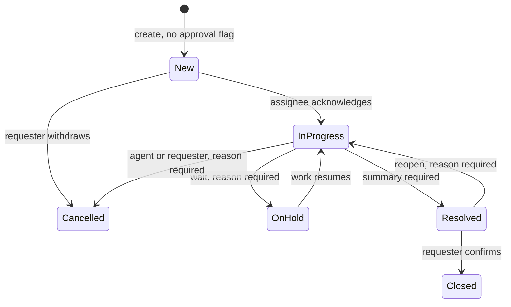
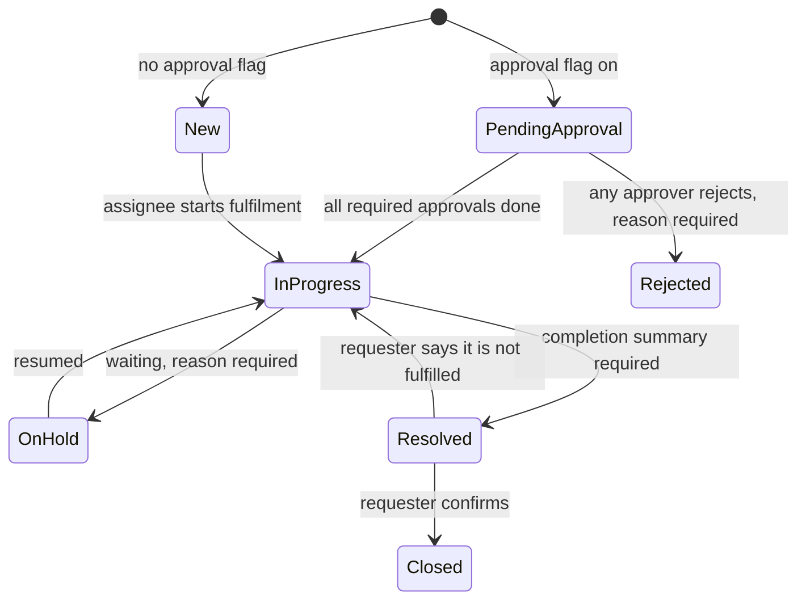
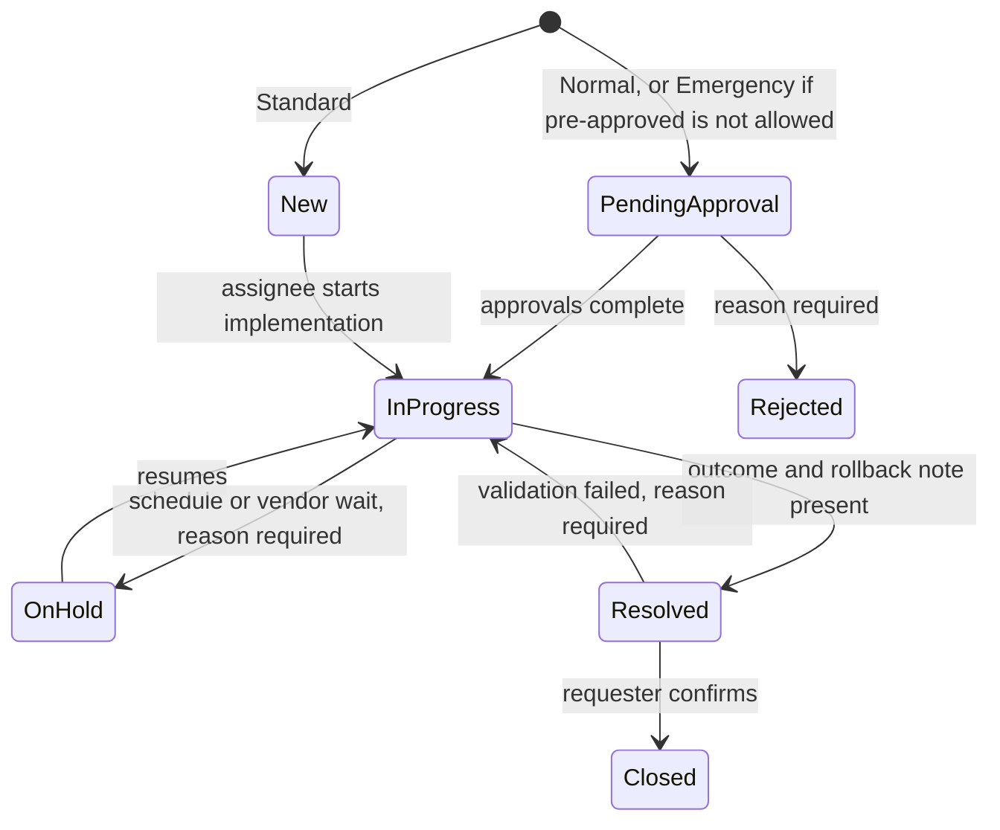

# ITSM Target Operating Workflow Specification

**Status:** Proposed for review. Not approved. Not implemented.
**Date:** 2026-11-23
**Branch:** `Aug26_AILWorks_AmimnrupSupport`
**HEAD inspected:** `f1f4bdb`
**ITSM source:** unchanged from `9c0c037` through `f1f4bdb`
**Mode:** Read-only inspection plus this new specification. No ASPX, C#, SQL, configuration, or existing ITSM document was modified. No SQL was executed. No UAT or LIVE connection was opened. Nothing was staged or committed.

Evidence labels used on every material statement:

| Label | Meaning |
|---|---|
| Existing and verified | Read in current ITSM source or an EF migration during this specification pass, or re-confirmed from the 2026-11-23 consolidation review against that same tree |
| Existing but partially verified | The code fact was read; a deployed row, seed population, or runtime result was not |
| Proposed | Target behaviour. It is not in the code |
| Requires business approval | A product rule this specification will not invent |
| Requires technical validation | A schema, session, or runtime fact that source alone cannot close |

The consolidation review and the ten ITSM documents were read as claims. Where they disagree with source, this specification follows the source. Design documents that describe `TicketClosureService`, attachment download, or a 72-hour auto-close are intent. Those behaviours are not implemented.

---

## 1. Executive summary

ITSM today is one ticket record, one transition map, and two approval checkboxes on request type. IR, SR, and CR are prefixes and names. They do not have separate lifecycles.

The target is **one ticket foundation and three thin policies**. Employees still raise one form. Agents still work one detail page. Type changes what is mandatory, who must approve, and what "done" means. It does not add a second engine, a CAB product, or a new status for every wait reason.

Recommended status set: the eight names already representable by `Configuration.Seed` — New, Pending Approval, In Progress, On Hold, Resolved, Closed, Rejected, Cancelled. Do not add Submitted, Assigned, Acknowledged, Pending Requester, Pending Information, or Pending Vendor as statuses. Assignment is a field. Acknowledgement is the move from New to In Progress. Waiting is On Hold plus a mandatory reason.

What already works and should be kept: hierarchical category selection with server re-validation, impact × urgency priority, branch-and-category dispatch to one employee, manager-then-IT-Head approval when the request type flags say so, rowversion on updates, and an audit row in the same transaction as the mutation.

What the target adds, only after the decisions in section 18: type-specific transition rules, a mandatory hold reason, a mandatory reassignment reason, resolution text copied into the audit row, persisted SLA start and due, notifications on approve / reject / resolve / hold, and queue filters for unassigned and resolved work. Support groups, CAB scheduling, catalogue forms, and automatic closure stay out of the first build unless the owner approves them.

Company-wide queue visibility is **not** redesigned here. The code lists tickets across companies on purpose. Making every query company-scoped would change that design. It is an open decision, not a silent fix.

---

## 2. Design principles

1. **One record.** IR, SR, and CR remain rows in `itsm.Tickets` distinguished by `MST_RequestType`. **Existing and verified.**
2. **Policy, not a new status machine per type.** Shared statuses. A small allow-list per type. **Proposed.**
3. **Few statuses.** A wait is On Hold with a reason, not a new status. **Proposed.** **Requires business approval.**
4. **Approval is not assignment.** An approver does not become the assignee. The code already separates `CanApproveTicket` from `CanProcessTicket`. **Existing and verified.**
5. **The requester asks; the assignee resolves.** Today the requester can resolve, reassign, and override priority. The target removes that. **Requires business approval**, because the current rule is deliberate in code.
6. **No automatic closure until an owner authorises the rule, the clock, and the exception path.** Entity comments mention a 72-hour auto-close. No job exists. **Existing and verified** absence. **Requires business approval** before any job is specified as in scope.
7. **Audit the business fact, not only the status name.** Status, owner, priority, approval, rejection reason, hold reason, and resolution summary share one transaction. **Proposed** for the fields that are missing. The transaction pattern for current mutations is **existing and verified**.
8. **Do not add a column the current schema can already express.** Department stays on the requester. Support "team" stays a query over `MST_SupportMapping` until a group entity is approved. Planned change windows and risk codes are not invented as columns in this document's first build.
9. **Persisted SLA before escalation.** Escalation on a value that exists only inside one email is not a control. **Proposed.**
10. **Modular monolith boundaries stay.** New behaviour goes through `~/ITSM/UI/`, `~/ITSM/BLL/`, `~/ITSM/DAL/`. UI does not gain SQL. BLL does not gain `System.Web`. Workflow rules stay in one BLL type, not in page code-behind.

---

## 3. Employee ticket creation journey

### 3.1 What the employee does today

**Existing and verified** path in `CreateTicket.aspx` / `CreateTicket.aspx.cs` / `TicketService.CreateTicket`:

1. Session must contain `WORKMAN`, `USERID`, and `BRANCH`. There is no `HasPermission` call on this page.
2. The employee picks request type, category, subcategory, optional item, impact, and urgency, then title and description.
3. The browser filters the hierarchy. The server calls `ValidateHierarchy` and `ValidateMasterDataIds` before insert.
4. `TicketService` snapshots `CompanyId` from the requester's `MST_UserMaster` row, resolves branch and plant, calculates priority, calculates an SLA that is not stored, and assigns an agent from `MST_SupportMapping`.
5. If either approval flag is set, status becomes Pending Approval and approval rows are inserted. Otherwise status becomes New.
6. The browser redirects to `TicketDetail.aspx?id=`. There is no confirmation dialog.

**Existing but partially verified:** which request-type rows are IR, SR, and CR, and whether their approval flags match the policies below. No seed script for `MST_RequestType` was found. Deployed prefixes and flags were not queried.

### 3.2 Target journey

Same page. The request type is the only choice that changes the rest of the form.

| Step | IR | SR | CR |
|---|---|---|---|
| 1. Type | Incident | Service | Change |
| 2. What | Category, subcategory, optional item | Same tables, treated as the catalogue | Same tables, treated as the change class |
| 3. Extra questions | Impact and urgency, both required | Only the fields marked mandatory for that category. **Proposed.** **Requires business approval** for the list | Impact required. A standard / normal / emergency class. **Proposed.** **Requires business approval** |
| 4. Text | Title and description required | Title, description, and the catalogue fields | Title, description, and what will change |
| 5. Submit | One submit. No second "confirm" page | Same | Same |
| 6. After submit | Detail page shows the number | If approval flags are on, the page says who must approve | Same, and names the class |

**Proposed** and **Requires business approval:** a confirmation popup is not part of this target. The detail page is the confirmation. The gap analysis recorded a popup as a missing requirement; this specification treats the redirect as sufficient unless the owner disagrees.

**Proposed:** the create page checks an explicit permission (`UI.ITSM_CreateTicket.View` already exists in permission SQL and is not consulted by the page). **Requires business approval** before that check is turned on, because every signed-in employee can create a ticket today.

---

## 4. Common ticket foundation

`itsm.Tickets` is the foundation. **Existing and verified** column list from `Ticket.cs` and `202608120550515_InitialItsmSchema`.

| Need | Current store | Label |
|---|---|---|
| Internal id | `Tickets.Id` | Existing and verified |
| Human reference | `Tickets.TicketNumber`, format prefix + `yy` + `MM` + four digits, `varchar(10)`, no unique index | Existing and verified. Uniqueness is a known gap, not a new requirement |
| Type | `RequestTypeId` → `MST_RequestType` (`Code`, `Name`, `Prefix`, two approval flags) | Existing and verified |
| Requester | `RequesterCode` → `dbo.MST_UserMaster.EmployeeCode` | Existing and verified |
| Employee display | Name joined at read time | Existing and verified as a read model |
| Company | `CompanyId` nullable snapshot of `MST_UserMaster.CompanyId`. No FK | Existing and verified |
| Branch | `BranchId` → `dbo.MST_Branch.Id`. Not the tenant | Existing and verified |
| Location / plant | `PlantId` nullable → `dbo.MST_Plant.Id` | Existing and verified. Ambiguous legacy plant ids become null |
| Department | Not a ticket column. `MST_UserMaster.DepartmentId` exists | Existing and verified on the user. Live HR value, not a snapshot. **Requires business approval** if a historical department is required |
| Category / subcategory / item | `CategoryId`, `SubCategoryId`, optional `ItemId` | Existing and verified. Global taxonomy, no company column |
| Subject / description | `Title` `nvarchar(200)`, `Description` `nvarchar(max)` | Existing and verified |
| Impact, urgency, priority | Three FKs. Priority is calculated, then overridable | Existing and verified |
| Status | `StatusId` → `MST_TicketStatus` | Existing and verified. Deployed `IsTerminal` values are **existing but partially verified** |
| Assigned agent | `AssigneeCode` nullable | Existing and verified |
| Assigned support group | No column, no group table | Absent. Do not add one in the first build. Team view is a query. **Proposed** |
| Created | `CreatedOn`, `CreatedByCode` | Existing and verified. Local `DateTime.Now` |
| Submitted | Same instant as create. No separate column | Existing and verified. A second timestamp is not proposed |
| Acknowledged | No column. Target: `ModifiedOn` when status first becomes In Progress, plus an audit row | **Proposed** event, not a new column |
| Updated | `ModifiedOn`, `ModifiedByCode` | Existing and verified |
| SLA response target | No column. `MST_Priority` has `SlaResolutionHours` only | Absent |
| SLA resolution target | Calculated in `SlaService`, written only into the creation email | Existing and verified calculation. Persistence absent |
| Resolution summary | `ResolutionText` `nvarchar(max)`. Required by code when the target name is Resolved. Not copied to the audit row | Existing and verified |
| Resolved / closed times | `ResolvedOn`, `ClosedOn` | Existing and verified writers on those status names |
| Closure actor | Only `ModifiedByCode` and the status audit | Existing and verified. No distinct closed-by column. Not proposed |
| CSAT | `CsatScore`, `CsatFeedback` columns. No writer | Existing and verified columns. Behaviour absent |
| Attachments | `itsm.TicketAttachments` metadata. No upload or download | Existing and verified table. Behaviour absent |
| Audit | `itsm.TicketAuditLog` | Existing and verified |
| Concurrency | `RowVersion` | Existing and verified in source. Not executed |
| Approval rows | `itsm.TicketApprovals` | Existing and verified |
| Comments | `itsm.TicketComments`, `IsInternal` | Existing and verified |

Additional fields this specification does **not** add until a named decision approves them: support group id, response-SLA hours, risk code, change class, planned start, planned end, request value, parent/duplicate ticket id, department snapshot. Each is listed under the decision that would justify it.

Number allocation stays in `TicketService.GenerateTicketNumber`. A separate numbering service is not part of this target. Making the number unique is a technical prerequisite (section 17), not a workflow redesign.

---

## 5. IR end-to-end workflow

Incident means "something is broken or degraded." The path is the short one.

| Stage | Target rule | Label |
|---|---|---|
| Report | Any authorised employee. Impact and urgency required. Description required | Existing and verified form. Permission on create is **proposed** |
| Classify | Category, subcategory, optional item. Server re-checks the hierarchy | Existing and verified |
| Impact and priority | Employee sets impact and urgency. `PriorityCalculationService` maps the pair. Fallback exists in code | Existing and verified mapping. Matrix contents **require technical validation** |
| Queue | `DispatchService` assigns one employee from branch + taxonomy, or leaves the ticket unassigned | Existing and verified. Group assignment is not proposed |
| Approval | IR default is no approval. A request-type flag can still force Pending Approval | **Requires business approval** for the default. The flag mechanism is existing and verified |
| Acknowledge | Assignee moves New → In Progress. That is the acknowledgement. No separate status | **Proposed** name for an existing transition |
| Investigate | In Progress. Internal notes for diagnosis. Requester-visible comments for updates | Comments exist. Using them as the diagnosis record is **proposed** |
| Escalate | Not a status. Notify the assignee's reporting manager when the resolution SLA is breached | **Proposed.** **Requires business approval.** SLA persistence is a prerequisite |
| Restore | Move to Resolved only from In Progress. `ResolutionText` mandatory and non-blank | The transition and the text rule are existing and verified. Copying the text into the audit row is **proposed** |
| User confirmation | Requester moves Resolved → Closed, or rejects the resolution back to In Progress with a reason | Resolved → Closed and Resolved → In Progress are in the map. Limiting the actor to the requester is **proposed.** **Requires business approval** |
| Reopen | Only Resolved → In Progress, reason required, within a window the owner sets | The edge exists. The reason and the window are **proposed.** **Requires business approval** |
| Closure | Closed is terminal under the repository seed | Seed is existing and verified. Deployed flag **requires technical validation** |

IR does not use CAB, a change window, or a catalogue form.

On Hold for an incident must say why: Requester, Vendor, or Internal. **Proposed.** The status On Hold exists. The reason does not.

---

## 6. SR end-to-end workflow

Service request means "provide something from the catalogue." The catalogue is the existing three-level taxonomy. A second catalogue system is not proposed.

| Stage | Target rule | Label |
|---|---|---|
| Catalogue selection | Category → subcategory → item. Item stays optional unless the owner marks that item mandatory | Hierarchy exists. Per-item mandatory rules are **proposed.** **Requires business approval** |
| Request-specific fields | No per-category field table exists. Phase scope is title, description, and the taxonomy. Do not build a form builder | **Proposed** boundary. **Requires business approval** if a category needs extra fields |
| Eligibility | Requester must be an active employee with a positive `CompanyId`. Branch must resolve | Company and branch checks are existing and verified. `IsActiveEmployee` exists and is not called on create. **Proposed** to call it |
| Conditional approval | Use `RequiresManagerApproval` and `RequiresItHeadApproval` on the request type. Manager is `ReportingManagerCode`. IT Head is the single active `MST_ApprovalConfiguration` row | Existing and verified. Branch-specific or value-based approvers are **not** in this build. **Requires business approval** to stay with two flags |
| Fulfilment assignment | Same dispatch cascade as IR | Existing and verified |
| Fulfilment | In Progress. Internal notes allowed for the assignee | Existing and verified comment flag |
| Completion evidence | `ResolutionText` states what was provided. File evidence waits until attachment upload is in scope | Text rule exists. Attachments are absent |
| Confirmation and closure | Same as IR | **Proposed** actor rule. **Requires business approval** |
| Rejection | Approver rejection is terminal. The employee raises a new SR. No in-place resubmit in this build | Terminal rejection is existing and verified. "Raise a new ticket" as the recovery path is **proposed.** **Requires business approval** |

SR does not gain a shopping-cart catalogue, a price, or a multi-level chain beyond manager then IT Head.

---

## 7. CR end-to-end workflow

Change means "a controlled modification." The first build stays on the same ticket. It does not add a schedule table or a CAB membership table.

Change class is a policy on top of the existing approval flags. **Proposed.** **Requires business approval.**

| Class | Meaning | Approval | Extra close rule |
|---|---|---|---|
| Standard | Pre-agreed category. Low risk | No approval rows. Status starts at New | Resolution summary must include the outcome |
| Normal | Needs review before implementation | Manager, then IT Head, using the flags already on the request type | Summary must include outcome and how to undo the change |
| Emergency | Implement first only when the owner allows it | IT Head. If the owner wants approval before implementation, Emergency uses the same Pending Approval gate as Normal | Summary must include why it was emergency and the outcome |

| Stage | Target rule | Label |
|---|---|---|
| Submit | Same create form. Type = CR | Existing and verified shell |
| Classify | Standard / Normal / Emergency | **Proposed.** No column today. Until a column is approved, class is implied by the request type's approval flags: no flags = Standard, both flags = Normal. Emergency is not representable without a decision |
| Risk and impact | Use the existing Impact value. Do not add a risk score in this build | **Proposed** reuse. **Requires business approval** |
| Implementation plan | Free text in the description at create, then internal notes. No plan entity | **Proposed** |
| CAB | Not a body and not a status. The IT Head approval is the single change authority | **Proposed.** **Requires business approval.** A real CAB roster is out of scope |
| Scheduling | No planned-start column. The assignee records the intended window in an internal note before moving to In Progress | **Proposed** workaround. A datetime pair **requires business approval** and **requires technical validation** before any column is added |
| Implementation | In Progress | Existing status |
| Validation | Resolved means the change was applied and checked. The summary says how it was checked | **Proposed** content rule on an existing field |
| Rollback | A required heading inside `ResolutionText` for Normal and Emergency: what was undone, or "no rollback required" | **Proposed.** **Requires business approval** |
| Post-implementation review | Not a status. For Normal and Emergency, Close is allowed only when the resolution text contains the outcome. A separate PIR meeting is not a system workflow | **Proposed.** **Requires business approval** |
| Closure | Same Resolved → Closed rule as IR and SR | **Proposed** actor rule |

If the owner needs Emergency to skip approval, that is a request-type row with `RequiresItHeadApproval = false` plus a written standard. The application cannot see the difference until a class field exists. **Requires business approval.**

---

## 8. Common agent processing journey

### 8.1 Queues

| View | Target | Label |
|---|---|---|
| My Tickets | Requester's own tickets. Already a tab, any signed-in employee | Existing and verified |
| My work | Tickets whose `AssigneeCode` is the actor and whose status is not terminal. Today's My Queue | Existing and verified. Includes Resolved when Resolved is non-terminal. **Existing but partially verified** against deployed flags |
| Team queue | Tickets whose branch and category match an active `MST_SupportMapping` row for this agent, including unassigned | **Proposed** query on existing tables. Mapping data **requires technical validation** |
| Unassigned | `AssigneeCode` is null, inside the team or the open list | **Proposed** filter. The column already allows null |
| Pending approvals | Actor has a pending `TicketApprovals` row. Already a tab, permission `ITSM.Approval.View` | Existing and verified |
| Waiting on requester | Status On Hold and hold reason = Requester | **Proposed.** Reason is not stored |
| SLA breached / at risk | Due time stored and compared with now | **Proposed.** Cannot be correct until SLA is stored |
| Resolved | Status name Resolved | **Proposed** filter. Data exists if that status is in use |
| Reassigned to me | Audit `ActionType = Reassignment` with this actor as the new value, since a chosen time | **Proposed** query. Reassignment audit exists. A reason does not |

Today's All Open list has no company predicate. **Existing and verified.** This specification does not turn it into a company filter. See decision D-1.

### 8.2 Ownership

| Action | Today | Target |
|---|---|---|
| View | Requester, assignee, pending approver, or same-company `ITSM.Ticket.View` | Keep. Existing and verified |
| Acknowledge, hold, resolve, comment | Requester or assignee | Assignee, or team lead under decision D-2. Requester keeps comments and confirmation only. **Requires business approval** |
| Reassign | Requester or assignee, target = any active employee | Assignee or team lead. Target must be an active employee who appears on an active support mapping for that branch and category, or any active employee if the owner rejects the tighter rule. **Requires business approval** |
| Override priority | Requester or assignee, reason audited | Assignee or team lead only. Keep the audited reason. **Requires business approval** |
| Approve / reject | Pending approver who is not the requester | Keep. Existing and verified |
| Configure IT Head and flags | `ITSM.ApprovalConfig.Manage` | Keep. Existing and verified |

A ticket with null `CompanyId` cannot be mutated. **Existing and verified.** The target does not weaken that rule and does not backfill company from the requester's current HR row.

### 8.3 Processing rules

| Rule | Target | Label |
|---|---|---|
| Take ownership | Unassigned → set `AssigneeCode` to the actor, audit `Reassignment` from Unassigned, reason "Accepted" | **Proposed** on existing fields |
| Manual reassignment | Previous owner, new owner, actor, time, and a non-blank reason | Owner, actor, and time exist. Reason is **proposed** |
| Acknowledgement | New or post-approval In Progress entry | Transition exists. Naming it acknowledgement is **proposed** |
| Internal note | `IsInternal = true`. Hidden from users who cannot process | Existing and verified flag. Visibility rule should be re-read when the actor rule changes |
| Requester comment | `IsInternal = false` | Existing and verified |
| Escalation | Notification event. Status does not change | **Proposed** |
| Duplicate | Agent resolves as Resolved with summary "Duplicate of {number}". No link column in this build | **Proposed.** **Requires business approval.** A parent-ticket FK is not proposed yet |
| Work history | `TicketAuditLog` plus comments | Existing and verified. Resolution text and hold reason must be added to the audit payload. **Proposed** |

---

## 9. Status and transition matrix

Repository seed, applied only when `itsm.MST_TicketStatus` is empty and only when the EF migrator runs. **Existing and verified** in `Configuration.Seed`. Deployed values **require technical validation**.

| Name | Seed `IsTerminal` | Role in the target |
|---|---|---|
| New | false | Created, not yet being worked, no approval waiting |
| Pending Approval | false | One or more approval rows pending. Not in the transition map. Only approve and reject move it |
| In Progress | false | Owned work |
| On Hold | false | Single pause. Reason required in the target |
| Resolved | false | Work complete. Awaiting confirmation |
| Closed | true | Confirmed complete. No exit |
| Cancelled | true | Withdrawn. No exit |
| Rejected | true | Approval refused. No exit in this build |

Not adopted: Submitted, Assigned, Acknowledged, Pending Requester, Pending Information, Pending Vendor.

`ChangeStatus` refuses a terminal current status before it reads the map. **Existing and verified.** Under the seed, Resolved can move to Closed or In Progress. If a deployed Resolved row is terminal, those edges are dead. **Requires technical validation.**

### 9.1 Shared transitions

Actor names below are the **target**. They are **requires business approval** wherever they differ from "requester or assignee."

| Current | Target | Actor | Permission | Validation | Reason | Notification | Audit | SLA |
|---|---|---|---|---|---|---|---|---|
| — | New | Requester | Create permission, if D-3 approves it | Hierarchy, active masters, company > 0, title | No | Assignee, or requester if unassigned | `Created` | Start resolution clock. **Proposed** persistence |
| — | Pending Approval | Requester | Same | Same, plus approver rows resolve | No | Each approver. **Proposed** | `Created` plus the approval rows | Start clock. **Requires business approval** whether approval time counts |
| New | In Progress | Assignee | Process | Not terminal. Map allows it | No | Requester. **Proposed** | `StatusChange` | Clock runs |
| New | Cancelled | Requester | Process limited to own ticket | Not terminal | Yes | Assignee if any. **Proposed** | `StatusChange` with reason | Stop |
| Pending Approval | In Progress | System, after last approval | Approver's approve right | Status name is Pending Approval. IT Head cannot act before Manager | No | Requester and assignee. **Proposed** | `Approval` | Clock runs |
| Pending Approval | Rejected | Approver | Approve right, not the requester | Non-blank reason. Length must fit `Comments` `nvarchar(500)` | Yes | Requester. **Proposed.** Not sent today | `Rejection` with reason | Stop |
| Pending Approval | Cancelled | Requester | Own ticket | Only before any approval is granted. **Proposed** | Yes | Approvers. **Proposed** | `StatusChange` | Stop |
| In Progress | On Hold | Assignee | Process | Reason class Requester, Vendor, or Internal | Yes | Requester when class is Requester. **Proposed** | `StatusChange` with reason | Pause. **Proposed** |
| On Hold | In Progress | Assignee. Requester may resume only when class is Requester | Process | Hold reason known | No | Assignee when the requester replied. **Proposed** | `StatusChange` | Resume |
| In Progress | Resolved | Assignee | Process | Non-blank summary. CR Normal/Emergency also needs the outcome sentence | The summary is the reason | Requester. **Proposed** | `StatusChange` and the summary in `Detail` | Stop |
| In Progress | Cancelled | Assignee or requester | Process | Reason | Yes | The other party. **Proposed** | `StatusChange` | Stop |
| Resolved | Closed | Requester | Own ticket | Ticket is Resolved and not terminal | No | Assignee. **Proposed** | `StatusChange` | Stays stopped |
| Resolved | In Progress | Requester | Own ticket | Reason. Inside the reopen window if D-6 sets one | Yes | Assignee. **Proposed** | `StatusChange` | Restart or continue. **Requires business approval** |
| On Hold | Cancelled | Requester or assignee | As above | Reason | Yes | Other party | `StatusChange` | Stop |

Rejected, Closed, and Cancelled have no outgoing transition.

IR, SR, and CR share this table. Type policy only changes:

- whether create lands on New or Pending Approval
- whether Resolved text must include a rollback sentence
- whether the requester may cancel during Pending Approval

Those three switches are **proposed** and **require business approval**. They belong in `TicketWorkflow`, not in the page.

### 9.2 Rejection and reassignment minimums

Rejection already demands a non-blank reason in `RejectTicket`, before the transaction. **Existing and verified.** The textbox has no length check in the BLL; the column is 500 characters. The target truncates nothing silently: over-length input is refused with a clear message. **Proposed.**

Reassignment today stores old owner, new owner, actor, and time. It does not store a reason and does not notify. **Existing and verified.** The target requires a reason and writes it to audit `Detail`. **Proposed.** **Requires business approval** only if the owner wants reassignment to stay reason-free. This specification recommends the reason.

Resolution already requires non-whitespace text for status name Resolved. **Existing and verified.** "Meaningful" is enforced as non-blank after trim, with a minimum length only if the owner sets one. A minimum length is **requires business approval**. The audit copy of the summary is **proposed** and does not need a new business rule; it records the rule the code already enforces.

---

## 10. Approval matrix

Approval and assignment stay separate.

| Question | Target answer | Label |
|---|---|---|
| Who is an approver? | The reporting manager and the one active IT Head, and only when that request type's flag is on | Existing and verified |
| Does the approver own the ticket? | No. `CanApproveTicket` does not grant `CanProcessTicket` | Existing and verified |
| Order | Manager first, then IT Head | Existing and verified |
| Same person is both | Two rows can exist. `FirstOrDefault` picks one. The target forbids creating both rows for the same employee: keep the Manager row and skip a duplicate IT Head row, and record that in the create audit | **Proposed.** **Requires technical validation** against real manager and IT Head codes |
| Requester is the manager | Create throws. Existing and verified |
| Requester is the IT Head | Create still inserts the row. Approve then refuses. The ticket can stall | Existing and verified behaviour. Target: reject that configuration at create, same as the manager rule. **Proposed** |
| Reject | Reason required. Other pending rows are rejected. Status becomes Rejected, or Cancelled if Rejected is missing | Existing and verified |
| Resubmit | Not in this build. The employee creates a new ticket and quotes the old number in the description | **Proposed.** **Requires business approval** |
| Delegate | Not in this build. An administrator changes the IT Head row. A manager absence is an HR reporting-line change, not an ITSM delegation screen | **Proposed** boundary. **Requires business approval** |
| Type | IR: flags off unless the owner turns them on. SR and CR Normal: flags on. CR Standard: flags off | **Requires business approval** |
| Category, department, branch, value, risk | Not selection criteria in this build. The schema cannot express them on the approval row | **Requires business approval** before any new rule table |

Configurable rules beyond the two flags are a later design. Building them now would add a matrix the current volume of types does not justify.

`ApprovalConfig.aspx` remains the place an administrator sets the IT Head and the two flags. **Existing and verified.**

---

## 11. SLA and escalation model

### 11.1 What exists

| Piece | Fact | Label |
|---|---|---|
| Resolution hours | `MST_Priority.SlaResolutionHours` | Existing and verified column. Seed values **require technical validation** |
| Priority selection | Impact × urgency matrix, then that priority's hours | Existing and verified code. Matrix rows **require technical validation** |
| Start | `SlaService` uses `dbo.VMS_PlantTimings` for the branch id it is given. Missing timing means "start now" | Existing and verified. Whether `Branch_ID` matches the id passed in **requires technical validation**. Create passes the legacy branch id into SLA and `MST_Branch.Id` into dispatch |
| Duration | Clock hours until midnight, skipping `MST_Calendar` weekends, else Saturday and Sunday | Existing and verified. This is not a plant-close calendar |
| Storage | Not on `Tickets`. The two timestamps are placed in the creation email body | Existing and verified |
| Response SLA | None | Existing and verified absence |
| Pause | None. On Hold does not stop a stored clock because no clock is stored | Existing and verified absence |
| Escalation | None | Existing and verified absence |
| Breach notification | None | Existing and verified absence |
| Reporting | None | Existing and verified absence |

### 11.2 Target, after D-7

Do not implement this section until the owner accepts persisted SLA.

| Rule | Proposal |
|---|---|
| Response target | Time from `CreatedOn` to the first In Progress audit. Hours come from a new nullable pair on `MST_Priority`, or from a documented fraction of `SlaResolutionHours` if the owner refuses a new column |
| Resolution target | Existing hours. Persist `SlaStartOn` and `SlaDueOn` on the ticket at create, inside the create transaction |
| Business hours | Keep the current calculator for the first persisted version, and label it honestly: start respects plant open, duration is clock time with weekend skips. A true open-to-close calendar is a later change |
| Holidays | `MST_Calendar.IsWeekend` is the only holiday signal in code. Extra holiday rows belong in that table if the business already maintains it. **Requires technical validation** |
| Pause | On Hold pauses the resolution clock. Returning to In Progress extends `SlaDueOn` by the paused duration. Response SLA is not paused; it either met the first In Progress or it did not |
| Stop | Resolved, Closed, Rejected, and Cancelled stop the clock |
| At risk | Optional notification at a percent the owner names. Default recommendation: do not add an at-risk mail in the first SLA release. Ship breach only |
| Breach | One mail to the assignee and to `MST_UserMaster.ReportingManagerCode` of the assignee. No new status |
| Reporting | A list filtered by `SlaDueOn < now` and status not terminal. No dashboard in this build |
| Recalculation | Reassignment and priority override recalculate the due time from the original start. **Requires business approval** |

Escalation levels beyond that single manager mail are out of scope. There is no team-lead entity to escalate to.

---

## 12. Resolution and closure model

| Control | Target | Label |
|---|---|---|
| Summary required | Non-blank `ResolutionText` to enter Resolved | Existing and verified |
| Summary retained in history | Audit `Detail` receives the summary on that transition | **Proposed** |
| Resolved timestamp | `ResolvedOn` | Existing and verified |
| Requester told | Mail on Resolved, with an absolute URL, not a `~/` path | **Proposed.** Creation mail exists and uses a relative path. **Existing and verified** defect of the link |
| Confirmation | Requester closes, or sends it back to In Progress with a reason | Edges exist. Actor restriction is **proposed.** **Requires business approval** |
| Automatic closure | Not authorised. Do not build a job because the entity comment mentions 72 hours | Absence is existing and verified. Any future rule **requires business approval** |
| Reopen | Resolved → In Progress only. Not from Closed | Edge exists. Window and reason **require business approval** |
| Closed timestamp | `ClosedOn` | Existing and verified |
| Closure audit | `StatusChange` is written. Add the actor, which is already `ActorCode` | Existing and verified |
| CSAT | Leave the columns unused. Do not block closure on a score | **Proposed.** **Requires business approval** if the owner wants CSAT to be mandatory |
| CR review | Outcome sentence inside the summary before Resolved. Not a new status | **Proposed.** **Requires business approval** |

Closed, Rejected, and Cancelled stay terminal. Reopen-from-Closed is not proposed. If confirmation was wrong, that is an operational exception outside this workflow until the owner asks for it.

---

## 13. Role and responsibility matrix

Permissions and responsibilities are different. A permission lets someone open a screen. A responsibility says what the workflow expects them to do.

| Role | Responsibility | Permission that exists in code or SQL | Label |
|---|---|---|---|
| Employee / requester | Create, comment, cancel own New ticket, confirm or return a resolution | Session only, for create. View via relationship without `ITSM.Ticket.View` | Existing and verified session gate. Create permission key exists and is unused |
| Service desk | Same as support agent in this build. No separate desk role is proposed | `ITSM.Queue.View`, `ITSM.Ticket.View` | Keys exist. **Requires technical validation** that they are granted |
| Support agent | Acknowledge, hold, resolve, reassign inside the mapping, internal notes | Queue view does not grant processing. Processing is assignee relationship only | Existing and verified. Target responsibility **requires business approval** (D-2) |
| Team lead | Reassign inside the team, priority override, receive the breach mail | No team-lead role exists. Breach mail would use the assignee's reporting manager | **Proposed.** **Requires business approval** |
| Approver | Approve or reject when a pending row names them | `ITSM.Approval.View` shows the tab. The row is the authority | Existing and verified |
| Change manager | The active IT Head, for CR Normal | `MST_ApprovalConfiguration` plus the flag | Existing and verified mechanism. The title "change manager" is **proposed** |
| CAB | Not a role in this build | None | **Proposed** exclusion. **Requires business approval** |
| ITSM administrator | Set IT Head, set the two approval flags, maintain support mappings by script | `ITSM.ApprovalConfig.Manage`. No mapping screen | Config screen existing and verified. Mapping maintenance is a DBA script. **Existing and verified** absence of a screen |

`ITSM_Agent` and `ITSMAdmin` are the role keys named in the permission SQL. There is no `ITSM_Manager` role row in those scripts. **Existing and verified** from the earlier document review of those scripts. This pass did not re-execute the SQL.

Nobody gets a responsibility to edit `TicketAuditLog`. The application inserts it. The database does not enforce append-only. **Existing and verified.** A database `DENY` is **requires technical validation** and is not part of the workflow build.

---

## 14. Notification matrix

| Event | Today | Target recipient | Label |
|---|---|---|---|
| Created | Insert into `dbo.NotificationQueue` inside the create transaction. Prefers the assignee email, else the requester. Subject includes the ticket number. Title is HTML-encoded. Link is `~/ITSM/UI/TicketDetail.aspx?id=` | Assignee. Requester only when unassigned. Absolute URL | Send path existing and verified. URL fix **proposed** |
| Approval requested | No | Each pending approver | **Proposed** |
| Approved | No | Requester and assignee | **Proposed** |
| Rejected | No | Requester | **Proposed** |
| Reassigned | No | New assignee | **Proposed** |
| On Hold, reason Requester | No | Requester | **Proposed** |
| Resolved | No | Requester | **Proposed** |
| Closed | No | Assignee | **Proposed** |
| SLA breach | No | Assignee and their reporting manager | **Proposed.** Depends on D-7 |
| Comment | No | Do not mail every comment in this build | **Proposed** exclusion |

One creation failure in the queue insert rolls the ticket back. An empty email skips the insert and still commits. **Existing and verified.** The target keeps that: missing email does not block the ticket; a SQL error still rolls back. **Requires technical validation** that `NotificationQueue` columns match the insert. Other modules use the same column list. The table DDL was not opened.

Mail is not a second workflow. If the queue is down, the ticket state is still the source of truth.

---

## 15. Audit requirements

| Event | `ActionType` today | Target payload | Label |
|---|---|---|---|
| Create | `Created` | Keep ticket number in `Detail` | Existing and verified |
| Status change | `StatusChange` | Old name, new name, and `Detail` = reason or resolution summary | Names exist. `Detail` is null today. **Proposed** |
| Reassignment | `Reassignment` | Old, new, reason in `Detail` | Old and new exist. Reason **proposed** |
| Priority override | `PriorityOverride` | Old, new, reason | Existing and verified |
| Approve | `Approval` | Pending → Approved or Approved (partial). Comment is null from the button | Existing and verified. An optional comment is not required for this build |
| Reject | `Rejection` | Reason in `Detail` | Existing and verified |
| Comment | `Comment` | Text, truncated to 1000, internal prefix | Existing and verified |
| SLA set or paused | None | `Detail` records old due and new due when those columns exist | **Proposed** |
| Read, export, login | None | Do not audit reads in this build | **Proposed** exclusion |

Rules that already hold and stay:

- Audit insert and ticket update commit in one `DbContextTransaction` on the six update methods. **Existing and verified.**
- A failed guard returns before commit and the `using` disposes the transaction. **Existing and verified.**
- `CompanyId` on the audit row is copied from the ticket snapshot and is non-nullable. **Existing and verified.**
- The BLL does not update or delete audit rows. The schema does not forbid it. **Existing and verified.**

Create uses several `SaveChanges` calls inside one transaction. **Existing and verified.** The target keeps one transaction. It does not require a single `SaveChanges` unless a later implementation prefers it.

---

## 16. Current-state versus target-state gap analysis

### 16.1 Workflow gaps

| Gap | Current | Target | Label |
|---|---|---|---|
| Three policies | One map for every type | Same statuses, three small allow-lists | **Proposed** |
| Hold reason | On Hold has no reason | Mandatory class | **Proposed** |
| Reassignment reason | Not stored | Mandatory | **Proposed** |
| Resolution in the audit | `Detail` null | Summary stored | **Proposed** |
| Requester can resolve and reassign | Yes | No, if D-2 is accepted | **Requires business approval** |
| Stranded Pending Approval | No admin exit. IT Head who is the requester can stall | Block that create. Still no admin override in this build | **Proposed** |
| `IsTerminal` versus the map | Flag wins | Keep the flag. Confirm deployed Resolved is not terminal | **Requires technical validation** |
| Direct New → Resolved | Refused | Stay refused | Existing and verified. Matches the target |
| Auto-close and CSAT | Columns and comments only | Leave unused | **Requires business approval** to turn on |
| Attachments | Table only | Out of this workflow build | Absence existing and verified |
| Support group | One employee code | Query, not a new entity | **Proposed** |
| SLA persistence and breach | Email only | Store due, one breach mail | **Proposed.** **Requires business approval** |
| Notifications other than create | None | The matrix in section 14 | **Proposed** |
| Ticket number collisions | Read-modify-write, no unique index | Prerequisite fix, not a workflow feature | Existing and verified exposure. No duplicate row was queried |
| Unencoded detail labels | Title, description, resolution assigned to `Label.Text` | Prerequisite fix | Existing and verified sink. Exploit not run |

### 16.2 Architecture deviations

These are observations. This specification does not fix them.

| Rule stated for the module | What the source does | Label |
|---|---|---|
| UI contains no inline SQL | No `SqlConnection` / `SqlCommand` in `ITSM/UI` | Existing and verified for the files searched |
| BLL independent of `System.Web` | No `System.Web` import under `ITSM/BLL`. Email encoding uses `System.Net.WebUtility` | Existing and verified |
| DAL uses EF6 | Yes, except `TicketService.EnqueueTicketCreatedNotification` runs raw `INSERT` SQL from the BLL | Existing and verified deviation |
| Reads use `AsNoTracking()` and `Select` projections | List, detail, and master reads do. Update paths load a tracked `Ticket` | Existing and verified. Tracking on a row that will be updated is appropriate |
| Every operation enforces `CompanyId` | Create writes it. Mutations require it. The permission view path compares it. Requester, assignee, and approver view does not compare it. `BuildQueueQuery` does not filter it | Existing and verified deviation from a universal filter. **Requires business approval** before any change (D-1) |
| No public static state or DataTables in code-behinds | No `DataTable` under `ITSM`. `TicketWorkflow` is a public static class with a readonly map. Page code-behinds have private static helpers | Existing and verified. The static map is shared configuration, not per-request mutable state |
| `Session["USERID"]` and `Session["BranchID"]` on every `Page_Load` | Create, list, and detail check `WORKMAN`, `USERID`, and `BRANCH`. `ApprovalConfig` checks `USERID` and `BRANCH` only. `BasePage` exposes `WORKMAN` as the employee code. There is no `Session["BranchID"]` check on these pages | Existing and verified deviation from the wording `BranchID` |
| Transitions centrally orchestrated | `TicketWorkflow` is the map. Approve and reject set status by name and do not call the map | Existing and verified partial deviation |
| State and audit in one transaction | True for the six update methods and for create's writes. Priority, SLA, and dispatch reads use other contexts | Existing and verified |

Repositories: `ITSM/DAL` is `ItsmDbContext`, entities, and migrations. There is no repository class. **Existing and verified.** The target does not add one.

---

## 17. Recommended implementation sequence

Do not start this sequence until section 18 is answered. The sequence is a recommendation, not authorisation to code.

| Order | Work | Why this order | Depends on |
|---|---|---|---|
| 0 | No build | Review this specification | — |
| 1 | Technical integrity already identified: unique ticket number, encode detail output, confirm deployed `IsTerminal` | Workflow rules on top of colliding numbers or a dead Closed edge will be reworked | D-4 for the number design. Terminal flag is a read-only check |
| 2 | Extend `TicketWorkflow` so approve, reject, and `ChangeStatus` share one policy method. Add hold reason and reassignment reason to the existing audit `Detail` | Removes split brains without new tables | D-2, D-5 |
| 3 | Restrict process actions to the assignee if D-2 says so. Leave view rules as they are | Smallest behaviour change with the largest accountability effect | D-2 |
| 4 | Notification rows for approve, reject, resolve, reassign, and requester hold. Fix the link to an absolute URL | Makes the status model visible to employees | D-8 for the site base URL. **Requires technical validation** |
| 5 | Queue filters: unassigned, resolved, waiting reason, team mapping | Uses columns that already exist once the reason exists | D-1 if any filter also applies company |
| 6 | Persist SLA start and due. Breach mail. No at-risk mail | Only after the clock rules are accepted | D-7 |
| 7 | Attachments, CSAT, auto-close, CAB dates, support-group entity, extra approval dimensions | Each is a separate decision. None is required for the operating model in sections 5–7 | Their own decisions |

Each implementation step, when it is eventually authorised, stays inside `~/ITSM/UI/`, `~/ITSM/BLL/`, and `~/ITSM/DAL/`, with the mutation and its audit row in one transaction.

---

## 18. Outstanding business decisions

| ID | Decision | This specification assumes, until told otherwise |
|---|---|---|
| D-1 | May All Open show other companies' titles and names? | Leave the current shared-service list unchanged |
| D-2 | May the requester resolve, reassign, or override priority? | Target says no. Not approved |
| D-3 | Must create require `UI.ITSM_CreateTicket.View` and an active employee? | Recommended yes. Not approved |
| D-4 | How should duplicate ticket numbers be prevented? | Prerequisite. Method is not chosen here |
| D-5 | Is On Hold plus a reason enough, with no extra pending statuses? | Yes for this target. Not approved |
| D-6 | Is there a reopen window, and does reopen restart the SLA? | Reopen from Resolved only. Window and SLA effect not set |
| D-7 | Are response SLA, stored due time, pause on hold, and one breach mail in scope? | Recommended yes, after D-5. Not approved |
| D-8 | What absolute base URL should mail links use? | Unknown. **Requires technical validation** and an owner value |
| D-9 | IR approval off, SR and CR Normal on, CR Standard off? | Recommended. Deployed flags unknown |
| D-10 | Is the IT Head the only change authority, with no CAB? | Recommended for this build. Not approved |
| D-11 | Is rejection terminal, with a new ticket as the only resubmit? | Recommended. Not approved |
| D-12 | Is automatic closure authorised? | No |
| D-13 | Is CSAT required to close? | No |
| D-14 | Must a support-group entity exist, or is branch + category + one agent enough? | One agent is enough for this build |
| D-15 | What happens to tickets whose `CompanyId` is null? | They stay frozen. No backfill is proposed |
| D-16 | Is a department snapshot required on the ticket? | No. Show the requester's current department |
| D-17 | Minimum length of a resolution summary? | Non-blank. No minimum until set |
| D-18 | May an agent mark a ticket duplicate without a link column? | Yes, by text in the summary, if accepted |

No decision in this table is closed by inference.

---

## 19. Acceptance criteria

These apply to a future implementation after approval. None of them is claimed as passing now.

1. An IR with approval flags off is stored as New, with a ticket number, company snapshot, branch, category, impact, urgency, calculated priority, and either an assignee or a null assignee.
2. An SR or CR whose request type requires manager approval is stored as Pending Approval and cannot be moved by `ChangeStatus`.
3. IT Head approval is refused while a Manager row is pending.
4. A rejection without a reason does not change the ticket.
5. The requester cannot approve their own ticket.
6. If D-2 is approved, the requester cannot resolve, reassign, or override priority, and the assignee can.
7. Resolved is impossible with a blank summary.
8. The audit row for that resolve contains the summary and commits or rolls back with the status change.
9. Reassignment stores the previous owner, the new owner, the actor, the time, and a reason.
10. On Hold without a reason class is refused.
11. Closed, Rejected, and Cancelled cannot be left by any screen.
12. Under the approved seed, Resolved can be closed by the requester and can be returned to In Progress with a reason.
13. No job closes a ticket by age unless D-12 is explicitly approved and the criteria are re-written.
14. Create, approve, reject, resolve, reassign, and requester-hold each enqueue one notification or explicitly skip when the recipient email is empty, without a partial ticket commit on SQL failure.
15. Mail links are absolute.
16. Queue screens do not gain a company filter unless D-1 says so.
17. New code adds no inline SQL in `ITSM/UI` and no `System.Web` reference in `ITSM/BLL`.
18. A ticket with null `CompanyId` still cannot be mutated.
19. IR, SR, and CR use the same status names. Type differences are limited to the entry status, the approval flags, and the CR summary sentence.
20. Deployed `MST_TicketStatus.IsTerminal` for Resolved is recorded from a named environment before closure is demonstrated.

---

## 20. Source inspected for this specification

Re-read for this document:

- `AnmolDristi/ITSM/DAL/Entities/Ticket.cs`, `RequestType.cs`, `Priority.cs`, `TicketComment.cs`
- `AnmolDristi/ITSM/DAL/Entities/UserMaster.cs` for `DepartmentId`, `CompanyId`, and `BranchId`
- `AnmolDristi/ITSM/DAL/ItsmDbContext.cs` constructor and the legacy-write guard
- `AnmolDristi/ITSM/DAL/Migrations/Configuration.cs` seed
- `AnmolDristi/ITSM/UI/TicketList.aspx.cs` session gate and tabs
- `AnmolDristi/ITSM/UI/CreateTicket.aspx.cs`, `TicketDetail.aspx.cs`, `ApprovalConfig.aspx.cs` session keys, by search
- `AnmolDristi/BasePage.cs` for `WORKMAN` and `USERID`
- Searches for `DataTable`, `Session[`, and `static` under `AnmolDristi/ITSM`

Carried forward from the 2026-11-23 consolidation review, which read the transition, approval, SLA, dispatch, numbering, and rendering code against this same ITSM tree:

- `TicketService.cs`, `TicketUpdateService.cs`, `TicketWorkflow.cs`, `ItsmTicketAccess.cs`, `SlaService.cs`, `TicketListService.cs`, `DispatchService.cs`, `TicketMasterDataService.cs`
- Initial migration foreign keys and the audit-log and company-id migrations
- The ten ITSM documents and `ITSM_DOCUMENTATION_CONSOLIDATION_REVIEW.md`

Not done: SQL execution, deployed catalogues, `Web.config`, a browser pass, and any edit to those documents.
