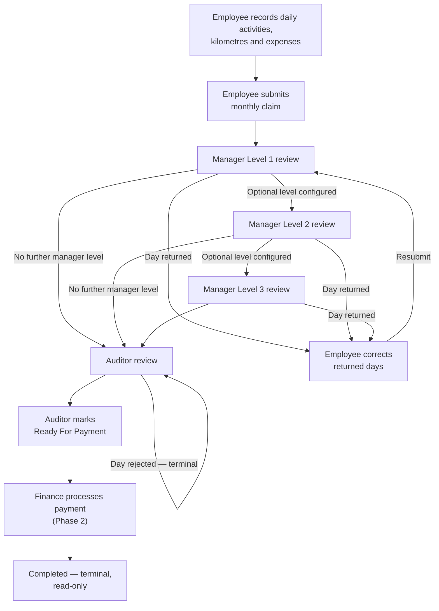
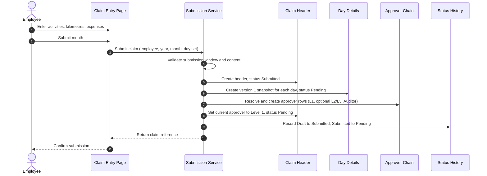
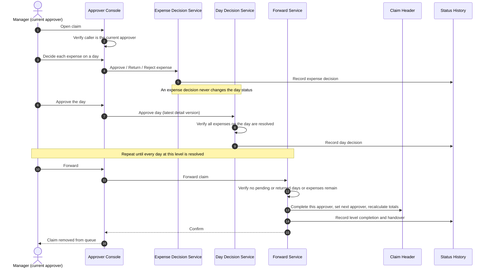
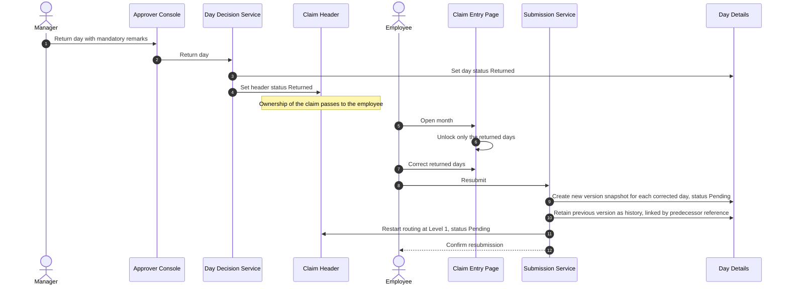
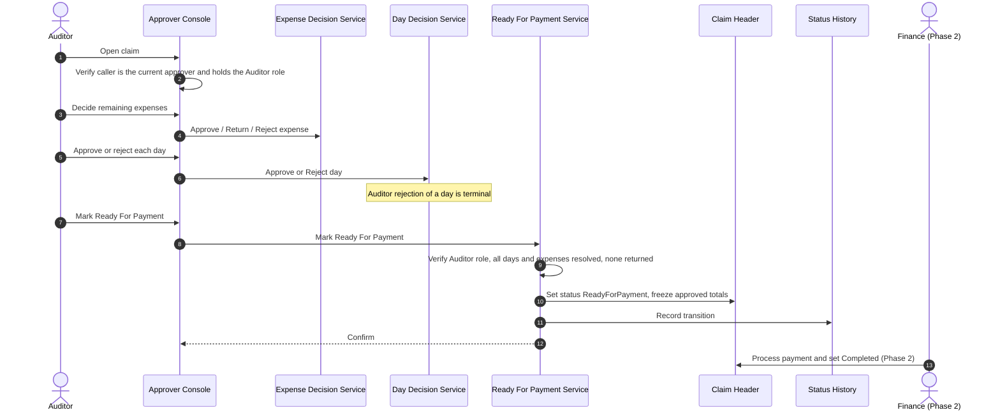
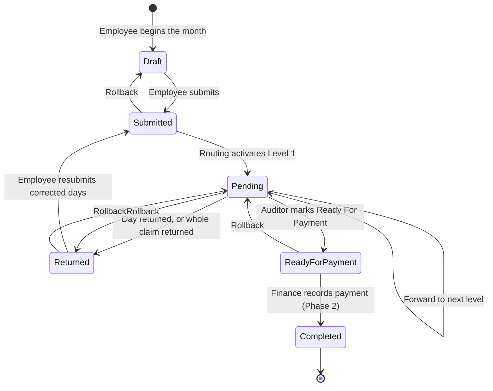
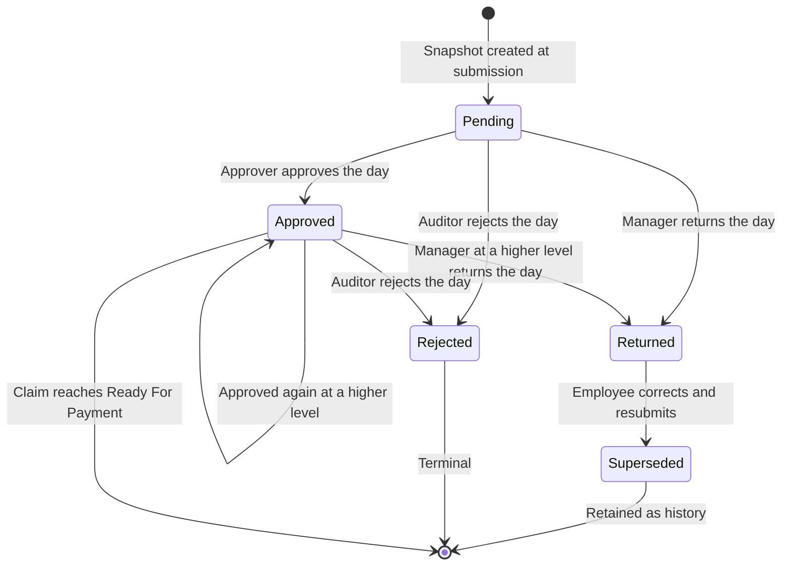
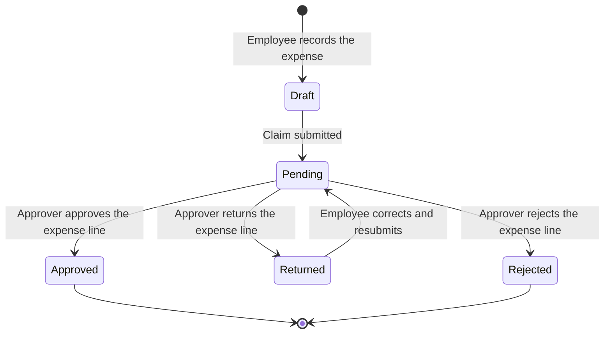
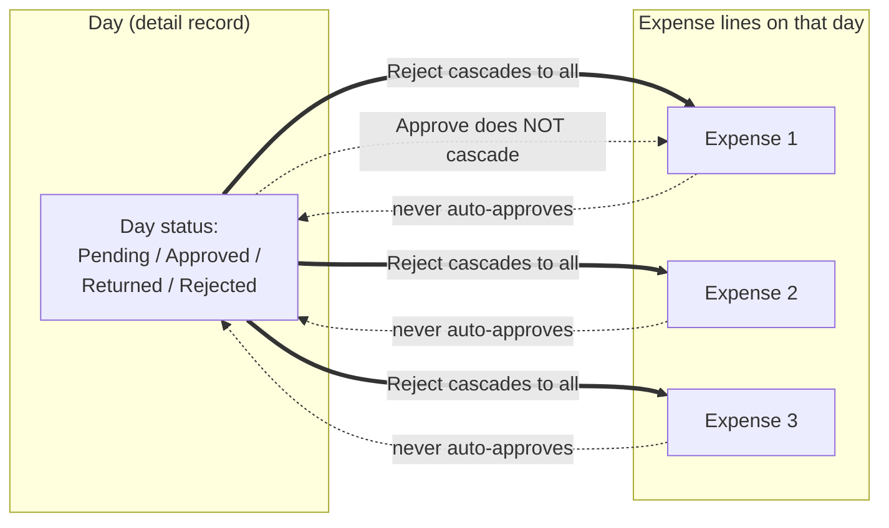

# Monthly Sales Claims Approval System
## Functional Specification — Phase 1
### Version 1.0

---

# 1. Document Control

## 1.1 Document identification

| Attribute | Value |
| --- | --- |
| Document title | Monthly Sales Claims Approval System — Functional Specification, Phase 1 |
| Document reference | FS-MSC-P1 |
| Version | 1.0 |
| Status | Issued for approval |
| Date | 2 August 2026 |
| Author | Enterprise Solution Architecture |
| Owning application | AnmolDristi — Sales TA/DA (Monthly Sales Claims) module |
| Baseline reviewed | Branch `July26_AILWorks_AminrupSupport`, commit `bf99fd0` |
| Classification | Internal — Business and IT |

## 1.2 Version history

| Version | Date | Author | Description |
| --- | --- | --- | --- |
| 1.0 | 2 Aug 2026 | Enterprise Solution Architecture | First issue. Establishes the Phase-1 authoritative business workflow, consolidating the agreed business rules with the documented current behaviour of the implemented system. |

## 1.3 Approval

| Role | Name | Signature | Date |
| --- | --- | --- | --- |
| Business Process Owner (Sales) | | | |
| Business Process Owner (Finance) | | | |
| Audit / Internal Control | | | |
| IT Application Owner | | | |
| Solution Architect | | | |

## 1.4 Purpose

This document is the authoritative functional reference for the Monthly Sales Claims Approval System. It defines, for Phase 1:

- the agreed business workflow and the meaning of every status;
- who may perform each action, and under what preconditions;
- the single owner of each workflow transition;
- the validation, exception, and audit requirements the system must satisfy.

Where the implemented system differs from the agreed business rules, this document records **both** the **Current Behaviour** and the **Target Behaviour**. It does not propose how to close the difference; remediation is governed separately by the Production Hardening Review (see §1.9, reference R1).

All future development, change requests, test cases, and defect classifications for this module are to be assessed against this document. Any behaviour not described here is undefined and must be raised as a specification change request rather than implemented by inference.

## 1.5 Scope

In scope for Phase 1:

| Area | Included |
| --- | --- |
| Monthly claim capture by the employee | Daily activity entry, kilometre capture, expense capture (DA, Hotel, Travel, Stationary), attachments, draft handling |
| Claim submission and resubmission | Submission for a calendar month, partial resubmission of returned days |
| Multi-level manager approval | Levels 1, 2 and 3, day-level and expense-level decisions, forwarding |
| Auditor review | Day-level and expense-level decisions, marking a claim Ready For Payment |
| Header, detail and expense state machines | Statuses, permitted transitions, terminal states |
| Detail versioning | Immutable per-day snapshots and version chaining on resubmission |
| Approval routing | Current approver ownership, optional levels, forward semantics |
| Authorization | Who may perform which action at which point |
| Payment lock | Read-only enforcement after completion |
| Audit trail | Status history, remarks, approval trail, expense and kilometre change history |

## 1.6 Out of scope

The following are explicitly **not** part of Phase 1. Items marked *Phase 2* are elaborated in §15.

| Item | Reason |
| --- | --- |
| Finance payment processing (the `ReadyForPayment → Completed` transition) | Not implemented in the current system. *Phase 2.* |
| Partial expense approval (an approved amount lower than the claimed amount) | Not supported by the current data capture or user interface. *Phase 2.* |
| Population of `SalesExpenseAdjustment` | Dependent on partial expense approval. *Phase 2.* |
| Payment reference, payment date, disbursement file, bank integration | Dependent on the Finance module. *Phase 2.* |
| Delegation, out-of-office approver substitution, escalation on ageing | Not an agreed Phase-1 requirement. |
| Mobile or API access to the workflow | Not an agreed Phase-1 requirement. |
| Policy and tolerance master maintenance | Separate module; consumed by, but not defined in, this specification. |
| Architectural change of any kind | This specification documents the workflow only. The technology stack (ASP.NET WebForms → ADO.NET → stored procedures → SQL Server) is fixed and unchanged. |
| Reporting and analytics beyond the existing claim views and Excel export | Not an agreed Phase-1 requirement. |

## 1.7 Definitions and abbreviations

| Term | Definition |
| --- | --- |
| **Claim** | The set of all daily activities and expenses submitted by one employee for one calendar month, represented by one approval request header. |
| **Header** | The claim-level record (`SalesApprovalRequest`). Carries the claim status, the current approver, and the claim totals. |
| **Detail** | A per-day, immutable snapshot of one activity within a claim (`SalesApprovalRequestDetail`). The unit that approvers action. |
| **Day** | Business synonym for a detail record. Approving "a day" means approving one detail record. |
| **Activity** | The live daily record entered by the employee (`SalesDailyActivity`). A detail is a snapshot of an activity taken at submission. |
| **Expense** | A receipt-level line item attached to a day (`SalesDailyExpense`): DA, Hotel, Travel, or Stationary. |
| **Detail Version** | The revision number of a detail snapshot for a given day within a claim. Incremented when a returned day is corrected and resubmitted. |
| **Latest Detail Version** | The single actionable detail record for a day; all earlier versions are historical and read-only. |
| **Current Approver** | The single person who may act on the claim at this moment, identified by `CurrentApproverLoginId` and `CurrentApproverLevel` on the header. |
| **Approver Level** | The ordinal position in the approval hierarchy: 1, 2, 3 for managers; the auditor occupies the level above the highest configured manager. |
| **Forward** | The act of completing the current approval level and passing ownership of the claim to the next approver. |
| **Return** | Sending a day, or the whole claim, back to the employee for correction. Reversible. |
| **Reject** | Refusing a day permanently. Terminal for that day. |
| **Ready For Payment** | The state in which all approval is complete and Finance may pay. |
| **Completed** | The state in which Finance has paid. Terminal and read-only for all actors. |
| **Rollback** | An administrative reversal of the claim to an earlier workflow state. |
| **Payment Lock** | The rule that a Completed claim is read-only to every actor and every action. |
| **Snapshot columns** | The `Snapshot_*` columns on the detail record, which freeze the day's kilometres and amounts at the moment the version was created. |
| **DA** | Daily Allowance. |
| **TA** | Travel Allowance, computed from kilometres and the applicable rate. |
| **L1 / L2 / L3** | Manager approval levels 1, 2 and 3. |
| **SP** | Stored procedure. |
| **Current Behaviour** | What the system does today, as verified against the code baseline in §1.1. |
| **Target Behaviour** | What the agreed business rules require. Where this differs from Current Behaviour, the difference is a known gap (§14). |

## 1.8 Reading conventions

- **Target Behaviour** statements are normative. The words *must*, *must not*, and *may* carry their usual specification meaning.
- **Current Behaviour** statements are descriptive and carry no normative weight. They exist so that testers, developers, and auditors can distinguish an unimplemented requirement from a defect.
- Where a rule is fully implemented, only one behaviour is stated and it is normative.
- Gap references of the form **[G-nn]** point to §14, which in turn maps to the Production Hardening Review.

## 1.9 Reference documents

| Ref | Document | Location |
| --- | --- | --- |
| R1 | Production Hardening Review — Monthly Sales Claims Workflow | `docs/Production_Hardening_Review_MonthlySalesClaims.md` |
| R2 | Approval engine stored procedure (only workflow SP under source control) | `Database/Scripts/005_usp_ProcessApprovalAction.sql` |
| R3 | Employee claim entry and submission page | `AnmolDristi/SalesMonthlyReview.aspx` |
| R4 | Approver console (current) | `AnmolDristi/ClaimsApproval_v2.aspx` |
| R5 | Approver console (legacy, retained) | `AnmolDristi/ClaimsApproval.aspx` |
| R6 | Employee claim views | `AnmolDristi/MyClaimsView_v2.aspx`, `AnmolDristi/ApprovedClaimsView.aspx` |
| R7 | Shared status and editability rules | `AnmolDristi/ClaimStatuses.cs`, `AnmolDristi/ClaimEditabilityHelper.cs`, `AnmolDristi/SalesApprovalDetailVersionHelper.cs` |

**Documentation constraint.** Only one workflow stored procedure (`usp_ProcessApprovalAction`) exists in source control. The behaviour of the remaining workflow procedures has been inferred from their call sites and from observed data effects. Statements about those procedures that could not be verified against a procedure body are marked **[unverified]**.

---

# 2. Business Overview

## 2.1 Purpose of monthly claims

Field sales employees incur travel and subsistence costs while servicing their territory. Each month they record, day by day, where they travelled, how far, and what they spent. At month end this record is submitted as a single claim for reimbursement.

The claim serves four business purposes:

1. **Reimbursement.** It is the instrument by which the employee is repaid.
2. **Control.** It gives the reporting line an itemised, day-level view of field expenditure before money leaves the business.
3. **Policy enforcement.** Kilometre tolerances, daily allowance rules, hotel caps, and receipt requirements are applied to each line.
4. **Audit evidence.** The approved claim, its supporting receipts, and the record of who approved what and when constitute the audit trail for the expenditure.

The system exists to move that claim through a controlled sequence of reviews, to record every decision, and to ensure that the amount ultimately paid is the amount that was approved — no more, and by the right people.

## 2.2 Actors

| Actor | Description | Primary responsibilities |
| --- | --- | --- |
| **Employee** | Field sales employee who incurs the expenditure. | Records daily activities, kilometres, and expenses. Attaches receipts. Submits the monthly claim. Corrects and resubmits days that are returned. |
| **Manager (L1, L2, L3)** | The employee's reporting line. Level 1 is the direct reporting manager; levels 2 and 3 are optional higher approvers. | Reviews each day and each expense. Approves, returns for correction, or refers upward. Forwards the claim once every day at their level is resolved. Returns the whole claim to the employee where wholesale correction is needed. |
| **Auditor** | Independent control function. The final reviewer before payment. | Performs the last review of days and expenses. Rejects days that are not payable. Marks the claim Ready For Payment. Auditor rejection is final. |
| **Finance** | Accounts payable function. | Processes payment against a claim that is Ready For Payment and records completion. *Not implemented in Phase 1 — see §14 [G-08] and §15.* |
| **System Administrator** | IT support and application administration. | Maintains approver hierarchies, policy masters, tolerances, and user permissions. Does not participate in the approval workflow. |

## 2.3 Actor authority summary

| Actor | May create a claim | May edit claim content | May decide on days | May decide on expenses | May move the claim forward | May pay |
| --- | --- | --- | --- | --- | --- | --- |
| Employee | Yes | Only while Draft, or on returned days | No | No | Only by submitting | No |
| Manager | No | Kilometre correction only, within tolerance | Approve, Return | Approve, Return, Reject | Forward to next level | No |
| Auditor | No | Kilometre correction only, within tolerance | Approve, Reject | Approve, Return, Reject | Mark Ready For Payment | No |
| Finance | No | No | No | No | No | Yes — *Phase 2* |
| Administrator | No | No | No | No | No | No |

**Reject authority — Target Behaviour.** Only the Auditor may reject a day. Managers may return a day for correction but may not reject it. Managers and the Auditor may both reject an individual expense line.

**Return authority — Target Behaviour.** Only a Manager may return a day or the whole claim to the employee. The Auditor may not return; the Auditor's negative decision at day level is rejection, which is terminal.

---

# 3. Workflow Overview

## 3.1 High-level workflow



## 3.2 Approval hierarchy

```
Employee
   │  submit
   ▼
Manager Level 1                (mandatory)
   │  forward
   ▼
Manager Level 2                (optional — configured per employee)
   │  forward
   ▼
Manager Level 3                (optional — configured per employee)
   │  forward
   ▼
Auditor                        (mandatory)
   │  mark Ready For Payment
   ▼
Finance                        (Phase 2)
   │  record payment
   ▼
Completed                      (terminal)
```

The hierarchy is fixed in order. Levels 2 and 3 are optional in configuration but, where configured, are mandatory in sequence: a claim may not skip a configured level. The Auditor level is always present and is always last in the approval chain.

## 3.3 Responsibilities by stage

| Stage | Owner | Entry condition | Work performed | Exit condition |
| --- | --- | --- | --- | --- |
| Capture | Employee | Month is open for entry | Enter activities, kilometres, expenses; attach receipts | Employee submits |
| Submission | Employee | At least one activity present and valid | Claim header created, day snapshots taken, approver chain resolved | Header becomes Pending at Level 1 |
| Manager review (per level) | Manager at that level | Claim is Pending and the level is current | Decide every day and every expense at that level | All days and expenses resolved, then Forward |
| Correction | Employee | One or more days returned | Correct only the returned days | Employee resubmits |
| Audit review | Auditor | Claim is Pending and the Auditor level is current | Decide every day and every expense; reject unpayable days | All days and expenses resolved |
| Payment authorisation | Auditor | All details resolved, no returned items outstanding | Mark Ready For Payment | Header becomes ReadyForPayment |
| Payment | Finance *(Phase 2)* | Header is ReadyForPayment | Disburse and record payment | Header becomes Completed |
| Closure | — | Header is Completed | None. Claim is read-only to all actors | Terminal |

## 3.4 Sequence — submission and first-level routing



## 3.5 Sequence — manager review and forward



## 3.6 Sequence — return and resubmission



## 3.7 Sequence — audit and payment authorisation



---

# 4. State Machine — Header

## 4.1 Header status definitions

| Status | Definition | Claim owner | Editable by employee | Actionable by approver |
| --- | --- | --- | --- | --- |
| **Draft** | The employee is still recording the month. No approval has been requested. | Employee | Yes — all days | No |
| **Submitted** | The claim has been successfully submitted and accepted by the system. Approver routing has been established. | System | No | Not yet |
| **Pending** | The claim is awaiting a decision from the current approver, at whatever level that approver occupies. | Current approver | No | Yes — current approver only |
| **Returned** | One or more days have been returned to the employee for correction, or the whole claim has been returned. | Employee | Yes — returned days only | No |
| **ReadyForPayment** | The Auditor has completed approval. Finance may process payment. | Finance | No | No |
| **Completed** | Finance has completed payment. The claim is closed. | None | No | No |

**Rule H-1.** `Approved` must never be used as a header status. Approval is recorded at day and expense level, and by the progression of the approver chain. A claim that has been fully approved is `Pending` until the Auditor marks it `ReadyForPayment`.

**Rule H-2.** `Completed` must never be written by a Manager or by the Auditor. It may be written only by Finance, and only to mean that payment has been made.

**Rule H-3.** `Completed` is terminal. No transition out of `Completed` exists.

## 4.2 Header status transition diagram



Rollback edges are administrative and are governed by §8.7 and §12.4. They are shown separately from the normal flow because they are exceptional, not routine.

## 4.3 Allowed transitions

| # | From | To | Trigger | Actor | Owning stored procedure | Preconditions |
| --- | --- | --- | --- | --- | --- | --- |
| T-01 | *(none)* | Draft | Employee opens a month and records the first activity | Employee | `usp_SaveActivitiesDraft` *(see Current Behaviour below)* | The submission window for the month is open |
| T-02 | Draft | Submitted | Employee submits the month | Employee | `usp_SubmitSalesDailyActivities` | At least one valid activity; kilometres within tolerance; required receipts attached; no existing open claim for the same employee-month |
| T-03 | Submitted | Pending | Routing activates the Level 1 approver | System, within the submission transaction | `usp_SubmitSalesDailyActivities` | Approver chain resolved with at least Level 1 and Auditor |
| T-04 | Pending | Pending | Current approver forwards after resolving every day at their level | Manager | `usp_ForwardApprovalRequest` | No pending days, no returned days, no pending expenses, no returned expenses; a next approver exists |
| T-05 | Pending | Returned | An approver returns a day | Manager | `usp_ProcessApprovalAction` | Caller is the current approver; day is the latest version and is not terminal; remarks supplied |
| T-06 | Pending | Returned | An approver returns the whole claim | Manager | `usp_ReturnClaimToEmployee` | Caller is the current approver and is not the Auditor; reason supplied |
| T-07 | Returned | Submitted | Employee resubmits the corrected days | Employee | `usp_SubmitSalesDailyActivities` | At least one returned day corrected; corrections pass validation |
| T-08 | Submitted | Pending | Routing restarts at Level 1 after resubmission | System, within the submission transaction | `usp_SubmitSalesDailyActivities` | As T-03 |
| T-09 | Pending | ReadyForPayment | Auditor authorises payment | Auditor | `usp_MarkRequestReadyForPayment` | Caller is the current approver and holds the Auditor role; every latest day is Approved or Rejected; every expense is Approved or Rejected; no returned items remain |
| T-10 | ReadyForPayment | Completed | Finance records payment | Finance | *Not implemented — Phase 2* | Payment executed and payment reference recorded |
| T-11 | Submitted \| Pending \| Returned \| ReadyForPayment | An earlier permitted state | Administrative rollback | Auditor or authorised administrator | `usp_ReopenApprovalRequestByAuditor` | Source state is one of the four permitted; claim is not Completed; reason recorded |

**Current Behaviour — T-01.** `Draft` is not persisted on the header. The header record is created for the first time at submission. A month with no submission has no header row at all, and the employee's days carry a `Draft` activity status instead. The employee page nevertheless tests for a header status of `Draft`, so the value may exist in legacy data. The draft-summary procedures `usp_SaveActivitiesDraft` and `usp_SaveMonthlyDraftSummary` exist but are not wired to any control.

**Target Behaviour — T-01.** Draft remains a logical state defined by the absence of an open claim. No change is specified for Phase 1.

**Current Behaviour — T-03 and T-08.** Whether `Submitted` is persisted as a distinct value before `Pending`, or whether the header is created directly as `Pending`, could not be verified because the submission procedure is not in source control. **[unverified]**

**Target Behaviour — T-03 and T-08.** `Submitted` must be recorded, at minimum in the status history, so that the submission event is auditable independently of the routing event.

**Current Behaviour — T-04.** The claim also advances to the next approver automatically, inside the day-approval procedure, when the last open day at a level is approved. The Forward button is therefore frequently pressed against a claim that has already been forwarded. See §7.4 and [G-04].

**Current Behaviour — T-10.** No mechanism exists. See §14 [G-08].

**Current Behaviour — T-11.** A reopen capability exists only on the retired approver console and applies no source-state restriction in the caller. See §14 [G-09].

## 4.4 Forbidden transitions

| # | Transition | Why forbidden |
| --- | --- | --- |
| F-01 | Any → `Approved` | `Approved` is not a header status. Approval is expressed at day and expense level and by the advance of the approver chain. |
| F-02 | `Pending` → `Completed` | `Completed` means payment has been made. No approver may assert that. |
| F-03 | `ReadyForPayment` → `Completed` by any actor other than Finance | Only Finance may record payment. |
| F-04 | `Completed` → any state | `Completed` is terminal. |
| F-05 | `Returned` → `ReadyForPayment` | A returned claim has unresolved days. It must be corrected, resubmitted, and re-approved through the full chain. |
| F-06 | `Draft` → `Pending` | A claim must pass through submission, which is the event that creates the snapshots and the approver chain. |
| F-07 | `Pending` at level *n* → `Pending` at level *n + 2* | Configured levels may not be skipped. |
| F-08 | `Pending` → `ReadyForPayment` by a Manager | Only the Auditor may authorise payment. |
| F-09 | `ReadyForPayment` → `Returned` | Correction after payment authorisation requires an explicit rollback (T-11), not a return. |
| F-10 | Any transition performed by a user who is not the current approver | See §8 and §11.1. |
| F-11 | Any transition on a claim whose header is `Completed` | Payment lock. See §9.10 and §11.3. |

**Current Behaviour — F-02.** The day-approval procedure sets the header to `Completed` when the highest configured approver has resolved every day and that approver is not an Auditor. See §14 [G-05].

**Current Behaviour — F-04 and F-11.** No mutating operation reads the header status before writing. Every action listed in §8 remains technically callable against a `Completed` claim. See §14 [G-02].

**Current Behaviour — F-08 and F-10.** Role and level are established from the approver chain for display purposes, but no operation validates the caller against `CurrentApproverLoginId` or `CurrentApproverLevel`. See §14 [G-01].

## 4.5 Header status and claim ownership

Exactly one party owns a claim at any moment. Ownership determines who may act and who is accountable for the claim's age.

| Header status | Owner | Ownership recorded in |
| --- | --- | --- |
| Draft | Employee | Implicit — no header exists |
| Submitted | System (transient) | Header, during the submission transaction |
| Pending | The current approver | `CurrentApproverLoginId`, `CurrentApproverLevel` |
| Returned | Employee | Header status; the requester is the owner |
| ReadyForPayment | Finance | Header status |
| Completed | None | — |

**Target Behaviour.** While the header is `Returned`, the claim is owned by the employee and no approver may act on it. `CurrentApproverLoginId` and `CurrentApproverLevel` must not be interpreted as conferring authority while the header is `Returned`.

**Current Behaviour.** When a day is returned, the header becomes `Returned` but the current approver fields are left pointing at the manager who returned it, and no rule prevents that manager from continuing to act while the employee is editing. See §14 [G-11].

---

# 5. Detail Workflow

## 5.1 Purpose of the detail record

A detail is an immutable snapshot of one day of the claim, taken at the moment the claim was submitted. It carries the day's kilometres and the day's amounts frozen at that instant, so that a later change to the live activity cannot alter what an approver saw and decided.

Approvers act on details, not on the live activities. The header totals are derived from details, not from live activities.

## 5.2 Detail status definitions

| Status | Definition | Editable by employee | Actionable by approver | Terminal |
| --- | --- | --- | --- | --- |
| **Pending** | Awaiting a decision at the current approval level. | No | Yes | No |
| **Approved** | Accepted at the level recorded against the detail. Must be approved again at each subsequent level. | No | Yes, at a higher level | No |
| **Returned** | Sent back to the employee for correction. | Yes | No, until resubmitted | No |
| **Rejected** | Refused permanently by the Auditor. Excluded from the claim totals. | **No — never** | No | **Yes** |

## 5.3 Detail lifecycle



`Superseded` is not a stored status. It denotes a detail row that is no longer the latest version for its day; such a row is retained unchanged as history.

## 5.4 Detail business rules

| # | Rule | Behaviour |
| --- | --- | --- |
| D-01 | One detail version per day is actionable at any time — the latest version. | Target and Current. Enforced in the approval procedure. Note the definition of "latest" differs between layers — see [G-12]. |
| D-02 | Historical detail versions are read-only and must never be actioned. | Target and Current. |
| D-03 | A `Rejected` detail is terminal. It may never be edited by the employee, never resubmitted, and never re-decided by an approver. | **Target.** **Current:** the employee page treats a rejected day as reopened for correction, and the approval procedure does not refuse an action on a rejected detail. See [G-03] and [G-13]. |
| D-04 | A `Returned` detail is editable by the employee and, on resubmission, produces a **new detail version**. The previous version is retained and linked as the predecessor. | Target. **Current:** version creation is performed by the submission procedure. **[unverified]** |
| D-05 | Correcting a returned day must never overwrite the previous snapshot in place. | Target. **Current:** the previous snapshot is retained, but the *current* snapshot's status fields are updated in place by each approval action, so the intra-version decision history is not preserved on the row. See [G-14]. |
| D-06 | Each approval level must approve each day explicitly. Approval at level 1 does not constitute approval at level 2. | Target and Current. The approved level is recorded against the detail and compared with the acting level. |
| D-07 | The level recorded against an approved detail must be the level of the person who approved it. | **Target.** **Current:** the header's current level is recorded, which differs from the approver's own level whenever an action is taken out of turn. See [G-15]. |
| D-08 | A day may not be approved while any expense attached to it is unresolved. | **Target.** **Current:** enforced only on the bulk-approval path; the single-row and modal paths do not enforce it. See [G-06]. |
| D-09 | Rejecting a day excludes it, and all its expenses, from the claim totals. | Target and Current for totals. **Current:** expenses already approved on that day are not cascaded to Rejected. See [G-07]. |
| D-10 | Returning a day must not disturb decisions already taken on that day's expenses at a lower level. | **Target.** **Current:** returning a day reverts already-approved expenses on that day to Returned. See [G-07]. |
| D-11 | The snapshot amounts on the latest detail version must reflect the current decided position of that day's expenses and kilometres. | **Target.** **Current:** snapshot amounts are refreshed by some paths and not by others. See [G-10]. |
| D-12 | Every detail transition must be recorded in the audit trail. | **Target.** **Current:** the detail row records the last actor, timestamp, and level, but no per-transition history row is written. See [G-16]. |

## 5.5 Detail versioning

**Version model.**

| Element | Meaning |
| --- | --- |
| Version number | Sequential per day within a claim, beginning at 1 at first submission. |
| Predecessor link | Points from a new version to the version it replaces, forming a chain per day. |
| Latest version | The one actionable row for the day. |
| Historical versions | Every earlier row. Read-only, retained indefinitely, and excluded from totals. |

**Versioning rules.**

| # | Rule |
| --- | --- |
| V-01 | A new version is created only by resubmission of a returned day. No other event creates a version. |
| V-02 | A new version starts at status `Pending` regardless of the status of the version it replaces. |
| V-03 | A new version takes a fresh snapshot of the day's kilometres and amounts at the moment of resubmission. |
| V-04 | Claim totals are computed exclusively from the latest version of each day. |
| V-05 | Approvers see only the latest version as actionable; earlier versions are available for reference. |
| V-06 | The definition of "latest version" must be identical in every layer of the system. |

**Current Behaviour — V-06.** Three different definitions are in use: the write path and the approver console use the highest detail identifier per day; an in-memory helper orders by version number and then by identifier; the employee page uses a third ordering. They agree only while identifier order and version order coincide. See [G-12].

**Current Behaviour — V-01.** Only days whose latest detail status is `Returned` are included in a resubmission. A day whose latest detail status is `Rejected` is editable on the employee page but is excluded from the resubmission, so the employee's edits are written to the live activity and expense records and never produce a new version. See [G-03].

---

# 6. Expense Workflow

## 6.1 Expense types

| Type | Description | Receipt required | Auto-generated |
| --- | --- | --- | --- |
| DA | Daily allowance for the day, derived from the applicable policy | No | Yes, in policy-driven modes |
| Hotel | Accommodation, claimed against a bill for a date range | Yes | No |
| Travel | Travel between locations, claimed against an invoice where required | Yes, where the policy requires it | No |
| Stationary | Incidental materials | Yes | No |

Auto-generated DA lines are created by the system when a qualifying hotel or travel expense is recorded, and may not be deleted by the employee independently of the expense that generated them.

## 6.2 Expense status definitions

| Status | Definition | Editable by employee | Actionable by approver | Terminal |
| --- | --- | --- | --- | --- |
| **Pending** | Awaiting an approver decision. | No | Yes | No |
| **Approved** | Accepted for payment at the claimed amount. | No | No | Effectively yes in Phase 1 |
| **Returned** | Sent back for correction or for a missing receipt. | Yes | No, until resubmitted | No |
| **Rejected** | Refused. Excluded from the claim totals. | No | No | Yes |

A `Draft` value also exists on expense records and denotes a line the employee has entered but not yet submitted. It is not an approval status and must never be presented to an approver as a decision state.

## 6.3 Expense lifecycle



## 6.4 Expense business rules

| # | Rule | Behaviour |
| --- | --- | --- |
| E-01 | **Approving an expense never approves the day.** The Manager or Auditor must approve the day explicitly and separately. | Target and Current. |
| E-02 | **Approving a day must not approve its expenses.** Each expense requires its own explicit decision. | **Target.** **Current:** approving a day sets every non-terminal expense on that day to Approved as a side effect. See [G-06]. |
| E-03 | A day may not be approved while any expense on it is `Pending`, `Returned`, `Draft`, or has no status. | **Target.** **Current:** enforced on the bulk path only, and the check recognises only `Pending` and `Returned`. See [G-06]. |
| E-04 | Rejecting a day rejects every expense on that day. | **Target.** **Current:** expenses already Approved are left Approved on a Rejected day, producing an orphan state. See [G-07]. |
| E-05 | Returning a day must not revert expenses already Approved on that day. | **Target.** **Current:** they are reverted to Returned. See [G-07]. |
| E-06 | Returning an expense line makes that line editable by the employee and requires resubmission of the parent day. | Target and Current. |
| E-07 | A rejected expense is terminal and is excluded from all totals. | Target and Current. |
| E-08 | Remarks are mandatory when returning or rejecting an expense. | Target and Current. |
| E-09 | The remark supplied with an expense decision must be stored against that expense. | **Target.** **Current:** where a remark already exists on the line, the new remark is discarded. See [G-17]. |
| E-10 | An expense decision must be recorded in the audit trail with actor, timestamp, and reason. | **Target.** **Current:** actor and timestamp are stored on the line; no history record is created. See [G-16]. |
| E-11 | Approval is all-or-nothing in Phase 1. An approver may approve the full claimed amount, return the line, or reject it. | Target and Current. Partial approval is *Phase 2* — see §15.2. |
| E-12 | `SalesExpenseAdjustment` holds a record only where the approved amount is lower than the claimed amount. | **Target, Phase 2.** **Current:** the table is not referenced anywhere in the application and no adjustment record is ever created, because partial approval does not exist. See §15.2. |
| E-13 | Deleted (soft-deleted) expense lines are excluded from every decision, total, and validation. | Target and Current. |
| E-14 | An auto-generated DA line follows the decision applied to it directly; it is not automatically decided by the decision on the expense that generated it. | Target and Current. |

## 6.5 Relationship between expense decisions and day decisions



The relationship is deliberately asymmetric:

- **Upward (expense to day): never automatic.** No number of approved expenses approves the day.
- **Downward, on approval: never automatic.** Approving a day does not approve its expenses; the day may only be approved once they are already resolved.
- **Downward, on rejection: always automatic.** Rejecting a day rejects everything on it, because the day itself is not payable.
- **Downward, on return: no effect on resolved lines.** Returning a day for correction leaves existing expense decisions intact.

---

# 7. Approval Routing

## 7.1 Approver chain

At submission the system resolves and records an ordered approver chain for the claim.

| Position | Role | Mandatory | Source of the approver identity |
| --- | --- | --- | --- |
| Level 1 | Manager | Yes | The employee's reporting manager |
| Level 2 | Manager | Optional | The reporting manager's manager, where configured |
| Level 3 | Manager | Optional | The next manager in the reporting line, where configured |
| Final | Auditor | Yes | The audit function assigned to the employee's organisation unit |

Each approver row records the level, the approver's login, the role, the approver's decision status, the acting user, the action timestamp, remarks, and whether the level is required.

**Current Behaviour.** Levels 2 and 3 are never populated: the submission call passes them as empty, so no claim can have more than one manager level. The auditor is resolved from a fixed literal value established at login rather than from the employee's configured auditor. The reporting manager and second-level manager are read from session state captured at sign-in, so a change of reporting line does not take effect for a session already open. See [G-05] and [G-18].

**Target Behaviour.** The chain must be resolved from the employee master at the moment of submission, must include levels 2 and 3 where configured, and must include a correctly resolved auditor.

## 7.2 Current approver

Two header fields define, at every moment, who may act:

| Field | Meaning |
| --- | --- |
| `CurrentApproverLoginId` | The single user who may act on the claim now. |
| `CurrentApproverLevel` | The level that user occupies in the chain for this claim. |

**Rule R-01.** These two fields are the sole authority for approval permission. No other source — session role, page state, hidden field, or grid selection — may be used to authorise a workflow action.

**Rule R-02.** While the header is `Returned`, `ReadyForPayment`, or `Completed`, no user may act as current approver, irrespective of the values held in these fields.

**Rule R-03.** When the last approval level completes, both fields are cleared. A claim in `ReadyForPayment` has no current approver.

**Current Behaviour.** Authorization is derived instead from the existence of an approver row for the user on the claim whose decision status is still outstanding. Because every approver in the chain has such a row from submission until they act, any approver in the chain — including the Auditor — can act at any time, irrespective of whose turn it is. See [G-01].

## 7.3 Forward semantics

**Definition.** Forwarding completes the current approval level and transfers ownership of the claim to the next approver in the chain.

Forward performs, as one atomic operation:

1. verification that the caller is the current approver;
2. verification that no day at the current level remains `Pending`;
3. verification that no day is `Returned`;
4. verification that no expense remains `Pending`;
5. verification that no expense is `Returned`;
6. completion of the current approver row;
7. selection of the next required approver in level order;
8. update of `CurrentApproverLoginId` and `CurrentApproverLevel` to that approver, or clearance of both if none remains;
9. recalculation of the claim totals from the latest detail versions;
10. creation of a status history record describing the handover.

**Rule R-04.** If any of checks 2 to 5 fails, the whole operation is refused and nothing is written.

**Rule R-05.** If no next approver exists and the current level is not the Auditor, the claim configuration is invalid. The operation must be refused. The claim must not be completed and must not be marked ready for payment.

**Rule R-06.** Forwarding past the Auditor is not a forward. The Auditor's terminal action is Mark Ready For Payment (§8.6).

## 7.4 Forward ownership

**Rule R-07 — Forward Ownership.** `usp_ForwardApprovalRequest` is the **only** procedure permitted to write `CurrentApproverLoginId` or `CurrentApproverLevel`. No other stored procedure, no inline statement, and no application code may write either field.

The rationale is that these two fields are the authorisation basis for every subsequent action. A single writer means a single place where the forward preconditions in §7.3 are enforced, and a single place to audit.

**Current Behaviour.** The rule is not met. The day-approval procedure writes both fields itself when the last open day at a level is approved, advancing the claim without executing the forward validations. In addition, the retired approver console contains an alternative implementation that writes both fields directly. See [G-04].

## 7.5 Optional levels

| # | Rule |
| --- | --- |
| R-08 | Levels 2 and 3 are optional at configuration time and mandatory at run time: a claim configured with level 2 must pass through level 2. |
| R-09 | An unconfigured level is absent from the chain entirely; it is not present-and-skipped. |
| R-10 | Level order is strictly ascending. A claim may not move to a lower level except by rollback (§8.7). |
| R-11 | The Auditor is always the final level and is never optional. |

## 7.6 Routing on return and resubmission

**Rule R-12.** When a day is returned, ownership of the claim passes to the employee and the header becomes `Returned`.

**Rule R-13.** On resubmission, routing restarts at Level 1. Approvals recorded at higher levels before the return are superseded, because the content those levels approved has changed.

**Rule R-14.** Restarting routing must reset the approver chain decisions for every level, so that each level is presented with the corrected claim.

**Current Behaviour.** Routing restart on resubmission is performed by the submission procedure. **[unverified]** The header is set to `Returned` on a day return, but the current approver fields are left pointing at the returning manager rather than being cleared or reassigned. See [G-11].

## 7.7 Routing decision table

| Current level role | All days resolved at this level | Days returned exist | Expenses unresolved | Next required approver exists | Outcome |
| --- | --- | --- | --- | --- | --- |
| Manager | No | — | — | — | Remain at this level. Forward refused. |
| Manager | Yes | Yes | — | — | Header `Returned`. Forward refused. |
| Manager | Yes | No | Yes | — | Remain at this level. Forward refused. |
| Manager | Yes | No | No | Yes | Forward. Header remains `Pending` at the next level. |
| Manager | Yes | No | No | No | **Invalid configuration.** Refuse. No auditor is configured. |
| Auditor | No | — | — | — | Remain at this level. Ready For Payment refused. |
| Auditor | Yes | Yes | — | — | Header `Returned`. Ready For Payment refused. |
| Auditor | Yes | No | Yes | — | Remain at this level. Ready For Payment refused. |
| Auditor | Yes | No | No | n/a | Ready For Payment permitted. |

---

# 8. Authorization Rules

## 8.1 Authorization principle

**Rule A-00.** Every workflow action is authorised on the server, at the point of data change, against the persisted state of the claim. No authorisation decision may rest on the visibility or enabled state of a user interface control, on page state, on session-held role values, or on any identifier supplied by the client without re-verification.

Four questions must be answered affirmatively before any workflow action proceeds:

1. **Identity** — is the caller authenticated and is the acting user known?
2. **Ownership** — is the caller the current approver of this claim, or, for employee actions, the requester of this claim?
3. **State** — does the header status permit this action?
4. **Role** — does the caller hold the role that this specific action requires?

## 8.2 Authorization matrix

| Action | Employee | Manager L1/L2/L3 | Auditor | Finance | Required header status | Additional preconditions |
| --- | --- | --- | --- | --- | --- | --- |
| Create / edit activity | Yes — own claim | No | No | No | Draft, Returned | Returned: only returned days |
| Add / edit / delete expense | Yes — own claim | No | No | No | Draft, Returned | Returned: only on returned days; only lines that are Draft or Returned |
| Submit claim | Yes — own claim | No | No | No | Draft | Validation passed; no open claim for the month |
| Resubmit claim | Yes — own claim | No | No | No | Returned | At least one returned day |
| Approve day | No | Yes | Yes | No | Pending | Caller is current approver; day is latest version and not terminal; all expenses on the day resolved |
| Return day | No | **Yes** | **No** | No | Pending | Caller is current approver; remarks mandatory |
| Reject day | No | **No** | **Yes** | No | Pending | Caller is current approver and holds the Auditor role; remarks mandatory |
| Approve expense | No | Yes | Yes | No | Pending | Caller is current approver |
| Return expense | No | Yes | Yes | No | Pending | Caller is current approver; remarks mandatory |
| Reject expense | No | Yes | Yes | No | Pending | Caller is current approver; remarks mandatory |
| Amend kilometres | No | Yes | Yes | No | Pending | Caller is current approver; within tolerance; reason mandatory; recorded in kilometre history |
| Forward | No | **Yes** | **No** | No | Pending | All §7.3 checks pass |
| Return whole claim to employee | No | **Yes** | **No** | No | Pending | Caller is current approver; reason mandatory |
| Mark Ready For Payment | No | **No** | **Yes** | No | Pending | Caller is current approver and holds the Auditor role; all details and expenses resolved; nothing returned |
| Record payment (Completed) | No | **No** | **No** | **Yes** | ReadyForPayment | *Phase 2* |
| Rollback | No | No | Yes | No | Submitted, Pending, Returned, ReadyForPayment | Reason mandatory; never from Completed |
| View own claim | Yes — own claim | — | — | — | Any | — |
| View any claim | No | Yes — claims in own chain | Yes — claims in own chain | Yes — *Phase 2* | Any | — |
| Export claim | Yes — own claim | Yes — claims in own chain | Yes — claims in own chain | Yes — *Phase 2* | Any | — |

## 8.3 Approve

**Who.** The current approver, whether Manager or Auditor.

**Preconditions.** Header is `Pending`. The caller is the current approver. The target detail is the latest version for its day. The detail is not `Rejected`. The detail has not already been approved at the caller's own level. Every non-deleted expense on the day is `Approved` or `Rejected`.

**Effect.** The detail becomes `Approved` and records the acting user, the timestamp, and the acting level. The header remains `Pending`. Expense statuses are not changed.

**Current Behaviour.** Callers are not verified against the current approver [G-01]; the expense precondition is enforced only on the bulk path [G-06]; approving a day sets its unresolved expenses to Approved [G-06]; and the level recorded is the header's level rather than the caller's [G-15].

## 8.4 Return

**Who.** A Manager only, and only the current approver. The Auditor may not return a day or a claim.

**Preconditions.** Header is `Pending`. The caller is the current approver and does not hold the Auditor role. Remarks are supplied. The target detail is the latest version and is not `Rejected`.

**Effect.** The detail becomes `Returned`. The header becomes `Returned`. Ownership passes to the employee. Expenses already decided on that day are not disturbed. The employee may correct only the returned days.

**Current Behaviour.** The Auditor restriction is applied in the application layer only. Returning a day reverts already-approved expenses on that day [G-07]. The current approver fields are not cleared [G-11].

## 8.5 Reject

**Who.** The Auditor only, and only when the Auditor is the current approver.

**Preconditions.** Header is `Pending`. The caller is the current approver and holds the Auditor role. Remarks are supplied. The target detail is the latest version and is not already `Rejected`.

**Effect.** The detail becomes `Rejected` — terminal. Every expense on the day becomes `Rejected`. The day and its expenses are excluded from the claim totals. The day may never be edited, resubmitted, or re-decided.

**Current Behaviour.** The Auditor restriction is applied in the application layer, using a role value held in session that is set from the last claim the user opened, so the role can be carried across claims [G-01]. Expenses already Approved are not cascaded [G-07]. Rejection is executed by a different procedure from the one that owns approval and return, and that path does not update header totals or write status history [G-16], [G-19].

## 8.6 Mark Ready For Payment

**Who.** The Auditor only.

**Preconditions.** Header is `Pending`. The caller is the current approver and holds the Auditor role. Every latest-version day is `Approved` or `Rejected`. Every non-deleted expense is `Approved` or `Rejected`. No day and no expense is `Returned`.

**Effect.** The header becomes `ReadyForPayment`. The approved totals are recalculated from the latest detail versions and frozen. `CurrentApproverLoginId` and `CurrentApproverLevel` are cleared. A status history record is written. The claim becomes read-only to all approvers and to the employee, and visible to Finance.

**Current Behaviour.** The role and completeness checks are performed in the application layer before the call. The header status is not checked, so the action can be repeated or applied to a claim in any state [G-02]. Recalculation and the status change are performed as two separate database round trips, so a failure between them leaves the claim authorised for payment with unrefreshed totals [G-20].

## 8.7 Rollback

**Who.** The Auditor, or an authorised administrator acting under a documented control procedure.

**Permitted source states.** `Submitted`, `Pending`, `Returned`, `ReadyForPayment`.

**Prohibited source state.** `Completed` — under no circumstances, for any actor, for any reason.

**Preconditions.** A reason is recorded. The claim is not `Completed`.

**Effect.** The header returns to the specified earlier state; the approver chain and current approver are reset consistently with that state; a status history record is written capturing the source state, the target state, the actor, and the reason.

**Current Behaviour.** A reopen capability exists only on the retired approver console. The caller applies no source-state restriction and no role re-check at the point of action, and the page recognises a status value that is not part of the agreed vocabulary. The behaviour of the underlying procedure is **[unverified]**. See [G-09].

## 8.8 Finance Complete

**Who.** Finance only.

**Permitted source state.** `ReadyForPayment` only.

**Preconditions.** Payment has been executed. A payment reference and payment date are recorded.

**Effect.** The header becomes `Completed`. The claim becomes permanently read-only to every actor. A status history record is written.

**Current Behaviour.** Not implemented. No page, handler, procedure, or scheduled process performs this transition, and no payment reference or payment date is captured anywhere. The value `Completed` is nevertheless written by the day-approval procedure to mean "approval chain exhausted", which is a different and conflicting meaning. See [G-05] and [G-08], and §15.1.

---

# 9. Business Rules

## 9.1 Employee rules

| # | Rule | Behaviour |
| --- | --- | --- |
| EM-01 | An employee may act only on their own claim. | Target. **Current:** claim and activity identifiers accepted from the page are not re-verified against the signed-in employee on the mutation paths. See [G-21]. |
| EM-02 | One claim exists per employee per calendar month. | Target. **Current:** no constraint prevents a second claim for the same month; the most recent by request date is treated as current. See [G-22]. |
| EM-03 | Entry and submission are permitted only within the configured submission window. For a previous month, submission is permitted between the 1st and the 15th where the previous-month policy is enabled. | Target and Current. |
| EM-04 | An employee may edit freely while the claim is `Draft`. | Target and Current. |
| EM-05 | Once submitted, an employee may edit **only** days whose latest detail status is `Returned`. | **Target.** **Current:** days whose latest detail status is `Rejected` are also unlocked for editing. See [G-03]. |
| EM-06 | An employee may never edit a claim whose header is `Submitted`, `Pending`, `ReadyForPayment`, or `Completed`. | **Target.** **Current:** `ReadyForPayment` and `Completed` are not distinguished from other locked states, so a returned or rejected day within such a claim remains editable. See [G-03]. |
| EM-07 | Resubmission includes only the corrected returned days. Days already approved are not resubmitted. | Target and Current. |
| EM-08 | Resubmission restarts approval at Level 1. | Target. **Current:** performed by the submission procedure. **[unverified]** |
| EM-09 | Duplicate submission of the same claim must be prevented. | **Target.** **Current:** prevented only by disabling the button in the browser. See [G-22]. |
| EM-10 | An employee may view and export only their own claims. | **Target.** **Current:** claim detail and export accept a claim identifier without verifying ownership. See [G-21]. |

## 9.2 Manager rules

| # | Rule | Behaviour |
| --- | --- | --- |
| MG-01 | A Manager may act only while they are the current approver. | **Target.** **Current:** not enforced. See [G-01]. |
| MG-02 | A Manager may approve or return a day. A Manager may not reject a day. | Target and Current (application layer). |
| MG-03 | A Manager may approve, return, or reject an individual expense line. | Target and Current. |
| MG-04 | A Manager must resolve every day and every expense at their level before forwarding. | Target and Current. |
| MG-05 | A Manager may amend kilometres within the configured tolerance, with a mandatory reason, and every amendment is recorded in the kilometre history. | Target and Current. |
| MG-06 | A Manager may return the whole claim to the employee where wholesale correction is required. | Target and Current. |
| MG-07 | A Manager may never mark a claim Ready For Payment. | Target and Current (application layer). |
| MG-08 | A Manager may never set the header to `Completed`. | **Target.** **Current:** the day-approval procedure sets `Completed` when the highest configured approver is not an Auditor. See [G-05]. |
| MG-09 | Approval by a Manager at one level does not bind any higher level. | Target and Current. |

## 9.3 Auditor rules

| # | Rule | Behaviour |
| --- | --- | --- |
| AU-01 | The Auditor may act only while they are the current approver. | **Target.** **Current:** not enforced; the Auditor can act on a claim still held at a manager level. See [G-01]. |
| AU-02 | The Auditor may approve or reject a day. The Auditor may not return a day. | Target and Current (application layer). |
| AU-03 | Auditor rejection of a day is terminal and irreversible. | **Target.** **Current:** the data layer does not refuse a subsequent action on a rejected day, and the employee page reopens it for editing. See [G-03], [G-13]. |
| AU-04 | The Auditor must resolve every remaining day and expense before marking Ready For Payment. | Target and Current. |
| AU-05 | Only the Auditor may mark a claim Ready For Payment. | Target and Current (application layer). |
| AU-06 | The Auditor may never set the header to `Completed`. | Target and Current — no Auditor path writes `Completed`. |
| AU-07 | The Auditor may initiate a rollback within the permitted source states. | Target. **Current:** available only on the retired console, unguarded. See [G-09]. |

## 9.4 Finance rules — *Phase 2*

| # | Rule |
| --- | --- |
| FN-01 | Finance may act only on claims whose header is `ReadyForPayment`. |
| FN-02 | Finance records payment and sets the header to `Completed`. Finance is the only actor permitted to write `Completed`. |
| FN-03 | Finance must record a payment reference and a payment date with the transition. |
| FN-04 | Finance may not alter any day, expense, kilometre, or amount. Finance may only pay the approved amount or refuse to pay. |
| FN-05 | Where Finance cannot pay, the claim must be rolled back (§8.7) rather than altered. |
| FN-06 | Once Finance has recorded payment, the payment lock (§9.10) applies absolutely. |

## 9.5 Expense rules

Consolidated in §6.4. The controlling rules are:

- an expense decision never decides the day (E-01);
- a day decision never approves an expense (E-02);
- a day may not be approved with an unresolved expense (E-03);
- day rejection cascades to all expenses (E-04);
- day return preserves existing expense decisions (E-05);
- approval is all-or-nothing in Phase 1 (E-11).

## 9.6 Attachment rules

| # | Rule | Behaviour |
| --- | --- | --- |
| AT-01 | A receipt is mandatory for Hotel and Stationary expenses, and for Travel where the policy requires an invoice. | Target and Current. |
| AT-02 | Permitted formats are JPG, JPEG, PNG, and PDF. The maximum size is 5 MB. | Target and Current. |
| AT-03 | An attachment must be verifiable as being of the declared type, not merely named as one. | **Target.** **Current:** only the file extension is checked. See [G-23]. |
| AT-04 | An attachment is immutable once the claim leaves the employee's control. It may be replaced only while the parent day is `Draft` or `Returned`. | Target and Current. |
| AT-05 | An attachment must remain retrievable for the retention period applicable to the claim. | Target. **Current:** the file is stored on the file system with the path held in the database; the database does not hold the content, so the two stores can diverge. See [G-23]. |
| AT-06 | Approvers may view but never modify or remove an attachment. | Target and Current. |

## 9.7 Kilometre rules

| # | Rule | Behaviour |
| --- | --- | --- |
| KM-01 | Kilometres for a day drive the travel allowance for that day, computed from the applicable rate. | Target and Current. |
| KM-02 | Employee-entered kilometres must fall within the tolerance configured for that employee and route. | Target and Current. |
| KM-03 | The number of times an employee may amend kilometres for a day is capped by the configured modification count. | Target and Current. |
| KM-04 | An approver may amend kilometres downward, with a mandatory reason. | Target and Current. |
| KM-05 | Every kilometre amendment, by any actor, is written to the kilometre history with the previous value, the new value, the actor, the timestamp, and the reason. | Target and Current. |
| KM-06 | An approver's kilometre amendment must flow through to the day's snapshot claim amount and to the claim totals. | **Target.** **Current:** the snapshot claim amount is not recomputed after an approver's kilometre change, so the approved amount does not follow the approved distance. See [G-10]. |
| KM-07 | Kilometres may not be amended once the claim is `ReadyForPayment` or `Completed`. | **Target.** **Current:** no status check is applied. See [G-02]. |

## 9.8 Returned rules

| # | Rule | Behaviour |
| --- | --- | --- |
| RT-01 | Return is always accompanied by mandatory remarks that are visible to the employee. | Target and Current. |
| RT-02 | Returning any day sets the header to `Returned` and passes ownership to the employee. | Target and Current. |
| RT-03 | While the header is `Returned`, no approver may act on the claim. | **Target.** **Current:** not enforced; the current approver fields still point at the returning manager. See [G-11]. |
| RT-04 | Only returned days are editable; approved days in the same claim remain locked. | Target and Current. |
| RT-05 | Correcting a returned day produces a new detail version on resubmission. | Target. **Current:** performed by the submission procedure. **[unverified]** |
| RT-06 | Resubmission restarts the approval chain at Level 1. | Target. **[unverified]** |
| RT-07 | A returned expense line makes the parent day resubmittable but does not by itself return the day. | Target and Current. |

## 9.9 Rejected rules

| # | Rule | Behaviour |
| --- | --- | --- |
| RJ-01 | Only the Auditor may reject a day. | Target and Current (application layer). |
| RJ-02 | Rejection is terminal. A rejected day may never be edited, resubmitted, re-approved, or re-rejected. | **Target.** **Current:** not enforced in the data layer, and the employee page reopens rejected days for editing. See [G-03], [G-13]. |
| RJ-03 | A rejected day and all of its expenses are excluded from the claim totals. | **Target.** **Current:** the day is excluded from totals, but expenses already approved on it remain Approved. See [G-07]. |
| RJ-04 | Rejection requires mandatory remarks recording the reason. | Target and Current. |
| RJ-05 | A rejected day does not block the claim: the claim may proceed to Ready For Payment with rejected days present. | Target and Current. |
| RJ-06 | An expense may be rejected independently of its day, by a Manager or by the Auditor. | Target and Current. |

## 9.10 Completed rules — payment lock

**Rule PL-01.** `Completed` means, and may only mean, that Finance has completed payment.

**Rule PL-02.** A claim whose header is `Completed` is **completely read-only**. The following are blocked without exception:

| Blocked action | Actor |
| --- | --- |
| Editing an activity, kilometre, or expense | Employee |
| Adding or deleting an expense or attachment | Employee |
| Resubmission | Employee |
| Approving, returning, or rejecting a day | Manager, Auditor |
| Approving, returning, or rejecting an expense | Manager, Auditor |
| Amending kilometres | Manager, Auditor |
| Forwarding | Manager |
| Marking Ready For Payment | Auditor |
| Rollback | Any actor |
| Recalculating totals | Any actor, including the system |
| Any change to the approver chain | Any actor |

**Rule PL-03.** The payment lock is enforced at the data layer, so that it holds irrespective of which interface, page, or endpoint is used.

**Rule PL-04.** A correction to a completed claim is handled as a new business transaction — a recovery or a supplementary claim — never as a modification of the completed claim.

**Current Behaviour.** No enforcement exists at any layer. No mutating operation reads the header status, so every action in the table above remains callable against a completed claim. See [G-02].

---

# 10. Stored Procedure Ownership

## 10.1 Ownership principle

**Rule SP-00.** Each workflow responsibility has exactly one owning stored procedure. That procedure is the only place where the transition is validated and written. No other procedure, no inline statement, and no application code may perform the same transition.

The purpose is threefold: a single place to enforce the preconditions; a single place to write the audit trail; and a single place to change when the rule changes.

## 10.2 Ownership table — Target

| # | Responsibility | Owning stored procedure | Actor | Writes |
| --- | --- | --- | --- | --- |
| O-01 | Create or update the employee's draft activities | `usp_SaveActivitiesDraft` | Employee | Activities |
| O-02 | Save a daily expense (DA, Stationary) | `usp_SaveDailyExpense` | Employee | Expenses |
| O-03 | Save a hotel expense | `usp_SaveHotelExpense` | Employee | Expenses |
| O-04 | Save a travel expense | `usp_InsertTravel_WithLock` | Employee | Expenses |
| O-05 | Amend kilometres — employee | `usp_UpdateActivityKM` | Employee | Activities, kilometre history |
| O-06 | Submit and resubmit a claim; create the header, the detail snapshots and versions, and the approver chain; establish routing at Level 1 | `usp_SubmitSalesDailyActivities` | Employee | Header, details, approver chain, activities, expenses, status history |
| O-07 | Decide a day — approve, return, **and reject** | `usp_ProcessApprovalAction` | Manager, Auditor | Detail, activity, expenses, header status, header totals, status history |
| O-08 | Decide an expense line — approve, return, reject | `usp_UpdateSalesDailyExpenseStatus` | Manager, Auditor | Expense, detail snapshot amounts, header totals, status history |
| O-09 | Amend kilometres — approver | `usp_UpdateActivityKM_WithHistory` | Manager, Auditor | Activity, kilometre history, detail snapshot amounts, header totals |
| O-10 | Return the whole claim to the employee | `usp_ReturnClaimToEmployee` | Manager | Header status, details, approver chain, status history |
| O-11 | Forward to the next approver; **sole owner of `CurrentApproverLoginId` and `CurrentApproverLevel`** | `usp_ForwardApprovalRequest` | Manager | Approver chain, header current approver, header totals, status history |
| O-12 | Mark Ready For Payment | `usp_MarkRequestReadyForPayment` | Auditor | Header status, header totals, current approver clearance, status history |
| O-13 | Record payment and set Completed | *To be created — Phase 2* | Finance | Header status, payment reference, status history |
| O-14 | Roll a claim back to an earlier permitted state | `usp_ReopenApprovalRequestByAuditor` | Auditor | Header status, approver chain, current approver, status history |
| O-15 | Recalculate claim totals from the latest detail versions | *Single owner to be designated* | System, invoked by O-07 to O-12 | Detail snapshot amounts, header totals |
| O-16 | Retrieve a claim and its details for display | `usp_GetApprovalRequestDetails`, `usp_GetApprovalRequest` | All | None — read only |
| O-17 | Retrieve an approver's queue | `usp_GetPendingApprovalsForUser_Filters` | Manager, Auditor | None — read only |
| O-18 | Retrieve an employee's claims | `usp_GetMyClaims` | Employee | None — read only |
| O-19 | Export a claim | `usp_Export_Auditor_Final_Excel` | All | None — read only |
| O-20 | Record an expense adjustment where the approved amount is below the claimed amount | *To be created — Phase 2* | System | `SalesExpenseAdjustment` |

## 10.3 Ownership deviations — Current Behaviour

| Responsibility | Target owner | Additional writers in the current system | Consequence |
| --- | --- | --- | --- |
| Decide a day — **reject** | `usp_ProcessApprovalAction` | `usp_ProcessSalesApprovalRequestDetail` plus an inline statement issued from the approver console; and `usp_ProcessApprovalRequestDetails_WithRemarks` from the retired console | Rejection receives none of the latest-version checking, total recalculation, or status history that the owning procedure provides. The reject branch that exists inside the owning procedure is never invoked. See [G-19]. |
| Current approver fields | `usp_ForwardApprovalRequest` | `usp_ProcessApprovalAction`, and an alternative implementation retained on the current console | The claim can advance without the forward preconditions being evaluated. See [G-04]. |
| Recalculate claim totals | Single owner | `usp_ProcessApprovalAction` and an inline statement batch issued from the approver console, with different rules; neither is invoked by the three asynchronous endpoints | Totals depend on which control the approver used. See [G-10]. |
| Mark Ready For Payment | `usp_MarkRequestReadyForPayment` | Invoked from both the current and the retired console, with different preconditions | Two different definitions of when a claim may be authorised for payment. See [G-24]. |
| Decide an expense | `usp_UpdateSalesDailyExpenseStatus` | Also written as a side effect by `usp_ProcessApprovalAction` on day approve, day return, and day reject, and by an inline statement on the reject path | Expense status can change without an expense decision having been taken. See [G-06], [G-07]. |
| Set header `Completed` | Finance only — *Phase 2* | `usp_ProcessApprovalAction` | A claim can present as paid when it has not been. See [G-05]. |
| Employee resubmission preparation | `usp_SubmitSalesDailyActivities` | An inline statement batch issued from the employee page before the procedure call | Activity and expense statuses can be changed with no submission behind them. See [G-25]. |

## 10.4 Procedures referenced only by retired or unreachable code

The following are recorded so that they are not mistaken for live workflow owners. They must not be extended, and they must not be treated as authoritative for any rule in this specification.

| Procedure | Referenced from | Status |
| --- | --- | --- |
| `usp_ProcessApprovalRequestDetails_WithRemarks` | Retired approver console | Legacy bulk approval |
| `usp_ProcessApprovalRequestDetails` | Unreachable code | Superseded |
| `usp_UpdateApprovalRequestDetailStatus` | Unreachable code | Superseded |
| `usp_UpdateApprovalRequestDetailStatus_AndMaybeActivity` | Unreachable code | Superseded |
| `usp_GetPendingApprovalsForUser_Fast` | Retired approver console | Superseded by the filtered variant |
| `usp_SaveMonthlyDraftSummary` | Unreachable code | Draft summary never wired to the interface |
| `usp_ProcessSalesApprovalRequestDetail` | Current and retired consoles, reject path only | To be retired once rejection is consolidated under O-07 |

---

# 11. Validation Rules

## 11.1 Current approver validation

Applied to every workflow action listed in §8.2 that mutates a claim.

| # | Validation | Failure response |
| --- | --- | --- |
| VA-01 | The caller is authenticated and the acting user identity is resolvable. The action must never proceed with a substituted or default identity. | Refuse. Do not write. |
| VA-02 | The claim exists. | Refuse. |
| VA-03 | `CurrentApproverLoginId` equals the acting user. | Refuse — not the current approver. |
| VA-04 | `CurrentApproverLevel` matches the level recorded for the acting user in the approver chain for this claim. | Refuse — level mismatch. |
| VA-05 | For actions restricted by role, the acting user's role in the approver chain for **this** claim matches the required role. A role established on a different claim must not be used. | Refuse — insufficient role. |
| VA-06 | Every identifier supplied by the client — claim, detail, activity, expense — belongs to the claim the caller is authorised to act on. | Refuse — identifier does not belong to this claim. |

**Current Behaviour.** VA-03, VA-04, and VA-06 are not performed anywhere. VA-05 is performed against a role value carried in session that is set from the last claim the user opened. VA-01 falls back to a placeholder identity on some asynchronous endpoints when the session has lapsed. See [G-01], [G-21].

## 11.2 Header validation

| # | Validation | Applies to | Failure response |
| --- | --- | --- | --- |
| VH-01 | The header status permits the requested action, per §4.3 and §4.4. | Every mutating action | Refuse — invalid transition. |
| VH-02 | The header is not `Completed`. | Every mutating action, without exception | Refuse — claim is closed. |
| VH-03 | The header is not `ReadyForPayment`, except for the Finance payment action and a permitted rollback. | Every other mutating action | Refuse — claim is awaiting payment. |
| VH-04 | The header is not `Returned` when an approver action is requested. | Approver actions | Refuse — claim is with the employee. |
| VH-05 | Exactly one open claim exists for the employee and month at submission. | Submission | Refuse — duplicate claim. |
| VH-06 | The header row is read under a lock held for the duration of the transition, so that two concurrent actions cannot both observe the same starting state. | Every mutating action | Serialise; the second caller observes the first caller's result. |

**Current Behaviour.** None of VH-01 to VH-05 is performed. VH-06 is not performed: the header, the current level, and the completeness counts are read before the transaction opens and without a lock. See [G-02], [G-22], [G-26].

## 11.3 Payment lock validation

| # | Validation |
| --- | --- |
| VP-01 | Before any write to the header, the details, the expenses, the activities, the approver chain, or the kilometre history for a claim, the claim's header status is read and the write is refused if the status is `Completed`. |
| VP-02 | The check is performed in the data layer so that it cannot be bypassed by using a different page, endpoint, or interface. |
| VP-03 | The check applies to system-initiated writes, including total recalculation, as well as to user-initiated writes. |
| VP-04 | The refusal is explicit and distinguishable from other failures, so that the interface can present a meaningful message and the event can be logged. |

**Current Behaviour.** Not implemented at any layer. See [G-02].

## 11.4 Detail validation

| # | Validation | Failure response |
| --- | --- | --- |
| VD-01 | The target detail belongs to the claim named in the request. | Refuse. |
| VD-02 | The target detail is the **latest version** for its day. | Refuse — historical version. |
| VD-03 | The target detail is not `Rejected`. | Refuse — terminal. |
| VD-04 | The target detail is not already in the requested outcome state at the caller's level. | Refuse — already actioned. |
| VD-05 | Remarks are supplied where the action is Return or Reject. | Refuse — remarks required. |
| VD-06 | For approval: every non-deleted expense on the day is `Approved` or `Rejected`. | Refuse — unresolved expenses. |
| VD-07 | The definition of "latest version" used by this validation is the same definition used by the interface that presented the row. | Design constraint. |

**Current Behaviour.** VD-02 is performed by the owning procedure but not by the rejection path. VD-03 and VD-04 are not performed in the data layer. VD-06 is performed only on the bulk path. VD-07 does not hold — three definitions are in use. See [G-06], [G-12], [G-13], [G-19].

## 11.5 Latest detail version validation

| # | Rule |
| --- | --- |
| VL-01 | The latest version of a day is determined by a single, system-wide definition. |
| VL-02 | Every read that presents actionable rows, every write that decides them, and every calculation that totals them uses that same definition. |
| VL-03 | An action against any row that is not the latest version is refused, whether the row was presented by the interface or supplied directly. |
| VL-04 | Claim totals are computed only from latest versions. |

**Current Behaviour.** VL-01 and VL-02 do not hold: the write path and the approver console use the highest detail identifier per day, an in-memory helper orders by version number then identifier, and the employee page uses a third ordering. See [G-12].

## 11.6 Expense validation

| # | Validation | Failure response |
| --- | --- | --- |
| VE-01 | The expense belongs to a day within the claim named in the request. | Refuse. |
| VE-02 | The expense is not soft-deleted. | Refuse. |
| VE-03 | The expense is not already in a terminal state, unless the action is a permitted correction. | Refuse. |
| VE-04 | The parent day is not `Rejected`. | Refuse. |
| VE-05 | Remarks are supplied where the action is Return or Reject. | Refuse. |
| VE-06 | The remark supplied replaces or appends to the stored remark; it is never discarded. | Design constraint. |
| VE-07 | An expense action never alters the parent day's status. | Design constraint. |
| VE-08 | Required attachments are present for the expense type before the expense may be approved. | Refuse. |
| VE-09 | An expense with no status, or with a `Draft` status, is treated as unresolved for the purpose of day approval. | Refuse day approval. |

**Current Behaviour.** VE-01 and VE-04 are not performed. VE-06 does not hold — where a remark already exists, the new one is discarded. VE-07 holds for the expense endpoint but not for the day endpoints, which alter expense statuses. VE-09 does not hold — unresolved-expense detection recognises only `Pending` and `Returned`. See [G-06], [G-17], [G-21].

## 11.7 Forward validation

Restated from §7.3 as a validation set, because it is the most frequently bypassed control.

| # | Validation |
| --- | --- |
| VF-01 | No day at the current level is `Pending`. |
| VF-02 | No day in the claim is `Returned`. |
| VF-03 | No expense in the claim is `Pending`. |
| VF-04 | No expense in the claim is `Returned`. |
| VF-05 | A next required approver exists in the chain. |
| VF-06 | All five checks are evaluated inside the same transaction as the forward, against locked rows. |

**Current Behaviour.** VF-01 to VF-05 are evaluated in the application layer before the call, on a separate connection from the transition itself, and are bypassed entirely by the automatic advance performed inside the day-approval procedure. VF-06 does not hold. See [G-04], [G-20].

## 11.8 Ready For Payment validation

| # | Validation |
| --- | --- |
| VR-01 | The caller is the current approver and holds the Auditor role for this claim. |
| VR-02 | The header is `Pending`. |
| VR-03 | Every latest-version day is `Approved` or `Rejected`. |
| VR-04 | Every non-deleted expense is `Approved` or `Rejected`. |
| VR-05 | No day and no expense is `Returned`. |
| VR-06 | Totals are recalculated and frozen within the same transaction as the status change. |
| VR-07 | The current approver fields are cleared within the same transaction. |

**Current Behaviour.** VR-01 is enforced by role only, in the application layer. VR-02 is not performed. VR-03 to VR-05 are performed in the application layer on a separate connection. VR-06 is performed as a separate round trip before the transition. See [G-02], [G-20], [G-24].

---

# 12. Exception Rules

## 12.1 Principle

**Rule X-00.** Every refusal is explicit, atomic, and auditable. A refused action writes nothing, reports a reason the user can act upon, and is distinguishable in the logs from an infrastructure failure.

## 12.2 Invalid transitions

| # | Condition | Response |
| --- | --- | --- |
| X-01 | The requested transition is not listed in §4.3 for the claim's current header status. | Refuse. Report the current status and the reason. Write nothing. |
| X-02 | The requested transition is listed in §4.4 as forbidden. | Refuse. Log as a control event, because a forbidden transition should not be reachable from the interface. |
| X-03 | The action targets a detail that is not the latest version. | Refuse. Instruct the user to refresh. |
| X-04 | The action targets a terminal detail or expense. | Refuse. Report that the item is closed. |
| X-05 | Forward is requested while any forward validation in §11.7 fails. | Refuse. Report the count and nature of the outstanding items. |
| X-06 | Mark Ready For Payment is requested while any validation in §11.8 fails. | Refuse. Report the outstanding items. |
| X-07 | Forward is requested and no next approver exists while the current level is not the Auditor. | Refuse. Report an invalid approver configuration. Escalate to the administrator; do not complete the claim. |

## 12.3 Unauthorized actions

| # | Condition | Response |
| --- | --- | --- |
| X-08 | The caller is not the current approver. | Refuse. Report that the claim is not currently theirs. Log the attempt with the claim, the caller, and the actual current approver. |
| X-09 | The caller does not hold the role the action requires — for example, a Manager attempting to reject a day or to mark Ready For Payment. | Refuse. Log. |
| X-10 | The caller is an employee acting on a claim that is not theirs. | Refuse. Log as a control event. |
| X-11 | A supplied identifier does not belong to the claim in context. | Refuse. Log as a control event, as this indicates a tampered or stale request. |
| X-12 | The session has lapsed and the acting identity cannot be resolved. | Refuse and require re-authentication. Never substitute a default or system identity for the acting user. |

## 12.4 Rollback restrictions

| # | Condition | Response |
| --- | --- | --- |
| X-13 | Rollback requested from `Completed`. | Refuse absolutely. Log as a control event. No override, no administrative exception. |
| X-14 | Rollback requested from a state other than `Submitted`, `Pending`, `Returned`, or `ReadyForPayment`. | Refuse. |
| X-15 | Rollback requested without a recorded reason. | Refuse. |
| X-16 | Rollback requested by a user who is neither the Auditor nor an authorised administrator. | Refuse. Log. |
| X-17 | Rollback leaves the approver chain in a state inconsistent with the target header status. | The whole rollback is refused and rolled back; a partial rollback is never committed. |

## 12.5 Concurrent actions

| # | Condition | Response |
| --- | --- | --- |
| X-18 | Two approvers act on the same claim simultaneously. | The claim header is locked for the duration of each transition. The second action observes the result of the first and is evaluated against it. |
| X-19 | The same approver submits the same action twice — a double click, a browser retry, or a resubmitted form. | The second attempt observes the state written by the first, finds the item already actioned, and is refused as a duplicate rather than applied twice. |
| X-20 | An employee submits a claim twice concurrently. | Exactly one claim is created for the employee-month; the second attempt is refused. |
| X-21 | Two days of the same claim are approved concurrently, and each would be the last outstanding day. | Serialised by the header lock, so the level completes exactly once and the claim advances exactly once. |
| X-22 | An approver acts on a day while the employee is editing the same day following a return. | Prevented by ownership: while the header is `Returned`, no approver action is permitted. |
| X-23 | A read presents a row that is decided before the user acts on it. | The action is refused as already actioned; the interface refreshes. |

**Current Behaviour.** X-18 to X-21 are not prevented. Transition state is read before the transaction opens, without a lock, so two concurrent day approvals can each conclude that they are the last and both advance the claim. Duplicate submission is prevented only by browser-side button disabling. See [G-22], [G-26].

## 12.6 Failure handling

| # | Condition | Response |
| --- | --- | --- |
| X-24 | Any step of a transition fails. | The entire transition is rolled back. No partial state is committed. |
| X-25 | A transition consists of more than one operation — for example a decision followed by a recalculation. | All operations execute within one transaction, so that a failure cannot leave a decided claim with unrefreshed totals. |
| X-26 | A business refusal occurs. | Reported to the user in business language, with enough information to correct the situation. |
| X-27 | An infrastructure failure occurs. | Reported as a generic failure with a correlation reference. Internal detail is not exposed to the user. |
| X-28 | A refusal or a failure occurs. | Logged with the claim, the actor, the attempted action, and the outcome. |

**Current Behaviour.** X-25 is not met for forward, mark ready for payment, day rejection, single-day approval, and employee resubmission, each of which spans two or more independent database round trips. X-27 is not met: the raw database error text is presented to the user, and detailed error pages are enabled. See [G-20], [G-27].

---

# 13. Audit Requirements

## 13.1 Principle

**Rule AD-00.** The complete history of a claim must be reconstructable from stored data alone: who did what, to which item, when, in which capacity, and why.

This is a control requirement, not a diagnostic convenience. The claim is a financial instrument and its approval trail is the evidence that the expenditure was authorised.

## 13.2 Header status history

| # | Requirement | Behaviour |
| --- | --- | --- |
| AD-01 | Every header status change writes a history record. | **Target.** **Current:** written only by the day-approval procedure. |
| AD-02 | Each record captures the claim, the previous status, the new status, the acting user, the timestamp, and a remark describing the event. | Target and Current for records that are written. |
| AD-03 | A history record is written for every level completion and handover, including where the header status itself does not change. | **Target.** **Current:** suppressed. Because the header remains `Pending` across levels, per-level approvals leave no history at all unless the level advance branch is taken. See [G-16]. |
| AD-04 | Forward, return to employee, mark ready for payment, rollback, and payment each write a history record. | **Target.** **Current:** not verified for forward, return to employee, or mark ready for payment. **[unverified]** Not applicable to payment, which does not exist. |
| AD-05 | History records are append-only. They are never updated or deleted. | Target and Current. |

## 13.3 Detail approval trail

| # | Requirement | Behaviour |
| --- | --- | --- |
| AD-06 | Every day-level decision records the acting user, the timestamp, the level acted at, and the remark. | Target and Current, on the detail row. |
| AD-07 | The level recorded is the level of the person who acted. | **Target.** **Current:** the header's current level is recorded. See [G-15]. |
| AD-08 | The decision history of a day across levels is reconstructable — not only the most recent decision. | **Target.** **Current:** each decision overwrites the previous one on the detail row, so only the last decision at the latest version survives. See [G-14]. |
| AD-09 | Every detail version is retained permanently, with its predecessor link, so that what each approver saw is reconstructable. | Target. **[unverified]** for version creation. |
| AD-10 | A historical detail version is never modified after it is superseded. | Target and Current. |

## 13.4 Expense audit

| # | Requirement | Behaviour |
| --- | --- | --- |
| AD-11 | Every expense decision records the acting user, the timestamp, and the reason. | Target. **Current:** actor and timestamp are stored on the expense; the reason is discarded where a remark already exists. See [G-17]. |
| AD-12 | Every expense decision writes a history record independent of the expense row. | **Target.** **Current:** no expense history exists. See [G-16]. |
| AD-13 | Expense status changes made as a side effect of a day decision are distinguishable from explicit expense decisions. | **Target.** **Current:** they are not distinguishable. See [G-06]. |
| AD-14 | Where an approved amount differs from a claimed amount, the difference, its reason, and its author are recorded. | **Target, Phase 2.** **Current:** no such capability. Deductions are recomputed for display at read time and are not stored. See §15.2. |

## 13.5 Kilometre audit

| # | Requirement | Behaviour |
| --- | --- | --- |
| AD-15 | Every kilometre amendment writes a history record with the previous value, the new value, the actor, the timestamp, and the reason. | Target and Current. |
| AD-16 | The number of employee amendments is countable from the history and enforced against the configured cap. | Target and Current. |
| AD-17 | An approver's amendment is distinguishable from an employee's amendment. | Target and Current, by the recorded actor. |

## 13.6 Remarks

| # | Requirement | Behaviour |
| --- | --- | --- |
| AD-18 | Remarks are mandatory for return and reject at both day and expense level. | Target and Current. |
| AD-19 | The remark identifies its author. | Target and Current — the acting user's name is appended when the remark is captured. |
| AD-20 | A remark is never silently discarded or overwritten. | **Target.** **Current:** an expense remark is discarded where the line already carries one. See [G-17]. |
| AD-21 | Remarks entered by an approver are visible to the employee for returned and rejected items. | Target and Current. |

## 13.7 Retention

| # | Requirement |
| --- | --- |
| AD-22 | Claim headers, details, all detail versions, expenses, attachments, status history, and kilometre history are retained for the statutory retention period applicable to expense records. |
| AD-23 | No workflow operation deletes any of the above. Expense removal by the employee is a soft deletion and the row is retained. |
| AD-24 | Attachments remain retrievable for the same period as the claim data that references them. |

---

# 14. Known Gaps

This section summarises, without proposing remediation, the differences between the agreed business rules and the implemented system. Each gap is identified in this specification by its reference. Full analysis, evidence, and recommended remediation are held in the Production Hardening Review (R1); the mapping to that document's issue numbers is given in the last column.

## 14.1 Gap register

| Ref | Gap | Rule affected | Severity | R1 issue |
| --- | --- | --- | --- | --- |
| **G-01** | No workflow action validates the acting user against the claim's current approver or current level. Authorisation resolves to membership of the approver chain, so any approver in the chain — including the Auditor — can act at any point in the sequence. | §7.2, §8, §11.1 | Critical | 1, 6 |
| **G-02** | The payment lock is not implemented. No mutating operation reads the header status, so every employee, manager, auditor, and system action remains callable against a `ReadyForPayment` or `Completed` claim. | §9.10, §11.2, §11.3 | Critical | 2 |
| **G-03** | Days whose latest detail status is `Rejected` are presented to the employee as editable, and `ReadyForPayment` and `Completed` headers are not distinguished from other locked states. Edits to a rejected day are written to the live records but excluded from resubmission, so the live data and the approved snapshot diverge without notice. | §5.4 D-03, §9.1 EM-05, EM-06, §9.9 RJ-02 | Critical | 3 |
| **G-04** | Forward ownership is not held by a single procedure. The day-approval procedure advances the current approver itself when the last open day at a level is approved, bypassing the forward validations. | §7.4 R-07, §11.7 | Critical | 5 |
| **G-05** | The day-approval procedure sets the header to `Completed` when the highest configured approver is not an Auditor, bypassing both the Auditor and Finance. The condition is reachable because approver levels 2 and 3 are never provisioned and the auditor is resolved from a fixed literal value. | §4.4 F-02, §9.2 MG-08, §7.1 | Critical | 8, 9 |
| **G-06** | Day approval and expense approval are coupled in the wrong direction. Approving a day sets its unresolved expenses to `Approved` as a side effect, and the requirement that a day may not be approved with unresolved expenses is enforced only on the bulk path, using a check that recognises only two of the four unresolved states. | §6.4 E-02, E-03, §5.4 D-08 | High | 13 |
| **G-07** | Cascade behaviour is inverted at both ends. Returning a day reverts expenses that were already approved on it; rejecting a day leaves approved expenses in place, producing an approved expense on a rejected day. | §6.4 E-04, E-05, §5.4 D-09, D-10 | High | 10, 11 |
| **G-08** | The Finance stage does not exist. Nothing moves a claim from `ReadyForPayment` to `Completed`, and no payment reference or payment date is captured anywhere. | §8.8, §9.4 | High | 17 |
| **G-09** | Rollback exists only as a reopen capability on the retired approver console, applies no source-state restriction at the point of action, and may write a status value outside the agreed vocabulary. | §8.7, §12.4 | High | 16 |
| **G-10** | Claim totals have two competing recalculation implementations with different rules, and neither is invoked by the three asynchronous endpoints. An approver's kilometre amendment does not flow through to the day's snapshot claim amount. | §5.4 D-11, §9.7 KM-06, §10.2 O-15 | High | 15 |
| **G-11** | When a day is returned the header becomes `Returned`, but the current approver fields continue to point at the returning manager, so ownership is ambiguous while the employee is correcting. | §4.5, §7.6 R-12, §9.8 RT-03 | High | 5, 12 |
| **G-12** | Three different definitions of "latest detail version" are in use across the write path, an in-memory helper, and the employee page. They agree only while identifier order and version order coincide. | §5.5 V-06, §11.5 | Medium | 19 |
| **G-13** | Terminal and already-decided details are not protected at the data layer. A rejected detail can be approved; an approved detail can be re-approved, overwriting the record of who approved it and when. | §5.4 D-03, §9.9 RJ-02, §11.4 VD-03, VD-04 | Medium | 20 |
| **G-14** | Approval actions update the detail snapshot row in place. Only the most recent decision on the latest version survives; the intra-version decision history is not preserved. | §5.4 D-05, §13.3 AD-08 | Medium | 21 |
| **G-15** | The approval level recorded against a detail is the header's current level rather than the level of the person who acted. Where the two differ, the record is misleading and level-based eligibility misbehaves. | §5.4 D-07, §13.3 AD-07 | Medium | 22 |
| **G-16** | The audit trail is incomplete. Per-level approvals write no history because the header status does not change; expense decisions and detail transitions write no history at all; several transitions rely on procedures whose history behaviour could not be verified. | §13.2, §13.3, §13.4 | Medium | 21 |
| **G-17** | An expense remark supplied with a decision is discarded where the line already carries a remark, so the reason for the second and subsequent decisions on a line is lost. | §6.4 E-09, §13.6 AD-20 | Medium | 23 |
| **G-18** | The approver chain is resolved from session values captured at sign-in, manager levels 2 and 3 are never populated, and the auditor is a fixed literal value rather than the employee's configured auditor. | §7.1 | High | 9 |
| **G-19** | Day rejection is executed by a different procedure from day approval and return, supplemented by an inline statement. The rejection branch inside the owning procedure is never invoked, so rejection receives no latest-version check, no total recalculation, and no status history. | §10.2 O-07, §10.3 | High | 12 |
| **G-20** | Workflow operations are not atomic. Forward, mark ready for payment, day rejection, single-day approval, and employee resubmission each span two or more independent database round trips, with no compensation if one fails. | §12.6 X-25 | Critical | 7 |
| **G-21** | Identifiers supplied by the client are not re-verified against the claim in context, on either the approver or the employee side, and two read endpoints expose another employee's claim detail. | §8.1, §11.1 VA-06, §11.6 VE-01 | Critical | 6, 31 |
| **G-22** | Submission has no server-side status re-check and no duplicate guard, and nothing prevents two claims existing for the same employee-month. | §9.1 EM-02, EM-09, §11.2 VH-05, §12.5 X-20 | Medium | 24 |
| **G-23** | Attachment validation checks the file extension only, and the file content is held on the file system while the database holds only the path, so the two stores can diverge. | §9.6 AT-03, AT-05 | Low | 32 |
| **G-24** | Mark Ready For Payment is reachable from two consoles with different preconditions; the retired console makes it available when the header is `Completed`. | §8.6, §10.3 | High | 4 |
| **G-25** | The employee page issues a status-synchronisation statement batch on a separate connection immediately before resubmission, as a workaround for inconsistent activity and detail statuses. | §10.3, §12.6 X-25 | Medium | 25 |
| **G-26** | Transition state is read before the transaction opens and without a lock, so concurrent actions on the same claim can both observe the same starting state and both advance it. | §11.2 VH-06, §12.5 X-18 to X-21 | High | 18 |
| **G-27** | Database error text is presented directly to the user, detailed error pages are enabled, and business refusals are not distinguishable from infrastructure failures. | §12.6 X-26, X-27 | Medium | 27 |
| **G-28** | A retired approver console remains deployed and reachable. It has no permission gate, drives the workflow through a different set of procedures, and offers a reopen capability that exists nowhere else. | §10.4, §8.7 | Critical | 4 |
| **G-29** | Business validation is duplicated between the application and the database — kilometre tolerance, allowance calculation, expense caps, duplicate allowance detection, and finalisation completeness — and one set of cap validations is present in the application but never executed. | §11, §9.7 | Medium | 26 |
| **G-30** | Complete alternative implementations of the workflow are retained alongside the live ones as unreachable event handlers, several of which write header status and routing fields directly. | §10.4 | Medium | 28 |
| **G-31** | Page-level authorisation is inconsistent: most claim pages perform no permission check and rely on the presence of a session alone. | §8.1 | Low | 29 |
| **G-32** | Only one workflow stored procedure is under source control. Thirteen live procedures and all claim table definitions exist only in the database, so a substantial part of the business logic cannot be reviewed or version-controlled. | §1.9, §10 | Low (as a defect); blocking (as a prerequisite) | 30 |

## 14.2 Gap summary by requirement area

| Requirement area | Gaps | Status |
| --- | --- | --- |
| Authorization | G-01, G-06, G-21, G-28, G-31 | Not met |
| Header state machine | G-05, G-09, G-11, G-13 | Partially met |
| Stored procedure ownership | G-04, G-10, G-19, G-24, G-30 | Not met |
| Forward validation | G-04, G-26 | Partially met |
| Auditor validation | G-01, G-05, G-24 | Partially met |
| Detail versioning | G-12, G-13, G-14 | Partially met |
| Expense workflow | G-06, G-07, G-17 | Not met |
| Transaction integrity | G-20, G-25, G-26 | Partially met |
| Audit trail | G-14, G-15, G-16, G-17 | Not met |
| Totals | G-10, G-12 | Not met |
| Payment lock | G-02, G-03 | Not met |
| Duplicated business rules | G-10, G-12, G-29 | Not met |
| Finance stage | G-08 | Not implemented |

---

# 15. Future Enhancements — Phase 2

Everything in this section is outside Phase 1. Nothing here may be relied upon by a Phase-1 design, test, or acceptance criterion.

## 15.1 Finance payment module

**Business need.** `ReadyForPayment` is currently a terminal state in practice. There is no supported means of recording that a claim has been paid, and no record of the payment reference or date. `Completed` is written by the approval engine with a different meaning, so the completed population cannot be relied upon as the paid population.

**Phase-2 scope.**

| Item | Description |
| --- | --- |
| Finance queue | A view of claims in `ReadyForPayment`, filterable by period, business unit, and amount |
| Payment action | A single owning transition that moves `ReadyForPayment → Completed` |
| Payment attributes | Payment reference, payment date, payment method, paying entity, and the acting Finance user |
| Refusal path | Where Finance cannot pay, a rollback to `Pending` with a mandatory reason, rather than an alteration of the claim |
| Batch payment | Selection and payment of multiple claims in one controlled operation |
| Audit | A status history record for every payment and every payment refusal |
| Reconciliation | A report reconciling approved totals to paid totals by period |

**Dependencies.** Requires that the approval engine no longer writes `Completed` (G-05), and that the payment lock is in force (G-02), so that `Completed` has exactly one meaning and is genuinely terminal.

## 15.2 Partial expense approval and `SalesExpenseAdjustment`

**Business need.** An approver today has three options on an expense line: approve it in full, return it, or reject it. There is no way to approve a lower amount than was claimed. Where an approver considers part of a claimed amount unjustified, the only available actions are disproportionate — rejecting the whole line, or returning it and requiring the employee to reduce it themselves.

**Current position.** No approved amount is captured, and `SalesExpenseAdjustment` is not referenced anywhere in the application. Deductions shown to employees and used in exports are recomputed at display time from the live records and are not stored, so they can change after the fact.

**Phase-2 scope.**

| Item | Description |
| --- | --- |
| Approved amount | An approved amount captured against each expense line at the point of decision, defaulting to the claimed amount |
| Validation | Approved amount must be greater than zero and not greater than the claimed amount; a reason is mandatory where it is lower |
| Adjustment record | A record written to `SalesExpenseAdjustment` **only** where the approved amount is lower than the claimed amount, capturing the claimed amount, the approved amount, the difference, the reason, the acting user, and the timestamp |
| Totals | Claim totals derived from approved amounts rather than claimed amounts |
| Snapshot | The day's snapshot amounts reflecting approved amounts once decided |
| Employee visibility | The deduction and its reason visible to the employee against the specific line |
| Reporting | Deduction reporting sourced from the stored adjustment records rather than recomputed at display time |
| Migration | A decision on whether historical deductions are back-filled or whether reporting distinguishes pre- and post-implementation periods |

**Rule to be carried forward.** `SalesExpenseAdjustment` contains a record only where the approved amount is lower than the claimed amount. A fully approved line produces no adjustment record.

**Dependencies.** Requires that expense decisions are owned by a single procedure (G-06) and that expense statuses are no longer changed as a side effect of day decisions, so that an approved amount cannot be established by anything other than an explicit expense decision.

## 15.3 Other Phase-2 candidates

| # | Enhancement | Business need |
| --- | --- | --- |
| P2-01 | Provisioning of manager levels 2 and 3 | The agreed hierarchy supports three manager levels; only one can exist today (G-18). |
| P2-02 | Supported rollback console | Rollback is an agreed capability with defined permitted states, but exists only on a retired page (G-09). |
| P2-03 | Approver delegation and out-of-office substitution | A claim currently stops when its current approver is unavailable. |
| P2-04 | Ageing and escalation | No visibility of how long a claim has been held at a level, and no escalation. |
| P2-05 | Workflow notifications | No notification is sent at any point in the workflow today. |
| P2-06 | Employee withdrawal of a submitted claim | An employee who submits in error must ask an approver to return the claim. |
| P2-07 | Supplementary and recovery claims | Required so that a completed claim is never reopened for correction (§9.10 PL-04). |
| P2-08 | Consolidated claim enquiry across periods | Present views are month-scoped. |

---

# 16. Appendix

## 16.1 Appendix A — Status matrix

### A.1 Header status matrix

| Status | Set by | Owner | Employee may edit | Approver may act | Finance may act | Terminal | Rollback permitted from |
| --- | --- | --- | --- | --- | --- | --- | --- |
| Draft | Employee | Employee | Yes — all days | No | No | No | n/a |
| Submitted | Submission procedure | System | No | No | No | No | Yes |
| Pending | Submission, forward, day decision | Current approver | No | Yes — current approver only | No | No | Yes |
| Returned | Day return, whole-claim return | Employee | Yes — returned days only | No | No | No | Yes |
| ReadyForPayment | Auditor | Finance | No | No | Yes — *Phase 2* | No | Yes |
| Completed | Finance — *Phase 2* | None | No | No | No | **Yes** | **Never** |

### A.2 Detail status matrix

| Status | Set by | Employee may edit | Approver may act | Creates a new version on correction | Included in totals | Terminal |
| --- | --- | --- | --- | --- | --- | --- |
| Pending | Submission | No | Yes | n/a | Yes | No |
| Approved | Manager, Auditor | No | Yes — at a higher level | n/a | Yes | No |
| Returned | Manager | Yes | No | **Yes** | No | No |
| Rejected | Auditor | **No** | No | No | No | **Yes** |

### A.3 Expense status matrix

| Status | Set by | Employee may edit | Approver may act | Included in totals | Terminal | Creates an adjustment record |
| --- | --- | --- | --- | --- | --- | --- |
| Draft | Employee | Yes | No — not presented as a decision state | No | No | No |
| Pending | Submission | No | Yes | Yes | No | No |
| Approved | Manager, Auditor | No | No | Yes | Effectively | Only where partially approved — *Phase 2* |
| Returned | Manager, Auditor | Yes | No | No | No | No |
| Rejected | Manager, Auditor | No | No | No | Yes | No |

### A.4 Status vocabulary control

| Value | Valid as header status | Valid as detail status | Valid as expense status |
| --- | --- | --- | --- |
| Draft | Yes | No | Yes |
| Submitted | Yes | No | No |
| Pending | Yes | Yes | Yes |
| **Approved** | **No — never** | Yes | Yes |
| Returned | Yes | Yes | Yes |
| Rejected | **No** | Yes | Yes |
| ReadyForPayment | Yes | No | No |
| Completed | Yes | No | No |
| Processed | **No** | No | No |
| Reopened | **No** | No | No |

Values marked "No" in every column are not part of the agreed vocabulary. `Processed` and `Reopened` appear in the retired console and in legacy data and must not be used.

## 16.2 Appendix B — Responsibility matrix

Legend: **R** responsible, **A** accountable, **C** consulted, **I** informed, **–** no involvement.

| Activity | Employee | Manager L1 | Manager L2/L3 | Auditor | Finance | Administrator |
| --- | --- | --- | --- | --- | --- | --- |
| Record daily activities and expenses | A/R | – | – | – | – | – |
| Attach receipts | A/R | – | – | – | – | – |
| Submit the claim | A/R | I | – | – | – | – |
| Approve a day | – | A/R | A/R | A/R | – | – |
| Return a day | I | A/R | A/R | – | – | – |
| Reject a day | I | – | – | A/R | – | – |
| Approve an expense | – | A/R | A/R | A/R | – | – |
| Return an expense | I | A/R | A/R | A/R | – | – |
| Reject an expense | I | A/R | A/R | A/R | – | – |
| Amend kilometres | I | A/R | A/R | A/R | – | – |
| Forward to the next level | – | A/R | A/R | – | – | – |
| Return the whole claim | I | A/R | A/R | – | – | – |
| Correct and resubmit | A/R | I | I | – | – | – |
| Mark Ready For Payment | I | I | I | A/R | I | – |
| Record payment — *Phase 2* | I | – | – | I | A/R | – |
| Rollback | I | – | – | A/R | C | C |
| Maintain the approver hierarchy | – | C | C | C | – | A/R |
| Maintain policies and tolerances | – | C | C | C | C | A/R |

## 16.3 Appendix C — Workflow matrix

### C.1 Header transitions

| From ↓ To → | Draft | Submitted | Pending | Returned | ReadyForPayment | Completed |
| --- | --- | --- | --- | --- | --- | --- |
| **Draft** | – | Submit | ✗ | ✗ | ✗ | ✗ |
| **Submitted** | Rollback | – | Routing | ✗ | ✗ | ✗ |
| **Pending** | ✗ | ✗ | Forward | Return | Auditor authorises | ✗ |
| **Returned** | ✗ | Resubmit | Rollback | – | ✗ | ✗ |
| **ReadyForPayment** | ✗ | ✗ | Rollback | ✗ | – | Finance pays — *Phase 2* |
| **Completed** | ✗ | ✗ | ✗ | ✗ | ✗ | – |

✗ = forbidden. A blank action name = the trigger for a permitted transition.

### C.2 Action availability by header status

| Action | Draft | Submitted | Pending | Returned | ReadyForPayment | Completed |
| --- | --- | --- | --- | --- | --- | --- |
| Employee edits an activity or expense | ✔ | ✗ | ✗ | ✔ returned days only | ✗ | ✗ |
| Employee submits or resubmits | ✔ | ✗ | ✗ | ✔ | ✗ | ✗ |
| Approver approves a day | ✗ | ✗ | ✔ | ✗ | ✗ | ✗ |
| Approver returns a day | ✗ | ✗ | ✔ manager only | ✗ | ✗ | ✗ |
| Auditor rejects a day | ✗ | ✗ | ✔ | ✗ | ✗ | ✗ |
| Approver decides an expense | ✗ | ✗ | ✔ | ✗ | ✗ | ✗ |
| Approver amends kilometres | ✗ | ✗ | ✔ | ✗ | ✗ | ✗ |
| Manager forwards | ✗ | ✗ | ✔ | ✗ | ✗ | ✗ |
| Auditor marks Ready For Payment | ✗ | ✗ | ✔ | ✗ | ✗ | ✗ |
| Finance records payment — *Phase 2* | ✗ | ✗ | ✗ | ✗ | ✔ | ✗ |
| Rollback | ✗ | ✔ | ✔ | ✔ | ✔ | ✗ |
| View and export | ✔ | ✔ | ✔ | ✔ | ✔ | ✔ |

### C.3 Day-decision outcome matrix

| Actor | Action | Detail becomes | Expenses on the day become | Header becomes | Included in totals |
| --- | --- | --- | --- | --- | --- |
| Manager | Approve | Approved at that level | Unchanged — must already be resolved | Pending | Yes |
| Manager | Return | Returned | Unchanged — decided lines are preserved | Returned | No |
| Auditor | Approve | Approved at auditor level | Unchanged — must already be resolved | Pending | Yes |
| Auditor | Reject | Rejected — terminal | All Rejected | Pending | No |

### C.4 Expense-decision outcome matrix

| Actor | Action | Expense becomes | Detail status | Header status | Included in totals |
| --- | --- | --- | --- | --- | --- |
| Manager or Auditor | Approve | Approved | Unchanged | Unchanged | Yes |
| Manager or Auditor | Return | Returned | Unchanged | Unchanged | No |
| Manager or Auditor | Reject | Rejected | Unchanged | Unchanged | No |

The invariant across C.3 and C.4: an expense decision never changes the day, and a day approval never changes an expense.

## 16.4 Appendix D — Stored procedure matrix

### D.1 Transition ownership

| Transition or responsibility | Owning procedure | Actor | Single owner today |
| --- | --- | --- | --- |
| Submit and resubmit | `usp_SubmitSalesDailyActivities` | Employee | Yes |
| Decide a day — approve | `usp_ProcessApprovalAction` | Manager, Auditor | Yes |
| Decide a day — return | `usp_ProcessApprovalAction` | Manager | Yes |
| Decide a day — reject | `usp_ProcessApprovalAction` | Auditor | **No** — see G-19 |
| Decide an expense | `usp_UpdateSalesDailyExpenseStatus` | Manager, Auditor | **No** — see G-06 |
| Amend kilometres — approver | `usp_UpdateActivityKM_WithHistory` | Manager, Auditor | Yes |
| Amend kilometres — employee | `usp_UpdateActivityKM` | Employee | Yes |
| Return the whole claim | `usp_ReturnClaimToEmployee` | Manager | Yes |
| Forward, and ownership of the current approver fields | `usp_ForwardApprovalRequest` | Manager | **No** — see G-04 |
| Mark Ready For Payment | `usp_MarkRequestReadyForPayment` | Auditor | **No** — see G-24 |
| Record payment | *To be created — Phase 2* | Finance | Not implemented |
| Rollback | `usp_ReopenApprovalRequestByAuditor` | Auditor | **No** — see G-09, G-28 |
| Recalculate totals | *Owner to be designated* | System | **No** — see G-10 |
| Record an expense adjustment | *To be created — Phase 2* | System | Not implemented |

### D.2 Read procedures

| Purpose | Procedure | Consumer |
| --- | --- | --- |
| Employee's monthly activities | `usp_GetSalesDailyActivity_Month` | Employee entry page |
| Employee's claims list | `usp_GetMyClaims` | Employee claim views |
| Approver queue | `usp_GetPendingApprovalsForUser_Filters` | Approver console |
| Claim header | `usp_GetApprovalRequest` | Approver console |
| Claim details | `usp_GetApprovalRequestDetails` | Approver console, employee views |
| Approver chain state | `usp_GetApprovers_WithComputedState` | Claim status view |
| Kilometre history | `usp_GetSalesDailyActivityKMHistory` | All consoles |
| Approved claims | `usp_GetApprovedClaimsByUser` | Approved claims view |
| Excel export | `usp_Export_Auditor_Final_Excel` | All consoles |
| Policy resolution | `usp_GetResolvedPolicy` | Employee entry page |
| Employee tolerance | `usp_GetEmployeeTolerance` | Employee entry page, tolerance administration |
| Expense settings | `usp_GetExpenseSettings` | Expense settings administration |

### D.3 Data objects

| Object | Role | Written by |
| --- | --- | --- |
| `SalesApprovalRequest` | Claim header: status, current approver, totals | Submission, day decision, forward, return, ready for payment, rollback, recalculation |
| `SalesApprovalRequestDetail` | Immutable per-day snapshot and version chain | Submission, day decision, recalculation |
| `SalesApprovalRequestApprover` | Approver chain and per-level decision state | Submission, day decision, forward, return, rollback |
| `SalesDailyActivity` | Live daily activity record | Employee entry, kilometre amendment, day decision |
| `SalesDailyExpense` | Expense lines | Employee entry, expense decision, day decision |
| `SalesDailyActivityKMHistory` | Kilometre amendment history | Kilometre amendment |
| `ApprovalRequestStatusHistory` | Header status history | Day decision; other transitions **[unverified]** |
| `SalesMonthlyDraftSummary` | Draft summary | Not written — the procedure is not wired to the interface |
| `SalesExpenseAdjustment` | Expense adjustment records | Not written — *Phase 2* |
| `TVP_ActivityUpdate` | Table type carrying the submission payload | Submission |

### D.4 User interface to procedure map

| Page | Role | Status |
| --- | --- | --- |
| `SalesMonthlyReview.aspx` | Employee claim entry, submission, resubmission | Live |
| `ClaimsApproval_v2.aspx` | Approver console — managers and auditor | Live |
| `MyClaimsView_v2.aspx` | Employee claim enquiry and export | Live |
| `ApprovedClaimsView.aspx` | Approved claim enquiry and export | Live |
| `SubmitClaim.aspx` | Entry point to the employee claim page | Live |
| `ClaimsApproval.aspx` | Approver console, superseded | **Retired but deployed** — see G-28 |
| `MyClaimsView.aspx` | Employee claim enquiry, superseded | Retired but deployed |
| `ClaimsSubmitted.aspx` | Claim status enquiry | Unreferenced |
| *Finance payment page* | Payment processing | **Does not exist** — *Phase 2* |

---

## Document end

**Approval note.** This document records the agreed Phase-1 business workflow. Where §14 identifies a difference between the agreed rules and the implemented system, the agreed rule as stated in the body of this document is authoritative for all future development, testing, and acceptance. Remediation sequencing is governed by the Production Hardening Review (R1) and is not part of this specification.
