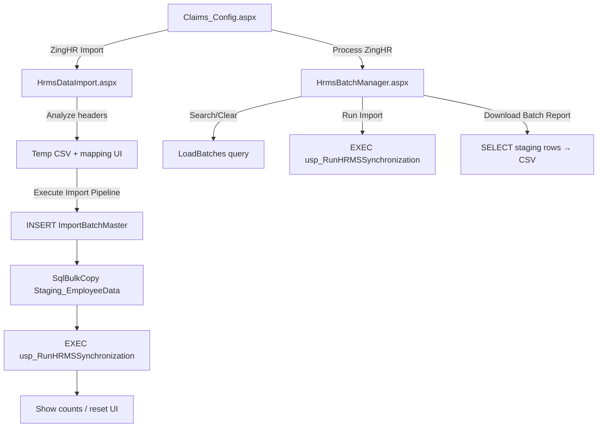

# 01 — Project Overview

**Module:** HRMS Import (ZingHR Employee Dump)  
**Application:** AnmolDristi ERP  
**Branch analyzed:** current working branch (documentation authored on `cursor/hrms-import-module-analysis-ebbf` from base analysis of the checked-out application sources)  
**Analysis mode:** Read-only. No application or SQL modifications.

---

## 1. Purpose of module

Provide a web UI to:

1. Upload a ZingHR employee-master CSV.
2. Map CSV columns to staging columns.
3. Persist rows into a staging table under an import batch.
4. Execute a SQL Server stored procedure that synchronizes staging data into the HRMS domain.
5. List prior batches, re-run synchronization with configurable options, and download a staging report.

**Source evidence**
- Page titles/markup: `HrmsDataImport.aspx` (Title `"Upload & Map HRMS Data"`), `HrmsBatchManager.aspx` (Title `"HRMS Master Data Import"`).
- Navigation labels: `Claims_Config.aspx` — “ZingHR Import”, “Process ZingHR”.
- Feature commit message (`1cd043e`): “upsert operation on the MST_UserMaster from Staging_EmployeeData” — historical intent; SP body is not in this repository.

---

## 2. Business objective

Allow administrators to import employee master dumps from ZingHR into AnmolDristi without manual per-row entry, using:

- Column mapping for varying CSV layouts (`HrmsDataImport.aspx.cs` → `ExpectedDbColumns`, `rptMapping_ItemDataBound`).
- Batch tracking (`ImportBatchMaster`).
- Configurable synchronization modes and modules (`HrmsBatchManager.aspx` → `rblProcessingMode`, `chkModules`, `rptOverwriteFields`).

Exact master-table write rules executed inside `usp_RunHRMSSynchronization` are **Not determinable from current repository** (procedure script absent).

---

## 3. Actors

| Actor | How identified in code | Capabilities in this module |
|---|---|---|
| Authenticated user | `Session["UserId"]` checked in both `Page_Load` methods | Upload CSV, map columns, run import; list/run batches; export report |
| Unauthenticated / empty session | Same checks redirect to `~/Login.aspx?msg=session_expired` | None |
| Permission-scoped role | `BasePage.RequirePermission` / `HasPermission` **not called** by either page | Not applied by this module |

`BasePage` (`BasePage.cs`) still runs `EnsureSessionValid()` on `OnInit` for login-token heartbeat when `Session["LoginToken"]` exists.

---

## 4. Technology & project dependencies

| Dependency | Source |
|---|---|
| ASP.NET Web Forms | `.aspx` + `CodeBehind`, `MasterPageFile="~/Dristi.Master"` |
| Target framework | `AnmolDristi.csproj` → `<TargetFrameworkVersion>v4.8</TargetFrameworkVersion>` (project file; differs from some external notes saying 4.5.2) |
| ADO.NET / SQL Client | `System.Data.SqlClient` usage in both code-behinds |
| Connection string | `Web.config` → `connectionStrings/DbConn`; read via `ConfigurationManager.ConnectionStrings["DbConn"]` |
| CSV parsing | `Microsoft.VisualBasic.FileIO.TextFieldParser` (`HrmsDataImport.aspx.cs`); project references `Microsoft.VisualBasic` (`AnmolDristi.csproj`) |
| UI stack | Bootstrap classes in markup; jQuery + Select2 CDN on DataImport; Font Awesome icons; Gentelella-style `x_panel` layout from master |
| AJAX | `ScriptManager` on `Dristi.Master`; `UpdatePanel` on `HrmsBatchManager.aspx` |
| Inheritance | Both pages inherit `AnmolDristi.BasePage` |

**User controls:** None registered or referenced on either page markup.

---

## 5. Entry points

| Entry | Location | Target |
|---|---|---|
| Claims config app button | `Claims_Config.aspx` → `href="HrmsDataImport.aspx"` | Upload/map/import page |
| Claims config app button | `Claims_Config.aspx` → `href="HrmsBatchManager.aspx"` | Batch manager page |
| Direct URL | IIS site path to either `.aspx` | Same pages (subject to session checks) |

---

## 6. Exit points

| Exit | Trigger | Destination / effect |
|---|---|---|
| Session redirect | Empty `Session["UserId"]` in either `Page_Load` | `~/Login.aspx?msg=session_expired` (`Response.Redirect(..., true)`) |
| BasePage soft logout | Inactive login token (`BasePage.RedirectToLogin`) | `~/login.aspx` |
| CSV download | `HrmsBatchManager.btnExportReport_Click` | Browser file download `HRMS_BatchReport_{batchId}.csv`; then `CompleteRequest()` |
| UI reset after import | `HrmsDataImport.btnProcess_Click` success → `btnCancel_Click` | Returns to upload panel on same page |
| Success/error messages | `ShowMessage` / `lblPageError` / `lblRunMessage` | Remain on page |

No redirect from DataImport to BatchManager exists in code.

---

## 7. Overall workflow

**Important coded behavior:** `HrmsDataImport.btnProcess_Click` both stages data **and** calls `ProcessBatch` (sync). Batch Manager can run sync again on the same `BatchId`.

---

## 8. Source file inventory

| File | Role |
|---|---|
| `AnmolDristi/HrmsDataImport.aspx` | Upload/mapping UI + Select2 JS |
| `AnmolDristi/HrmsDataImport.aspx.cs` | Upload, map, bulk insert, sync |
| `AnmolDristi/HrmsDataImport.aspx.designer.cs` | Control field declarations |
| `AnmolDristi/HrmsBatchManager.aspx` | Batch list + sync config UI + JS |
| `AnmolDristi/HrmsBatchManager.aspx.cs` | Filter, sync run, export |
| `AnmolDristi/HrmsBatchManager.aspx.designer.cs` | Control field declarations |
| `AnmolDristi/Dristi.Master` | Master page / ScriptManager |
| `AnmolDristi/BasePage.cs` | Shared session heartbeat / permissions helpers |
| `AnmolDristi/Claims_Config.aspx` | Navigation entry |
| `AnmolDristi/Web.config` | `DbConn` |

**SQL scripts for module objects:** Not present under `Database/` for `ImportBatchMaster`, `Staging_EmployeeData`, `MST_HRMSImportField`, or `usp_RunHRMSSynchronization`.

---

## 9. Related but out-of-scope pages

These share staging/import patterns but are **not** part of the HRMS pages under analysis:

- `ImportCsv.aspx` / `AdminBatches.aspx` — Sales daily activity staging (`SalesDailyActivity_Staging`, different SPs).

Documented only to prevent confusion with Inventory.md §9 naming.
