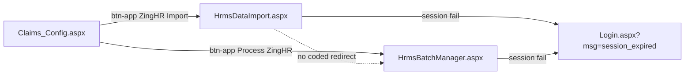
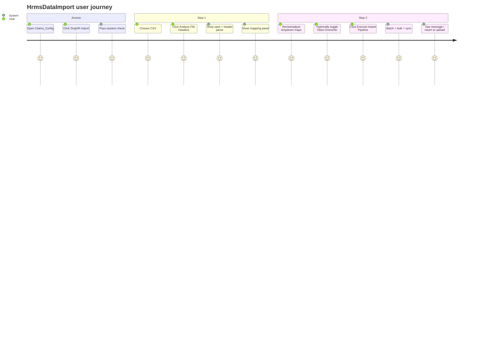
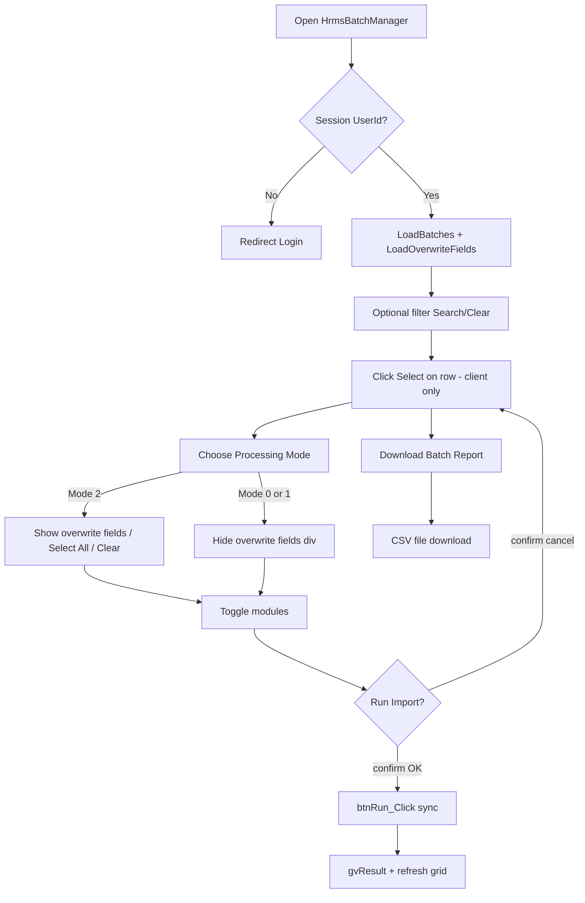
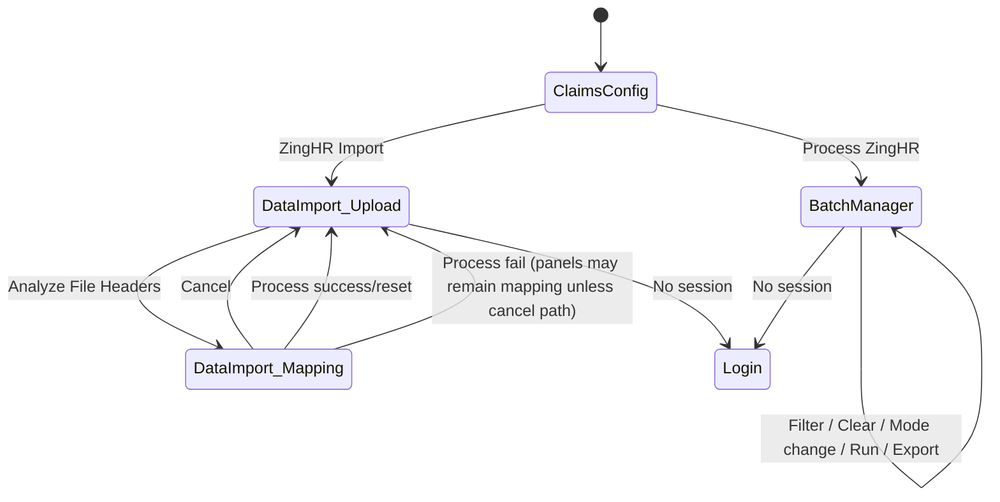

# 02 — UI Flow

**Sources:** `HrmsDataImport.aspx`, `HrmsBatchManager.aspx`, `Claims_Config.aspx`, designers, client scripts in page markup.

No modals exist on either HRMS page. No custom user controls.

---

## 1. Navigation flow

| Link | Markup location | Destination |
|---|---|---|
| ZingHR Import | `Claims_Config.aspx` ~L81–85 | `HrmsDataImport.aspx` |
| Process ZingHR | `Claims_Config.aspx` ~L87–91 | `HrmsBatchManager.aspx` |

Both HRMS pages use `MasterPageFile="~/Dristi.Master"` and content placeholders `head` + `ContentPlaceHolder1`.

---

## 2. Screen: HrmsDataImport.aspx

### 2.1 Layout regions

| Region | Markup | Visibility |
|---|---|---|
| Page title | `<h5>HRMS Data Import Pipeline</h5>` | Always |
| Panel title | `<h2>Step 1: Upload HRMS Data (CSV)</h2>` | Always (title not swapped on step 2) |
| Message | `lblMessage` | Always present; text set by code |
| Upload step | `pnlUpload` | Default visible |
| Mapping step | `pnlMapping` | Default `Visible="false"`; shown after analyze |

### 2.2 Controls inventory

| Control ID | Type | Purpose | Server events / client |
|---|---|---|---|
| `lblMessage` | Label | Success/error text | Set by `ShowMessage` |
| `pnlUpload` | Panel | Step 1 container | Visibility toggled |
| `fileUploadCsv` | FileUpload | CSV selection; `accept=".csv"` (client hint only) | Read in `btnReadHeaders_Click` |
| `btnReadHeaders` | Button | “Analyze File Headers” | `OnClick=btnReadHeaders_Click` |
| `pnlMapping` | Panel | Step 2 container | Visibility toggled |
| `rptMapping` | Repeater | One row per expected DB column | `OnItemDataBound=rptMapping_ItemDataBound` |
| `lblDbColumn` | Label (item) | Shows target DB column name | Bind `Eval("DbColumn")` |
| `hfDbColumn` | HiddenField (item) | Stores DB column name | Used when building map |
| `ddlExcelColumn` | DropDownList (item) | Source CSV header; CSS `searchable-dropdown` | Populated in ItemDataBound; Select2 enhanced |
| `chkAllowOverwrite` | CheckBox | “Allow Overwrite…”; `Checked="true"` | Read as `chkAllowOverwrite.Checked` in `btnProcess_Click` → `ProcessBatch` |
| `btnProcess` | Button | “Execute Import Pipeline” | `OnClick=btnProcess_Click`; `OnClientClick` sets label/disabled; `UseSubmitBehavior="false"` |
| `btnCancel` | Button | “Cancel & Upload New” | `OnClick=btnCancel_Click` |

**GridView:** none.  
**Modal:** none.  
**UpdatePanel:** none on this page.

### 2.3 JavaScript / AJAX

| Function / hook | Location | Behavior |
|---|---|---|
| Select2 CSS 3.5.3 | CDN link in `head` | Styles |
| Select2 JS 4.1.0-rc.0 | Script tag at top of content | May define `$.fn.select2` |
| Fallback Select2 3.5.3 | `$.getScript(...)` if `!$.fn.select2` | Loaded dynamically |
| `initSearchableDropdowns()` | Page script | `$('.searchable-dropdown').select2({width:'100%', placeholder:...})` |
| `$(document).ready` | Page script | Init or load then init |
| `PageRequestManager.endRequest` | Page script | Re-init Select2 after async postbacks (defensive; page has no UpdatePanel) |
| `btnProcess` OnClientClick | Markup | Sets button text to `Processing...` and adds CSS class `disabled` |

### 2.4 User journey — DataImport

---

## 3. Screen: HrmsBatchManager.aspx

### 3.1 Layout regions

| Region | Description |
|---|---|
| Page title | “HRMS Data Import Pipeline” |
| Panel A | “Manage Import Batches” — filters, grid, sync config, run/export |
| Panel B | “Last RUN Result” — `gvResult` |

### 3.2 Filter controls (outside UpdatePanel content, but trigger it)

| Control ID | Type | Options / notes |
|---|---|---|
| `txtFrom` | TextBox `type="date"` | From (IST) |
| `txtTo` | TextBox `type="date"` | To (IST) |
| `ddlStatus` | DropDownList | `""` All; `Processed`; `Pending`; `Uploaded` |
| `btnFilter` | Button “Search” | `btnFilter_Click`; AsyncPostBackTrigger for `upBatches` |
| `btnClear` | Button “Clear” | `btnClear_Click`; AsyncPostBackTrigger for `upBatches` |
| `lblPageError` | Label | Error text |

### 3.3 UpdatePanel `upBatches`

| Control ID | Type | Purpose |
|---|---|---|
| `gvBatches` | GridView | Batch list; `AutoGenerateColumns="False"` |
| `lnkSelect` | LinkButton (template) | Client-only select via `onRowSelect`; `return false` prevents postback |
| Bound columns | BoundField | `ImportBatchId`, `AnyFile`, `TotalRows`, `ProcessedCount`, `ErrorCount`, `WaitingCount`, `Status`, `LastModifiedIST` |
| `hfSelectedBatch` | HiddenField | Selected batch id (set by JS) |
| `lblSelectedBatch` | Label | Displays selected id or `(none selected)` |
| `rblProcessingMode` | RadioButtonList | Values `0`,`1`,`2` (default `2` Selected); `AutoPostBack=true` |
| `chkModules` | CheckBoxList | `MASTER`, `EMPLOYEE`, `HIERARCHY` (all Selected by default) |
| `divOverwriteFields` | HtmlGenericControl | Container for field checkboxes |
| `btnSelectAll` / `btnClearAll` | Buttons | Check/uncheck all overwrite fields |
| `rptOverwriteFields` | Repeater | Field checkboxes from `MST_HRMSImportField` |
| `chkField` | CheckBox (item) | Default from `IsDefault` |
| `hfFieldCode` | HiddenField (item) | `FieldCode` value |
| `btnRun` | Button | Run sync; client `confirmRun()` |
| `btnExportReport` | Button | Full postback download (`PostBackTrigger`) |
| `lblRunMessage` | Label | Success message |

**Commented-out (inactive) controls** in markup ~L109–126: `txtProcessedBy`, `chkAllowOverwrite` (BatchManager). Not in designer as active fields for those IDs in the live designer file for overwrite/processed-by (designer has the new sync controls instead).

### 3.4 UpdatePanel `upResult`

| Control ID | Type | Purpose |
|---|---|---|
| `gvResult` | GridView | `AutoGenerateColumns="true"`; `EmptyDataText="No result returned."` |
| Trigger | AsyncPostBackTrigger | `btnRun` Click |

### 3.5 UpdatePanel triggers summary

| Panel | Trigger | Type |
|---|---|---|
| `upBatches` | `btnFilter` Click | Async |
| `upBatches` | `btnClear` Click | Async |
| `upBatches` | `btnExportReport` | Full PostBack |
| `upResult` | `btnRun` Click | Async |

Controls inside `upBatches` (e.g. `rblProcessingMode` AutoPostBack, `btnSelectAll`, `btnClearAll`, `btnRun`) participate in the panel’s default async postback behavior when clicked.

### 3.6 JavaScript

| Function | Behavior |
|---|---|
| `onRowSelect(btnElement, batchId)` | Sets `hfSelectedBatch`, updates `lblSelectedBatch` text, toggles CSS class `selected-row` on grid rows |
| `confirmRun()` | Alerts if no selection; `confirm()` dialog; sets Run button text to `Running...` and adds `disabled` class; returns true/false |

### 3.7 User journey — BatchManager

---

## 4. Screen flow (combined)

**Note on process failure:** `btnProcess_Click` catch calls `ShowMessage` only; it does not call `btnCancel_Click`. Mapping panel can remain visible after a failed process (temp file may still be deleted in `finally`).

---

## 5. Visual / CSS notes (source-only)

| Page | Styles |
|---|---|
| DataImport | `.mapping-grid`, `.mapping-row`, `.mapping-label`, Select2 choice height overrides |
| BatchManager | `.selected-row` highlight for selected grid row |
