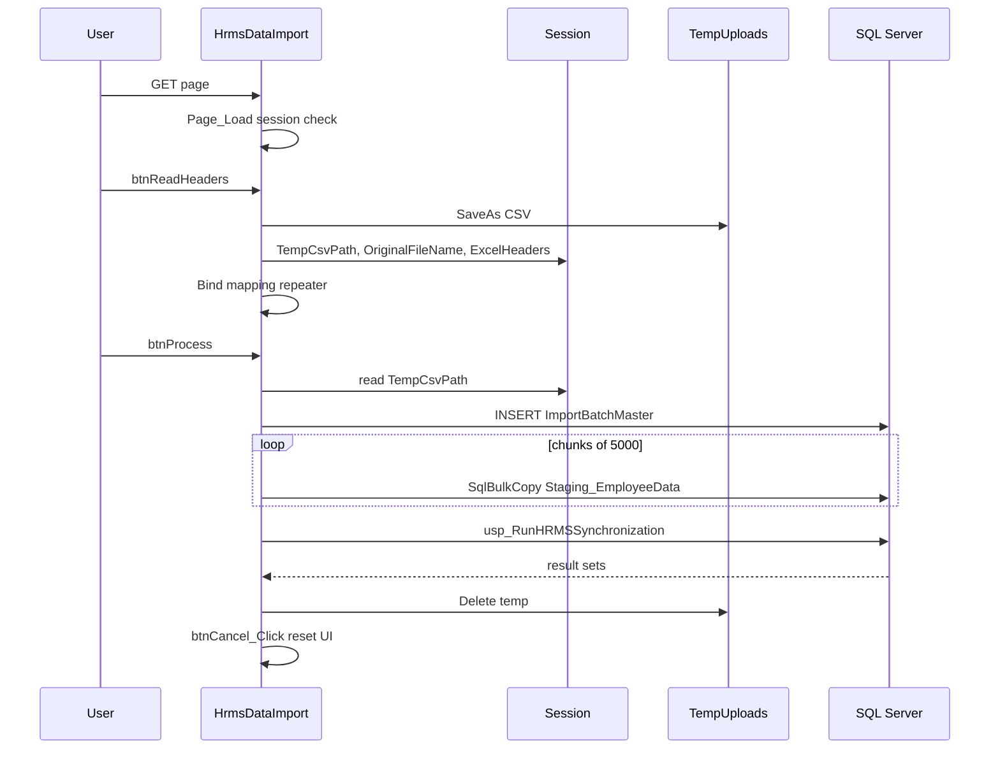
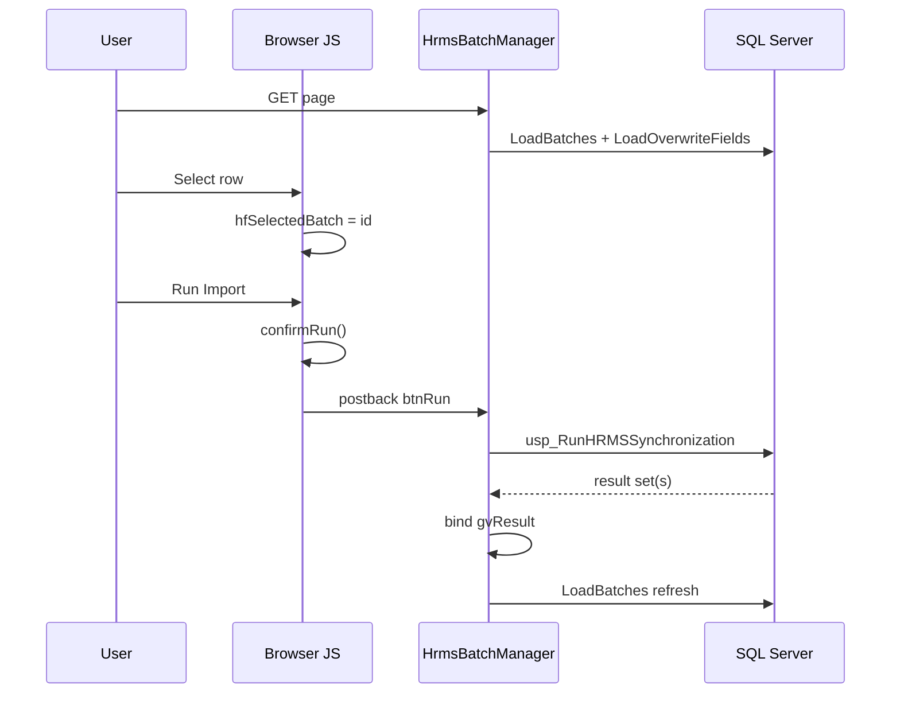

# 03 — Page Event Flow

Documents ASP.NET lifecycle events, button handlers, JavaScript, UpdatePanel interactions, and validation order as implemented.

---

## 1. Shared base lifecycle

Both pages inherit `AnmolDristi.BasePage`.

| Phase | Method | File | Behavior relevant to HRMS |
|---|---|---|---|
| Init | `BasePage.OnInit` | `BasePage.cs` | Calls `EnsureSessionValid()` (login-token heartbeat; may redirect to `~/login.aspx`) |
| Load | Page `Page_Load` | Each code-behind | Module-specific `Session["UserId"]` gate |

HRMS pages do **not** call `RequirePermission` or `ApplyUiPermissions`.

---

## 2. HrmsDataImport — event execution order

### 2.1 First GET (cold load)

```
BasePage.OnInit → EnsureSessionValid
Page_Load
  └─ if Session["UserId"] empty → Redirect Login (endResponse: true)
  └─ if !IsPostBack → empty block (no bind)
Render: pnlUpload visible, pnlMapping hidden
document.ready → initSearchableDropdowns (no .searchable-dropdown yet)
```

**Source:** `HrmsDataImport.aspx.cs` `Page_Load`; `HrmsDataImport.aspx` panels + script.

### 2.2 Analyze File Headers postback

```
Page_Load (session check; IsPostBack=true → skip empty block)
btnReadHeaders_Click
  ├─ Validation: fileUploadCsv.HasFile
  │    └─ fail → ShowMessage(...); return
  ├─ Ensure ~/TempUploads/
  ├─ SaveAs unique file
  ├─ Session[TempCsvPath], Session[OriginalFileName]
  ├─ TextFieldParser read header row → Session[ExcelHeaders]
  ├─ Build DataTable of ExpectedDbColumns
  ├─ rptMapping.DataBind
  │    └─ per item: rptMapping_ItemDataBound
  │         ├─ fill ddlExcelColumn
  │         └─ auto-select exact name match
  ├─ pnlUpload.Visible=false; pnlMapping.Visible=true
  └─ clear lblMessage
catch → ShowMessage error
```

**Validation flow (server):** only `HasFile` check. No extension/size validators. No ASP.NET validation controls.

**Client:** none on Analyze button.

### 2.3 Execute Import Pipeline postback

**Client first:** `OnClientClick` sets button text/`disabled` class; `UseSubmitBehavior="false"` still posts via ASP.NET mechanism for Button.

```
Page_Load (session check)
btnProcess_Click
  ├─ Validation: Session TempCsvPath exists on disk
  │    └─ fail → ShowMessage; btnCancel_Click; return
  ├─ Build dbToExcelMap from repeater (non-empty SelectedValue only)
  ├─ try
  │    ├─ INSERT ImportBatchMaster → batchId
  │    ├─ parse CSV rows → CreateStagingTable rows
  │    ├─ every 5000 rows → InsertBatch (transactional SqlBulkCopy)
  │    ├─ remainder → InsertBatch
  │    ├─ ProcessBatch(batchId, chkAllowOverwrite.Checked, connStr)
  │    │    └─ EXEC usp_RunHRMSSynchronization
  │    │    └─ ShowMessage success counts
  │    ├─ File.Delete(tempPath)
  │    └─ btnCancel_Click (reset panels/session keys)
  ├─ catch → ShowMessage critical error
  └─ finally → delete temp if still exists (GC.Collect path)
```

**No Grid events** on this page.

### 2.4 Cancel

```
btnCancel_Click
  ├─ pnlUpload.Visible=true
  ├─ pnlMapping.Visible=false
  ├─ Session[TempCsvPath]=null
  └─ Session[ExcelHeaders]=null
```

Does **not** delete the temp file. Does **not** clear `Session["OriginalFileName"]`.

### 2.5 JavaScript events (DataImport)

| Event | Handler | Effect |
|---|---|---|
| DOM ready | anonymous | Select2 init / CDN fallback load |
| AJAX endRequest | PageRequestManager | Re-init Select2 |
| btnProcess click (client) | inline OnClientClick | UI busy state only |

---

## 3. HrmsBatchManager — event execution order

### 3.1 First GET

```
BasePage.OnInit → EnsureSessionValid
Page_Load
  ├─ Session["UserId"] gate → possible Redirect
  └─ !IsPostBack
       ├─ LoadBatches()
       └─ LoadOverwriteFields()
Render: rblProcessingMode default Selected Value=2
        divOverwriteFields visible (no initial Visible=false in markup)
```

### 3.2 Search / Clear (async via `upBatches` triggers)

**Search**

```
Page_Load (postback; skip initial load block)
btnFilter_Click
  ├─ ClearSelection()
  └─ LoadBatches()
```

**Clear**

```
btnClear_Click
  ├─ clear txtFrom, txtTo
  ├─ ddlStatus.SelectedIndex=0
  ├─ ClearSelection()
  └─ LoadBatches()
```

`ClearSelection`:

```
hfSelectedBatch=""
lblSelectedBatch="(none selected)"
lblRunMessage=""
gvResult.DataSource=null; DataBind()
```

**Note:** `gvResult` lives in `upResult`. Clearing it from a `btnFilter`/`btnClear` handler that primarily updates `upBatches` may not refresh `upResult` UI on that async postback (no trigger linking Filter/Clear to `upResult`). Source: trigger declarations in `HrmsBatchManager.aspx`.

### 3.3 Processing mode change (AutoPostBack)

```
Page_Load
rblProcessingMode_SelectedIndexChanged
  └─ divOverwriteFields.Visible = (SelectedValue == "2")
```

### 3.4 Select All / Clear All overwrite fields

```
btnSelectAll_Click / btnClearAll_Click
  └─ foreach rptOverwriteFields items → chkField.Checked = true/false
```

### 3.5 Row select (client only — no server Grid event)

`lnkSelect` `OnClientClick` calls `onRowSelect(...); return false;`  
→ **No server GridView SelectedIndex / RowCommand handler exists.**

Order:

```
User click Select
→ onRowSelect sets hfSelectedBatch + label + CSS
→ postback aborted (return false)
```

### 3.6 Run Import

**Client:** `confirmRun()`  
1. If `hfSelectedBatch` empty → alert → return false (no postback)  
2. If user cancels confirm → return false  
3. Else busy UI → return true → postback

**Server:**

```
Page_Load
btnRun_Click
  ├─ clear labels
  ├─ Validation: hfSelectedBatch not whitespace
  │    └─ fail → lblPageError; return
  ├─ batchId = Convert.ToInt32(hfSelectedBatch)
  ├─ processingMode = TryParse(rblProcessingMode)
  ├─ allowOverwrite = processingMode != 0
  ├─ modules = GetSelectedModules()
  ├─ overwriteFields = GetSelectedOverwriteFields()
  ├─ executedBy = Session["UserId"] or ""
  ├─ try
  │    ├─ EXEC usp_RunHRMSSynchronization (params)
  │    ├─ SqlDataAdapter.Fill → gvResult bind
  │    ├─ lblRunMessage success text
  │    └─ LoadBatches()
  └─ catch → lblPageError = ex.Message
```

**UpdatePanel interaction:**  
- `btnRun` is inside `upBatches` → async update of that panel (includes refreshed grid via `LoadBatches`).  
- `upResult` has `AsyncPostBackTrigger` for `btnRun` → result grid updates.

### 3.7 Download Batch Report (full postback)

```
Page_Load
btnExportReport_Click
  ├─ Validation: hfSelectedBatch not empty
  │    └─ fail → lblPageError; return
  ├─ SELECT staging columns for BatchId
  ├─ build CSV string
  ├─ Response.Clear / headers / write / Flush
  └─ ApplicationInstance.CompleteRequest()
```

`PostBackTrigger` on `upBatches` ensures full postback for file download.

---

## 4. Validation flow summary

| Page | Layer | Rule | Location |
|---|---|---|---|
| DataImport | Server | File must be selected | `btnReadHeaders_Click` |
| DataImport | Server | Temp path must exist | `btnProcess_Click` |
| DataImport | Client | `accept=".csv"` hint only | markup |
| BatchManager | Client | Batch selected + confirm | `confirmRun` |
| BatchManager | Server | Batch selected for run | `btnRun_Click` |
| BatchManager | Server | Batch selected for export | `btnExportReport_Click` |
| Both | Server | Session UserId present | `Page_Load` |

No `RequiredFieldValidator`, `CustomValidator`, or `ValidationGroup` appears on either page.

---

## 5. Sequence — full import (DataImport)



---

## 6. Sequence — batch run (BatchManager)


