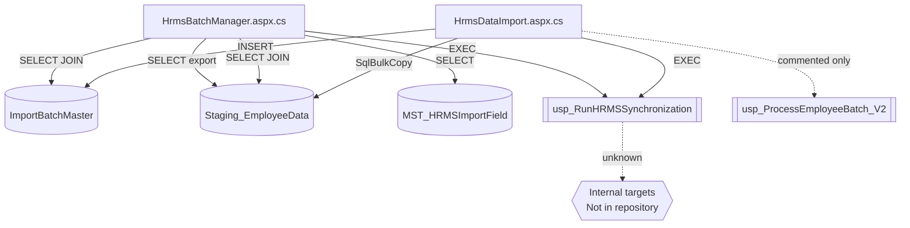

# 05 — SQL Dependency Map

**Rule applied:** Only objects referenced by the HRMS module C#/ASPX sources are listed.  
**Critical limitation:** Stored procedure and table **definitions are not in this repository**. Nested SP calls, triggers, views, and functions inside `usp_RunHRMSSynchronization` are **Not determinable from current repository.**

---

## 1. Objects referenced by application code

| Object | Type | Referenced from | How used |
|---|---|---|---|
| `dbo.ImportBatchMaster` | Table | `HrmsDataImport.btnProcess_Click`; `HrmsBatchManager.LoadBatches` | INSERT; SELECT |
| `dbo.Staging_EmployeeData` | Table | `InsertBatch`; `LoadBatches`; `btnExportReport_Click` | BULK INSERT; SELECT aggregates; SELECT export |
| `MST_HRMSImportField` | Table | `LoadOverwriteFields` | SELECT (`dbo.` schema not prefixed in SQL text) |
| `dbo.usp_RunHRMSSynchronization` | Stored procedure | `HrmsDataImport.ProcessBatch`; `HrmsBatchManager.btnRun_Click` | EXEC |
| `dbo.usp_ProcessEmployeeBatch_V2` | Stored procedure | Commented dead code only | Not executed |
| `dbo.usp_ProcessEmployeeBatch` | Stored procedure | Git history only (replaced) | Not in current source as live call |

| Object | Type | In module code? |
|---|---|---|
| Views | — | **None referenced** |
| Functions | — | **None referenced** |
| Triggers | — | **None referenced** (existence on tables Not determinable from current repository) |

Connection: `DbConn` from `Web.config`.

---

## 2. Dependency tree (as callable from pages)

```
HrmsDataImport.aspx.cs
├─ INSERT dbo.ImportBatchMaster
├─ SqlBulkCopy dbo.Staging_EmployeeData
└─ EXEC dbo.usp_RunHRMSSynchronization
       ├─ @BatchId
       ├─ @AllowOverwrite
       ├─ @ProcessingMode
       ├─ @Modules
       ├─ @OverwriteFields
       └─ @ExecutedBy
       │
       └─ Internal callees / tables written
            └─ Not determinable from current repository.
               (Historical commit message states MST_UserMaster upsert intent;
                that write path is not present as SQL source here.)

HrmsBatchManager.aspx.cs
├─ SELECT dbo.ImportBatchMaster
│   └─ LEFT JOIN dbo.Staging_EmployeeData
├─ SELECT MST_HRMSImportField
├─ EXEC usp_RunHRMSSynchronization   (same SP; schema prefix omitted in command text)
└─ SELECT dbo.Staging_EmployeeData   (export)
```

### Mermaid dependency graph



---

## 3. Example tree from the request (verified vs not)

Requested illustration:

```
HrmsBatchManager
↓
usp_RunHRMSSynchronization
↓
usp_ProcessEmployeeBatch
↓
MST_UserMaster
↓
ImportBatchMaster
↓
Staging_EmployeeData
```

| Edge | Status in current repository |
|---|---|
| `HrmsBatchManager` → `usp_RunHRMSSynchronization` | **Verified** (`btnRun_Click`) |
| `usp_RunHRMSSynchronization` → `usp_ProcessEmployeeBatch` | **Not determinable from current repository** (no SP source; live C# no longer calls `usp_ProcessEmployeeBatch`) |
| SP → `MST_UserMaster` | **Not determinable from current repository** as a coded dependency of these pages; `MST_UserMaster.sql` exists as a table extract but is not referenced by HRMS page C# |
| `HrmsBatchManager` → `ImportBatchMaster` / `Staging_EmployeeData` | **Verified** (direct SQL in `LoadBatches` / export) |

Corrected tree limited to verified edges:

```
HrmsBatchManager
├─ LoadBatches → ImportBatchMaster ⟕ Staging_EmployeeData
├─ LoadOverwriteFields → MST_HRMSImportField
├─ btnRun_Click → usp_RunHRMSSynchronization → ???
└─ btnExportReport_Click → Staging_EmployeeData

HrmsDataImport
├─ btnProcess_Click → ImportBatchMaster (INSERT)
├─ InsertBatch → Staging_EmployeeData (BULK INSERT)
└─ ProcessBatch → usp_RunHRMSSynchronization → ???
```

---

## 4. Stored procedure parameter contract (from C# only)

| Parameter | DataImport `ProcessBatch` | BatchManager `btnRun_Click` |
|---|---|---|
| `@BatchId` | local `batchId` | `Convert.ToInt32(hfSelectedBatch.Value)` |
| `@AllowOverwrite` | `chkAllowOverwrite.Checked` | `processingMode != 0` |
| `@ProcessingMode` | literal `0` | `rblProcessingMode` parsed int |
| `@Modules` | literal `"Employees"` | `GetSelectedModules()` pipe string |
| `@OverwriteFields` | `DBNull.Value` | `GetSelectedOverwriteFields()` |
| `@ExecutedBy` | `Session["UserId"]` or `"SYSTEM"` | `Session["UserId"]` or `""` |

Command timeout both: `300` seconds.

Command text difference: DataImport uses `"dbo.usp_RunHRMSSynchronization"`; BatchManager uses `"usp_RunHRMSSynchronization"` (no schema prefix).

---

## 5. Result-set contract (from C# only)

### DataImport reader expectations (`ProcessBatch`)

- Comment states first result set is debug `#EmployeeSource`.
- Code skips via `reader.NextResult()` until a result set `HasRows`, then reads one row.
- Optional columns: `TotalRecords`, `InsertedCount`, `UpdatedCount`, `SkippedCount`, `ErrorCount`.

### BatchManager fill behavior (`btnRun_Click`)

- `SqlDataAdapter.Fill(DataTable)` — binds whatever the provider returns into a single `DataTable` (ADO.NET fills the first result set into a single `DataTable`).
- No column-name inspection.

Exact SP result-set definitions: **Not determinable from current repository.**

---

## 6. Column-level dependencies observed in SQL strings / bulk map

### ImportBatchMaster (columns named in C#)

`BatchId`, `FileName`, `UploadedBy`, `UploadDate`, `Status`

### Staging_EmployeeData (columns named in C#)

`StagingId`, `BatchId`, `ImportStatus`, `ErrorMessage`, plus all `ExpectedDbColumns` names used as bulk mappings, and export columns `EmpCode`, `EmpName`, `Email`, `MobileNo`.

### MST_HRMSImportField (columns named in C#/ASPX binds)

`IsVisible`, `Category`, `DisplayOrder`, `IsDefault`, `DisplayName`, `FieldCode` (+ `SELECT *` may return more).

---

## 7. Objects investigated but not referenced by these pages

From repo inventory / other modules (explicitly **not** called by HRMS pages):

- `Process_StagingToFinal_FromJson` / `_Idempotent`
- `usp_SyncHierarchyForBatch`
- `usp_SyncHierarchyAndSalesActivity`
- `SalesDailyActivity_Staging`

These belong to the Sales CSV import path (`ImportCsv.aspx` / `AdminBatches.aspx`).

---

## 8. Missing scripts checklist

| Required for full SP review | Present in `Database/`? |
|---|---|
| `usp_RunHRMSSynchronization.sql` | No |
| `ImportBatchMaster.sql` | No |
| `Staging_EmployeeData.sql` | No |
| `MST_HRMSImportField.sql` | No |
| `usp_ProcessEmployeeBatch*.sql` | No |

`Database/Tables/MST_UserMaster.sql` exists but is **not directly referenced** by the two HRMS page code-behinds.
