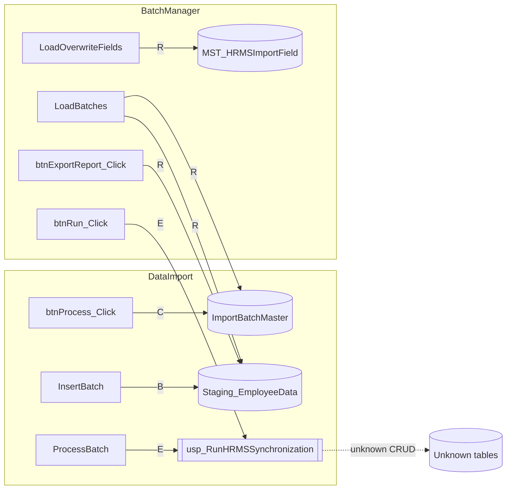

# 06 — Table CRUD Matrix

CRUD operations **performed by C# in this module**, plus SP operations where the SP body is unavailable.

Legend:
- **C** Create/Insert  
- **R** Read/Select  
- **U** Update  
- **D** Delete  
- **B** SqlBulkCopy insert  
- **E** EXEC (SP may perform unknown CRUD)

---

## 1. Matrix — application code (verified)

| Table | C | R | U | D | B | Page | Method | Mechanism |
|---|---|---|---|---|---|---|---|---|
| `dbo.ImportBatchMaster` | ✓ | | | | | HrmsDataImport | `btnProcess_Click` | `INSERT ... OUTPUT INSERTED.BatchId` |
| `dbo.ImportBatchMaster` | | ✓ | | | | HrmsBatchManager | `LoadBatches` | SELECT with filters/group |
| `dbo.Staging_EmployeeData` | | | | | ✓ | HrmsDataImport | `InsertBatch` | `SqlBulkCopy` |
| `dbo.Staging_EmployeeData` | | ✓ | | | | HrmsBatchManager | `LoadBatches` | JOIN aggregates on `ImportStatus` |
| `dbo.Staging_EmployeeData` | | ✓ | | | | HrmsBatchManager | `btnExportReport_Click` | SELECT by `BatchId` |
| `MST_HRMSImportField` | | ✓ | | | | HrmsBatchManager | `LoadOverwriteFields` | `SELECT * WHERE IsVisible=1` |

**No C# method in these pages issues UPDATE or DELETE against these tables.**

---

## 2. Matrix — via stored procedure (not fully knowable)

| Table / object | Operation by SP | Evidence |
|---|---|---|
| Any table touched by `usp_RunHRMSSynchronization` | Unknown combination of C/R/U/D | Page calls EXEC only; SP script absent → **Not determinable from current repository** |
| `Staging_EmployeeData.ImportStatus` / `ErrorMessage` | Possibly updated by SP | C# **reads** these values after runs in `LoadBatches` / export; **no C# UPDATE** exists. Writer of status changes is Not determinable from current repository. |
| `ImportBatchMaster.Status` | Possibly updated by SP or default constraint | C# INSERT does not set `Status`; UI filters/displays `b.Status`. Who sets it: Not determinable from current repository. |
| `MST_UserMaster` | Possibly upserted | Not referenced in HRMS C#; historical commit message only. CRUD by module: Not determinable from current repository. |

---

## 3. Per-table detail

### 3.1 `dbo.ImportBatchMaster`

| Op | Page | Method | SQL / API | Columns touched in statement |
|---|---|---|---|---|
| C | HrmsDataImport | `btnProcess_Click` | INSERT | `FileName`, `UploadedBy` (output `BatchId`) |
| R | HrmsBatchManager | `LoadBatches` | SELECT | `BatchId`, `FileName`, `UploadDate`, `Status` |
| U | — | — | — | None in C# |
| D | — | — | — | None in C# |

Also passed as `@BatchId` into SP from both pages (SP may read/update row — unknown).

### 3.2 `dbo.Staging_EmployeeData`

| Op | Page | Method | SQL / API | Columns |
|---|---|---|---|---|
| B (Create) | HrmsDataImport | `InsertBatch` | SqlBulkCopy | `BatchId` + all `ExpectedDbColumns` mapped by name |
| R | HrmsBatchManager | `LoadBatches` | aggregate JOIN | `StagingId`, `BatchId`, `ImportStatus` |
| R | HrmsBatchManager | `btnExportReport_Click` | SELECT | `EmpCode`, `EmpName`, `Email`, `MobileNo`, `ImportStatus`, `ErrorMessage` |
| U/D | — | — | — | None in C# |

Default values for unmapped bulk columns / identity `StagingId`: Not determinable from current repository (no table script).

### 3.3 `MST_HRMSImportField`

| Op | Page | Method | Notes |
|---|---|---|---|
| R | HrmsBatchManager | `LoadOverwriteFields` | Filter `IsVisible=1` |
| C/U/D | — | — | None in this module |

Used only as UI metadata for overwrite checkboxes (`FieldCode`, `DisplayName`, `IsDefault`, etc.).

### 3.4 Other masters (`MST_UserMaster`, `MST_Branch`, …)

| Op by HRMS pages’ C# | Result |
|---|---|
| Direct CRUD | **None** |
| Indirect via SP | **Not determinable from current repository** |

`MST_UserMaster` schema is available in `Database/Tables/MST_UserMaster.sql` but is not queried/updated by the two page code-behinds.

---

## 4. CRUD by actor path

---

## 5. Session / filesystem “stores” (non-SQL)

Not tables, but state stores used by the module:

| Store | Create/Write | Read | Clear/Delete |
|---|---|---|---|
| `Session["TempCsvPath"]` | `btnReadHeaders_Click` | `btnProcess_Click` | `btnCancel_Click` (null) |
| `Session["OriginalFileName"]` | `btnReadHeaders_Click` | `btnProcess_Click` | **Never cleared in code** |
| `Session["ExcelHeaders"]` | `btnReadHeaders_Click` | `rptMapping_ItemDataBound` | `btnCancel_Click` |
| `~/TempUploads/*` file | `SaveAs` | StreamReader/parser | `File.Delete` in process success/finally; **not** on Cancel |
