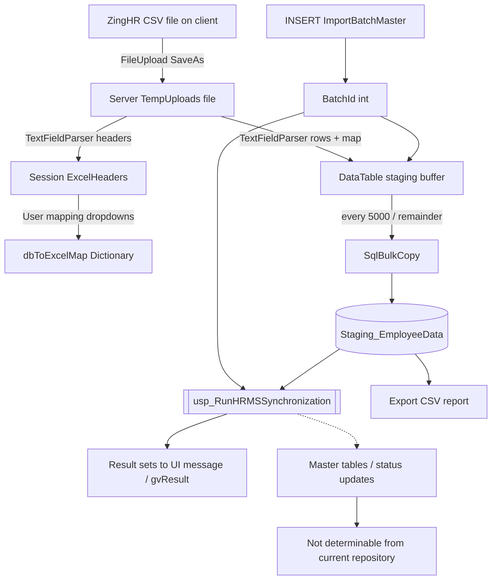
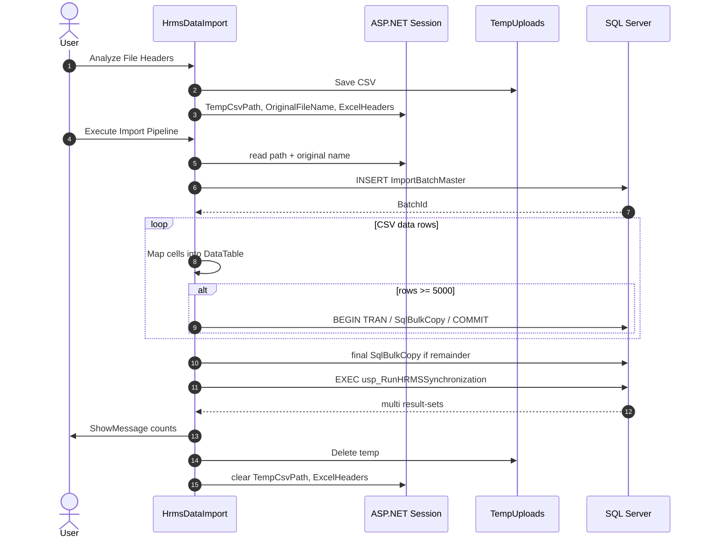
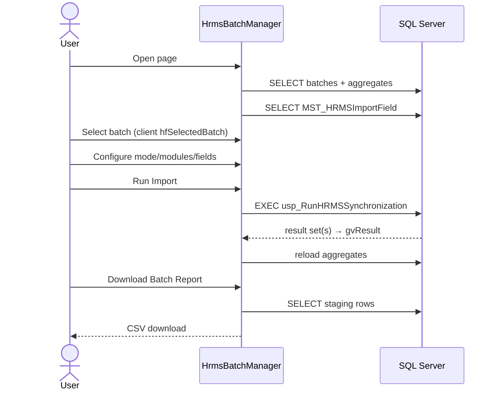
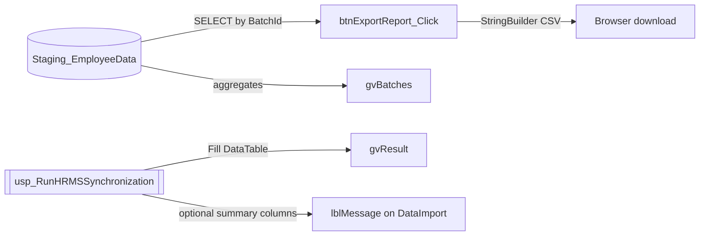

# 08 — Data Flow

---

## 1. End-to-end data path (coded)

### Stages present in code

| Stage | Implemented where | Notes |
|---|---|---|
| Upload | `btnReadHeaders_Click` | Temp file + session |
| Validation | Minimal (`HasFile`, temp exists, batch selected) | No schema/business validation layer |
| Bulk Copy | `InsertBatch` | Transaction per chunk |
| Staging | `Staging_EmployeeData` | |
| Synchronization | `ProcessBatch` / `btnRun_Click` | SP |
| Master Tables | Inside SP | Not determinable from current repository |
| Reporting | `btnExportReport_Click` + on-screen grids/messages | |

---

## 2. Sequence — upload to staging to sync

---

## 3. Sequence — batch manager re-sync + report

---

## 4. Special analysis — tracked variables

### 4.1 `ProcessingMode`

| Aspect | Detail | Source |
|---|---|---|
| Origin (BatchManager) | `rblProcessingMode` ListItems values `"0"|"1"|"2"`; default selected `"2"` | `HrmsBatchManager.aspx` |
| Modified | User radio change; AutoPostBack toggles overwrite panel visibility | `rblProcessingMode_SelectedIndexChanged` |
| Consumed | Parsed to `int processingMode`; sent as `@ProcessingMode` | `btnRun_Click` |
| Origin (DataImport) | None in UI | — |
| Consumed (DataImport) | Hard-coded literal `0` as `@ProcessingMode` | `ProcessBatch` |
| Duplicate logic | Two different sources of truth for the same SP parameter | DataImport vs BatchManager |

Also stored as property on unused `SyncExecutionContext.ProcessingMode` (never set).

---

### 4.2 `Modules`

| Aspect | Detail | Source |
|---|---|---|
| Origin | `chkModules` values `MASTER`, `EMPLOYEE`, `HIERARCHY` (default all selected) | `HrmsBatchManager.aspx` |
| Modified | User checkbox toggles | UI |
| Consumed | `GetSelectedModules()` → trim + `ToUpper` + `\|` join → `@Modules` | `btnRun_Click` |
| DataImport | Literal `"Employees"` → `@Modules` | `ProcessBatch` |
| Duplicate / divergence | Token `"Employees"` vs `"EMPLOYEE"`; DataImport cannot select MASTER/HIERARCHY | Both ProcessBatch / GetSelectedModules |

Unused DTO: `SyncExecutionContext.Modules`.

---

### 4.3 `OverwriteFields`

| Aspect | Detail | Source |
|---|---|---|
| Origin | `MST_HRMSImportField.FieldCode` via `hfFieldCode` | `LoadOverwriteFields` + repeater |
| Modified | User checks; Select All / Clear All | `btnSelectAll_Click`, `btnClearAll_Click` |
| Consumed | `GetSelectedOverwriteFields()` → `\|` join → `@OverwriteFields` | `btnRun_Click` |
| DataImport | Always `DBNull.Value` | `ProcessBatch` |
| Visibility gate | Collected even if mode ≠ 2 (method does not check mode); panel hidden only affects UX | `GetSelectedOverwriteFields` vs `rblProcessingMode_SelectedIndexChanged` |

---

### 4.4 `AllowOverwrite`

| Aspect | Detail | Source |
|---|---|---|
| Origin (DataImport) | `chkAllowOverwrite` (default true) | ASPX + `ProcessBatch(batchId, chkAllowOverwrite.Checked, ...)` |
| Consumed (DataImport) | `@AllowOverwrite` | `ProcessBatch` |
| Interaction (DataImport) | Sent alongside hard-coded `ProcessingMode=0` | same |
| Origin (BatchManager) | **Not** from checkbox (checkbox commented out) | ASPX comment block |
| Derived (BatchManager) | `allowOverwrite = processingMode != 0` | `btnRun_Click` |
| Consumed (BatchManager) | `@AllowOverwrite` | `btnRun_Click` |
| Duplicate logic | Checkbox boolean vs mode-derived boolean | Two pages |

DTO property `SyncExecutionContext.AllowOverwrite` unused.

---

### 4.5 `BatchId`

| Aspect | Detail | Source |
|---|---|---|
| Created | `OUTPUT INSERTED.BatchId` from `ImportBatchMaster` insert | `btnProcess_Click` |
| Propagated | Set on every staging `DataRow["BatchId"]` | `btnProcess_Click` |
| Passed to SP | `@BatchId` | `ProcessBatch` |
| Selected (BatchManager) | Client `onRowSelect` → `hfSelectedBatch` | JS + hidden field |
| Consumed | `Convert.ToInt32(hfSelectedBatch.Value)` for run/export | `btnRun_Click`, `btnExportReport_Click` |
| Displayed | Grid column `ImportBatchId` (alias of `b.BatchId`) | `LoadBatches` |
| Cleared | `ClearSelection` empties hidden field | filter/clear |

---

### 4.6 `ExecutedBy`

| Aspect | Detail | Source |
|---|---|---|
| Origin | `Session["UserId"]` | Both SP call sites |
| Fallback DataImport | `"SYSTEM"` | `ProcessBatch` |
| Fallback BatchManager | `""` | `btnRun_Click` |
| Consumed | `@ExecutedBy` SP parameter | both |
| Related | `UploadedBy` on batch insert uses `"UnknownSystemUser"` fallback | `btnProcess_Click` |

Duplicate pattern with inconsistent fallbacks.

---

### 4.7 `ImportStatus`

| Aspect | Detail | Source |
|---|---|---|
| Written by C# | **Never** | No UPDATE/INSERT of ImportStatus in C# (bulk may omit column → DB default unknown) |
| Read | Aggregate CASE expressions | `LoadBatches` |
| Read | Export column | `btnExportReport_Click` |
| Literals in C# | `'Processed'`, `'Error'`, `'Pending'` | `LoadBatches` |
| Modified where | Not determinable from current repository (likely SP) | — |

---

### 4.8 Batch `Status` (`ImportBatchMaster.Status`)

| Aspect | Detail | Source |
|---|---|---|
| Written by C# | **Never** | INSERT omits Status |
| Read | Selected as `b.Status`; filter `@Status` | `LoadBatches` |
| UI filter values | Processed, Pending, Uploaded | `ddlStatus` |
| Modified where | Not determinable from current repository | — |

---

## 5. Data transformation notes (coded)

| Transform | Detail | Source |
|---|---|---|
| Header → index map | Case-insensitive dictionary; first occurrence wins if duplicates | `btnProcess_Click` |
| DB col → Excel col | User dictionary; only non-empty selections | same |
| All staging attributes | Forced `string` type in DataTable | `CreateStagingTable` |
| To-date filter | Inclusive through 23:59:59 of selected day | `LoadBatches` |
| Modules normalize | Uppercase | `GetSelectedModules` |
| CSV error field | Quotes doubled for CSV | `btnExportReport_Click` |

---

## 6. Reporting data flow

