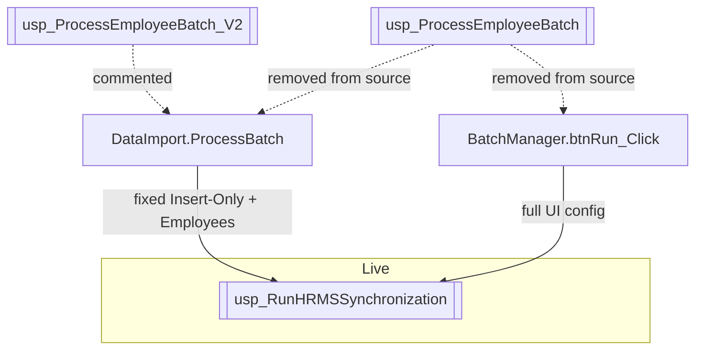

# 09 — Stored Procedure Review

**NO CODE CHANGES.** Analysis of SP usage from application call sites only.

SP scripts for this module are **not in the repository**. Therefore internal responsibilities, transactions, error handling, and nested calls are largely **Not determinable from current repository.**

---

## 1. Procedures in scope

| Procedure | Live call? | Call sites |
|---|---|---|
| `dbo.usp_RunHRMSSynchronization` | Yes | `HrmsDataImport.ProcessBatch`; `HrmsBatchManager.btnRun_Click` |
| `dbo.usp_ProcessEmployeeBatch_V2` | No (commented) | Commented block in `HrmsDataImport.aspx.cs` |
| `dbo.usp_ProcessEmployeeBatch` | No (removed from current source) | Present only in git history prior to commit `9a9f491` |

---

## 2. `usp_RunHRMSSynchronization`

### 2.1 Responsibilities (as implied by callers — not by SP source)

From C# parameter names and UI labels only:

| Concern | Evidence in app |
|---|---|
| Process a batch by id | `@BatchId` |
| Legacy overwrite flag | `@AllowOverwrite` + comment “Legacy parameter (wrapper still accepts it)” in `ProcessBatch` |
| Processing mode | `@ProcessingMode` + radio texts Insert/Update All/Update Selected |
| Module selection | `@Modules` pipe-delimited |
| Field-level overwrite list | `@OverwriteFields` pipe-delimited FieldCodes |
| Executor identity | `@ExecutedBy` |

Actual SQL responsibilities: **Not determinable from current repository.**

### 2.2 Parameters — usage comparison

| Parameter | DataImport | BatchManager | Unused / inconsistent? |
|---|---|---|---|
| `@BatchId` | Yes | Yes | — |
| `@AllowOverwrite` | Checkbox | Derived `mode != 0` | Different derivation |
| `@ProcessingMode` | Always `0` | UI `0/1/2` | DataImport ignores UI capability |
| `@Modules` | `"Employees"` | `MASTER\|EMPLOYEE\|HIERARCHY` | Token mismatch risk |
| `@OverwriteFields` | `DBNull` | Pipe string (may be empty) | DataImport never sends fields |
| `@ExecutedBy` | UserId or `"SYSTEM"` | UserId or `""` | Empty vs SYSTEM |

Whether SP treats empty string, null, and `"SYSTEM"` differently: Not determinable from current repository.

### 2.3 Result sets

| Caller | Handling |
|---|---|
| DataImport | Assumes ≥2 result sets; skips via `NextResult`; looks for summary columns `TotalRecords`, `InsertedCount`, `UpdatedCount`, `SkippedCount`, `ErrorCount`; comment mentions debug `#EmployeeSource` |
| BatchManager | `SqlDataAdapter.Fill(DataTable)` — no multi-RS navigation |

Overlap: both call same SP but consume outputs differently.  
Exact RS shapes: Not determinable from current repository.

### 2.4 Return values / return codes

Neither caller inspects `ReturnValue` parameter or `@@ROWCOUNT`. Success is “no exception” (+ optional column read on DataImport).

### 2.5 Error handling

| Layer | Behavior |
|---|---|
| SP TRY/CATCH / RAISERROR | Not determinable from current repository |
| DataImport | Exception bubbles to `btnProcess_Click` catch → user message |
| BatchManager | Exception → `lblPageError.Text = ex.Message` |

### 2.6 Transaction handling

| Layer | Behavior |
|---|---|
| SP transactions | Not determinable from current repository |
| App around SP | No ambient `SqlTransaction` wrapping the SP call on either page |
| Bulk insert | Own per-chunk transaction in `InsertBatch` (separate from SP) |

### 2.7 Timeouts

Both call sites: `CommandTimeout = 300`.

### 2.8 Command text inconsistency

- DataImport: `"dbo.usp_RunHRMSSynchronization"`
- BatchManager: `"usp_RunHRMSSynchronization"`

---

## 3. Legacy `usp_ProcessEmployeeBatch_V2` (commented)

| Aspect | From commented code |
|---|---|
| Parameters | `@BatchId`, `@AllowOverwrite` only |
| Expected RS columns | `ProcessedCount`, `ErrorCount`, `SkippedCount` |
| Overlap with current | Narrower contract than `usp_RunHRMSSynchronization` |
| Status | Dead; not executed |

---

## 4. Legacy `usp_ProcessEmployeeBatch` (history)

From git history before `9a9f491`:

- Called by both pages with `@BatchId`, `@AllowOverwrite`.
- Replaced by `usp_RunHRMSSynchronization`.
- Script still **Not determinable from current repository** (not extracted).

---

## 5. Overlap / duplicated logic (call-site view)

| Finding | Detail |
|---|---|
| Overlap | Two pages invoke the same live SP with different parameter policies |
| Duplicated logic | Parameter packing repeated in two methods |
| Missing logic (app) | No shared helper; no validation that modules/mode/fields are coherent |
| Missing logic (SQL visibility) | Cannot compare SP internals for duplicated SQL upsert logic — script absent |
| Unused parameters (effective) | On DataImport path, `@AllowOverwrite` may be unused if SP prioritizes `@ProcessingMode=0` — **Not determinable from current repository**; app still sends it |
| Unused type | `SyncExecutionContext` mirrors SP params but is unused |

---

## 6. Comparison table — procedure generations

| Feature | V1 (history) | V2 (commented) | Current sync SP |
|---|---|---|---|
| Name | `usp_ProcessEmployeeBatch` | `usp_ProcessEmployeeBatch_V2` | `usp_RunHRMSSynchronization` |
| `@ProcessingMode` | No | No | Yes |
| `@Modules` | No | No | Yes |
| `@OverwriteFields` | No | No | Yes |
| `@ExecutedBy` | No | No | Yes |
| `@AllowOverwrite` | Yes | Yes | Yes (legacy comment) |
| Summary columns expected by app | Processed/Error/Skipped | Same | Total/Inserted/Updated/Skipped/Error |
| Script in repo | No | No | No |

---

## 7. What a full SP review would still need

To complete architect-level SP review, extract from SQL Server:

1. `usp_RunHRMSSynchronization` definition (+ nested procedures).  
2. Table defs/defaults/triggers for `ImportBatchMaster`, `Staging_EmployeeData`, `MST_HRMSImportField`.  
3. Permissions / synonym / synonym schema for unqualified name used by BatchManager.

Until then, items such as overlap inside SQL, missing SQL validations, and transaction boundaries remain: **Not determinable from current repository.**
