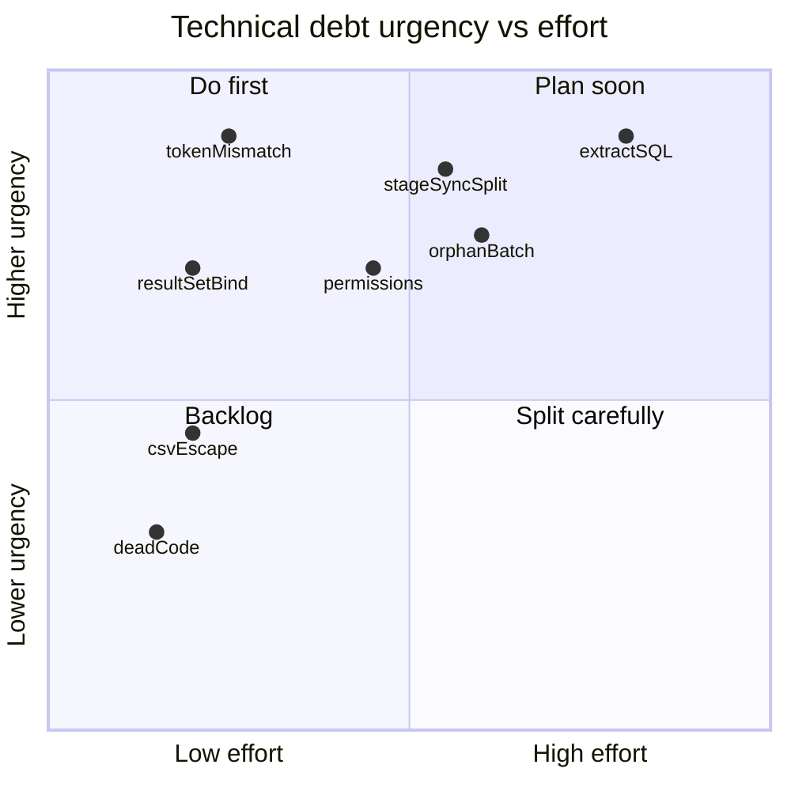

# 12 — Technical Debt

Inventory of smells and issues visible in the current HRMS Import sources.  
No fixes applied.

---

## 1. Magic strings

| String / literal | Location | Concern |
|---|---|---|
| `"UserId"` session key | Both `Page_Load`, SP ExecutedBy, UploadedBy | Differs in casing from widespread `"USERID"` usage elsewhere (ASP.NET session is case-insensitive, but inconsistent for readers) |
| `"Employees"` | `ProcessBatch` `@Modules` | Diverges from UI token `EMPLOYEE` |
| `"MASTER"`, `"EMPLOYEE"`, `"HIERARCHY"` | `HrmsBatchManager.aspx` | Duplicated conceptually with SP contract (unknown) |
| `"Processed"`, `"Error"`, `"Pending"` | `LoadBatches` | Status domain not centralized |
| `"Processed"`, `"Pending"`, `"Uploaded"` | `ddlStatus` | Batch status domain not centralized |
| `"SYSTEM"`, `"UnknownSystemUser"`, `""` | ExecutedBy / UploadedBy fallbacks | Three different anonymous identities |
| `"DbConn"` | Both `GetConnectionString` | Acceptable config key; duplicated helper |
| `"dbo.Staging_EmployeeData"` / `"dbo.ImportBatchMaster"` | Multiple methods | Repeated SQL object names |
| Temp folder `"~/TempUploads/"` | `btnReadHeaders_Click` | Hard-coded path |
| Select2 CDN URLs / versions | `HrmsDataImport.aspx` | Hard-coded external versions |
| Success text `"Synchronization completed successfully."` | `btnRun_Click` | Ignores actual counts |
| CSV header `"EmpCode,EmpName,Email,Mobile,Status,ErrorMessage"` | `btnExportReport_Click` | Hard-coded |

---

## 2. Duplicate logic

| Duplication | Locations |
|---|---|
| Connection string helper | Both code-behinds `GetConnectionString` |
| Session redirect gate | Both `Page_Load` |
| SP parameter assembly | `ProcessBatch` vs `btnRun_Click` |
| TextFieldParser setup | Analyze + Process |
| Select-all / clear-all loops | Two methods |
| UI shell vs Sales AdminBatches | Filters, select JS, UpdatePanels, export pattern |

---

## 3. Large methods

| Method | Approx. role size | Smell |
|---|---|---|
| `btnProcess_Click` | Orchestrates validate→insert batch→parse→bulk→sync→cleanup | God method |
| `ProcessBatch` | SP exec + multi-RS parse + UI message | Mixed concerns |
| `LoadBatches` | Dynamic SQL + bind | Could be query object |
| `btnRun_Click` | Validate + config + SP + bind + reload | Mixed concerns |
| `btnExportReport_Click` | Query + CSV + HTTP response | Mixed concerns |

---

## 4. Repeated SQL

| Pattern | Occurrences |
|---|---|
| `Staging_EmployeeData` by `BatchId` | Aggregates in `LoadBatches`; export SELECT |
| SP name | Two call sites (one with `dbo.`, one without) |
| `SELECT * FROM MST_HRMSImportField WHERE IsVisible=1` | Single site but unbound column contract (`*`) |

No shared SQL constants/resources.

---

## 5. Repeated validations

| Validation | Where repeated / incomplete |
|---|---|
| Batch selected | Client `confirmRun` + server `btnRun_Click` + server export (good layering, but messages differ) |
| Session user | Every `Page_Load` (duplicated text) |
| File present | Only on analyze; process checks temp path instead |
| Missing | EmpCode mapped; module selected; CSV extension; max size; batch not already processing |

---

## 6. Code smells

| Smell | Evidence |
|---|---|
| Dead code | `SyncExecutionContext`; commented V2 `ProcessBatch`; commented ASPX controls; `using System.Linq`; empty `!IsPostBack` |
| Misleading UI | Allow Overwrite on DataImport while mode forced to Insert Only |
| Comment debt | “Temporary values until V2 is completed” while calling a different SP generation |
| `SELECT *` | `LoadOverwriteFields` |
| `AddWithValue` | All SQL parameters |
| Swallowing errors | Temp delete catch → `Debug.WriteLine` only |
| `GC.Collect` in request | finally block |
| Client “disabled” class without preventing double post | Busy buttons rely on CSS class `disabled`, not always `disabled` attribute |
| `UseSubmitBehavior="false"` on Process | Unusual pattern; easy to misuse |
| Cross-UpdatePanel state | Clearing `gvResult` from `upBatches` postbacks |
| PII in repo | `TempUploads` CSVs |

---

## 7. Potential bugs (code-visible)

| Bug | Source reference |
|---|---|
| ProcessingMode always 0 on upload sync | `ProcessBatch` |
| Modules token mismatch | `"Employees"` vs `"EMPLOYEE"` |
| First RS bound on BatchManager vs skipped on DataImport | `Fill` vs `NextResult` loop |
| Orphan batch on mid-failure | `btnProcess_Click` order of operations |
| Cancel leaves temp file | `btnCancel_Click` |
| CSV injection/breakage for unescaped fields | `btnExportReport_Click` |
| OverwriteFields sent when mode hidden | `btnRun_Click` always calls `GetSelectedOverwriteFields` |
| `Convert.ToInt32(hfSelectedBatch.Value)` without TryParse | `btnRun_Click`, `btnExportReport_Click` (client normally sets int, but value is user-controllable hidden field) |
| NullReference if `OriginalFileName` session missing during process | `Session["OriginalFileName"].ToString()` |

---

## 8. Maintainability issues

| Issue | Impact |
|---|---|
| SP and table scripts missing from repo | Cannot review or regression-test sync rules |
| Two pages own divergent sync policies | Behavior depends on which entry point was used |
| No shared domain constants for statuses/modes/modules | Drift between UI, SQL filters, and SP |
| Designer + commented markup leftovers | Confusing control surface |
| Reliance on comments for RS meaning (`#EmployeeSource`) | Fragile contract |
| Framework note | Project targets .NET Framework **4.8** (`AnmolDristi.csproj`) while some external docs say 4.5.2 |
| No automated tests for this module | Regressions only found in production runs |

---

## 9. Debt heatmap (summary)

---

## 10. Cross-reference

| Debt theme | See also |
|---|---|
| Variable divergence | `08_Data_Flow.md` §4 |
| Risks | `10_Risk_Assessment.md` |
| Backlog items | `11_Refactoring_Backlog.md` |
| SQL gaps | `05_SQL_Dependency_Map.md`, `09_StoredProcedure_Review.md` |
