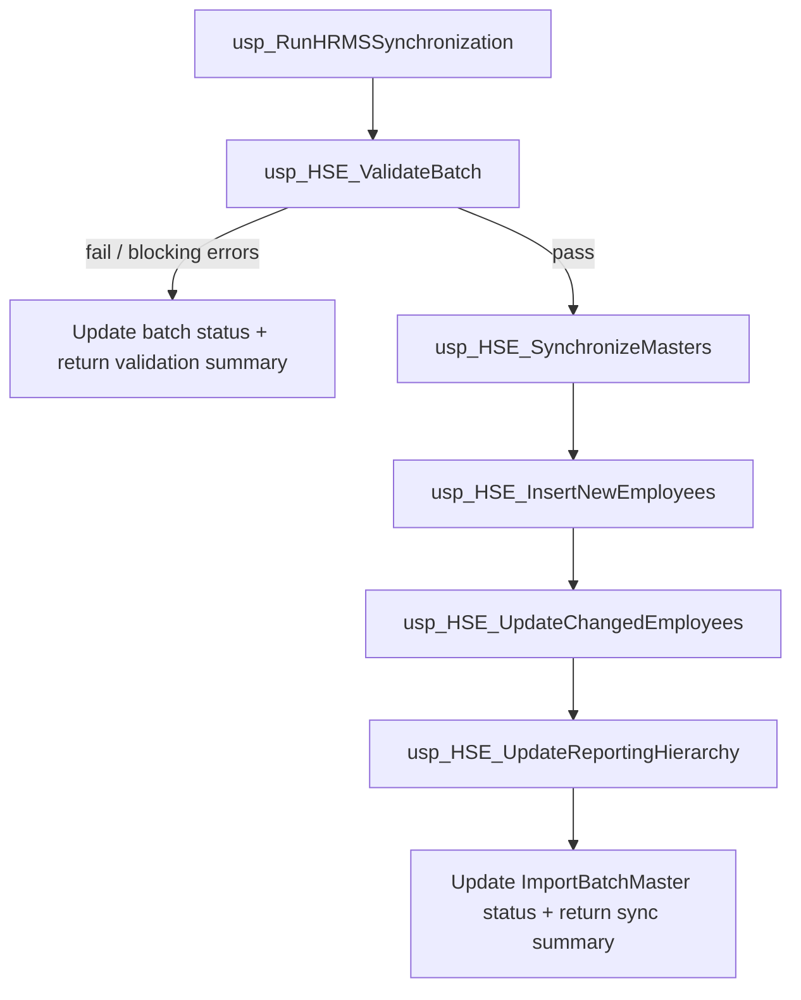

# Phase 3 — HRMS Synchronization Engine Architecture Plan (Revised)

**Status:** Approved with architectural refinements — **plan only**.  
**SQL generation:** Not started. Awaiting go-ahead per sub-phase (3.1 → 3.6).  
**UI:** No changes. Do not modify `HrmsDataImport` or `HrmsBatchManager`.

---

## 1. Objectives

Refactor the validated HRMS synchronization logic into modular stored procedures.

| Do | Do not |
|---|---|
| Split validated SSMS logic into HSE procedures | Redesign synchronization rules |
| Replace PoC table with staging by `BatchId` | Change UI or page code-behind |
| Add pre-sync validation procedure | Invent new business predicates |
| Make orchestrator coordination-only | Put business logic in the orchestrator |
| Implement **one procedure per sub-phase** | Generate all procedures at once |

---

## 2. Source-of-truth rules

1. **Validated SSMS logic** is the source of truth for sync behavior.  
2. **Only structural change to data source:**

```text
KKM_SO_TADA_Export_14Nov25$
        ↓ replace with
dbo.Staging_EmployeeData
WHERE BatchId = @BatchId
```

3. All predicates, mappings, joins, validations, and business rules from the validated script remain unchanged.  
4. PoC table must not appear in any deployed procedure.

---

## 3. Designation mapping (exact — do not redesign)

```text
Staging_EmployeeData.Designation_ID     (HRMS / business code)
        ↓  match on
MST_Designation.Designation_ID          (varchar code)
        ↓  take PK
MST_Designation.Id                      (int)
        ↓  store on
MST_UserMaster.Designation_ID           (int)
```

Applies wherever the validated logic inserts or updates employee designation.

---

## 4. Final stored procedure architecture

```text
usp_RunHRMSSynchronization          ← Orchestrator (coordination only)
        │
        ├─ 1. usp_HSE_ValidateBatch
        ├─ 2. usp_HSE_SynchronizeMasters
        ├─ 3. usp_HSE_InsertNewEmployees
        ├─ 4. usp_HSE_UpdateChangedEmployees
        └─ 5. usp_HSE_UpdateReportingHierarchy
```

Execution is **strictly sequential**. Validation must complete successfully before any synchronization step runs.



**Note:** Module / ProcessingMode gating that already exists in the validated logic is applied by the orchestrator as **coordination** (which child to call), not as reimplemented business rules inside the orchestrator body. Child procedures retain the actual insert/update/hierarchy logic.

---

## 5. Procedure responsibilities

### 5.1 `usp_HSE_ValidateBatch` (Phase 3.1)

Runs **before any synchronization**.

| Responsibility |
|---|
| Validate `@BatchId` exists in `ImportBatchMaster` |
| Validate staging rows exist for `@BatchId` |
| Validate mandatory fields (per validated rules; at minimum EmpCode and any other fields required by the SSMS script) |
| Detect duplicate Employee Codes within the batch |
| Detect invalid master references (per validated rules) |
| Validate `@ProcessingMode` and `@Modules` values |
| Populate `Staging_EmployeeData.ImportStatus` and `ErrorMessage` where applicable |
| Return a **validation summary** result set |

Independently compilable and testable with a staged batch (no master writes required beyond staging status updates).

---

### 5.2 `usp_HSE_SynchronizeMasters` (Phase 3.2)

| Responsibility |
|---|
| Upsert org / lookup masters from distinct staging values for `@BatchId` |
| Preserve validated master sync logic (source table swap only) |
| May include designation master maintenance if present in validated SQL |
| Return optional master sync counts for orchestrator rollup |

---

### 5.3 `usp_HSE_InsertNewEmployees` (Phase 3.3)

| Responsibility |
|---|
| Insert employees present in staging but absent from `MST_UserMaster` |
| Preserve Designation mapping chain |
| Preserve validated INSERT field list and predicates |
| Update staging row status per validated rules |
| Return insert / error counts |

---

### 5.4 `usp_HSE_UpdateChangedEmployees` (Phase 3.4)

| Responsibility |
|---|
| Update **only changed** existing employees (validated change-detection) |
| Honor validated `@ProcessingMode` / `@OverwriteFields` / `@AllowOverwrite` behavior |
| Preserve Designation mapping when designation is in scope |
| Return updated / skipped / error counts |

---

### 5.5 `usp_HSE_UpdateReportingHierarchy` (Phase 3.5)

| Responsibility |
|---|
| Apply reporting hierarchy fields from staging for `@BatchId` |
| Preserve validated hierarchy update logic |
| Return hierarchy update counts |

---

### 5.6 `usp_RunHRMSSynchronization` (Phase 3.6) — Orchestrator

**May:**

- Accept existing UI parameters (`@BatchId`, `@AllowOverwrite`, `@ProcessingMode`, `@Modules`, `@OverwriteFields`, `@ExecutedBy`)
- Call child procedures in the fixed order above
- Gate child calls by `@Modules` / `@ProcessingMode` **exactly as the validated orchestrating flow intends** (coordination)
- Short-circuit after validation failure (no sync children)
- Update `ImportBatchMaster.Status`
- Aggregate and return the **final synchronization summary** (and validation summary when sync does not proceed)

**Must not:**

- Contain insert/update/master/hierarchy business logic
- Contain change-detection or field-mapping SQL belonging in children
- Reference the PoC table

---

## 6. UI / application contract (unchanged)

`HrmsBatchManager` continues to call:

```text
usp_RunHRMSSynchronization
  @BatchId, @AllowOverwrite, @ProcessingMode,
  @Modules, @OverwriteFields, @ExecutedBy
```

No changes to:

- `HrmsDataImport.aspx` / `.cs`
- `HrmsBatchManager.aspx` / `.cs`
- ProcessingMode / Modules / OverwriteFields UI semantics

Summary result-set column names should remain compatible with existing consumers (`TotalRecords`, `InsertedCount`, `UpdatedCount`, `SkippedCount`, `ErrorCount`, plus validation fields as needed). Final RS order will match whatever keeps BatchManager behavior stable once the live/validated output shape is confirmed.

---

## 7. Implementation strategy — one procedure per sub-phase

| Sub-phase | Deliverable | Exit criteria before next phase |
|---|---|---|
| **3.1** | `usp_HSE_ValidateBatch` | Compiles; runnable against a test `BatchId`; returns validation summary; sets staging status/errors as designed |
| **3.2** | `usp_HSE_SynchronizeMasters` | Compiles; masters sync from staging by `BatchId` only; no PoC table |
| **3.3** | `usp_HSE_InsertNewEmployees` | Compiles; inserts new employees; Designation chain preserved |
| **3.4** | `usp_HSE_UpdateChangedEmployees` | Compiles; updates only changed rows per validated rules |
| **3.5** | `usp_HSE_UpdateReportingHierarchy` | Compiles; hierarchy updates from staging by `BatchId` |
| **3.6** | `usp_RunHRMSSynchronization` | Orchestrates 3.1→3.5; no embedded business logic; updates batch status; returns final summary |

**Rule:** Do not start sub-phase *N+1* SQL until sub-phase *N* is reviewed/approved as independently testable.

Suggested repo paths (when SQL generation begins):

```text
Database/Stored Procedures/HRMS/
  usp_HSE_ValidateBatch.sql
  usp_HSE_SynchronizeMasters.sql
  usp_HSE_InsertNewEmployees.sql
  usp_HSE_UpdateChangedEmployees.sql
  usp_HSE_UpdateReportingHierarchy.sql
  usp_RunHRMSSynchronization.sql
```

---

## 8. Prerequisite still required before any SQL generation

Validated SSMS / live procedure text is **not in this repository**. Before Phase **3.1** SQL is written, provide:

1. Validated PoC script(s), and/or  
2. Current `usp_RunHRMSSynchronization` definition (and nested helpers)

Without that source, Phase 3 cannot preserve “all validated business rules” faithfully.

---

## 9. Explicit non-goals

- Redesigning sync algorithms or overwrite semantics  
- Using `KKM_SO_TADA_Export_14Nov25$` in application or procedures  
- UI / Web Forms changes  
- Generating all six procedures in one pass  
- Putting business logic in the orchestrator  

---

## 10. Approval gate for next action

This revised plan incorporates:

1. New `usp_HSE_ValidateBatch` before sync  
2. Final architecture (Validate → Masters → Insert → Update → Hierarchy → Orchestrator)  
3. Source table swap only  
4. Exact Designation mapping  
5. One-procedure-per-sub-phase delivery  

**Next step when ready:** Approve start of **Phase 3.1 only** and supply validated SQL source → then generate `usp_HSE_ValidateBatch` alone.
