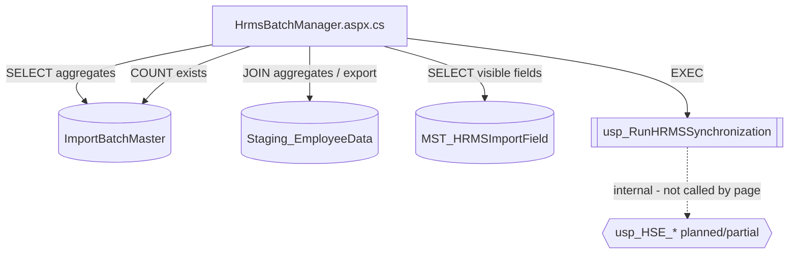

# 15 — HrmsBatchManager Architecture

**Scope:** `HrmsBatchManager.aspx` + `HrmsBatchManager.aspx.cs` (+ designer declarations)  
**Analysis mode:** Read-only. No ASPX / code-behind / SP / SQL / CSS / JS modifications in this task.  
**Upstream context:** `HrmsDataImport` Phase 1 is complete (stage-only upload → redirect with `?BatchId=`).

---

## 1. Purpose

`HrmsBatchManager` is the **synchronization cockpit** for staged HRMS batches:

1. List / filter import batches from `ImportBatchMaster` ⟕ `Staging_EmployeeData`
2. Select a batch (manual or via query-string handoff)
3. Configure ProcessingMode / Modules / OverwriteFields
4. Execute `usp_RunHRMSSynchronization`
5. Show last-run result grid
6. Download a staging CSV report

It does **not** upload CSV files (that is `HrmsDataImport`).

---

## 2. Control hierarchy

```text
Dristi.Master
└─ ContentPlaceHolder1
   └─ right_col / container
      ├─ Page title: "HRMS Data Import Pipeline"
      ├─ Panel: Manage Import Batches
      │  ├─ lblPageError
      │  ├─ Filters (outside UpdatePanel content, trigger it)
      │  │  ├─ txtFrom, txtTo (type=date)
      │  │  ├─ ddlStatus (All | Processed | Pending | Uploaded)
      │  │  └─ btnFilter, btnClear
      │  └─ upBatches (UpdatePanel)
      │     ├─ gvBatches (+ lnkSelect per row)
      │     ├─ hfSelectedBatch
      │     ├─ lblSelectedBatch
      │     ├─ syncConfigurationSection (#syncConfigurationSection)
      │     │  ├─ rblProcessingMode (0|1|2, default 2, AutoPostBack)
      │     │  ├─ chkModules (MASTER|EMPLOYEE|HIERARCHY)
      │     │  └─ divOverwriteFields
      │     │     ├─ btnSelectAll, btnClearAll
      │     │     └─ rptOverwriteFields (chkField + hfFieldCode)
      │     ├─ btnRun, btnExportReport
      │     └─ lblRunMessage
      └─ Panel: Last RUN Result
         └─ upResult (UpdatePanel)
            └─ gvResult (AutoGenerateColumns=true)
```

**Client scripts (page markup):**

| Function | Role |
|---|---|
| `onRowSelect(btn, batchId)` | Sets hidden/label; toggles CSS `selected-row`; `return false` prevents postback |
| `confirmRun()` | Requires selection; confirm dialog; sets Run button busy text |
| Startup scroll script | Registered from code-behind when query-string batch selected |

**Commented-out UI (inactive):** `txtProcessedBy`, `chkAllowOverwrite` inside ASPX comment block.

---

## 3. Complete page lifecycle

### 3.1 Inheritance / Init

| Phase | Handler | Behavior |
|---|---|---|
| Init | `BasePage.OnInit` → `EnsureSessionValid` | Login-token heartbeat when `Session["LoginToken"]` present |
| Load | `HrmsBatchManager.Page_Load` | Module session gate + initial bind |

HRMS page does **not** call `RequirePermission`.

### 3.2 First GET (`!IsPostBack`)

```text
Page_Load
  ├─ if Session["UserId"] empty → Redirect Login.aspx?msg=session_expired (endResponse:true)
  └─ !IsPostBack
       ├─ TrySelectBatchFromQueryString()     // may set hf/lbl
       ├─ LoadBatches()                       // RowDataBound highlights if hf set
       ├─ LoadOverwriteFields()
       └─ if query batch selected
            └─ RegisterScrollToSyncConfiguration()
```

### 3.3 Postbacks

| Trigger | Panel behavior | Server path |
|---|---|---|
| `btnFilter` | Async → `upBatches` | `ClearSelection` → `LoadBatches` |
| `btnClear` | Async → `upBatches` | Reset filters → `ClearSelection` → `LoadBatches` |
| `rblProcessingMode` | Async (inside `upBatches`) | Toggle `divOverwriteFields.Visible` (mode == `"2"`) |
| `btnSelectAll` / `btnClearAll` | Async | Check/uncheck overwrite field boxes |
| `btnRun` | Async (`upBatches` + `upResult` trigger) | `btnRun_Click` → SP → bind result → `LoadBatches` |
| `btnExportReport` | **Full postback** (`PostBackTrigger`) | Stream CSV |
| `lnkSelect` | **No postback** (`return false`) | Client-only selection |

---

## 4. Event sequence — “Run Import”

```mermaid
sequenceDiagram
    actor User
    participant JS as confirmRun()
    participant P as HrmsBatchManager
    participant DB as SQL Server

    User->>JS: Click Run Import
    JS->>JS: Require hfSelectedBatch; confirm()
    JS->>P: Postback btnRun_Click
    P->>P: Parse ProcessingMode, Modules, OverwriteFields
    P->>P: allowOverwrite = (mode != 0)
    P->>DB: EXEC usp_RunHRMSSynchronization
    DB-->>P: Result set(s)
    P->>P: SqlDataAdapter.Fill → gvResult
    P->>P: lblRunMessage = success text
    P->>DB: LoadBatches (refresh aggregates)
    P-->>User: Updated grid + Last RUN Result
```

**Client gate (`confirmRun`):**

1. Empty selection → `alert` → abort  
2. User cancels confirm → abort  
3. Else set button text `Running...`, add CSS class `disabled`, allow postback  

**Server gate (`btnRun_Click`):**

1. Clear `lblPageError` / `lblRunMessage`  
2. If `hfSelectedBatch` whitespace → error label, return  
3. `batchId = Convert.ToInt32(hfSelectedBatch.Value)` (no TryParse)  
4. Build SP parameters (see §8)  
5. Execute SP (timeout 300s)  
6. Bind first filled `DataTable` to `gvResult`  
7. Always set success message if no exception  
8. `LoadBatches()` refresh  
9. On exception → `lblPageError = ex.Message`

---

## 5. Batch selection flow

### 5.1 QueryString handoff (Phase 2)

| Step | Method | Behavior |
|---|---|---|
| Read | `TrySelectBatchFromQueryString` | `Request.QueryString["BatchId"]` |
| Parse | same | `int.TryParse`; reject `<= 0` |
| Validate | `BatchExists` | `COUNT(1) FROM ImportBatchMaster WHERE BatchId=@BatchId` |
| Select | same | `hfSelectedBatch.Value` + `lblSelectedBatch.Text` |
| Highlight | `gvBatches_RowDataBound` | Adds CSS class `selected-row` when row id matches hf |
| Scroll | `RegisterScrollToSyncConfiguration` | `scrollIntoView` on `#syncConfigurationSection` |

Missing / invalid / non-existent `BatchId` → **no change** to default empty selection.

### 5.2 Manual select

`lnkSelect` → `onRowSelect` sets hf/label + CSS; no server round-trip.

### 5.3 Clear selection

`ClearSelection` (used by Filter/Clear):

- Empties `hfSelectedBatch`
- Label → `(none selected)`
- Clears `lblRunMessage`
- Empties `gvResult`

---

## 6. State management

| State | Store | Lifetime / notes |
|---|---|---|
| Selected batch | `hfSelectedBatch` (ViewState-backed hidden field) | Survives postbacks until cleared |
| Selected batch display | `lblSelectedBatch` | Server + client updates |
| Filters | `txtFrom`, `txtTo`, `ddlStatus` | ViewState |
| ProcessingMode | `rblProcessingMode` | Default `"2"`; ViewState |
| Modules | `chkModules` | Defaults all selected |
| Overwrite field checks | Repeater checkboxes | Defaults from `MST_HRMSImportField.IsDefault` |
| Overwrite panel visibility | `divOverwriteFields.Visible` | Driven by mode == `"2"` on AutoPostBack; initial markup visible (matches default mode 2) |
| Last run grid | `gvResult` | Rebound on Run; cleared on ClearSelection |
| Session auth | `Session["UserId"]` | Gate + `@ExecutedBy` |
| QueryString BatchId | Request only on GET | Not re-applied on postback |

**Unused DTO:** nested class `SyncExecutionContext` (never instantiated).

---

## 7. ProcessingMode handling

| UI Value | Label | Default |
|---|---|---|
| `0` | Insert New Employees Only | No |
| `1` | Update All Existing Employees | No |
| `2` | Update Selected Fields Only | **Yes** |

**Code path (`btnRun_Click`):**

```text
processingMode = int.TryParse(rblProcessingMode.SelectedValue)  // fail → 0
allowOverwrite = (processingMode != 0)
@ProcessingMode = processingMode
@AllowOverwrite = allowOverwrite
```

**UI side effect:** `rblProcessingMode_SelectedIndexChanged` shows overwrite field list only when value is `"2"`.

There is **no** server-side validation that mode ∈ {0,1,2} beyond TryParse defaulting to 0.

---

## 8. Module handling

| UI Value | Label | Default selected |
|---|---|---|
| `MASTER` | Synchronize Masters | Yes |
| `EMPLOYEE` | Synchronize Employees | Yes |
| `HIERARCHY` | Synchronize Reporting Hierarchy | Yes |

**Code path (`GetSelectedModules`):**

```text
selected items → Trim → ToUpper → join with "|"
→ @Modules  e.g. "MASTER|EMPLOYEE|HIERARCHY"
```

Empty selection yields `@Modules = ""` (no C# guard). Module semantics inside SQL are **not visible in this page**; they are delegated to `usp_RunHRMSSynchronization`.

---

## 9. OverwriteFields handling

| Step | Location |
|---|---|
| Load catalog | `LoadOverwriteFields` → `SELECT * FROM MST_HRMSImportField WHERE IsVisible=1 ORDER BY Category,DisplayOrder` |
| Bind UI | `rptOverwriteFields` — `DisplayName`, `FieldCode`, `IsDefault` |
| Select All / Clear | `btnSelectAll_Click` / `btnClearAll_Click` |
| Collect | `GetSelectedOverwriteFields` → checked `FieldCode` values joined by `"\|"` |
| Send | `@OverwriteFields` on Run |

**Notes:**

- Collection runs even if mode ≠ 2 (panel may be hidden; ViewState still holds checks).  
- Empty selection → `@OverwriteFields = ""` (not `DBNull`).  
- Legacy Allow Overwrite checkbox is commented out; overwrite intent is derived from ProcessingMode.

---

## 10. Synchronization pipeline (as implemented in this page)

```text
[Selected BatchId]
      + ProcessingMode / Modules / OverwriteFields / ExecutedBy
      ↓
usp_RunHRMSSynchronization   ◄── ONLY SP invoked for sync
      ↓
SqlDataAdapter.Fill(DataTable)   ◄── first result set only
      ↓
gvResult + success toast
      ↓
LoadBatches() refresh aggregates
```

**Important:** This page does **not** call `usp_HSE_ValidateBatch` or any `usp_HSE_*` child procedures directly. Those exist (or are planned) only as internals of / successors to the orchestrator. From the Web Forms perspective, sync is a single black-box EXEC.

---

## 11. Stored procedure dependency map



| Object | Operation from this page |
|---|---|
| `dbo.ImportBatchMaster` | SELECT (list); COUNT (BatchExists) |
| `dbo.Staging_EmployeeData` | SELECT aggregates; SELECT export columns |
| `MST_HRMSImportField` | SELECT `*` filtered by `IsVisible=1` |
| `usp_RunHRMSSynchronization` | EXEC with 6 parameters |

No direct C# calls to `usp_HSE_ValidateBatch` / Masters / Insert / Update / Hierarchy.

---

## 12. UI → SQL parameter mapping

| UI / state source | C# variable | SP parameter | Transform |
|---|---|---|---|
| `hfSelectedBatch` | `batchId` | `@BatchId` | `Convert.ToInt32` |
| Derived from mode | `allowOverwrite` | `@AllowOverwrite` | `processingMode != 0` |
| `rblProcessingMode` | `processingMode` | `@ProcessingMode` | `int.TryParse` (default 0) |
| `chkModules` | `modules` | `@Modules` | Trim + Upper + `\|` join |
| `rptOverwriteFields` checked | `overwriteFields` | `@OverwriteFields` | Trim `FieldCode` + `\|` join |
| `Session["UserId"]` | `executedBy` | `@ExecutedBy` | String or `""` |

**Command:** `"usp_RunHRMSSynchronization"` (no `dbo.` prefix)  
**Timeout:** 300 seconds  
**Result binding:** `SqlDataAdapter.Fill(DataTable)` → first result set → `gvResult`

---

## 13. Validation flow (page-level)

| Layer | What is validated | Where |
|---|---|---|
| Client | Batch selected before Run | `confirmRun` |
| Server | Batch selected before Run | `btnRun_Click` |
| Server | Batch selected before Export | `btnExportReport_Click` |
| Server | Session present | `Page_Load` |
| Server | QueryString BatchId exists in DB | `BatchExists` (selection only) |
| **Not present** | Call to `usp_HSE_ValidateBatch` before sync | — |
| **Not present** | Modules non-empty | — |
| **Not present** | Mode 2 requires ≥1 overwrite field | — |
| **Not present** | Re-run / InProgress guard | — |
| **Not present** | ASP.NET validators | — |

Staging row validation (`ImportStatus` / `ErrorMessage`) is only **displayed** via grid aggregates and export; this page does not run a pre-sync validation procedure.

---

## 14. Report generation flow

```text
btnExportReport_Click
  ├─ Require hfSelectedBatch
  ├─ SELECT EmpCode, EmpName, Email, MobileNo, ImportStatus, ErrorMessage
  │    FROM Staging_EmployeeData WHERE BatchId=@BatchId
  ├─ Build CSV (header: EmpCode,EmpName,Email,Mobile,Status,ErrorMessage)
  ├─ Quote-escape ErrorMessage only
  └─ Response attachment HRMS_BatchReport_{batchId}.csv
       + CompleteRequest()
```

Uses `PostBackTrigger` so file download is a full postback (not async UpdatePanel).

---

## 15. Filter / list query (supporting sync ops)

`LoadBatches` builds dynamic SQL:

- Base: `ImportBatchMaster` LEFT JOIN `Staging_EmployeeData`
- Aggregates: TotalRows; Processed / Error / Waiting from `ImportStatus` literals `Processed` | `Error` | `Pending`
- Optional filters: `UploadDate` from/to; `b.Status`
- Order: `UploadDate DESC`
- Side effect: clears `lblPageError` and `lblRunMessage`

---

## 16. UpdatePanel trigger map

| Panel | Trigger | Type |
|---|---|---|
| `upBatches` | `btnFilter` Click | Async |
| `upBatches` | `btnClear` Click | Async |
| `upBatches` | `btnExportReport` | Full PostBack |
| `upResult` | `btnRun` Click | Async |

`btnRun` lives inside `upBatches`, so Run also refreshes that panel (including rebinding `gvBatches` after `LoadBatches`).

---

## 17. Current technical debt

| ID | Debt | Evidence |
|---|---|---|
| TD-01 | No pre-sync validation call (`usp_HSE_ValidateBatch` unused by UI) | `btnRun_Click` goes straight to orchestrator |
| TD-02 | Success toast ignores actual SP summary counts | Hard-coded “Synchronization completed successfully.” |
| TD-03 | `Fill(DataTable)` binds only first result set | May show debug RS if SP emits multiple sets |
| TD-04 | `Convert.ToInt32` on hidden field without TryParse | `btnRun_Click`, `btnExportReport_Click` |
| TD-05 | OverwriteFields sent even when mode ≠ 2 | `GetSelectedOverwriteFields` always called |
| TD-06 | Empty Modules allowed | No guard in `GetSelectedModules` / Run |
| TD-07 | Dead `SyncExecutionContext` + unused `using System.Linq` | Code-behind |
| TD-08 | `LoadOverwriteFields` / Run `SqlDataAdapter` not always disposed with `using` | `LoadOverwriteFields`, `btnRun_Click` |
| TD-09 | CSV export escapes only `ErrorMessage` | Other fields can break CSV |
| TD-10 | Filter/Clear clears `gvResult` in code but `upResult` may not refresh | No trigger linking Filter to `upResult` |
| TD-11 | Client “disabled” class on Run does not set HTML `disabled` attribute | `confirmRun` |
| TD-12 | SP name omits `dbo.` schema prefix | `"usp_RunHRMSSynchronization"` |
| TD-13 | Commented legacy overwrite/processed-by UI remains in ASPX | Markup ~L109–126 |
| TD-14 | No concurrency / completed-batch re-run guard | Unlike Sales `AdminBatches` pattern |

---

## 18. Refactoring recommendations (documentation only — not implemented)

| Priority | Recommendation |
|---|---|
| High | Before EXEC, call `usp_HSE_ValidateBatch` (or rely on orchestrator Phase 3.6 to call it) and surface validation summary on UI |
| High | Bind / display structured sync summary columns (Inserted/Updated/Errors) instead of generic success text |
| High | Align result-set consumption with final orchestrator RS order |
| Medium | Guard: require ≥1 module; if mode=2 require ≥1 overwrite field (or clear OverwriteFields when mode≠2) |
| Medium | Use `int.TryParse` for batch id; typed `SqlParameter`s; `dbo.` prefix |
| Medium | Escape all CSV fields; stream writer |
| Low | Remove dead `SyncExecutionContext`, unused usings, commented ASPX |
| Low | Re-apply selection highlight after every `LoadBatches` (already via RowDataBound when hf set) and wire Filter clear to `upResult` |
| Low | Extract shared sync-invoke helper once orchestrator contract is frozen |

---

## 19. Method index (code-behind)

| Method | Role |
|---|---|
| `GetConnectionString` | `DbConn` |
| `Page_Load` | Auth + initial load / query-string select |
| `TrySelectBatchFromQueryString` | Handoff selection |
| `BatchExists` | `ImportBatchMaster` existence |
| `RegisterScrollToSyncConfiguration` | Startup scroll script |
| `gvBatches_RowDataBound` | Highlight selected row |
| `LoadBatches` | Filterable batch grid |
| `LoadOverwriteFields` | Field catalog bind |
| `rblProcessingMode_SelectedIndexChanged` | Show/hide overwrite UI |
| `btnSelectAll_Click` / `btnClearAll_Click` | Overwrite checkbox helpers |
| `GetSelectedOverwriteFields` | Build `@OverwriteFields` |
| `GetSelectedModules` | Build `@Modules` |
| `ClearSelection` | Reset selection + result grid |
| `btnFilter_Click` / `btnClear_Click` | Filter UX |
| `btnRun_Click` | Synchronization entry point |
| `btnExportReport_Click` | CSV report |
| `SyncExecutionContext` | Unused DTO |

---

## 20. End-to-end sync path (system view)

```text
HrmsDataImport (Phase 1 — out of scope here)
  → ImportBatchMaster (Status=Uploaded)
  → Staging_EmployeeData
  → Redirect HrmsBatchManager?BatchId=N

HrmsBatchManager (this document)
  → Auto-select N / manual select
  → Configure mode/modules/fields
  → Run Import
  → usp_RunHRMSSynchronization(@BatchId, …)
       └─ (future/internal) Validate → Masters → Insert → Update → Hierarchy
  → gvResult + batch aggregate refresh
  → Optional CSV export from staging
```
