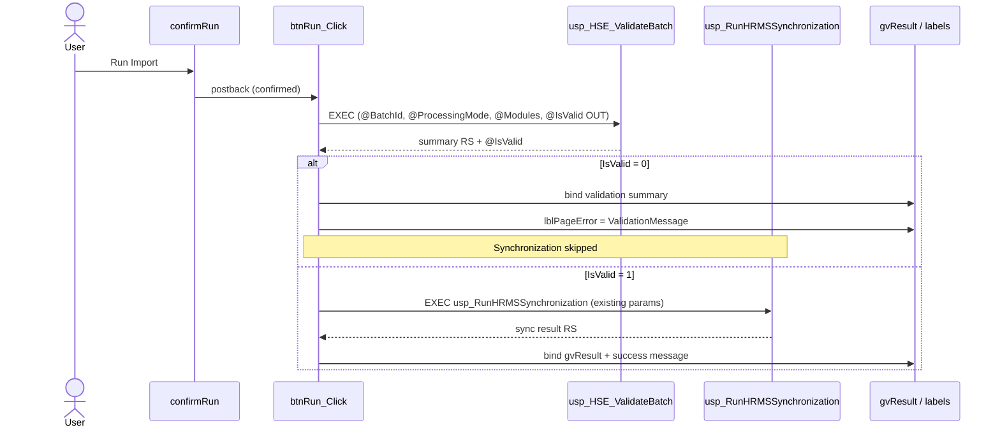

# 16 — Phase 3.3 Validation Integration (HrmsBatchManager)

**Scope:** `HrmsBatchManager.aspx.cs` only  
**Change:** Call `dbo.usp_HSE_ValidateBatch` before `usp_RunHRMSSynchronization`  
**Unchanged:** ASPX, CSS, JavaScript, stored procedures, SQL scripts

---

## 1. Old flow

```text
confirmRun (JS)
    ↓
btnRun_Click
    ↓
gather BatchId / ProcessingMode / Modules / OverwriteFields / ExecutedBy
    ↓
EXEC usp_RunHRMSSynchronization
    ↓
bind gvResult + success message + LoadBatches
```

No pre-sync validation was performed by the page.

---

## 2. New flow

```text
confirmRun (JS)                         ← unchanged
    ↓
btnRun_Click
    ↓
gather parameters                       ← unchanged
    ↓
STEP 1: EXEC dbo.usp_HSE_ValidateBatch
         (@BatchId, @ProcessingMode, @Modules, @IsValid OUTPUT)
    ↓
STEP 2: if @IsValid = 0
         • do NOT call usp_RunHRMSSynchronization
         • bind validation summary → gvResult
         • show failure message on lblPageError
         • LoadBatches (refresh staging aggregates)
         • return
    ↓
STEP 3: if @IsValid = 1
         • existing usp_RunHRMSSynchronization flow unchanged
```

---

## 3. Sequence diagram



---

## 4. Parameters passed to `usp_HSE_ValidateBatch`

| Parameter | Source in `btnRun_Click` | Notes |
|---|---|---|
| `@BatchId` | `Convert.ToInt32(hfSelectedBatch.Value)` | Same batch used for sync |
| `@ProcessingMode` | `rblProcessingMode` via `int.TryParse` | `0` / `1` / `2` |
| `@Modules` | `GetSelectedModules()` | Pipe-delimited `MASTER\|EMPLOYEE\|HIERARCHY`; empty → `DBNull` |
| `@IsValid` | OUTPUT `BIT` | Gate for STEP 2 / STEP 3 |

**Naming note:** The procedure parameter is `@Modules` (plural), matching `usp_HSE_ValidateBatch` and the existing sync call. The objective text’s `@Module` is treated as the same value.

Helper: `ExecuteHseValidateBatch(...)` in `HrmsBatchManager.aspx.cs`.

---

## 5. Failure path (`@IsValid = 0`)

1. `usp_RunHRMSSynchronization` is **not** executed.  
2. Validation summary `DataTable` is bound to `gvResult` (Last RUN Result panel).  
3. `lblPageError` shows `ValidationMessage` from the summary row when present; otherwise a default failure string.  
4. `lblRunMessage` is cleared (no success styling).  
5. `LoadBatches()` refreshes grid aggregates so staging `ImportStatus` / error counts from validation are visible.  
6. Method returns.

---

## 6. Success path (`@IsValid = 1`)

1. Existing synchronization block runs unchanged:
   - `usp_RunHRMSSynchronization` with `@BatchId`, `@AllowOverwrite`, `@ProcessingMode`, `@Modules`, `@OverwriteFields`, `@ExecutedBy`
   - `SqlDataAdapter.Fill` → `gvResult`
   - `lblRunMessage = "Synchronization completed successfully."`
2. `LoadBatches()` as before.
3. Warnings from validation (if any) do not block sync when `@IsValid = 1` (procedure contract).

---

## 7. Backward compatibility

| Aspect | Compatibility |
|---|---|
| ASPX / JS / CSS | Unchanged |
| SP signatures | Unchanged; page now *calls* existing `usp_HSE_ValidateBatch` |
| Sync parameter set | Unchanged when validation passes |
| Manual batch select / query-string select | Unchanged |
| Export report | Unchanged |
| Filter / Clear | Unchanged |

Requirement: `dbo.usp_HSE_ValidateBatch` must be deployed to the target database (Phase 3.1 script).

---

## 8. Code touchpoints

| Item | Location |
|---|---|
| Modified | `btnRun_Click` in `HrmsBatchManager.aspx.cs` |
| Added | `ExecuteHseValidateBatch` helper in same file |
| Docs | This file |

---

## 9. Manual test checklist

| # | Case | Expected |
|---|---|---|
| 1 | Valid batch, mode/modules OK | Validation passes; sync runs; success message |
| 2 | Missing EmpCode rows | Validation fails; sync skipped; summary in `gvResult`; error label set |
| 3 | Duplicate EmpCode | Same as #2 |
| 4 | Invalid Modules (none selected → empty/`DBNull`) | Validation fails at batch level; sync skipped |
| 5 | InvalidString BatchId auto-selected then Run | Same as #1 when data valid |
| 6 | Export after failed validation | Still downloads staging (including updated `ImportStatus`/`ErrorMessage`) |
