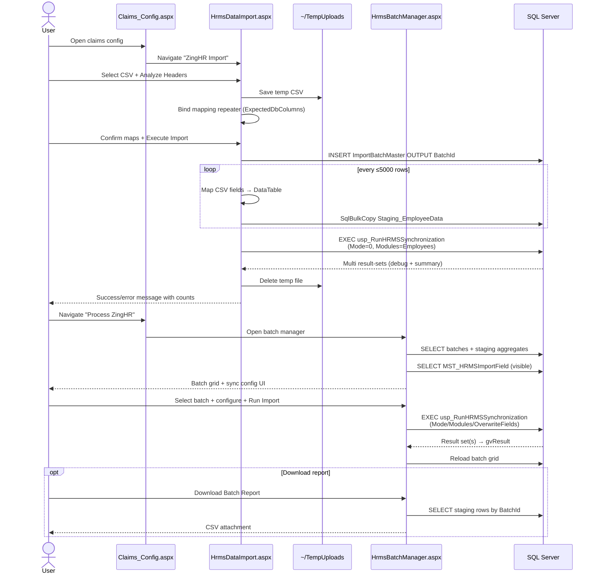

# HRMS Import Module — Complete Analysis

**Scope (code):**
- `AnmolDristi/HrmsDataImport.aspx` (+ `.cs`, `.designer.cs`)
- `AnmolDristi/HrmsBatchManager.aspx` (+ `.cs`, `.designer.cs`)

**Related entry point:** `Claims_Config.aspx` (“ZingHR Import” → `HrmsDataImport.aspx`, “Process ZingHR” → `HrmsBatchManager.aspx`)

**Analysis date:** 2026-08-02  
**Code changes:** None (read-only study)

---

## Executive summary

The HRMS Import module is a two-page ZingHR employee-dump pipeline:

1. **Upload & map** CSV → create batch → bulk-load staging → optionally/automatically synchronize.
2. **Batch manager** → select prior batch → configure sync mode/modules/fields → re-run synchronization → export staging report.

The live synchronization engine is `dbo.usp_RunHRMSSynchronization`. Its script (and the scripts for `ImportBatchMaster`, `Staging_EmployeeData`, `MST_HRMSImportField`) are **not present in this repository**. Schema and SP behavior below are inferred from C# call sites, UI contracts, sample CSVs under `TempUploads/`, commit history, and known target table `MST_UserMaster`.

---

## 1. End-to-end workflow

### 1.1 Intended product flow (from UI labeling)

```
Claims_Config
   │
   ├─ ZingHR Import ──────────────► HrmsDataImport.aspx
   │                                   (upload + column map + stage)
   │
   └─ Process ZingHR ─────────────► HrmsBatchManager.aspx
                                       (select batch + sync config + run)
```

### 1.2 Actual runtime flow (as coded today)

```
[User authenticated session]
        │
        ▼
HrmsDataImport.aspx
  Step 1: Upload CSV → save under ~/TempUploads/{guid}_{filename}
  Step 2: Map ExpectedDbColumns ← CSV headers (auto-match by exact name)
  Step 3: btnProcess
           ├─ INSERT ImportBatchMaster → BatchId
           ├─ Parse CSV with TextFieldParser
           ├─ SqlBulkCopy → Staging_EmployeeData (chunks of 5000)
           ├─ EXEC usp_RunHRMSSynchronization
           │     @ProcessingMode = 0 (Insert Only)   ◄── hard-coded
           │     @Modules = 'Employees'               ◄── hard-coded
           │     @AllowOverwrite = chkAllowOverwrite  ◄── largely ignored by mode=0
           ├─ Delete temp file
           └─ Reset UI + show counts
        │
        ▼
HrmsBatchManager.aspx (optional / second pass)
  Filter/list batches from ImportBatchMaster ⟕ Staging_EmployeeData
  Select batch (client-side JS → hfSelectedBatch)
  Configure:
     ProcessingMode 0|1|2
     Modules MASTER|EMPLOYEE|HIERARCHY
     Overwrite field codes from MST_HRMSImportField (mode 2)
  Run → EXEC usp_RunHRMSSynchronization (full param set)
  Bind result grid + refresh batch list
  Optional: Download Batch Report CSV from Staging_EmployeeData
```

### 1.3 Synchronization contract (inferred)

| Parameter | HrmsDataImport | HrmsBatchManager |
|---|---|---|
| `@BatchId` | created batch | selected batch |
| `@AllowOverwrite` | checkbox | `processingMode != 0` |
| `@ProcessingMode` | **always `0`** | radio `0/1/2` |
| `@Modules` | **`"Employees"`** | `MASTER\|EMPLOYEE\|HIERARCHY` (selected) |
| `@OverwriteFields` | `NULL` | `FieldCode` values joined by `\|` |
| `@ExecutedBy` | `Session["UserId"]` or `"SYSTEM"` | `Session["UserId"]` or `""` |

**Result sets (inferred from reader logic):**
1. Debug/first set (commented as `#EmployeeSource`) — skipped by DataImport reader; **consumed as the only fill** by BatchManager `SqlDataAdapter.Fill(DataTable)`.
2. Summary set with columns: `TotalRecords`, `InsertedCount`, `UpdatedCount`, `SkippedCount`, `ErrorCount` (DataImport searches for these).

**Target of upsert (from feature commit message):** `MST_UserMaster` from `Staging_EmployeeData`. Modules imply additional writes to master lookup tables and reporting hierarchy fields (`ReportingManager*`).

### 1.4 Staging row lifecycle (inferred)

| `ImportStatus` | Meaning in UI aggregates |
|---|---|
| `Pending` | WaitingCount |
| `Processed` | ProcessedCount |
| `Error` | ErrorCount |

Batch-level `ImportBatchMaster.Status` filter options in UI: `Processed`, `Pending`, `Uploaded` (actual writer of these values is the missing SP / insert defaults).

---

## 2. Sequence diagram



---

## 3. Database interaction map

### 3.1 Objects referenced from the two pages

| Object | Type | Referenced by | Operation |
|---|---|---|---|
| `dbo.ImportBatchMaster` | Table | DataImport, BatchManager | INSERT; SELECT (+ filters/aggregates) |
| `dbo.Staging_EmployeeData` | Table | DataImport, BatchManager | BULK INSERT; SELECT (counts/export) |
| `dbo.MST_HRMSImportField` | Table | BatchManager | SELECT visible overwrite fields |
| `dbo.usp_RunHRMSSynchronization` | Stored proc | DataImport, BatchManager | EXEC synchronize |
| `dbo.usp_ProcessEmployeeBatch` | Stored proc (legacy) | *(replaced; no longer called)* | Historical |
| `dbo.usp_ProcessEmployeeBatch_V2` | Stored proc (planned) | *(commented dead code only)* | Historical/planned |

**Repository status:** None of the four live HRMS objects above have `.sql` scripts under `Database/`. They exist only as runtime dependencies.

### 3.2 Logical data flow

```
ZingHR CSV
   │  (column map in UI)
   ▼
ImportBatchMaster -------- BatchId --------► Staging_EmployeeData
   │                                              │
   │ Status / UploadDate / FileName               │ ImportStatus / ErrorMessage
   │                                              │ EmpCode + org/master attrs
   │                                              ▼
   │                               usp_RunHRMSSynchronization
   │                                 ├─ Module MASTER   → master lookup upserts (inferred)
   │                                 ├─ Module EMPLOYEE → MST_UserMaster upsert (documented intent)
   │                                 └─ Module HIERARCHY→ ReportingManager* sync (inferred)
   │
   └── MST_HRMSImportField (UI metadata for selective overwrite FieldCodes)
```

### 3.3 Inferred table contracts (from C#)

#### `ImportBatchMaster`
| Column | Evidence |
|---|---|
| `BatchId` (int, identity) | `OUTPUT INSERTED.BatchId` |
| `FileName` | INSERT / SELECT as `AnyFile` |
| `UploadedBy` | INSERT |
| `UploadDate` | SELECT / date filters |
| `Status` | SELECT / status filter |

#### `Staging_EmployeeData`
| Column | Evidence |
|---|---|
| `StagingId` | COUNT in batch grid |
| `BatchId` | FK-like join / filter |
| Mapped string cols | `ExpectedDbColumns` list (see §5) |
| `ImportStatus` | aggregates + export |
| `ErrorMessage` | export |

#### `MST_HRMSImportField`
| Column | Evidence |
|---|---|
| `IsVisible`, `Category`, `DisplayOrder` | WHERE/ORDER BY |
| `IsDefault`, `DisplayName`, `FieldCode` | repeater bind |

#### Confirmed downstream table (in repo)
- `dbo.MST_UserMaster` — employee master; PK `EmployeeCode`; hierarchy columns `ReportingManager*` present.

### 3.4 Connection

Both pages use `ConfigurationManager.ConnectionStrings["DbConn"]`.

---

## 4. Stored procedure dependency tree

```
usp_RunHRMSSynchronization                      ◄── ONLY live SP called by both pages
│
├─ Inputs
│   ├─ @BatchId
│   ├─ @AllowOverwrite          (legacy; still accepted)
│   ├─ @ProcessingMode          (0 insert / 1 update all / 2 update selected)
│   ├─ @Modules                 (pipe-delimited module tokens)
│   ├─ @OverwriteFields         (pipe-delimited FieldCodes; mode 2)
│   └─ @ExecutedBy
│
├─ Reads (inferred)
│   ├─ Staging_EmployeeData (by BatchId)
│   ├─ ImportBatchMaster
│   └─ MST_HRMSImportField / FieldCode semantics (likely)
│
├─ Writes (inferred from modules + feature intent)
│   ├─ MASTER   → org master tables (Branch/Dept/Grade/Plant/Region/Division/Category/Company/…)
│   ├─ EMPLOYEE / Employees → MST_UserMaster upsert
│   ├─ HIERARCHY → ReportingManager* on users / related hierarchy
│   └─ Staging_EmployeeData.ImportStatus / ErrorMessage
│       ImportBatchMaster.Status (likely)
│
└─ Outputs (multi-result)
    ├─ RS1: debug (#EmployeeSource)     ◄── BatchManager Fill() binds THIS
    └─ RSn: summary counts              ◄── DataImport reader seeks THIS

Legacy / unused in current code paths
├─ usp_ProcessEmployeeBatch        (replaced Jul 2026; was @BatchId,@AllowOverwrite)
└─ usp_ProcessEmployeeBatch_V2     (commented only; never shipped in active path)

Adjacent (NOT called by these two pages; Sales-import / claims staging family)
├─ Process_StagingToFinal_FromJson*
├─ usp_SyncHierarchyForBatch
└─ usp_SyncHierarchyAndSalesActivity
   (Inventory.md incorrectly groups some of these with Hrms pages; Sales path is ImportCsv/AdminBatches)
```

**Module token mismatch risk**

| Caller | Token(s) sent |
|---|---|
| DataImport | `Employees` |
| BatchManager | `EMPLOYEE`, `MASTER`, `HIERARCHY` |

If the SP matches tokens exactly (case/name), DataImport’s `"Employees"` may not activate the employee module the UI intends—or may hit a different alias branch. This cannot be verified without the SP source.

---

## 5. UI flow

### 5.1 Navigation

`Claims_Config.aspx` → app buttons:
- **ZingHR Import** → `HrmsDataImport.aspx`
- **Process ZingHR** → `HrmsBatchManager.aspx`

Master page: `Dristi.Master` (provides `ScriptManager`).

### 5.2 HrmsDataImport — screens

| Panel | Controls | Action |
|---|---|---|
| `pnlUpload` | `fileUploadCsv`, `btnReadHeaders` | Save temp file; parse headers; show mapping |
| `pnlMapping` | `rptMapping` + Select2 dropdowns, `chkAllowOverwrite`, `btnProcess`, `btnCancel` | Map columns; run pipeline; or cancel |

**Expected DB columns offered for mapping:**

```
EmpCode, EmpName, EmpStatus, EmployeeStatus, Email, MobileNo, DOJ, Gender,
Branch_ID/Description, Department_ID/Description, Designation_ID/Description,
Grade_ID/Description, PlantID_ID/Description, Region_ID/Description,
Division_ID/Description, Category_ID/Description, Company_ID/Description,
SubDepartment_ID,
ReportingManager, ReportingManagerCode,
ReportingManagersManagerName, ReportingManagersManagerCode
```

Sample ZingHR CSV also contains fields **not** in the mapper (e.g. `DOB`, `BloodGroup`, `Location_*`, `SubDepartment_Description`, `Zone_*`, `Group_Description`, `SubDivision_*`).

### 5.3 HrmsBatchManager — screens

1. **Filters:** From/To (date), Status, Search, Clear  
2. **Batch grid:** Select / Batch ID / File / Total / Processed / Errors / Waiting / Status / Upload Date  
3. **Sync configuration:**
   - Processing Mode (default **Update Selected Fields Only** = `2`)
   - Modules (MASTER, EMPLOYEE, HIERARCHY — all selected by default)
   - Overwrite field checkboxes (from `MST_HRMSImportField`, visible when mode=`2`)
4. **Actions:** Run Import (confirm JS), Download Batch Report  
5. **Last RUN Result:** auto-generated columns grid (`gvResult`)

Client JS:
- `onRowSelect` → sets hidden batch id + highlight  
- `confirmRun` → validates selection + confirm dialog + disables button label

### 5.4 Auth gate (both pages)

On every `Page_Load`, if `Session["UserId"]` empty → redirect `~/Login.aspx?msg=session_expired`.

ASP.NET session keys are case-insensitive, so this resolves to the same slot as `Session["USERID"]` set by `login.aspx.cs`. No fine-grained permission (`RequirePermission`) is applied on these pages.

---

## 6. Dead code list

| Location | Item | Why dead |
|---|---|---|
| `HrmsDataImport.aspx.cs` ~345–372 | Commented `ProcessBatch` calling `usp_ProcessEmployeeBatch_V2` | Fully commented; replaced by live `ProcessBatch` |
| `HrmsBatchManager.aspx` ~109–126 | Commented `txtProcessedBy` + `chkAllowOverwrite` UI | Markup commented out; designer no longer exposes them |
| `HrmsBatchManager.aspx.cs` `SyncExecutionContext` | Public nested class | Never instantiated / referenced |
| `HrmsBatchManager.aspx.cs` `using System.Linq` | Import | No LINQ usage in file |
| `HrmsDataImport.aspx.cs` `Page_Load` `!IsPostBack` block | Empty placeholder | No-op |
| Legacy SP names in history | `usp_ProcessEmployeeBatch` | No remaining live call sites in these pages |
| `HrmsDataImport` `chkAllowOverwrite` (effective) | UI still shown | ProcessingMode hard-coded to `0`, so overwrite path is not meaningfully driven by the checkbox |

---

## 7. Duplicate code list

| Pattern | Occurrences | Notes |
|---|---|---|
| Session auth redirect block | Both page `Page_Load`s | Near-identical `Session["UserId"]` check + redirect |
| `GetConnectionString()` | Both pages | Identical `DbConn` helper |
| `usp_RunHRMSSynchronization` invocation | `ProcessBatch` vs `btnRun_Click` | Parallel param packing; different defaults |
| CSV parse with `TextFieldParser` | `btnReadHeaders_Click` + `btnProcess_Click` | Header read duplicated |
| Temp path / session keys for upload | DataImport only, but pattern mirrors `ImportCsv` bulk staging | Same 5000-row chunk + `SqlBulkCopy` style |
| Batch manager UX shell | `HrmsBatchManager` ≅ `AdminBatches` | Same filter row, Select JS, UpdatePanels, result grid, export button patterns (Sales staging clone) |
| Export CSV streaming | `btnExportReport_Click` (HRMS) vs AdminBatches export | Same Response header / CompleteRequest approach |
| Select-all / clear-all checkbox loops | `btnSelectAll_Click` / `btnClearAll_Click` | Symmetric duplication (minor) |

---

## 8. Potential bugs

### Critical / high

1. **Upload page always runs Insert-Only sync**  
   `ProcessBatch` hard-codes `@ProcessingMode = 0` and `@Modules = "Employees"` while still showing “Allow Overwrite”. Users can believe they updated existing employees when the SP is instructed to insert-only.

2. **Two-step UX vs one-step code**  
   Claims Config implies Upload then Process. Upload already executes synchronization. Re-running from Batch Manager can double-process the same staging batch; behavior depends on undocumented SP idempotency.

3. **Module token mismatch (`Employees` vs `EMPLOYEE`)**  
   DataImport and BatchManager send different module strings. If SP parsing is strict, upload-time sync may no-op employee upsert or take an unexpected branch.

4. **BatchManager result grid likely shows debug RS, not summary**  
   `SqlDataAdapter.Fill(DataTable)` keeps only the **first** result set. DataImport explicitly skips RS1 (`#EmployeeSource`) to find summary columns. `gvResult` therefore likely displays the debug dump, while the success toast always says “Synchronization completed successfully” even when summary counts are not shown.

5. **Orphan batch on mid-pipeline failure**  
   `ImportBatchMaster` row is committed before bulk copy / SP. On later failure, batch + partial staging remain with no compensating delete/status update in the `catch`.

6. **Cancel does not delete temp file**  
   `btnCancel_Click` clears session keys but leaves `~/TempUploads/{guid}_…` on disk. `OriginalFileName` session key is also not cleared.

7. **No server-side file-type / size validation**  
   Only client `accept=".csv"`. Non-CSV or huge files can be saved and parsed.

8. **No concurrency / re-run guard**  
   Unlike `AdminBatches.GetBatchState`, HRMS BatchManager does not block InProgress/Completed re-execution.

### Medium

9. **CSV export escaping incomplete**  
   Only `ErrorMessage` is quote-escaped. `EmpName` / `Email` containing commas break CSV columns.

10. **Partial CSV field escaping / encoding**  
    No BOM; no culture-safe date parsing before staging (all strings). Bad DOJ formats become SP errors at sync time.

11. **Select2 version conflict**  
    Page loads Select2 **4.1.0-rc.0** script tag, CSS **3.5.3**, then dynamically loads **3.5.3** JS if `$.fn.select2` missing. Fragile / racey UI.

12. **`CompleteRequest` after CSV write**  
    Avoids `ThreadAbort` from `Response.End`, but remaining page lifecycle may still append markup to the download stream in some hosting setups.

13. **Auth is session-presence only**  
    No `RequirePermission(...)` for HRMS import. Any logged-in user who can reach the URL can mutate employee master data.

14. **IDisposable leaks (minor)**  
    `LoadOverwriteFields` and `btnRun_Click` create `SqlDataAdapter`/`DataTable` without `using`.

15. **`GC.Collect()` in temp cleanup**  
    Forces full GC to release file handles — masks disposal bugs and hurts app-pool performance.

### Low / UX

16. **Status filter values may not match SP-written statuses**  
    Dropdown: Processed / Pending / Uploaded. Staging aggregates use Processed / Error / Pending. Drift possible.

17. **Selected-row highlight lost on async postback**  
    Highlight is pure client CSS; `AdminBatches` re-applies via `RowDataBound`, HRMS does not.

18. **PII sample dumps committed under `TempUploads/`**  
    Full employee master CSVs in git history/workspace — security/compliance risk (not runtime logic, but module artifact).

---

## 9. Improvement recommendations

### Immediate correctness

1. **Split stage vs sync**  
   Make `HrmsDataImport` only create batch + bulk insert. Leave synchronization exclusively to `HrmsBatchManager` (matches Claims Config labels and avoids double-run ambiguity).

2. **Honor overwrite UI on upload** *(if upload-time sync is kept)*  
   Map checkbox → `@ProcessingMode` (`0` vs `1`) or remove the checkbox.

3. **Normalize module tokens**  
   Single enum/constants shared by both pages (`MASTER|EMPLOYEE|HIERARCHY`) and document SP accepted aliases.

4. **Fix result-set handling in BatchManager**  
   Use `SqlDataAdapter.Fill(DataSet)` and bind the summary table, or skip debug RS like DataImport.

5. **Transactional batch creation**  
   Create batch + bulk insert (+ optional status=`Uploaded`) in one unit of work; on failure mark `Status=Failed` or delete orphan batch/staging.

6. **Add re-run guards**  
   Disable Run when batch is InProgress/fully Processed (unless explicit “Reprocess errors only” mode).

### Security & ops

7. Enforce permission keys (e.g. `HRMS.Import.Upload`, `HRMS.Import.Process`).  
8. Validate `.csv` extension, MIME, max size; store temps outside web root or deny HTTP access to `TempUploads`.  
9. Remove committed employee CSVs from repo; add cleanup job for stale temp files.  
10. Extract and version-control SQL for:
    - `ImportBatchMaster`, `Staging_EmployeeData`, `MST_HRMSImportField`
    - `usp_RunHRMSSynchronization` (+ any nested procs)
    - Deprecate/remove `usp_ProcessEmployeeBatch` / `_V2` if obsolete

### Maintainability

11. Extract shared `HrmsImportService` (connection, batch create, bulk copy, sync invoke, CSV export).  
12. Delete dead code (`SyncExecutionContext`, commented V2, unused usings, commented ASPX).  
13. Align Select2 to one version (prefer local `Resources/select2` already in repo).  
14. Escape all CSV fields; stream with `StreamWriter` + proper dispose.  
15. Replace `AddWithValue` with typed `SqlParameter`s for `@BatchId`, bits, and NVARCHARs.  
16. Persist mapping presets (optional) instead of only exact-name auto-match.  
17. Surface SP summary counts in BatchManager toast (Inserted/Updated/Errors), not a generic success string.  
18. Add integration tests against a restored DB snapshot covering modes `0/1/2` and each module flag.

---

## Appendix A — File inventory

| File | Role |
|---|---|
| `HrmsDataImport.aspx` | Upload + mapping UI |
| `HrmsDataImport.aspx.cs` | CSV parse, batch create, bulk copy, sync |
| `HrmsDataImport.aspx.designer.cs` | Control declarations |
| `HrmsBatchManager.aspx` | Batch list + sync config UI + JS |
| `HrmsBatchManager.aspx.cs` | Filter, run sync, export |
| `HrmsBatchManager.aspx.designer.cs` | Control declarations |
| `Claims_Config.aspx` | Navigation entry points |

## Appendix B — Evolution (git)

| Commit | Change |
|---|---|
| `1cd043e` | Initial ZingHR feature: both pages; SP `usp_ProcessEmployeeBatch`; upsert intent → `MST_UserMaster` |
| `caaf18b` | Minor DataImport tweaks |
| `ba52969` | Harden session redirect, disposables, temp cleanup, DOJ/Gender columns |
| `9a9f491` | Switch both pages to `usp_RunHRMSSynchronization`; add processing modes, modules, overwrite field UI |

## Appendix C — SQL objects missing from repo

These are **required at runtime** by the studied pages but have **no scripts** under `Database/`:

1. `dbo.ImportBatchMaster`  
2. `dbo.Staging_EmployeeData`  
3. `dbo.MST_HRMSImportField`  
4. `dbo.usp_RunHRMSSynchronization`  

Legacy/planned (referenced only in comments/history):

5. `dbo.usp_ProcessEmployeeBatch`  
6. `dbo.usp_ProcessEmployeeBatch_V2`  

Until these are extracted from the live database, the dependency tree’s write-side details (exact master tables touched, status transitions, idempotency) remain partially inferred.
