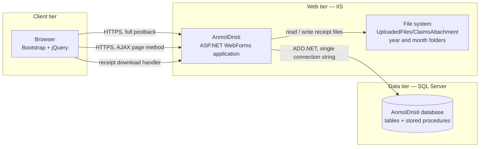
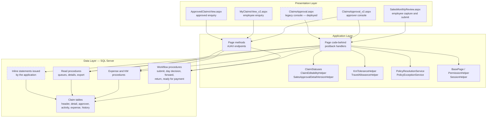
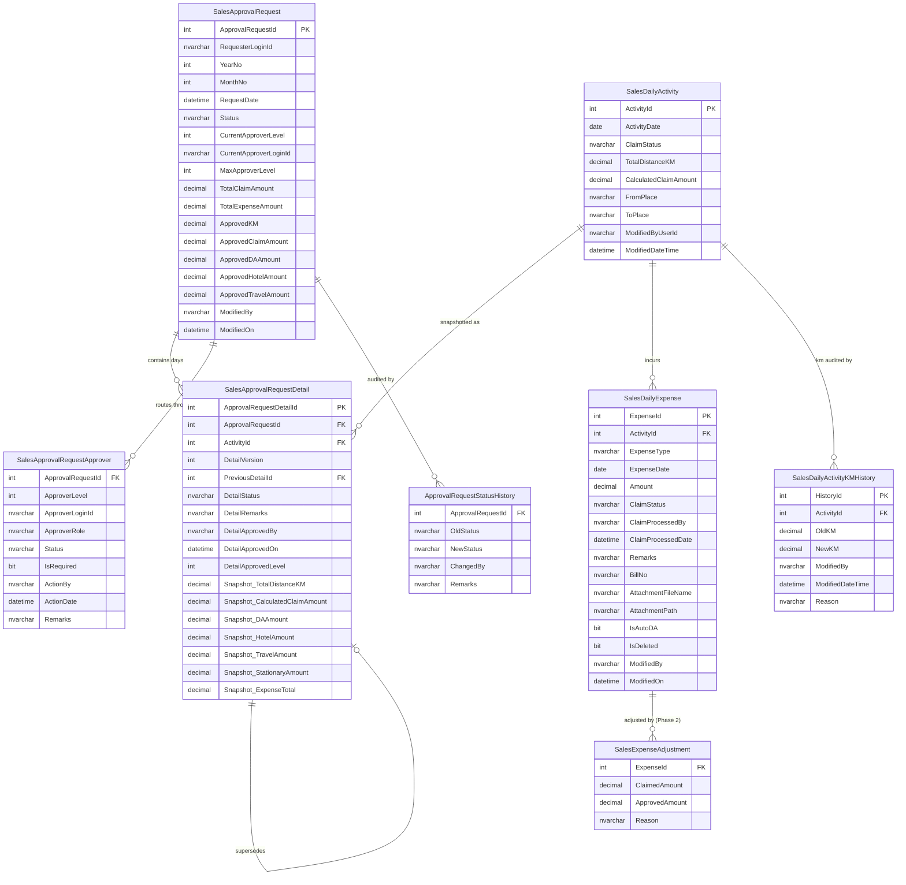
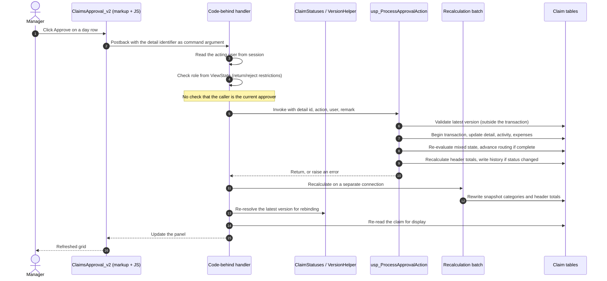
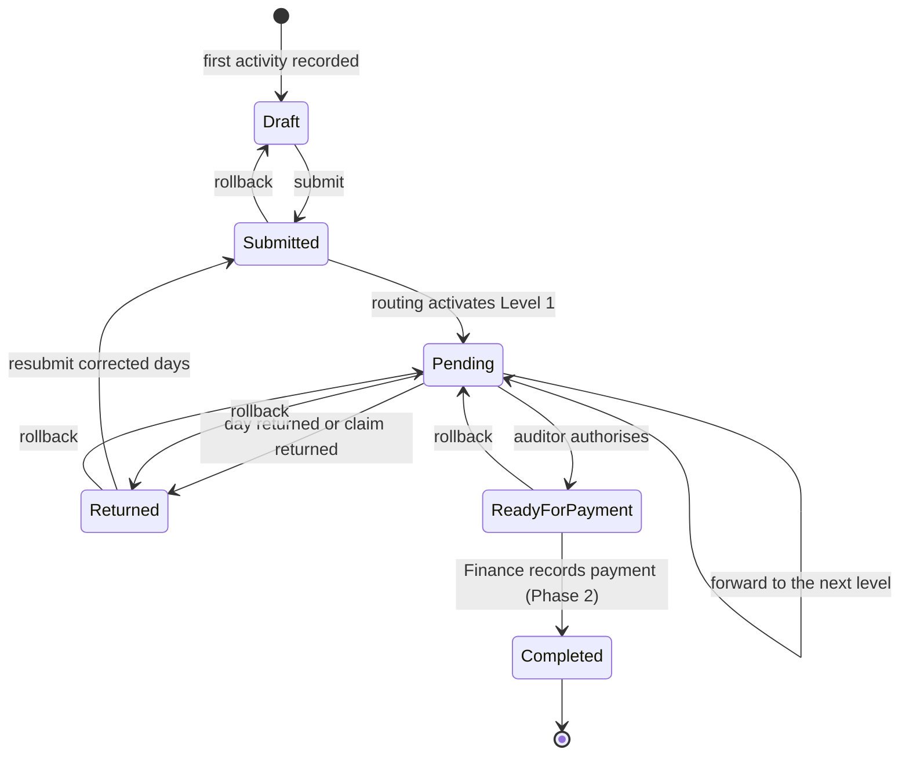
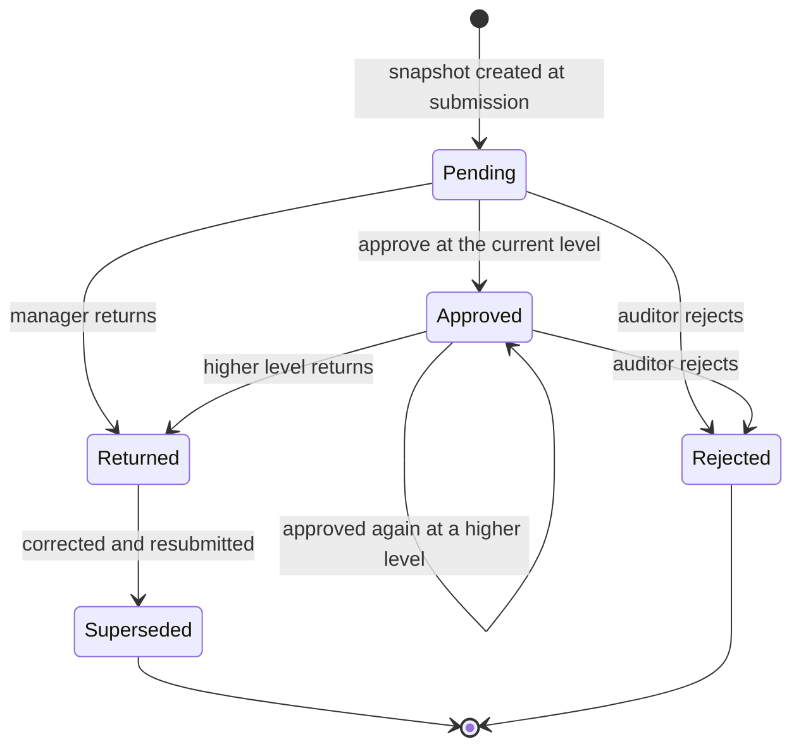
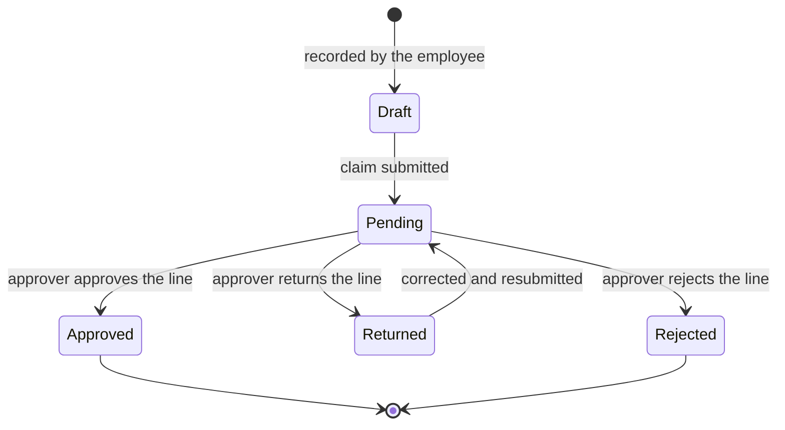
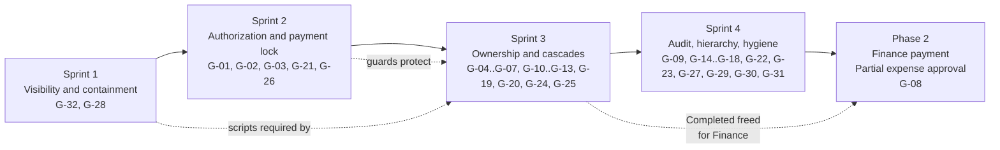

# Monthly Sales Claims Approval System
## Technical Design Specification — Phase 1
### Version 1.0

---

# 1. Document Control

## 1.1 Document identification

| Attribute | Value |
| --- | --- |
| Document title | Monthly Sales Claims Approval System — Technical Design Specification, Phase 1 |
| Document reference | TDS-MSC-P1 |
| Version | 1.0 |
| Status | Issued for technical review |
| Date | 2 August 2026 |
| Author | Enterprise Solution Architecture |
| Owning application | AnmolDristi — Sales TA/DA (Monthly Sales Claims) module |
| Baseline documented | Branch `July26_AILWorks_AminrupSupport`, commit `bf99fd0` |
| Classification | Internal — IT |

## 1.2 Revision history

| Version | Date | Author | Description |
| --- | --- | --- | --- |
| 1.0 | 2 Aug 2026 | Enterprise Solution Architecture | First issue. Documents the current technical implementation of the Monthly Sales Claims workflow and maps it to the approved Phase-1 Functional Specification. Records Current Implementation, Target Design, and Gap wherever the two differ. |

## 1.3 Purpose

The Functional Specification (FS) defines **what** the system must do. This Technical Design Specification defines **how** the current system implements it, and where the implementation and the specification diverge.

It is the implementation blueprint for Phase-1 remediation. Specifically it:

- documents the deployed architecture, database design, stored procedure contracts, and application layer as they exist today;
- maps every approved business rule to exactly one technical owner;
- states, for each divergence, the Current Implementation, the Target Design, and the Gap, without proposing code;
- sequences the remediation into four sprints with dependencies and regression risk;
- defines the testing and deployment approach for those sprints.

This document introduces no new business rules. Where a rule is stated here, it is restated from the FS and is traceable to it.

## 1.4 Scope

| Included | Excluded |
| --- | --- |
| Deployed architecture and layer responsibilities | Any change of technology, framework, or architecture style |
| Physical database design of the claims workflow objects | Physical design of unrelated modules (QA/QC, VMS, HRMS) |
| Contract and behaviour of every workflow stored procedure | Procedure bodies, which are not reproduced here |
| Application layer design of the claims pages, handlers, and helpers | Presentation styling, layout, and client-side rendering detail |
| Workflow engine, security, validation, transaction, and audit design | Infrastructure design (IIS topology, SQL Server HA, backup) |
| Gap analysis against the FS, and the remediation roadmap | Implementation code, SQL, C#, or pseudocode |
| Test and deployment design for the roadmap | Phase-2 functionality (Finance payment, partial expense approval) |

## 1.5 Audience

| Audience | How to use this document |
| --- | --- |
| **Developers** | §4 for procedure contracts, §5 for page and helper responsibilities, §12 for which object owns which rule, §15 for sprint scope. |
| **Technical leads** | §2 for architecture, §9 for transaction boundaries, §13 for ownership, §15 for sequencing and dependencies. |
| **QA engineers** | §6 for the state machine and transition matrix, §8 for validation points, §11 for expected error behaviour, §16 for the test design. |
| **Solution architects** | §2, §3, §6, §7, §14 for the architectural position and the gap set. |
| **Future maintenance teams** | §13 and §18 as the object inventory and responsibility register; §14 as the record of what was known to be wrong at baseline. |
| **Release management** | §17 for deployment order, rollback strategy, and checklists. |

## 1.6 Authoritative inputs and precedence

| Priority | Source | Role in this document |
| --- | --- | --- |
| 1 | Phase-1 Functional Specification v1.0 (`docs/FunctionalSpecification_MonthlySalesClaims_Phase1_v1.0.md`) | Defines Target Design. Where this document states a target, it derives from the FS. |
| 2 | Production Hardening Review (`docs/Production_Hardening_Review_MonthlySalesClaims.md`) | Source of the gap set and the remediation sequencing. |
| 3 | Current SQL Server database | Source for schema and procedure behaviour that is not in source control. |
| 4 | Current stored procedures | `usp_ProcessApprovalAction` is available in source control; the remainder are documented from their call sites. |
| 5 | Current ASP.NET WebForms application | Source for the application layer design. |

**Conflict rule.** Where sources conflict, the FS defines the Target and the implementation defines the Current. This document never resolves a conflict by inventing a third position.

## 1.7 Reading conventions

- **Current Implementation** — descriptive. What the deployed system does at the documented baseline.
- **Target Design** — normative. What the FS requires.
- **Gap** — the difference, carrying the FS gap reference **[G-nn]** and the hardening review issue number.
- **[unverified]** — behaviour inferred from call sites because the procedure body is not in source control. Must be confirmed against the database before any change depends on it.
- Gap references **G-01** to **G-32** are those of FS §14 and are not renumbered here.

## 1.8 Critical documentation constraint

Only one workflow stored procedure — `usp_ProcessApprovalAction` — exists in source control. Thirteen further live procedures and **all** claim table definitions exist only in the deployed database. No DDL for any claims table is under version control.

Consequences for this document:

1. §3 (Database Design) documents the schema as **reconstructed from the query surface** of the application and the one available procedure. Column presence is evidenced; data types, nullability, defaults, indexes, and constraints are **inferred and unverified**.
2. §4 documents procedure **contracts** (inputs, outputs, observed effects) rather than procedure logic, except for `usp_ProcessApprovalAction`.
3. Sprint 1 of the roadmap (§15) is the extraction of these objects into source control. No other sprint may start before it completes, because every subsequent change is to an object that cannot currently be reviewed.

---

# 2. Solution Overview

## 2.1 Architecture style

Classic three-layer server-rendered web application. The layering is logical, not physical: all three layers are deployed in a single ASP.NET application process talking to a single SQL Server instance.

| Layer | Realised by | Responsibility |
| --- | --- | --- |
| **Presentation** | `.aspx` markup, Bootstrap, jQuery, page-scoped JavaScript | Rendering, client-side convenience validation, AJAX invocation of page methods |
| **Application / Business** | `.aspx.cs` code-behind, static page methods, helper classes | Request handling, page lifecycle, orchestration of procedure calls, session and view state, presentation-oriented business rules |
| **Data** | ADO.NET (`SqlConnection`, `SqlCommand`, `SqlDataAdapter`), SQL Server stored procedures | Persistence, and — by design intent — the authoritative business rules and transaction boundaries |

**Architectural intent, restated from the FS.** Business rules and transaction boundaries belong in the data layer. The application layer orchestrates and presents. The presentation layer never enforces.

**Architectural reality at baseline.** A material share of business rules is enforced only in the application layer, and several transaction boundaries span multiple application-initiated round trips. §9 and §14 document this precisely. The remediation roadmap moves rules downward into existing procedures; it does not change the layering.

## 2.2 Technology stack

| Concern | Technology | Version / note |
| --- | --- | --- |
| Runtime | .NET Framework | 4.5 target |
| Web framework | ASP.NET WebForms | Server controls, ViewState, page lifecycle, `ScriptManager`/`UpdatePanel` partial postbacks |
| Data access | ADO.NET | Direct `SqlCommand`, no ORM, no repository, no unit of work |
| Database | Microsoft SQL Server | Single database, `dbo` schema |
| Business logic host | T-SQL stored procedures | Primary intended location for workflow rules |
| Client scripting | JavaScript, jQuery | Page-scoped, inline in `.aspx` |
| UI framework | Bootstrap | Modals, grids, badges, notifications (PNotify) |
| Async transport | ASP.NET page methods (`WebMethod` with session enabled), invoked by jQuery AJAX | Used for the unified day modal, expense decisions, kilometre amendment, and read-only lookups |
| Authentication | ASP.NET Forms Authentication + server session | See §7 |
| File storage | Server file system under the application root | Receipt attachments |
| Logging | NLog, Application Insights module | Configured but not used by the claims workflow paths |
| Reporting/export | Server-generated Excel export via a stored procedure result set | |

**Constraint.** This stack is fixed. No item in this document proposes replacing, supplementing, or migrating any of it.

## 2.3 Deployment model

| Aspect | Current Implementation | Target Design | Gap |
| --- | --- | --- | --- |
| Application deployment | Single IIS application, one virtual directory | Unchanged | — |
| Database | Single SQL Server database, single connection string named `DbConn` | Unchanged | — |
| Credentials | Connection string held in plain text in `Web.config`, using a privileged server login; machine key hard-coded in the same file | Credentials held outside source control; least-privilege application login | **[G-31]** |
| Transport security | Cookies not marked as requiring TLS | Cookies restricted to TLS | **[G-31]** |
| Error surface | Detailed error pages enabled; debug compilation enabled | Remote errors suppressed; release compilation | **[G-31]**, **[G-27]** |
| Attachment storage | File system path recorded in the database; content not stored in the database | Unchanged for Phase 1; divergence risk recorded | **[G-23]** |
| Background processing | One session-cleanup timer in the application host. No background process mutates claim state | Unchanged | — |

## 2.4 Project structure

The application is a single flat WebForms project. Claims-workflow objects are listed here; unrelated modules are omitted.

| Path | Type | Role |
| --- | --- | --- |
| `AnmolDristi/SalesMonthlyReview.aspx(.cs)` | Page | Employee claim capture, expense capture, submission and resubmission |
| `AnmolDristi/ClaimsApproval_v2.aspx(.cs)` | Page | Approver console — managers and auditor. Live |
| `AnmolDristi/ClaimsApproval.aspx(.cs)` | Page | Approver console — superseded. Deployed and reachable |
| `AnmolDristi/MyClaimsView_v2.aspx(.cs)` | Page | Employee claim enquiry and export. Live |
| `AnmolDristi/MyClaimsView.aspx(.cs)` | Page | Employee claim enquiry — superseded |
| `AnmolDristi/ApprovedClaimsView.aspx(.cs)` | Page | Approved claim enquiry and export |
| `AnmolDristi/ClaimsSubmitted.aspx(.cs)` | Page | Claim status enquiry. Unreferenced |
| `AnmolDristi/SubmitClaim.aspx(.cs)` | Page | Permission-gated entry point that redirects to claim capture |
| `AnmolDristi/DownloadExpense.ashx(.cs)` | Handler | Receipt download |
| `AnmolDristi/UploadImageHandler.ashx(.cs)` | Handler | Image upload |
| `AnmolDristi/ClaimStatuses.cs` | Helper | Canonical status constants and case-insensitive comparison |
| `AnmolDristi/ClaimEditabilityHelper.cs` | Helper | Edit and delete eligibility rules for activities and expenses |
| `AnmolDristi/SalesApprovalDetailVersionHelper.cs` | Helper | Latest-detail-version resolution, in memory and as reusable query fragments |
| `AnmolDristi/KmToleranceHelper.cs` | Helper | Allowed kilometre range and tolerance evaluation |
| `AnmolDristi/TravelAllowanceHelper.cs` | Helper | Travel allowance amount from distance and rate |
| `AnmolDristi/PolicyResolutionService.cs`, `BLL/PolicyResolutionService.cs` | Service | Policy resolution for an employee, date, and expense type |
| `AnmolDristi/BLL/PolicyExceptionService.cs` | Service | Policy exception maintenance |
| `AnmolDristi/DAL/PolicyResolutionDataAccess.cs`, `DAL/PolicyExceptionDataAccess.cs` | Data access | The only two classes in the codebase with a dedicated data-access layer |
| `AnmolDristi/ResolvedPolicyDto.cs`, `PolicyExceptionDto.cs` | DTO | Policy transfer objects |
| `AnmolDristi/PolicyExceptionSerializer.cs`, `PolicyOverrideMergeHelper.cs` | Utility | Policy snapshot serialisation and override merging |
| `AnmolDristi/BasePage.cs` | Base class | Session heartbeat, permission assertion helper |
| `AnmolDristi/PermissionHelper.cs`, `PermissionService.cs`, `PermissionCache.cs`, `UiPermissionController.cs` | Security | UI permission resolution and caching |
| `AnmolDristi/SessionHelper.cs` | Utility | Session registry and stale-session cleanup |
| `AnmolDristi/DatabaseHelper.cs` | Utility | Generic connection and query helper. Not used by the claims workflow paths |
| `AnmolDristi/Dristi.Master(.cs)` | Master page | Navigation and UI permission application |
| `AnmolDristi/Web.config` | Configuration | Connection string, authentication, session, error handling |
| `Database/Scripts/005_usp_ProcessApprovalAction.sql` | Database script | The only workflow procedure under source control |

## 2.5 Layer responsibilities

| Responsibility | Presentation | Application | Data | Current owner | Target owner |
| --- | --- | --- | --- | --- | --- |
| Rendering and navigation | ● | | | Presentation | Presentation |
| Client convenience validation | ● | | | Presentation | Presentation |
| Session and identity resolution | | ● | | Application | Application |
| Page permission assertion | | ● | | Application (inconsistently applied) | Application |
| Orchestration of a workflow action | | ● | | Application | Application |
| **Current approver authorisation** | | ○ | | Application, incomplete | **Data** |
| **Header status / payment lock** | | | | Nowhere | **Data** |
| **Transition validation** | | ○ | ● | Split | **Data** |
| **Detail version resolution** | | ● | ● | Split, three definitions | **Data**, single definition |
| **Expense completeness for day approval** | ○ | ● | | Application, one path only | **Data** |
| **Totals recalculation** | | ● | ● | Split, two implementations | **Data**, single owner |
| **Transaction boundary** | | ● | ● | Split | **Data** |
| **Audit history writes** | | | ● | Data, incomplete | **Data** |
| Amount and tolerance calculation for display | | ● | | Application | Application |
| Amount and tolerance **validation** | | ● | ○ | Application | **Data** |

● primary owner ○ partial or advisory

## 2.6 Architecture diagram

Dashed elements are architectural exceptions carried at baseline: the legacy console (**[G-28]**) and inline statements issued directly by the application against workflow tables (**[G-04]**, **[G-19]**, **[G-25]**, **[G-10]**).

---

# 3. Database Design

## 3.1 Database overview

A single SQL Server database in the `dbo` schema holds the claims workflow alongside the other application modules. The claims workflow occupies ten objects: three approval objects, two operational objects, two history objects, one adjustment object reserved for Phase 2, one draft-summary object that is not written, and one table type used to carry the submission payload.

**Evidence basis.** No DDL for any of these objects is in source control (**[G-32]**). Column presence below is evidenced from the query surface. Data types are indicative. Nullability, defaults, computed columns, indexes, keys, and constraints are **inferred and unverified** and must be confirmed by extraction in Sprint 1.

## 3.2 Core tables

### 3.2.1 `SalesApprovalRequest` — claim header

One row per employee per submitted month. Carries the workflow status, the routing pointer, and the claim totals.

| Column | Type (indicative) | Role |
| --- | --- | --- |
| `ApprovalRequestId` | int identity | Primary key |
| `RequesterLoginId` | nvarchar | Employee code of the claimant |
| `YearNo` | int | Claim year |
| `MonthNo` | int | Claim month |
| `RequestDate` | datetime | Submission timestamp; used to select the most recent claim for a month |
| `Status` | nvarchar | **Header status.** Draft, Submitted, Pending, Returned, ReadyForPayment, Completed |
| `CurrentApproverLevel` | int, nullable | **Routing pointer.** Level currently holding the claim |
| `CurrentApproverLoginId` | nvarchar, nullable | **Routing pointer.** User currently holding the claim |
| `MaxApproverLevel` | int | Highest configured level; used to derive the final-approver flag |
| `TotalClaimAmount` | decimal | Claimed total at submission |
| `TotalExpenseAmount` | decimal | Claimed expense total at submission |
| `ApprovedKM` | decimal | Approved distance, recalculated from latest details |
| `ApprovedClaimAmount` | decimal | Approved travel allowance, recalculated from latest details |
| `ApprovedDAAmount` | decimal | Approved daily allowance total |
| `ApprovedHotelAmount` | decimal | Approved hotel total |
| `ApprovedTravelAmount` | decimal | Approved travel expense total |
| `ModifiedBy` | nvarchar | Last actor |
| `ModifiedOn` | datetime | Last change timestamp |

Notes. There is no approved stationary total on the header, although a stationary snapshot exists on the detail and is included in the detail expense total — an asymmetry that makes the header category totals not sum to the header expense position. Payment reference and payment date columns do not exist (Phase 2, **[G-08]**).

### 3.2.2 `SalesApprovalRequestDetail` — per-day immutable snapshot

One row per day per version within a claim. The unit approvers act on, and the sole source for claim totals.

| Column | Type (indicative) | Role |
| --- | --- | --- |
| `ApprovalRequestDetailId` | int identity | Primary key. Also used as the de facto "latest version" discriminator |
| `ApprovalRequestId` | int | Foreign key to the header |
| `ActivityId` | int | Foreign key to the live activity this snapshot was taken from |
| `DetailVersion` | int, nullable | Version number per day within the claim; treated as 1 when null |
| `PreviousDetailId` | int, nullable | Self-reference to the version this row supersedes |
| `DetailStatus` | nvarchar | **Detail status.** Pending, Approved, Returned, Rejected |
| `DetailRemarks` | nvarchar(max) | Latest decision remark |
| `DetailApprovedBy` | nvarchar | Actor of the latest decision |
| `DetailApprovedOn` | datetime | Timestamp of the latest decision |
| `DetailApprovedLevel` | int | Level recorded against the latest decision |
| `Snapshot_TotalDistanceKM` | decimal | Frozen distance for the day |
| `Snapshot_CalculatedClaimAmount` | decimal | Frozen travel allowance for the day |
| `Snapshot_DAAmount` | decimal | Daily allowance total for the day |
| `Snapshot_HotelAmount` | decimal | Hotel total for the day |
| `Snapshot_TravelAmount` | decimal | Travel expense total for the day |
| `Snapshot_StationaryAmount` | decimal | Stationary total for the day |
| `Snapshot_ExpenseTotal` | decimal | Sum of the four category snapshots |

**Design tension.** The row is described as an immutable snapshot, and the amount columns behave that way at creation. The status columns do not: every decision overwrites `DetailStatus`, `DetailRemarks`, `DetailApprovedBy`, `DetailApprovedOn`, and `DetailApprovedLevel` in place, so only the most recent decision on a version survives (**[G-14]**). Separately, the `Snapshot_DAAmount`, `Snapshot_HotelAmount`, `Snapshot_TravelAmount`, `Snapshot_StationaryAmount`, and `Snapshot_ExpenseTotal` columns are rewritten by the recalculation logic after expense decisions, so they are a current position rather than a frozen one, while `Snapshot_TotalDistanceKM` and `Snapshot_CalculatedClaimAmount` are never recalculated (**[G-10]**).

### 3.2.3 `SalesApprovalRequestApprover` — approver chain

One row per approval level per claim, capturing who must act and what they decided.

| Column | Type (indicative) | Role |
| --- | --- | --- |
| `ApprovalRequestId` | int | Foreign key to the header. Part of the natural key with `ApproverLevel` |
| `ApproverLevel` | int | Ordinal position: 1, 2, 3 for managers; the next level for the auditor |
| `ApproverLoginId` | nvarchar | Employee code of the approver |
| `ApproverRole` | nvarchar | Role discriminator. Observed values include `Auditor` and `Accounts` |
| `Status` | nvarchar | Per-level decision state: Pending, Approved, Returned |
| `IsRequired` | bit, nullable | Whether the level must act; treated as required when null |
| `ActionBy` | nvarchar | Acting user |
| `ActionDate` | datetime | Action timestamp |
| `Remarks` | nvarchar(max) | Level remark |

**Authorization significance.** This table, not the header routing pointer, is what the application currently uses to decide whether a user may act (**[G-01]**). Because a row exists with status Pending for every level from submission until that level acts, the predicate "the user has a pending approver row" admits every approver in the chain at all times.

### 3.2.4 `SalesDailyActivity` — live daily activity

The employee's working record for a day. A detail snapshot is taken from it at submission; thereafter the two can diverge.

| Column | Type (indicative) | Role |
| --- | --- | --- |
| `ActivityId` | int identity | Primary key |
| `ActivityDate` | date | The day |
| `ClaimStatus` | nvarchar | Operational status mirrored from the detail decision: Draft, Pending, Approved, Returned, Rejected |
| `TotalDistanceKM` | decimal | Current distance |
| `CalculatedClaimAmount` | decimal | Current travel allowance |
| `FromPlace`, `ToPlace` | nvarchar | Route endpoints |
| `ModifiedByUserId` | nvarchar | Last actor |
| `ModifiedDateTime` | datetime | Last change timestamp, written in local time (UTC + 5:30) |

**Design note — dual status.** The day carries a status in two places: `SalesApprovalRequestDetail.DetailStatus` (the workflow decision) and `SalesDailyActivity.ClaimStatus` (the operational mirror). They are synchronised by the approval procedures and by an inline statement issued from the employee page before resubmission (**[G-25]**). They can and do diverge, which is why that synchronisation statement exists. The FS treats `DetailStatus` as authoritative.

**Design note — mixed time bases.** `ModifiedDateTime` on activity and expense rows is written in local time by adding a fixed offset, while header and detail timestamps are written in UTC. Any chronological reconstruction across tables must account for the offset.

### 3.2.5 `SalesDailyExpense` — expense lines

| Column | Type (indicative) | Role |
| --- | --- | --- |
| `ExpenseId` | int identity | Primary key |
| `ActivityId` | int | Foreign key to the day |
| `ExpenseType` | nvarchar | `DA`, `Hotel`, `Travel`, `Stationary` |
| `ExpenseDate` | date | Expense date |
| `Amount` | decimal | **Claimed** amount. No approved amount column exists (Phase 2) |
| `ClaimStatus` | nvarchar | **Expense status.** Draft, Pending, Approved, Returned, Rejected |
| `ClaimProcessedBy` | nvarchar | Actor of the decision |
| `ClaimProcessedDate` | datetime | Decision timestamp, local time |
| `Remarks` | nvarchar(max) | Decision remark |
| `BillNo` | nvarchar | Bill or invoice reference |
| `FromPlace`, `ToPlace`, `Purpose` | nvarchar | Descriptive fields |
| `AttachmentFileName`, `AttachmentPath` | nvarchar | Receipt reference |
| `AttachmentContent` | varbinary, nullable | Present but never populated |
| `IsAutoDA` | bit | Whether the line was generated by policy rather than entered |
| `PolicyMode`, `PolicySnapshot` | nvarchar | Policy context frozen at capture |
| `IsDeleted` | bit | Soft delete flag |
| `ModifiedBy`, `ModifiedOn` | nvarchar, datetime | Last change |
| `CreatedBy`, `CreatedByIP`, `Source` | nvarchar | Provenance |

**Design gap — no approved amount.** Every downstream deduction figure is derived at read time by comparing claimed amounts and statuses, rather than read from a stored approved amount. There is consequently no stored record of what was approved, only of what was claimed and what status it reached (**[G-14]** in the hardening review; FS §15.2).

### 3.2.6 `SalesDailyActivityKMHistory` — kilometre change history

| Column | Type (indicative) | Role |
| --- | --- | --- |
| `HistoryId` | int identity | Primary key |
| `ActivityId` | int | Foreign key to the day |
| `OldKM`, `NewKM` | decimal | Before and after |
| `ModifiedBy` | nvarchar | Actor |
| `ModifiedDateTime` | datetime | Timestamp |
| `Reason` | nvarchar | Mandatory reason |

This is the most complete history object in the module. It is used both as an audit record and as a functional input: the employee's modification cap is enforced by counting rows, and the deduction reports reconstruct the originally claimed distance from the highest recorded value.

### 3.2.7 `ApprovalRequestStatusHistory` — header status history

| Column | Type (indicative) | Role |
| --- | --- | --- |
| `ApprovalRequestId` | int | Foreign key to the header |
| `OldStatus`, `NewStatus` | nvarchar | Transition |
| `ChangedBy` | nvarchar | Actor |
| `Remarks` | nvarchar(max) | Narrative |

Identity and timestamp columns are presumed present but are not referenced by any application query. Only the day-decision procedure writes to this table, and it suppresses the most common transition (**[G-16]**).

### 3.2.8 `SalesExpenseAdjustment` — reserved, Phase 2

The table exists in the agreed design. It is referenced by **no** application code and **no** procedure at baseline. Per the FS it holds a row only where an approved amount is lower than a claimed amount, which requires partial approval and is therefore Phase 2.

### 3.2.9 `SalesMonthlyDraftSummary` — draft summary

Written only by `usp_SaveMonthlyDraftSummary`, which is not wired to any control. Effectively dormant.

### 3.2.10 `TVP_ActivityUpdate` — submission payload table type

A table type carrying the per-day submission payload from the employee page to the submission procedure. The payload includes the activity identifier, the distance, and the **application-calculated** claim amount — which is the mechanism by which a presentation-layer calculation becomes persisted fact (**[G-29]**).

## 3.3 Relationships, keys, and constraints

### 3.3.1 Relationships

| Parent | Child | Cardinality | Join |
| --- | --- | --- | --- |
| `SalesApprovalRequest` | `SalesApprovalRequestDetail` | 1 : many | `ApprovalRequestId` |
| `SalesApprovalRequest` | `SalesApprovalRequestApprover` | 1 : many | `ApprovalRequestId` |
| `SalesApprovalRequest` | `ApprovalRequestStatusHistory` | 1 : many | `ApprovalRequestId` |
| `SalesDailyActivity` | `SalesApprovalRequestDetail` | 1 : many (one per version) | `ActivityId` |
| `SalesDailyActivity` | `SalesDailyExpense` | 1 : many | `ActivityId` |
| `SalesDailyActivity` | `SalesDailyActivityKMHistory` | 1 : many | `ActivityId` |
| `SalesApprovalRequestDetail` | `SalesApprovalRequestDetail` | self, 1 : 0..1 | `PreviousDetailId` → `ApprovalRequestDetailId` |
| `SalesDailyExpense` | `SalesExpenseAdjustment` | 1 : 0..many (Phase 2) | `ExpenseId` |

**Structural note.** Expenses attach to the **activity**, not to the detail version. An expense therefore has no version affinity: when a returned day is corrected and a new detail version is created, the expense rows are the same rows. Any query that needs "the expenses of this claim" must route through the detail table to reach the activity, and must restrict to the latest version to avoid multiplying rows — which is why the latest-version join fragment appears in every such query.

### 3.3.2 Keys

| Table | Primary key | Natural / alternate key |
| --- | --- | --- |
| `SalesApprovalRequest` | `ApprovalRequestId` | `RequesterLoginId` + `YearNo` + `MonthNo` — **not enforced** (**[G-22]**) |
| `SalesApprovalRequestDetail` | `ApprovalRequestDetailId` | `ApprovalRequestId` + `ActivityId` + `DetailVersion` |
| `SalesApprovalRequestApprover` | Presumed `ApprovalRequestId` + `ApproverLevel` | Same |
| `SalesDailyActivity` | `ActivityId` | Employee + `ActivityDate` |
| `SalesDailyExpense` | `ExpenseId` | — |
| `SalesDailyActivityKMHistory` | `HistoryId` | — |
| `ApprovalRequestStatusHistory` | Presumed surrogate | — |

### 3.3.3 Constraints — Current vs Target

| Constraint | Current Implementation | Target Design | Gap |
| --- | --- | --- | --- |
| Referential integrity between header, detail, approver, activity, expense | Unverified. No DDL in source control | Declared foreign keys on every relationship in §3.3.1 | **[G-32]** |
| Uniqueness of a claim per employee-month | Not enforced; the most recent by `RequestDate` is treated as current | Unique constraint, subject to data validation | **[G-22]** |
| Uniqueness of a detail version per day per claim | Unverified | Unique on claim + activity + version | **[G-12]**, **[G-32]** |
| Uniqueness of an approver level per claim | Unverified | Unique on claim + level | **[G-32]** |
| Status domain enforcement | None. Statuses are free-text and non-canonical values (`Processed`, `Reopened`, empty, null) occur | Check constraints or reference tables per FS Appendix A.4 | **[G-32]** |
| Non-negative amounts and distances | Unverified | Check constraints | **[G-32]** |
| Soft-delete semantics on expenses | Convention only, honoured by queries | Unchanged; documented convention | — |

**Design position.** Constraint hardening is not a redesign and is in scope for Phase 1, but it is dependent on Sprint 1 extraction and on a data-quality assessment, because several of these constraints will be violated by existing rows.

## 3.4 Status columns register

| Table | Column | Domain | Authoritative for | Written by |
| --- | --- | --- | --- | --- |
| `SalesApprovalRequest` | `Status` | Draft, Submitted, Pending, Returned, ReadyForPayment, Completed | Claim workflow state | Submission, day decision, forward, return, ready for payment, rollback |
| `SalesApprovalRequestDetail` | `DetailStatus` | Pending, Approved, Returned, Rejected | Day decision | Submission, day decision |
| `SalesApprovalRequestApprover` | `Status` | Pending, Approved, Returned | Per-level decision | Submission, day decision, forward, return, rollback |
| `SalesDailyActivity` | `ClaimStatus` | Draft, Pending, Approved, Returned, Rejected | Operational mirror of the day decision | Employee capture, day decision, resubmission synchronisation |
| `SalesDailyExpense` | `ClaimStatus` | Draft, Pending, Approved, Returned, Rejected | Expense decision | Employee capture, expense decision, day decision cascade |

**Rule.** Five status columns exist; only three are workflow-authoritative (header, detail, approver). Activity and expense statuses are operational. Divergence between `DetailStatus` and `SalesDailyActivity.ClaimStatus` is a known defect class, not a design feature.

## 3.5 Version columns register

| Column | Table | Meaning | Consumed by |
| --- | --- | --- | --- |
| `DetailVersion` | `SalesApprovalRequestDetail` | Version ordinal per day within a claim | Display badge; the employee page's latest-version query; the in-memory helper |
| `PreviousDetailId` | `SalesApprovalRequestDetail` | Predecessor link forming the per-day version chain | Nothing at baseline — the column is written but never read |
| `ApprovalRequestDetailId` | `SalesApprovalRequestDetail` | Surrogate key, used as the de facto latest-version discriminator by the write path | Approval procedure; approver console; all totals queries |

**Design defect.** Three definitions of "latest version" coexist: highest identifier per day (write path and approver console), highest version then highest identifier (in-memory helper), and a ranked ordering by version then identifier (employee page). They agree only while identifier order and version order coincide (**[G-12]**). The predecessor link, which would make the chain explicit, is never used.

## 3.6 Entity relationship diagram

---

# 4. Stored Procedure Design

## 4.1 Documentation approach

Each workflow procedure is documented as a card with the twelve required attributes. Read-only and configuration procedures are grouped into summary tables, because their contracts are uniform and they carry no workflow responsibility.

**Verification status.** Only `usp_ProcessApprovalAction` (§4.3) is documented from its body. Every other card is documented from its call sites and observed effects and is marked **[unverified]** where behaviour is inferred. Sprint 1 replaces these inferences with extracted definitions.

## 4.2 `usp_SubmitSalesDailyActivities`

| Attribute | Description |
| --- | --- |
| **Purpose** | Sole owner of submission and resubmission. Creates the claim header, takes the per-day detail snapshots, establishes the approver chain, and activates routing at Level 1. |
| **Inputs** | Day payload as a table-valued parameter of type `TVP_ActivityUpdate`; employee login; year; month; remarks; Level 1 approver code; Level 2 approver code; Level 3 approver code; auditor code. |
| **Outputs** | A result set carrying the created or updated approval request identifier. |
| **Business rules** | Create or reuse the claim for the employee-month; snapshot each submitted day; on resubmission create a new version for each corrected day and link it to its predecessor; resolve and record the approver chain; set routing to Level 1; set the header to Submitted then Pending. **[unverified]** |
| **Transaction scope** | Presumed single internal transaction. **[unverified]** Not atomic with the caller, which issues a status-synchronisation statement on a separate connection immediately beforehand (**[G-25]**). |
| **Tables updated** | `SalesApprovalRequest`, `SalesApprovalRequestDetail`, `SalesApprovalRequestApprover`, `SalesDailyActivity`, `SalesDailyExpense`, `ApprovalRequestStatusHistory`. **[unverified]** |
| **Tables read** | `SalesDailyActivity`, `SalesDailyExpense`, employee and hierarchy masters. |
| **Side effects** | Sets activity and expense statuses from Draft or Returned to Pending; restarts the approver chain on resubmission. |
| **Called by** | `SalesMonthlyReview.aspx.cs` — the submit handler, single call site. |
| **Dependencies** | `TVP_ActivityUpdate`; employee and approver masters; the caller's pre-synchronisation statement. |
| **Error handling** | **[unverified]**. The caller surfaces the raw message to the page. |
| **Concurrency** | No duplicate-submission guard is evidenced. Two concurrent submissions for the same employee-month can both proceed (**[G-22]**). |

**Current vs Target**

| Aspect | Current | Target | Gap |
| --- | --- | --- | --- |
| Approver chain source | Level 1 and auditor from session values captured at sign-in; Levels 2 and 3 always empty; auditor a fixed literal | Resolve the full chain from the employee master at submission | **[G-18]** |
| Duplicate submission | Prevented only by disabling the browser button | Locked status re-check inside the procedure | **[G-22]** |
| Status pre-synchronisation | Performed by the caller on a separate connection | Performed inside this procedure, in its transaction | **[G-25]** |
| Claim amount | Calculated by the application and accepted as fact via the payload | Recomputed and validated inside the procedure | **[G-29]** |

## 4.3 `usp_ProcessApprovalAction`

The only procedure available in source control, and the intended owner of all three day decisions.

| Attribute | Description |
| --- | --- |
| **Purpose** | Apply a day-level decision — approve, return, or reject — to a single detail record, cascade to the day's activity and expenses, re-evaluate the claim's mixed state, advance routing where the level completes, recalculate header totals, and record status history. |
| **Inputs** | Detail identifier; action word (`APPROVE`, `RETURN`, `REJECT`); acting user; remarks (optional for approve, mandatory for return and reject). |
| **Outputs** | None. Success is the absence of an error. |
| **Business rules** | Action word must be one of the three; acting user mandatory; remarks mandatory for return and reject; the target must be the latest detail version for its activity; approve and reject map to Approved and Rejected, return maps to Returned; where all latest details are resolved and none returned, the current approver row is completed and routing advances; where any latest detail is Returned the header becomes Returned; header totals are recomputed from latest, non-returned, non-rejected details. |
| **Transaction scope** | Explicit transaction with `XACT_ABORT` enabled, opened **after** the validation reads. All writes are inside it; the validation reads are not. |
| **Tables updated** | `SalesApprovalRequestDetail`, `SalesDailyActivity`, `SalesDailyExpense`, `SalesApprovalRequestApprover`, `SalesApprovalRequest`, `ApprovalRequestStatusHistory`. |
| **Tables read** | The same set, plus the latest-version subquery over the detail table. |
| **Side effects** | Cascades a status to every non-terminal expense on the day; can advance `CurrentApproverLevel` and `CurrentApproverLoginId`; can set the header to Completed; rewrites five header total columns. |
| **Called by** | `ClaimsApproval_v2.aspx.cs` — the row command handler, the bulk handler, and the unified day modal page method. Approve and return only; **the reject branch is never invoked**. |
| **Dependencies** | The approver chain must contain a row for the current level for the role check to resolve. |
| **Error handling** | Guard clauses raise and return before the transaction. In-transaction failures are caught, rolled back, and re-raised by message only, losing the original error number and mishandling percent characters. |
| **Concurrency** | Header status, current level, and the latest-version check are read **before** the transaction with no lock. Two concurrent day decisions on one claim can both observe the same starting state. |

**Current vs Target**

| Aspect | Current | Target | Gap |
| --- | --- | --- | --- |
| Caller authorisation | Acting user accepted as a label; never compared to the routing pointer | Refuse unless the acting user is the current approver at the current level | **[G-01]** |
| Header status guard | None | Refuse when the header is Completed, and when ReadyForPayment other than for permitted actions | **[G-02]** |
| Routing writes | Advances the routing pointer itself when a level completes | Routing owned solely by the forward procedure | **[G-04]** |
| Completion | Sets the header to Completed when the final approver is not an auditor | Never write Completed; refuse on invalid approver configuration | **[G-05]** |
| Reject branch | Present but unreachable; rejection runs elsewhere | This procedure owns all three decisions | **[G-19]** |
| Expense cascade on approve | Sets unresolved expenses to Approved | Refuse the approval while expenses are unresolved; never cascade on approve | **[G-06]** |
| Expense cascade on return | Reverts already-approved expenses | Leave resolved expenses untouched | **[G-07]** |
| Expense cascade on reject | Leaves already-approved expenses approved | Cascade to all expenses on the day | **[G-07]** |
| Terminal-state guard | Only the latest-version check exists | Also refuse rejected details and repeat decisions at the same level | **[G-13]** |
| Approved level stamp | Records the header's current level | Record the acting approver's own level | **[G-15]** |
| Expense remark | Discarded where a remark already exists | Always applied | **[G-17]** |
| History | Suppressed for the level-to-level case, which is the most common | A record for every action | **[G-16]** |
| Locking | Reads before the transaction, unlocked | Transaction first, header read under an update lock held to commit | **[G-26]** |
| Error propagation | Message-only re-raise | Preserve number, message, and state | **[G-27]** |

## 4.4 `usp_ProcessSalesApprovalRequestDetail`

| Attribute | Description |
| --- | --- |
| **Purpose** | Legacy per-detail decision procedure. At baseline it is the live implementation of **reject** on both consoles. |
| **Inputs** | Detail identifier; approval request identifier; action word; acting user; action remarks. |
| **Outputs** | None evidenced. |
| **Business rules** | **[unverified]**. Presumed to set the detail status and record the actor. |
| **Transaction scope** | **[unverified]**. Callers do not wrap it except on the bulk path. |
| **Tables updated** | `SalesApprovalRequestDetail`, and presumably others. **[unverified]** |
| **Tables read** | **[unverified]** |
| **Side effects** | On the reject path the caller immediately issues a separate inline statement that sets the day's activity to Rejected and its non-approved expenses to Rejected — outside any transaction on the single-row and modal paths. |
| **Called by** | `ClaimsApproval_v2.aspx.cs` reject paths; `ClaimsApproval.aspx.cs` per-row decisions. |
| **Dependencies** | The caller's companion inline statement, without which rejection is incomplete. |
| **Error handling** | **[unverified]** |
| **Concurrency** | No evidenced control. |

**Target Design.** Retired. Rejection consolidates under `usp_ProcessApprovalAction`, whose reject branch already exists (**[G-19]**).

## 4.5 `usp_ForwardApprovalRequest`

| Attribute | Description |
| --- | --- |
| **Purpose** | Complete the current approval level and transfer claim ownership to the next approver. Designated **sole owner** of `CurrentApproverLoginId` and `CurrentApproverLevel`. |
| **Inputs** | Approval request identifier; acting user. Notably, **not** the level — the caller reads the level from page state and discards it. |
| **Outputs** | None evidenced. |
| **Business rules** | Per FS §7.3: verify the caller is the current approver; verify no pending or returned days and no pending or returned expenses; complete the current approver row; select the next required approver in level order; move the routing pointer or clear it; recalculate totals; write history. **[unverified]** which of these it actually performs. |
| **Transaction scope** | **[unverified]**. The caller wraps nothing; a previously present transaction wrapper in the caller is retained as commented-out code. |
| **Tables updated** | `SalesApprovalRequestApprover`, `SalesApprovalRequest`. Presumably `ApprovalRequestStatusHistory`. **[unverified]** |
| **Tables read** | Approver chain, header, details, expenses. **[unverified]** |
| **Side effects** | Changes who may act on the claim. |
| **Called by** | `ClaimsApproval_v2.aspx.cs` — the forward handler, single call site. |
| **Dependencies** | The caller performs a totals recalculation on a separate connection immediately beforehand and a completeness check on a third connection before that. |
| **Error handling** | **[unverified]**. The caller catches and displays the raw message. |
| **Concurrency** | No evidenced control. |

**Current vs Target**

| Aspect | Current | Target | Gap |
| --- | --- | --- | --- |
| Ownership of routing columns | Shared with `usp_ProcessApprovalAction` and with retained legacy code | Exclusive | **[G-04]** |
| Forward validation location | Application layer, on a separate connection, before the call | Inside this procedure, inside its transaction, against locked rows | **[G-04]**, **[G-26]** |
| Totals recalculation | Application layer, separate connection, before the call | Inside this procedure's transaction | **[G-10]**, **[G-20]** |
| Behaviour when no next approver and the level is not the auditor | Not evidenced; the day-decision procedure completes the claim in this case | Refuse as an invalid approver configuration | **[G-05]** |

## 4.6 `usp_ReturnClaimToEmployee`

| Attribute | Description |
| --- | --- |
| **Purpose** | Return the entire claim to the employee for wholesale correction. |
| **Inputs** | Approval request identifier; acting user; return reason. |
| **Outputs** | None evidenced. |
| **Business rules** | Set the header to Returned; presumably set the outstanding details to Returned and reset the approver chain. **[unverified]** |
| **Transaction scope** | **[unverified]**. No caller transaction. |
| **Tables updated** | `SalesApprovalRequest`, presumably `SalesApprovalRequestDetail`, `SalesApprovalRequestApprover`, `ApprovalRequestStatusHistory`. **[unverified]** |
| **Tables read** | **[unverified]** |
| **Side effects** | Transfers claim ownership to the employee. |
| **Called by** | `ClaimsApproval_v2.aspx.cs` — the return-to-employee handler, single call site. |
| **Dependencies** | None evidenced. |
| **Error handling** | **[unverified]** |
| **Concurrency** | No evidenced control. |

**Current vs Target.** The caller enforces only that a reason is non-empty. The manager-only restriction is applied by control visibility, not by a server check; the current-approver and header-status checks are absent; completeness is not checked, so a claim can be returned wholesale while decisions are outstanding (**[G-01]**, **[G-02]**). The routing pointer is not cleared, leaving ownership ambiguous while the employee edits (**[G-11]**).

## 4.7 `usp_MarkRequestReadyForPayment`

| Attribute | Description |
| --- | --- |
| **Purpose** | Auditor authorisation of a claim for payment. Moves the header to ReadyForPayment. |
| **Inputs** | Approval request identifier; acting user. |
| **Outputs** | None evidenced. |
| **Business rules** | Per FS §8.6: auditor role; current approver; every latest day and every expense resolved; nothing returned; freeze totals; clear the routing pointer; write history. **[unverified]** which it performs. |
| **Transaction scope** | **[unverified]**. No caller transaction; a previously present wrapper is retained as commented-out code. |
| **Tables updated** | `SalesApprovalRequest`; presumably `SalesApprovalRequestApprover` and `ApprovalRequestStatusHistory`. **[unverified]** |
| **Tables read** | Header, details, expenses. **[unverified]** |
| **Side effects** | Makes the claim visible to Finance and read-only to approvers. |
| **Called by** | `ClaimsApproval_v2.aspx.cs` (live) **and** `ClaimsApproval.aspx.cs` (legacy console) — two call sites with different preconditions. |
| **Dependencies** | The live caller performs the completeness check and the totals recalculation on separate connections beforehand. |
| **Error handling** | **[unverified]** |
| **Concurrency** | No evidenced control; the action can be repeated. |

**Current vs Target**

| Aspect | Current | Target | Gap |
| --- | --- | --- | --- |
| Call sites | Two consoles, different preconditions; the legacy console offers the action when the header is Completed | One console, one precondition set | **[G-24]**, **[G-28]** |
| Auditor check | Application layer only, from a session-held role that is set by the last claim opened | Data layer, against this claim's approver chain | **[G-01]** |
| Header status check | None | Refuse unless Pending | **[G-02]** |
| Atomicity | Recalculation and transition are separate round trips | One transaction | **[G-20]** |

## 4.8 `usp_UpdateSalesDailyExpenseStatus`

| Attribute | Description |
| --- | --- |
| **Purpose** | Apply an approver decision to a single expense line. |
| **Inputs** | Expense identifier; new status word; acting user; remarks. |
| **Outputs** | None evidenced. |
| **Business rules** | Set the expense status, actor, timestamp, and remark. **[unverified]** |
| **Transaction scope** | **[unverified]**. Single statement presumed. |
| **Tables updated** | `SalesDailyExpense`. **[unverified]** |
| **Tables read** | **[unverified]** |
| **Side effects** | None intended. The parent day is not changed, which is correct per FS rule E-01. |
| **Called by** | `ClaimsApproval_v2.aspx.cs` and `ClaimsApproval.aspx.cs` — the expense decision page methods. |
| **Dependencies** | The live caller relies on a client-side script to trigger a subsequent recalculation via a hidden control; the AJAX path itself performs none. |
| **Error handling** | The caller returns the raw message in the JSON response. |
| **Concurrency** | No evidenced control. |

**Current vs Target**

| Aspect | Current | Target | Gap |
| --- | --- | --- | --- |
| Authorisation | None. Only an expense identifier and a session-derived user, with a role value fetched and then unused | Verify the expense belongs to a claim the caller currently holds | **[G-06]**, **[G-21]** |
| Parent-day guard | None | Refuse when the parent day is Rejected | **[G-06]** |
| Recalculation | Not performed on the AJAX path | Perform within this procedure's transaction | **[G-10]** |
| Approved amount | Not supported | Phase 2 | FS §15.2 |

## 4.9 `usp_UpdateActivityKM_WithHistory`

| Attribute | Description |
| --- | --- |
| **Purpose** | Approver amendment of a day's distance, with an audit record. |
| **Inputs** | Activity identifier; new distance; acting user; reason. |
| **Outputs** | None evidenced. |
| **Business rules** | Update the activity distance; write a kilometre history row with the previous and new values and the reason. **[unverified]** |
| **Transaction scope** | **[unverified]**. Should be atomic across the update and the history insert. |
| **Tables updated** | `SalesDailyActivity`, `SalesDailyActivityKMHistory`. |
| **Tables read** | `SalesDailyActivity`. |
| **Side effects** | Changes the basis of the day's travel allowance without changing the detail snapshot. |
| **Called by** | `ClaimsApproval_v2.aspx.cs` and `ClaimsApproval.aspx.cs` — the kilometre page methods. |
| **Dependencies** | Tolerance evaluation is performed in the application layer before the call. |
| **Error handling** | The caller returns the raw message in the JSON response. |
| **Concurrency** | No evidenced control. |

**Current vs Target.** No authorisation, no header status guard, and — most significantly — the amended distance does not flow into `Snapshot_TotalDistanceKM` or `Snapshot_CalculatedClaimAmount`, so the approved amount does not follow the approved distance (**[G-01]**, **[G-02]**, **[G-10]**).

## 4.10 `usp_UpdateActivityKM`

| Attribute | Description |
| --- | --- |
| **Purpose** | Employee amendment of a day's distance, optionally with route metadata. |
| **Inputs** | Activity identifier; new distance; modifying user; and on the modal path a reason, route origin and destination names, waypoints, and travel mode. |
| **Outputs** | None evidenced. |
| **Business rules** | Update the distance and recalculate the day's allowance. **[unverified]** |
| **Transaction scope** | **[unverified]** |
| **Tables updated** | `SalesDailyActivity`, presumably `SalesDailyActivityKMHistory`. |
| **Tables read** | `SalesDailyActivity`. |
| **Side effects** | Changes the day's claimable amount before submission. |
| **Called by** | `SalesMonthlyReview.aspx.cs` — three call sites with different parameter sets. |
| **Dependencies** | Tolerance and modification-count checks performed in the application layer. |
| **Error handling** | **[unverified]** |
| **Concurrency** | The modification-count check is a read-then-write in the application layer and is therefore racy. |

## 4.11 `usp_ReopenApprovalRequestByAuditor`

| Attribute | Description |
| --- | --- |
| **Purpose** | Administrative rollback of a claim to an earlier workflow state. |
| **Inputs** | Approval request identifier; acting user; remarks. |
| **Outputs** | None evidenced. |
| **Business rules** | **[unverified]**. The legacy console tests for a header value of `Reopened`, which is outside the agreed vocabulary and suggests the procedure may write it. |
| **Transaction scope** | **[unverified]** |
| **Tables updated** | `SalesApprovalRequest`, presumably `SalesApprovalRequestApprover`. **[unverified]** |
| **Tables read** | **[unverified]** |
| **Side effects** | Returns a claim to an approvable state. |
| **Called by** | `ClaimsApproval.aspx.cs` — the legacy console only. |
| **Dependencies** | None evidenced. |
| **Error handling** | **[unverified]** |
| **Concurrency** | No evidenced control. |

**Current vs Target.** This is the system's only rollback capability and it lives entirely on a retired page, with no source-state restriction and no auditor re-check at the point of action. Target per FS §8.7: permitted only from Submitted, Pending, Returned, or ReadyForPayment; never from Completed; reason mandatory; canonical status written (**[G-09]**, **[G-28]**).

## 4.12 Expense capture procedures

| Procedure | Purpose | Inputs (summary) | Outputs | Transaction | Tables updated | Called by |
| --- | --- | --- | --- | --- | --- | --- |
| `usp_SaveDailyExpense` | Insert or update a DA or Stationary expense | Activity, type, date, amount, places, purpose, bill number, attachment metadata, policy context, provenance | Error code and error message output parameters | Caller-supplied transaction; command timeout raised to 90 seconds on the allowance path | `SalesDailyExpense` | `SalesMonthlyReview.aspx.cs`, three call sites |
| `usp_SaveHotelExpense` | Insert or update a hotel expense over a date range | Activity, date range, bill number, amount, purpose, attachment metadata, policy context | Error code and error message output parameters | Caller-supplied transaction; timeout 90 seconds | `SalesDailyExpense` | `SalesMonthlyReview.aspx.cs` |
| `usp_InsertTravel_WithLock` | Insert a travel expense under a lock, returning whether it is the first for the day | Activity, date, amount, travel type, places, bill number, attachment metadata, purpose, policy context | First-of-day flag, inserted identifier, error code, error message | Caller-supplied transaction; the procedure name indicates internal locking | `SalesDailyExpense` | `SalesMonthlyReview.aspx.cs` |

**Common design notes.** These three are the only procedures in the module that use an explicit error-code contract rather than raising an error, and the only ones the caller invokes inside a caller-managed transaction. They are consequently the best-behaved data-layer contracts in the module and are the pattern to follow when validation is moved downward. Policy caps are validated inside them; the application also contains a cap validation routine that is never executed (**[G-29]**).

## 4.13 Legacy and superseded procedures

Recorded so they are not mistaken for live owners. None may be extended.

| Procedure | Referenced by | Status |
| --- | --- | --- |
| `usp_ProcessApprovalRequestDetails_WithRemarks` | Legacy console bulk approval | Live only on the retired page. Returns the next approver login as an output parameter, implying it performs routing |
| `usp_ProcessApprovalRequestDetails` | Unreachable code | Superseded |
| `usp_UpdateApprovalRequestDetailStatus` | Unreachable code | Superseded |
| `usp_UpdateApprovalRequestDetailStatus_AndMaybeActivity` | Unreachable code | Superseded |
| `usp_GetPendingApprovalsForUser_Fast` | Legacy console | Superseded by the filtered variant |
| `usp_SaveActivitiesDraft` | Commented-out code | Never wired |
| `usp_SaveMonthlyDraftSummary` | Commented-out code | Never wired |

## 4.14 Read procedures

Uniform contract: parameterised read, no writes, no transaction, result set consumed by a grid, modal, or export.

| Procedure | Purpose | Key inputs | Called by |
| --- | --- | --- | --- |
| `usp_GetSalesDailyActivity_Month` | Employee's activities for a month | Login, year, month | `SalesMonthlyReview.aspx.cs` |
| `usp_GetMyClaims` | Employee's claim list | Employee code | `MyClaimsView_v2.aspx.cs`, `MyClaimsView.aspx.cs` |
| `usp_GetPendingApprovalsForUser_Filters` | Approver queue with filters | Approver login, filters | `ClaimsApproval_v2.aspx.cs` |
| `usp_GetApprovalRequest` | Claim header including current and maximum level | Request identifier | `ClaimsApproval_v2.aspx.cs` |
| `usp_GetApprovalRequestDetails` | Claim day details for the grid | Request identifier | `ClaimsApproval_v2.aspx.cs`, `MyClaimsView*.aspx.cs`, `ApprovedClaimsView.aspx.cs`, `ClaimsSubmitted.aspx.cs` |
| `usp_GetApprovers_WithComputedState` | Approver chain with derived state | Request identifier | `ClaimsSubmitted.aspx.cs` |
| `usp_GetApprovalRequestsForUser` | Claims for a user | User | `ClaimsSubmitted.aspx.cs` |
| `usp_GetApprovedClaimsByUser` | Approved claims | User | `ApprovedClaimsView.aspx.cs` |
| `usp_GetSalesDailyActivityKMHistory` | Kilometre history for a day | Activity identifier | `ClaimsApproval.aspx.cs` |
| `usp_Export_Auditor_Final_Excel` | Export data set | Request identifier | `MyClaimsView*.aspx.cs`, `ApprovedClaimsView.aspx.cs` |
| `usp_GetResolvedPolicy` | Effective policy for employee, date, and type | Employee, date, type | `PolicyResolutionDataAccess.cs` |
| `usp_GetEmployeeTolerance` | Kilometre tolerance for an employee | Employee | `SalesMonthlyReview.aspx.cs`, tolerance administration |
| `usp_GetExpenseSettings` | Expense configuration | — | Expense settings administration |

**Design gap common to the read layer.** Several read procedures and page methods accept a claim, activity, or expense identifier and apply no ownership predicate, so an authenticated user can retrieve another employee's claim detail by identifier (**[G-21]**).

**Calculation gap in the read layer.** The deduction-breakdown queries are duplicated across four pages and are not identical: the approver console derives the per-kilometre rate from the day's snapshot, while the two employee-facing pages use a hard-coded rate. The same deduction can therefore be reported differently to the employee and to the approver (**[G-10]**).

## 4.15 Procedures to be created — Phase 2

| Procedure | Responsibility | Depends on |
| --- | --- | --- |
| `usp_MarkRequestPaid` | Move ReadyForPayment to Completed; record payment reference and date; write history | Approval engine no longer writing Completed (**[G-05]**); payment lock in force (**[G-02]**) |
| `usp_RecalculateApprovalRequestTotals` | Single owner of snapshot and header total recalculation, invoked from within each transition transaction | Consolidation of the two existing implementations (**[G-10]**) |
| `usp_RecordExpenseAdjustment` | Write an adjustment row where an approved amount is below a claimed amount | Partial expense approval (FS §15.2) |

## 4.16 Stored procedure ownership matrix

Exactly one owner per responsibility. The final column records whether that is true at baseline.

| # | Responsibility | Owning procedure | Actor | Single owner today |
| --- | --- | --- | --- | --- |
| O-01 | Save draft activities | `usp_SaveActivitiesDraft` | Employee | Dormant |
| O-02 | Save DA / Stationary expense | `usp_SaveDailyExpense` | Employee | Yes |
| O-03 | Save hotel expense | `usp_SaveHotelExpense` | Employee | Yes |
| O-04 | Save travel expense | `usp_InsertTravel_WithLock` | Employee | Yes |
| O-05 | Employee kilometre amendment | `usp_UpdateActivityKM` | Employee | Yes |
| O-06 | Submit and resubmit | `usp_SubmitSalesDailyActivities` | Employee | Yes, but preceded by caller-issued statements (**[G-25]**) |
| O-07 | Day decision — approve, return, **reject** | `usp_ProcessApprovalAction` | Manager, Auditor | **No** (**[G-19]**) |
| O-08 | Expense decision | `usp_UpdateSalesDailyExpenseStatus` | Manager, Auditor | **No** — day decisions also write expense status (**[G-06]**, **[G-07]**) |
| O-09 | Approver kilometre amendment | `usp_UpdateActivityKM_WithHistory` | Manager, Auditor | Yes |
| O-10 | Return whole claim | `usp_ReturnClaimToEmployee` | Manager | Yes |
| O-11 | Forward, and **sole ownership of the routing pointer** | `usp_ForwardApprovalRequest` | Manager | **No** (**[G-04]**) |
| O-12 | Mark Ready For Payment | `usp_MarkRequestReadyForPayment` | Auditor | **No** — two consoles (**[G-24]**) |
| O-13 | Record payment | *To be created — Phase 2* | Finance | Not implemented (**[G-08]**) |
| O-14 | Rollback | `usp_ReopenApprovalRequestByAuditor` | Auditor | **No** — unguarded, legacy-only (**[G-09]**) |
| O-15 | Recalculate totals | *To be designated* | System | **No** — two implementations (**[G-10]**) |
| O-16 | Record expense adjustment | *To be created — Phase 2* | System | Not implemented |
| O-17 | Reads | Per §4.14 | All | Yes, but duplicated deduction logic in the pages (**[G-10]**) |

---

# 5. Application Layer Design

## 5.1 Page responsibilities

### 5.1.1 `SalesMonthlyReview.aspx` — employee claim capture and submission

| Attribute | Description |
| --- | --- |
| **Single responsibility** | Let an employee record, correct, and submit one month of activities and expenses. |
| **Actors** | Employee. |
| **Base class** | `BasePage`. No permission assertion. |
| **Key server events** | Month bind; grid row edit and update; kilometre modal open and save; expense modal open, save, and delete; submit. |
| **AJAX endpoints** | None. All interaction is by postback. |
| **Procedures invoked** | `usp_GetSalesDailyActivity_Month`, `usp_UpdateActivityKM`, `usp_SaveDailyExpense`, `usp_SaveHotelExpense`, `usp_InsertTravel_WithLock`, `usp_SubmitSalesDailyActivities`, `usp_GetEmployeeTolerance`, `usp_GetResolvedPolicy`. |
| **Inline statements** | Header lookup for the month; latest-detail lookup; expense soft delete; the pre-resubmission status synchronisation batch. |
| **Helpers used** | `ClaimStatuses`, `ClaimEditabilityHelper`, `KmToleranceHelper`, `TravelAllowanceHelper`, `PolicyResolutionService`, `PolicyExceptionSerializer`. |
| **State** | ViewState carries the month lock, the submission permission, and the policy window. Session carries the working grid and the approver hierarchy captured at sign-in. |
| **Transaction usage** | An explicit transaction around expense save and around expense delete. None around submission. |
| **Design concerns** | Editability is computed in six places with three different helper methods; the month gate does not distinguish ReadyForPayment or Completed; the submit handler does not re-read the submission permission; the pre-resubmission synchronisation runs on a separate connection. (**[G-03]**, **[G-22]**, **[G-25]**) |

### 5.1.2 `ClaimsApproval_v2.aspx` — approver console

| Attribute | Description |
| --- | --- |
| **Single responsibility** | Let the current approver review a claim and record day and expense decisions, then hand the claim on. |
| **Actors** | Manager, Auditor. |
| **Base class** | `System.Web.UI.Page` — **not** `BasePage`. Session presence is checked manually; no permission assertion. |
| **Key server events** | Queue bind; claim modal open; day row command; bulk day action; expense refresh; forward; return to employee; mark ready for payment; recalculate. |
| **AJAX endpoints** | Unified day action; expense decision; kilometre amendment; kilometre history read; deduction breakdown read. |
| **Procedures invoked** | `usp_GetPendingApprovalsForUser_Filters`, `usp_GetApprovalRequest`, `usp_GetApprovalRequestDetails`, `usp_ProcessApprovalAction`, `usp_ProcessSalesApprovalRequestDetail`, `usp_ForwardApprovalRequest`, `usp_ReturnClaimToEmployee`, `usp_MarkRequestReadyForPayment`, `usp_UpdateSalesDailyExpenseStatus`, `usp_UpdateActivityKM_WithHistory`. |
| **Inline statements** | The reject cascade; the totals recalculation batch; the approver role and level lookup; the finalisation completeness checks; the returned-item count; the dashboard aggregate. |
| **Helpers used** | `ClaimStatuses`, `SalesApprovalDetailVersionHelper`. |
| **State** | ViewState carries the caller's level and role. Session carries a single approver-role slot, written whenever any claim modal is opened. Hidden fields carry the acting claim identifier and role flags. |
| **Transaction usage** | One transaction, around the bulk day action only. |
| **Design concerns** | Authorisation derives from the approver chain rather than the routing pointer; the session role slot is claim-agnostic; three AJAX endpoints mutate state with no ownership check; recalculation is invoked from nine call sites but from none of the AJAX endpoints; roughly forty per cent of the mutating code in the file is unreachable superseded handlers. (**[G-01]**, **[G-06]**, **[G-10]**, **[G-21]**, **[G-30]**) |

### 5.1.3 `ClaimsApproval.aspx` — legacy approver console

| Attribute | Description |
| --- | --- |
| **Single responsibility** | Superseded by `ClaimsApproval_v2.aspx`. Retains no responsibility in the target design. |
| **Status** | Unlinked from navigation, **deployed and directly reachable**, no permission assertion. |
| **Procedures invoked** | `usp_GetPendingApprovalsForUser_Fast`, `usp_ProcessSalesApprovalRequestDetail`, `usp_ProcessApprovalRequestDetails_WithRemarks`, `usp_UpdateSalesDailyExpenseStatus`, `usp_UpdateActivityKM_WithHistory`, `usp_MarkRequestReadyForPayment`, `usp_ReopenApprovalRequestByAuditor`. |
| **Divergences from the live console** | No return-to-employee capability; no Returned handling; no totals recalculation; a different bulk-approval procedure; the auditor identified by a hard-coded level rather than by role; a `Reopened` header value outside the agreed vocabulary; the ready-for-payment button offered when the header is Completed; a reopen capability that exists nowhere else. |
| **Transaction usage** | None on any mutating path. |
| **Design position** | It constitutes a second, contradictory workflow engine writing the same tables. Target: unreachable. (**[G-28]**) |

### 5.1.4 Supporting pages and handlers

| Object | Responsibility | Mutates workflow state |
| --- | --- | --- |
| `MyClaimsView_v2.aspx` | Employee claim enquiry, detail modal, deduction breakdown, kilometre history, Excel export | No |
| `MyClaimsView.aspx` | Superseded equivalent | No |
| `ApprovedClaimsView.aspx` | Approved claim enquiry and export. The only claims page with a permission assertion besides the entry point | No |
| `ClaimsSubmitted.aspx` | Claim status enquiry including the approver chain and status history. Unreferenced; links to a page that does not exist | No |
| `SubmitClaim.aspx` | Permission-gated entry point; asserts two permissions and redirects | No |
| `DownloadExpense.ashx` | Receipt retrieval | No |
| `UploadImageHandler.ashx` | Image upload | No |

## 5.2 Helper classes

| Class | Single responsibility | Consumers | Design notes |
| --- | --- | --- | --- |
| `ClaimStatuses` | Canonical status constants and case-insensitive comparison | All claims pages, and — by string concatenation — many inline statements | The vocabulary is centralised, but two non-canonical values (`Processed`, `Unknown`) are defined and a third (`Reopened`) is used in the legacy console without being defined |
| `ClaimEditabilityHelper` | Edit and delete eligibility for activities and expenses | `SalesMonthlyReview.aspx.cs`, legacy pages | Fifteen predicates with overlapping semantics. Two of them disagree about rejected days: the correction predicate admits Rejected, the expense predicate excludes it. This is the mechanism of **[G-03]** |
| `SalesApprovalDetailVersionHelper` | Resolve the latest detail version, in memory and as reusable query fragments | `ClaimsApproval_v2.aspx.cs`, `MyClaimsView_v2.aspx.cs` | Provides two SQL fragments keyed on highest identifier and one in-memory comparer keyed on version then identifier — two of the three competing definitions in **[G-12]**. Not used by `SalesMonthlyReview.aspx.cs`, which implements a third |
| `KmToleranceHelper` | Compute the allowed distance range and evaluate a proposed distance against it | `SalesMonthlyReview.aspx.cs` | Pure function; correct in isolation. Its output is advisory only because the data layer does not re-validate (**[G-29]**) |
| `TravelAllowanceHelper` | Compute a day's travel allowance from distance, rate, and any fixed allowance | `SalesMonthlyReview.aspx.cs` | Pure function. Its output is persisted through the submission payload, making a presentation-layer calculation into stored fact (**[G-29]**) |
| `PolicyResolutionService`, `PolicyExceptionService` | Resolve the effective policy and maintain exceptions | Employee capture page, policy administration | The only components in the module with a service and data-access separation |
| `PolicyExceptionSerializer`, `PolicyOverrideMergeHelper` | Serialise the policy snapshot and merge overrides | Policy services | Produce the policy snapshot frozen on each expense |
| `BasePage` | Session heartbeat and the permission assertion helper | Most pages | The heartbeat is conditional on a token being present; the permission helper is opt-in and rarely called (**[G-31]**) |
| `PermissionHelper`, `PermissionService`, `PermissionCache`, `UiPermissionController` | Resolve and cache UI permissions | Master page, administration pages | Drive menu visibility only; they do not gate page access |
| `SessionHelper` | Session registry and stale-session cleanup | Application host | The only background process in the application; touches no claim data |
| `DatabaseHelper` | Generic connection and query utility | Other modules | **Not** used by any claims page; every claims page constructs its own connections |

## 5.3 DTOs and data-access classes

| Object | Role |
| --- | --- |
| `ResolvedPolicyDto` | Effective policy values for an employee, date, and expense type |
| `PolicyExceptionDto` | A policy exception record |
| `PolicyResolutionDataAccess` | Data access for policy resolution |
| `PolicyExceptionDataAccess` | Data access for policy exception maintenance |
| `BulkDetailDbContext` (private, in the approver console) | Per-row bulk eligibility context: detail identifier, activity, manual-review flag, detail status, approved level, expense statuses, latest-version flag |

**Design observation.** The claims workflow has no DTO layer. Data moves as `DataTable`, `DataRow`, `SqlDataReader`, and hidden-field strings. This is consistent with the WebForms architecture and is not proposed for change; it is recorded because it explains why type-level validation is absent and why identifiers arrive at handlers as strings.

## 5.4 Shared components

| Component | Shared by | Purpose |
| --- | --- | --- |
| `Dristi.Master` | All pages | Navigation, UI permission application. The claims menu links only to the current pages, which is why the legacy pages are unlinked but still reachable |
| Bootstrap modal pattern | Both consoles and the capture page | Claim detail, day action, expense action, kilometre amendment |
| PNotify notification pattern | All claims pages | User feedback |
| Hidden-field action context | Approver console | Carries the acting claim identifier, the caller's level, and role flags across postbacks and into AJAX calls |
| Remark attribution convention | Both consoles | Appends the acting user's name to every remark before storage |
| Latest-version query fragments | Approver console, employee enquiry | Shared SQL text supplied by the version helper |

## 5.5 Sequence diagram — day approval through the application layer

Steps 12 and 13 are outside the transaction opened at step 9 — the atomicity gap recorded as **[G-20]**. Step 6 is the authorisation gap recorded as **[G-01]**.

---

# 6. Workflow Engine Design

## 6.1 Engine topology

There is no workflow engine component. The workflow is realised as the combined effect of five procedures and two consoles operating on three status columns and one routing pointer. This is a deliberate characteristic of the architecture and is retained.

| Engine concern | Realised by |
| --- | --- |
| State | `SalesApprovalRequest.Status`, `SalesApprovalRequestDetail.DetailStatus`, `SalesApprovalRequestApprover.Status` |
| Routing | `SalesApprovalRequest.CurrentApproverLevel`, `CurrentApproverLoginId` |
| Transition logic | The five workflow procedures |
| Guard evaluation | Split between the application layer and the procedures (target: procedures) |
| Transition trigger | User action on a console |
| Audit | `ApprovalRequestStatusHistory` |

## 6.2 Header workflow

**Implementation mapping.**

| Transition | Triggered from | Executed by | Guard location today | Guard location in target |
| --- | --- | --- | --- | --- |
| Draft → Submitted | Employee capture page | `usp_SubmitSalesDailyActivities` | Application | Procedure |
| Submitted → Pending | Same transaction | `usp_SubmitSalesDailyActivities` | Procedure | Procedure |
| Pending → Pending | Approver console forward button | `usp_ForwardApprovalRequest` | Application, separate connection | Procedure |
| Pending → Pending | **Also** the last day approval at a level | `usp_ProcessApprovalAction` | None | Removed — **[G-04]** |
| Pending → Returned | Day return, or claim return | `usp_ProcessApprovalAction`, `usp_ReturnClaimToEmployee` | Application role check only | Procedure |
| Returned → Submitted | Employee resubmission | `usp_SubmitSalesDailyActivities` | Application | Procedure |
| Pending → ReadyForPayment | Auditor button | `usp_MarkRequestReadyForPayment` | Application, separate connection | Procedure |
| Pending → **Completed** | Last approval where the final approver is not an auditor | `usp_ProcessApprovalAction` | None | **Forbidden** — **[G-05]** |
| ReadyForPayment → Completed | — | Not implemented | — | Phase 2 |
| Rollback | Legacy console | `usp_ReopenApprovalRequestByAuditor` | None | Procedure |

## 6.3 Detail workflow

**Implementation notes.** `Superseded` is not stored; it denotes a row that is no longer the highest identifier for its activity. Level progression is expressed by `DetailApprovedLevel` rather than by a distinct status, so a day approved at Level 1 remains `Approved` and becomes actionable again at Level 2 because the recorded level is lower than the acting level. That comparison is made in the application layer, against a column the procedure fills with the header's level rather than the actor's — the mechanism of **[G-15]**.

## 6.4 Expense workflow

**Cascade design.** The relationship between a day and its expenses is asymmetric by design.

| Direction | Event | Target Design | Current Implementation | Gap |
| --- | --- | --- | --- | --- |
| Expense → Day | Any expense decision | Never changes the day | Correct | — |
| Day → Expense | Day approved | Never changes an expense; the day may only be approved once expenses are resolved | Sets every non-terminal expense to Approved | **[G-06]** |
| Day → Expense | Day returned | Leaves resolved expenses untouched | Reverts already-approved expenses to Returned | **[G-07]** |
| Day → Expense | Day rejected | Cascades to every expense on the day | Leaves already-approved expenses Approved | **[G-07]** |

## 6.5 Approval hierarchy and forward ownership

| Element | Current Implementation | Target Design | Gap |
| --- | --- | --- | --- |
| Chain construction | At submission, from session values; Levels 2 and 3 always empty; auditor a fixed literal | From the employee master at submission, including configured optional levels and the assigned auditor | **[G-18]** |
| Chain storage | `SalesApprovalRequestApprover`, one row per level | Unchanged | — |
| Routing pointer | Header columns, written by two procedures and by retained legacy code | Written only by `usp_ForwardApprovalRequest` | **[G-04]** |
| Level ordering | Ascending by `ApproverLevel`; the next required level selected by lowest level above the current with an outstanding status | Unchanged | — |
| Auditor identification | By `ApproverRole` on the live console; by hard-coded level on the legacy console | By `ApproverRole` only | **[G-28]** |
| Ownership while Returned | Pointer left on the returning manager | Pointer cleared or reassigned to the employee-owned state | **[G-11]** |
| Ownership after ReadyForPayment | Not evidenced | Pointer cleared | **[unverified]** |

## 6.6 ReadyForPayment and Completed

| Concern | ReadyForPayment | Completed |
| --- | --- | --- |
| Meaning | Approval complete; Finance may pay | Finance has paid |
| Written by | `usp_MarkRequestReadyForPayment` | Finance procedure — Phase 2 |
| Currently written by | The same procedure, from two consoles | **`usp_ProcessApprovalAction`**, with a different meaning |
| Preconditions | Auditor; all days and expenses resolved; nothing returned | Payment executed and recorded |
| Post-state | Read-only to employee and approvers; visible to Finance | Read-only to everyone |
| Enforcement of the post-state | **None** | **None** |
| Gap | **[G-02]**, **[G-24]** | **[G-02]**, **[G-05]**, **[G-08]** |

**Design consequence.** Because the approval engine writes `Completed` for a different reason than Finance would, the completed population cannot currently be treated as the paid population. This must be resolved before any Phase-2 Finance work begins, and is why it is scheduled in Sprint 2 rather than deferred.

## 6.7 State transition matrix

Rows are the current header status; columns are the target. Cell content is the owning procedure, or ✗ where forbidden.

| From ↓ To → | Draft | Submitted | Pending | Returned | ReadyForPayment | Completed |
| --- | --- | --- | --- | --- | --- | --- |
| **Draft** | — | `usp_SubmitSalesDailyActivities` | ✗ | ✗ | ✗ | ✗ |
| **Submitted** | rollback | — | `usp_SubmitSalesDailyActivities` | ✗ | ✗ | ✗ |
| **Pending** | ✗ | ✗ | `usp_ForwardApprovalRequest` | `usp_ProcessApprovalAction` / `usp_ReturnClaimToEmployee` | `usp_MarkRequestReadyForPayment` | ✗ *(occurs today via `usp_ProcessApprovalAction` — **[G-05]**)* |
| **Returned** | ✗ | `usp_SubmitSalesDailyActivities` | rollback | — | ✗ | ✗ |
| **ReadyForPayment** | ✗ | ✗ | rollback | ✗ | — | Phase-2 procedure |
| **Completed** | ✗ | ✗ | ✗ | ✗ | ✗ | — |

Rollback is owned by `usp_ReopenApprovalRequestByAuditor` in every cell where it appears.

---

# 7. Security Design

## 7.1 Authentication

| Element | Current Implementation | Target Design | Gap |
| --- | --- | --- | --- |
| Mechanism | ASP.NET Forms Authentication with a sliding 60-minute expiry, plus server session state | Unchanged | — |
| Identity keys | `Session["USERID"]`, `Session["USERNAME"]`, `Session["WORKMAN"]` (employee code) | Unchanged | — |
| Session validation | `BasePage` performs a heartbeat only when a login token is present; pages otherwise check for a session key themselves | Consistent validation on every page | **[G-31]** |
| Ticket protection | Machine key hard-coded in configuration | Key held outside source control | **[G-31]** |
| Cookie transport | Not restricted to TLS | Restricted to TLS | **[G-31]** |
| Identity fallback | Two AJAX endpoints substitute a placeholder identity when the session has lapsed | Refuse and require re-authentication | **[G-01]** |
| Key casing defect | One enquiry page reads a lower-case session key that is never written, falling back to a literal | Consistent key | **[G-31]** |

## 7.2 Authorization model

Three distinct mechanisms exist. Only the third is workflow-authoritative in the target design.

| Layer | Mechanism | What it protects | Bypassable |
| --- | --- | --- | --- |
| Menu | UI permission resolution applied by the master page | Menu visibility | Yes — by direct URL |
| Page | `RequirePermission` assertion in the page load | Page access | Only where called — two claims pages of nine |
| Action | The routing pointer on the claim header | The workflow action itself | **Not implemented** |

## 7.3 Current approver validation

This is the central security control of the module and it is absent.

| Check | Target | Current |
| --- | --- | --- |
| Acting user resolvable and not substituted | Required | Two endpoints substitute a placeholder |
| Acting user equals `CurrentApproverLoginId` | Required | Never performed |
| Acting level equals `CurrentApproverLevel` | Required | Never performed |
| Role matches the action, for **this** claim | Required | Derived from a session slot written by the last claim opened |
| Supplied identifiers belong to the claim in context | Required | Never performed |
| Enforcement layer | Data layer | Application layer, partially |

**Mechanism of the gap.** The console resolves the caller's role and level by looking for an approver row on the claim for that user whose decision status is outstanding. Because a row exists for every level from submission until that level acts, the predicate is true for every approver in the chain at all times. The routing pointer — which is the only field that distinguishes whose turn it is — is read for display and never for authorisation (**[G-01]**).

**Session role bleed.** The approver role is cached in one session slot when any claim modal is opened. A user who is an auditor on one claim and a line manager on another retains the auditor role after opening the first, and the auditor-only reject action then passes its role check on the second (**[G-01]**).

## 7.4 Permission model

| Permission key | Asserted by | Protects |
| --- | --- | --- |
| `UI.SO_TaDa_Module.View` | `SubmitClaim.aspx` | Module entry |
| `UI.SO_TaDa_Submit.View` | `SubmitClaim.aspx` | Submission entry |
| `UI.SO_TaDa_ViewApproved.View` | `ApprovedClaimsView.aspx` | Approved claim enquiry |
| `UI.SO_TaDa_View.View` | *Not asserted* | Employee claim enquiry |
| `UI.SO_TaDa_Approve.View` | *Not asserted* | **The approver console** |

The keys exist and drive the menu; the assertions are missing on the pages that matter most (**[G-31]**).

## 7.5 Session usage

| Session key | Written at | Read by | Risk |
| --- | --- | --- | --- |
| `USERID`, `USERNAME` | Sign-in | Page load checks | — |
| `WORKMAN` | Sign-in | Every mutating handler as the acting user | Single source of actor identity; no re-verification |
| `RONE_CODE`, `RTWO_CODE` | Sign-in | Submission | Stale if the reporting line changes mid-session (**[G-18]**) |
| `AUDITOR_CODE` | Sign-in, as a fixed literal | Submission | Auditor routing depends on a magic value (**[G-18]**) |
| `ClaimsApproval_ApproverRole` | Whenever any claim modal is opened | Three AJAX endpoints | **Role bleeds across claims** (**[G-01]**) |
| Working grid | Month bind | Submission payload assembly | Submission payload derives from session rather than from the database |

## 7.6 SQL-layer authorization

| Aspect | Current | Target |
| --- | --- | --- |
| Application login privilege | A highly privileged server login | Least privilege: execute on the workflow procedures, no direct table rights |
| Direct table access from the application | Extensive — inline statements read and write workflow tables | Reduced as inline statements are folded into procedures |
| Authorisation inside procedures | None | The current-approver and payment-lock guards of §7.3 and §7.7 |
| Injection exposure | No user text is concatenated into statements; dynamic fragments are built from status constants and shared query fragments | Unchanged |

**Note.** Removing direct table rights is only possible once the inline statements identified in §4 and §5 are folded into procedures. It is therefore a Sprint 4 candidate, not a Sprint 1 one.

## 7.7 Payment lock

| Element | Design |
| --- | --- |
| Rule | A claim whose header is `Completed` is read-only to every actor and every action, including system recalculation |
| Enforcement layer | Data layer, so that it holds regardless of which page, endpoint, or interface is used |
| Scope | Header, details, approver chain, activities, expenses, attachments, kilometre history |
| Failure mode | Explicit, distinguishable refusal, logged as a control event |
| Current Implementation | **Not implemented at any layer.** No mutating operation reads the header status |
| Gap | **[G-02]** |

## 7.8 Security matrix

| Control | Presentation | Application | Data | Status |
| --- | --- | --- | --- | --- |
| Authentication | — | ● | — | Implemented |
| Session validity | — | ● | — | Partial — conditional heartbeat |
| Menu visibility | ● | ● | — | Implemented |
| Page access | — | ● | — | **Partial — two of nine claims pages** |
| Current approver | — | ○ | ● | **Not implemented** |
| Role for action | — | ○ | ● | **Partial — session-scoped, claim-agnostic** |
| Ownership of supplied identifiers | — | — | ● | **Not implemented** |
| Header status / payment lock | — | — | ● | **Not implemented** |
| Employee owns the claim | — | — | ● | **Not implemented** |
| Injection resistance | — | ● | ● | Implemented |
| Transport security | — | ● | — | **Not enforced** |
| Credential protection | — | ● | — | **Not implemented** |
| Audit of refusals | — | ● | ● | Not implemented |

● target owner ○ advisory only

---

# 8. Validation Design

## 8.1 Validation ownership principle

| Validation class | Owner | Rationale |
| --- | --- | --- |
| Format, presence, range for user comfort | Presentation | Immediate feedback; never authoritative |
| Navigational and state-driven control enablement | Application | Determines what is offered, not what is permitted |
| **Every business rule** | **Data** | Single enforcement point, reachable from any interface, inside the transaction |

**Rule.** A validation implemented only in the presentation or application layer is advisory. Every rule in FS §11 must have a data-layer enforcement point. Where the same rule also exists in the application layer for user experience, that is acceptable duplication provided the data layer is authoritative.

## 8.2 Header validation

| # | Validation | Current owner | Target owner | Gap |
| --- | --- | --- | --- | --- |
| VH-01 | The header status permits the requested action | None | Every transition procedure | **[G-02]** |
| VH-02 | The header is not Completed | None | Every mutating procedure | **[G-02]** |
| VH-03 | The header is not ReadyForPayment, except for payment and permitted rollback | None | Every mutating procedure | **[G-02]** |
| VH-04 | The header is not Returned when an approver acts | None | Transition procedures | **[G-02]**, **[G-11]** |
| VH-05 | Exactly one open claim per employee-month | None | Submission procedure and a unique constraint | **[G-22]** |
| VH-06 | The header row is read under a lock held to commit | None | Every transition procedure | **[G-26]** |

## 8.3 Detail validation

| # | Validation | Current owner | Target owner | Gap |
| --- | --- | --- | --- | --- |
| VD-01 | The detail belongs to the claim named in the request | None | Day decision procedure | **[G-21]** |
| VD-02 | The detail is the latest version | Day decision procedure (approve/return only) | Day decision procedure, all actions | **[G-19]** |
| VD-03 | The detail is not Rejected | None | Day decision procedure | **[G-13]** |
| VD-04 | The detail is not already in the requested state at this level | Application, bulk path only | Day decision procedure | **[G-13]** |
| VD-05 | Remarks present for return and reject | Application **and** day decision procedure | Both — acceptable duplication | — |
| VD-06 | All expenses on the day resolved before approval | Application, bulk path only | Day decision procedure | **[G-06]** |
| VD-07 | One definition of latest version across all layers | Three definitions | One definition | **[G-12]** |

## 8.4 Expense validation

| # | Validation | Current owner | Target owner | Gap |
| --- | --- | --- | --- | --- |
| VE-01 | The expense belongs to the claim in context | None | Expense decision procedure | **[G-21]** |
| VE-02 | The expense is not soft-deleted | Queries filter it | Expense decision procedure | — |
| VE-03 | The expense is not already terminal | None | Expense decision procedure | **[G-13]** |
| VE-04 | The parent day is not Rejected | None | Expense decision procedure | **[G-07]** |
| VE-05 | Remarks present for return and reject | Application | Application and procedure | — |
| VE-06 | The supplied remark is stored, never discarded | Defective in the day decision procedure | Procedure | **[G-17]** |
| VE-07 | An expense action never changes the day | Correct on the expense endpoint | Unchanged | — |
| VE-08 | Required attachments present before approval | None evidenced | Expense decision procedure | **[G-06]** |
| VE-09 | Draft and null statuses count as unresolved | Not honoured — only Pending and Returned are detected | Expense and day decision procedures | **[G-06]** |
| VE-10 | Policy caps (hotel, allowance) | Capture procedures, via the error-code contract. An application routine exists but is never executed | Capture procedures | **[G-29]** |

## 8.5 Submission validation

| # | Validation | Current owner | Target owner | Gap |
| --- | --- | --- | --- | --- |
| VS-01 | Submission window open | Application, twice (load and submit) | Submission procedure | **[G-29]** |
| VS-02 | At least one valid day in the payload | Application | Submission procedure | **[G-29]** |
| VS-03 | Distance within tolerance for every day | Application | Submission procedure | **[G-29]** |
| VS-04 | Claim amount consistent with distance and rate | Application computes it and submits it as fact | Submission procedure recomputes and validates | **[G-29]** |
| VS-05 | No open claim already exists for the month | Application, partial | Submission procedure, under a lock | **[G-22]** |
| VS-06 | Only Returned days are included on resubmission | Application | Submission procedure | **[G-03]** |
| VS-07 | Activity and expense statuses consistent before submission | Application, by a pre-synchronisation statement on a separate connection | Submission procedure, inside its transaction | **[G-25]** |
| VS-08 | Duplicate submission prevented | Browser only | Submission procedure | **[G-22]** |

## 8.6 Forward validation

| # | Validation | Current owner | Target owner | Gap |
| --- | --- | --- | --- | --- |
| VF-01 | No day at the current level is Pending | Application, separate connection | Forward procedure, in transaction | **[G-04]** |
| VF-02 | No day is Returned | Application, separate connection | Forward procedure, in transaction | **[G-04]** |
| VF-03 | No expense is Pending | Application, separate connection | Forward procedure, in transaction | **[G-04]** |
| VF-04 | No expense is Returned | Application, separate connection | Forward procedure, in transaction | **[G-04]** |
| VF-05 | A next required approver exists | Not evidenced | Forward procedure | **[G-05]** |
| VF-06 | All checks inside the transition transaction, against locked rows | No | Yes | **[G-26]** |
| VF-07 | The automatic advance inside the day decision procedure evaluates the same checks | **It evaluates none** | The automatic advance is removed | **[G-04]** |

## 8.7 ReadyForPayment validation

| # | Validation | Current owner | Target owner | Gap |
| --- | --- | --- | --- | --- |
| VR-01 | Caller is the current approver and holds the auditor role | Application, session role | Procedure, against this claim's chain | **[G-01]** |
| VR-02 | Header is Pending | None | Procedure | **[G-02]** |
| VR-03 | Every latest day is Approved or Rejected | Application, separate connection | Procedure | **[G-20]** |
| VR-04 | Every expense is Approved or Rejected | Application, separate connection | Procedure | **[G-20]** |
| VR-05 | Nothing is Returned | Application, separate connection | Procedure | **[G-20]** |
| VR-06 | Totals recalculated inside the transition transaction | Separate round trip before the call | Inside | **[G-10]**, **[G-20]** |
| VR-07 | Routing pointer cleared in the same transaction | Not evidenced | Inside | **[unverified]** |

## 8.8 Latest detail version validation

| # | Rule | Current | Target |
| --- | --- | --- | --- |
| VL-01 | One definition system-wide | Three | One — highest detail identifier per activity, the definition the write path already uses |
| VL-02 | Reads, writes, and totals use the same definition | No | Yes |
| VL-03 | Any non-latest row is refused | Enforced on approve and return; not on reject | Enforced on all actions |
| VL-04 | Totals computed only from latest versions | Yes in both recalculation implementations | Yes in the single implementation |

**Additional defect.** The employee capture page resolves a day's detail status by querying the detail table on activity alone, without scoping to a claim, and with a dirty-read hint. Where an activity appears in more than one claim, this can return a status from the wrong claim.

## 8.9 Validation ownership summary — UI versus SQL

| Rule family | UI | Application | SQL today | SQL target |
| --- | --- | --- | --- | --- |
| Field presence and format | ● | ● | ○ | ○ |
| Remarks mandatory | ● | ● | ● | ● |
| Distance tolerance | ● | ● | ○ | ● |
| Allowance amount | — | ● | — | ● |
| Policy caps | — | ○ dead code | ● | ● |
| Editability | ● | ● | ○ | ● |
| Latest version | ○ | ● | ● | ● |
| Expense completeness | ○ | ● partial | — | ● |
| Current approver | — | ○ | — | ● |
| Header status and payment lock | — | — | — | ● |
| Forward preconditions | — | ● | — | ● |
| Duplicate submission | ● | — | — | ● |

● authoritative ○ advisory or partial

---

# 9. Transaction Design

## 9.1 Principle

**One logical workflow operation is one database transaction.** Every write that participates in a transition — the decision, the cascades, the totals, and the history — commits together or not at all.

## 9.2 Current transaction boundaries

| Workflow operation | Steps | Connections | Transaction | Atomic |
| --- | --- | --- | --- | --- |
| Employee expense save | Save procedure, then automatic allowance handling | 1 | Application-managed | **Yes** |
| Employee expense delete | Soft delete, then allowance cascade | 1 | Application-managed | **Yes** |
| Employee kilometre amendment | Status read, then procedure | 2 | None | No |
| Employee submission | Status synchronisation batch, then submission procedure | 2 | Procedure-internal only | **No** |
| Day approve or return — grid | Procedure, then recalculation | 2 | Procedure-internal only | **No** |
| Day approve or return — modal endpoint | Procedure only; no recalculation | 1 | Procedure-internal | Partial — totals left stale |
| Day reject — grid or modal | Reject procedure, then inline cascade, then recalculation on the grid path | 2–3 | None | **No** |
| Day action — bulk | Procedures in a loop, then recalculation after commit | 1 for the loop, 1 for recalculation | Application-managed for the loop | **Partial** |
| Expense decision | Procedure only | 1 | None | Partial — totals left stale |
| Approver kilometre amendment | Procedure only | 1 | Procedure-internal | Partial — snapshot not updated |
| Forward | Completeness check, recalculation, forward procedure | 3 | None | **No** |
| Mark ready for payment | Completeness check, recalculation, transition procedure | 3 | None | **No** |
| Return whole claim | Procedure only | 1 | Procedure-internal | **[unverified]** |
| Rollback | Procedure only | 1 | **[unverified]** | **[unverified]** |

## 9.3 Target transaction boundaries

| Workflow operation | Owning procedure | Transaction contains |
| --- | --- | --- |
| Submission / resubmission | `usp_SubmitSalesDailyActivities` | Status synchronisation, header create or update, detail versioning, approver chain, routing, history |
| Day decision (all three) | `usp_ProcessApprovalAction` | Guards, detail update, activity mirror, expense cascade, mixed-state evaluation, header status, totals, history |
| Expense decision | `usp_UpdateSalesDailyExpenseStatus` | Guards, expense update, snapshot recalculation, header totals, history |
| Kilometre amendment (approver) | `usp_UpdateActivityKM_WithHistory` | Guards, activity update, kilometre history, snapshot recalculation, header totals |
| Forward | `usp_ForwardApprovalRequest` | Guards, forward preconditions, approver completion, routing, totals, history |
| Return whole claim | `usp_ReturnClaimToEmployee` | Guards, header status, detail statuses, approver reset, history |
| Ready for payment | `usp_MarkRequestReadyForPayment` | Guards, completeness checks, totals freeze, header status, routing clearance, history |
| Rollback | `usp_ReopenApprovalRequestByAuditor` | Guards, source-state check, header status, approver reset, routing, history |
| Payment — Phase 2 | `usp_MarkRequestPaid` | Guards, header status, payment attributes, history |

**Application-layer transactions.** The bulk day action retains its application-managed transaction, because it deliberately spans several independent day decisions and must succeed or fail as a batch. Its recalculation moves inside the day decision procedure, so no post-commit step remains.

## 9.4 Rollback strategy

| Failure point | Behaviour |
| --- | --- |
| Guard clause before the transaction | Raise and return. Nothing written |
| Any statement inside the transaction | `XACT_ABORT` aborts the batch; the catch block rolls back and re-raises |
| Application-managed batch (bulk action) | The catch rolls the batch back and re-raises; no rows are applied |
| Connection or timeout failure mid-operation | The transaction is rolled back by the server; the application reports a failure |
| Failure of a step that is currently outside the transaction | **No compensation exists.** This is the exposure that §9.3 removes |

## 9.5 Nested procedure calls

At baseline there is no procedure-to-procedure calling in the workflow: the application composes operations. The target design introduces exactly one nesting pattern — transition procedures invoking the single recalculation owner within their own transaction.

| Rule | Requirement |
| --- | --- |
| N-01 | A nested procedure never opens or commits a transaction of its own; it participates in the caller's |
| N-02 | Nesting depth is limited to one level: transition procedure → recalculation procedure |
| N-03 | A nested procedure never contains a guard that the caller has already evaluated |
| N-04 | The automatic advance currently performed inside the day decision procedure is removed rather than converted into a nested call, so that forwarding remains a user-initiated act |

## 9.6 History writes

| Rule | Requirement |
| --- | --- |
| H-01 | Every history record is written inside the transaction of the transition it describes |
| H-02 | A rolled-back transition leaves no history record |
| H-03 | A transition that changes nothing writes no history record |
| H-04 | A transition that changes something always writes a history record, including where the header status is unchanged — the current suppression of the level-to-level case is removed (**[G-16]**) |

## 9.7 Recalculation

| Aspect | Current | Target |
| --- | --- | --- |
| Implementations | Two, with different rules | One |
| Invocation | From nine application call sites and from within the day decision procedure; not from any AJAX endpoint | From within every transition procedure |
| Scope | Snapshot categories and the day expense total (application implementation only); five header totals (both) | Both scopes, plus `Snapshot_CalculatedClaimAmount` after a kilometre amendment |
| Transactional | No — always a separate round trip | Yes — inside the transition transaction |
| Gap | **[G-10]**, **[G-20]** | — |

## 9.8 Concurrency controls

| Control | Current | Target |
| --- | --- | --- |
| Header lock | None. Status, level, and completeness are read before the transaction | Header read with an update lock, held to commit, as the first statement inside the transaction |
| Isolation level | Provider default throughout | Default retained; correctness supplied by the explicit lock rather than by raising isolation |
| Dirty reads | Two employee-page queries read the detail table with a dirty-read hint | Removed from any read that informs a decision |
| Optimistic concurrency | None | Not introduced; pessimistic locking on the header is sufficient and simpler |
| Duplicate action | Not prevented | Prevented by the terminal-state and already-actioned guards, evaluated under the lock |
| Command timeout | Never set; provider default of 30 seconds against a configured request timeout of 3600 seconds | Explicit timeouts on bulk and export commands |

**Lock ordering.** Every transition acquires the claim header lock first, then touches detail, approver, activity, expense, and history rows. A single, consistent acquisition order across all procedures is the deadlock-avoidance strategy.

## 9.9 Deadlock considerations

| Scenario | Risk | Mitigation |
| --- | --- | --- |
| Two approvers acting on different days of one claim | Both take the header lock; the second waits | Acceptable. Short transactions |
| Bulk approval of many days on one claim | Header lock held for the duration of the batch | Acceptable, but the batch should be bounded; measure and set an explicit command timeout |
| A transition and an enquiry on the same claim | Readers blocked by the update lock | Reads that do not inform a decision are unaffected in practice; enquiry pages are read-only and short |
| Two claims sharing an activity | Not possible in the intended data model; possible if the duplicate-claim gap is realised | Closed by the uniqueness constraint (**[G-22]**) |
| Cross-table ordering differences between procedures | Deadlock | Enforced ordering per §9.8 |

**Design note.** Introducing the header lock increases contention where none previously existed. It also removes the double-advance and lost-update scenarios that currently exist. The trade is deliberate and is recorded as a measurable regression risk in Sprint 2.

---

# 10. Audit Design

## 10.1 Principle

The complete history of a claim must be reconstructable from stored data alone: who did what, to which item, when, in which capacity, and why.

## 10.2 Audit stores

| Store | Records | Written by | Completeness at baseline |
| --- | --- | --- | --- |
| `ApprovalRequestStatusHistory` | Header status transitions | Day decision procedure only | **Incomplete** — the level-to-level case is suppressed; other transitions unverified |
| `SalesApprovalRequestDetail` decision columns | Latest decision on each detail version | Day decision procedure | **Latest only** — earlier decisions on the same version are overwritten |
| `SalesApprovalRequestDetail` version chain | What each approver saw | Submission procedure | Retained; predecessor link written but never read |
| `SalesApprovalRequestApprover` | Per-level decision, actor, timestamp, remark | Submission, day decision, forward, return | Present |
| `SalesDailyExpense` decision columns | Latest decision on each expense | Expense decision, day decision cascade | **Latest only**, and the remark can be discarded |
| `SalesDailyActivityKMHistory` | Every distance change | Kilometre procedures | **Complete** |

## 10.3 Audit requirements versus implementation

| # | Requirement | Current | Target owner | Gap |
| --- | --- | --- | --- | --- |
| AD-01 | Every header status change writes a record | Day decision procedure only | All transition procedures | **[G-16]** |
| AD-03 | Level completion and handover write a record even when the status is unchanged | Suppressed | Day decision and forward procedures | **[G-16]** |
| AD-04 | Forward, return, ready for payment, rollback, payment each write a record | **[unverified]** | Each owning procedure | **[G-16]** |
| AD-06 | Every day decision records actor, timestamp, level, remark | Yes, on the detail row | Day decision procedure | — |
| AD-07 | The recorded level is the actor's level | No — the header's level | Day decision procedure | **[G-15]** |
| AD-08 | Decision history across levels is reconstructable | No — overwritten in place | Day decision procedure, writing a history record per decision | **[G-14]** |
| AD-09 | Every detail version retained with its predecessor link | Yes | Submission procedure | — |
| AD-11 | Every expense decision records actor, timestamp, reason | Partially — the reason can be discarded | Expense decision procedure | **[G-17]** |
| AD-12 | Expense decisions write a history record | No expense history exists | Expense decision procedure | **[G-16]** |
| AD-13 | Cascaded expense changes distinguishable from explicit decisions | No | Day and expense decision procedures | **[G-06]** |
| AD-14 | Approved-versus-claimed differences recorded | No | Phase 2 | FS §15.2 |
| AD-15 | Every distance change recorded with before, after, actor, reason | Yes | Kilometre procedures | — |
| AD-20 | Remarks never silently discarded | No | Day and expense decision procedures | **[G-17]** |
| AD-28 | Refusals and authorisation failures logged | No | Application and procedures | **[G-27]** |

## 10.4 Audit ownership

| Audit artefact | Single owner | Consumers |
| --- | --- | --- |
| Header status history | The transition procedure performing the change | Claim status enquiry, audit reporting |
| Detail decision record | `usp_ProcessApprovalAction` | Approver console, employee enquiry, export |
| Detail version chain | `usp_SubmitSalesDailyActivities` | Approver console version badge, audit reconstruction |
| Approver chain record | The procedure completing the level | Claim status enquiry, progress tracker |
| Expense decision record | `usp_UpdateSalesDailyExpenseStatus` | Expense modal, deduction breakdown |
| Kilometre history | `usp_UpdateActivityKM` and `usp_UpdateActivityKM_WithHistory` | Kilometre history modal, deduction breakdown, modification cap |
| Expense adjustment record | Phase 2 procedure | Deduction reporting |

**Rule.** No audit artefact has more than one writer. Where a cascade changes a row that another owner is responsible for, the cascade writes the audit record attributing the change to the cascading action, not to a decision that was never taken.

## 10.5 Retention

| Rule | Requirement |
| --- | --- |
| R-01 | Headers, details, all versions, approver rows, expenses, attachments, status history, and kilometre history are retained for the statutory period for expense records |
| R-02 | No workflow operation performs a physical delete; expense removal is a soft delete |
| R-03 | Attachments remain retrievable for the same period as the data referencing them; the file-system dependency is a known risk (**[G-23]**) |

---

# 11. Exception Handling

## 11.1 Exception taxonomy

| Class | Meaning | Layer that raises | Presentation | Logged |
| --- | --- | --- | --- | --- |
| **Validation error** | Input is incomplete or malformed | Presentation, application, data | Inline field message | No |
| **Business error** | The action is not permitted in the current state | Data | Business-language message identifying the blocking condition | Yes |
| **Authorization failure** | The caller may not perform this action | Data | Generic refusal identifying the current owner of the claim | Yes, as a control event |
| **Concurrency failure** | Another actor changed the claim first | Data | "Already actioned — refresh" message | Yes |
| **Database failure** | Infrastructure fault | Data | Generic failure with a correlation reference | Yes, with full detail |

## 11.2 Current implementation

| Aspect | Current | Target | Gap |
| --- | --- | --- | --- |
| Error re-raise in procedures | Caught and re-raised by message only; the original error number is lost and a percent character in the message breaks formatting | Re-raise preserving number, message, and state | **[G-27]** |
| Business versus infrastructure distinction | None. Both surface identically | Business errors identified by a user-defined error number range | **[G-27]** |
| Message to the user | The raw database message is written into the page and into AJAX responses; detailed error pages are enabled | Business message for business errors; generic message with a correlation reference otherwise | **[G-27]**, **[G-31]** |
| Swallowed exceptions | Several catch blocks in mutating paths log and continue, or fall back silently | Mutating paths never continue after a failure | **[G-27]** |
| Refusal logging | None | Every refusal logged with claim, actor, attempted action, and outcome | **[G-27]** |
| AJAX endpoints | Return the raw message inside a success-shaped JSON envelope | Distinguish refusal from failure in the envelope | **[G-27]** |

## 11.3 Raise strategy

| Rule | Requirement |
| --- | --- |
| E-01 | Guard clauses raise before the transaction opens; nothing is written |
| E-02 | In-transaction failures roll back the whole transaction |
| E-03 | Errors are re-raised in a form that preserves the original number, message, and state, so callers can classify them |
| E-04 | Business refusals use a user-defined error number range, so the application can distinguish them without parsing text |
| E-05 | `XACT_ABORT` remains enabled in every procedure |
| E-06 | The application never presents raw database text for an error outside the business range |
| E-07 | The application never proceeds after a failed mutating call |

## 11.4 User messages

| Condition | Message intent |
| --- | --- |
| Not the current approver | Identify who currently holds the claim, and at which level |
| Header is Completed | State that the claim is closed following payment and cannot be changed |
| Header is ReadyForPayment | State that the claim is awaiting payment |
| Day is Rejected | State that the decision is final |
| Detail is not the latest version | Instruct the user to refresh |
| Already actioned | State that another action was recorded first, and refresh |
| Unresolved expenses on the day | State how many receipts remain and where to action them |
| Forward blocked | State the count and nature of the outstanding items |
| Ready for payment blocked | State the outstanding items |
| Invalid approver configuration | State that the claim's approver chain is incomplete and must be corrected by an administrator |
| Infrastructure failure | Generic failure with a correlation reference |

---

# 12. Business Rule Mapping

Every rule maps to exactly one technical owner. "Validation point" states where the rule is authoritatively enforced in the target design. Where the current enforcement differs, the gap reference is given.

| # | Business rule (FS ref) | Owning procedure | Page | Helper | Table | Validation point | Gap |
| --- | --- | --- | --- | --- | --- | --- | --- |
| 1 | One claim per employee per month (EM-02) | `usp_SubmitSalesDailyActivities` | `SalesMonthlyReview` | — | `SalesApprovalRequest` | Submission procedure, under lock | **[G-22]** |
| 2 | Submission window (EM-03) | `usp_SubmitSalesDailyActivities` | `SalesMonthlyReview` | — | `SalesApprovalRequest` | Submission procedure | **[G-29]** |
| 3 | Employee edits freely while Draft (EM-04) | — | `SalesMonthlyReview` | `ClaimEditabilityHelper` | `SalesDailyActivity` | Capture procedures | — |
| 4 | After submission only Returned days are editable (EM-05) | Capture procedures | `SalesMonthlyReview` | `ClaimEditabilityHelper` | `SalesApprovalRequestDetail` | Capture procedures | **[G-03]** |
| 5 | No employee edit when Submitted, Pending, ReadyForPayment, Completed (EM-06) | Capture procedures | `SalesMonthlyReview` | `ClaimEditabilityHelper` | `SalesApprovalRequest` | Capture procedures | **[G-03]**, **[G-02]** |
| 6 | Resubmission includes only corrected returned days (EM-07) | `usp_SubmitSalesDailyActivities` | `SalesMonthlyReview` | — | `SalesApprovalRequestDetail` | Submission procedure | — |
| 7 | Resubmission restarts at Level 1 (EM-08) | `usp_SubmitSalesDailyActivities` | — | — | `SalesApprovalRequestApprover` | Submission procedure | **[unverified]** |
| 8 | Duplicate submission prevented (EM-09) | `usp_SubmitSalesDailyActivities` | `SalesMonthlyReview` | — | `SalesApprovalRequest` | Submission procedure | **[G-22]** |
| 9 | Employee sees only own claims (EM-01, EM-10) | Read procedures | `MyClaimsView_v2` | — | `SalesApprovalRequest` | Read procedures | **[G-21]** |
| 10 | Manager acts only while current approver (MG-01) | All transition procedures | `ClaimsApproval_v2` | — | `SalesApprovalRequest` | Every transition procedure | **[G-01]** |
| 11 | Manager may approve or return, never reject a day (MG-02) | `usp_ProcessApprovalAction` | `ClaimsApproval_v2` | — | `SalesApprovalRequestDetail` | Day decision procedure | **[G-01]** |
| 12 | Manager may decide an expense (MG-03) | `usp_UpdateSalesDailyExpenseStatus` | `ClaimsApproval_v2` | — | `SalesDailyExpense` | Expense decision procedure | **[G-21]** |
| 13 | All days and expenses resolved before forward (MG-04) | `usp_ForwardApprovalRequest` | `ClaimsApproval_v2` | — | Detail, expense | Forward procedure | **[G-04]** |
| 14 | Approver kilometre amendment within tolerance, with reason (MG-05) | `usp_UpdateActivityKM_WithHistory` | `ClaimsApproval_v2` | `KmToleranceHelper` | `SalesDailyActivity`, KM history | Kilometre procedure | **[G-29]** |
| 15 | Manager may return the whole claim (MG-06) | `usp_ReturnClaimToEmployee` | `ClaimsApproval_v2` | — | `SalesApprovalRequest` | Return procedure | **[G-01]** |
| 16 | Manager may never mark ready for payment (MG-07) | `usp_MarkRequestReadyForPayment` | `ClaimsApproval_v2` | — | `SalesApprovalRequest` | Ready-for-payment procedure | **[G-01]** |
| 17 | Manager may never write Completed (MG-08) | `usp_ProcessApprovalAction` | — | — | `SalesApprovalRequest` | Day decision procedure | **[G-05]** |
| 18 | Approval at one level does not bind a higher level (MG-09) | `usp_ProcessApprovalAction` | `ClaimsApproval_v2` | — | `SalesApprovalRequestDetail` | Day decision procedure | **[G-15]** |
| 19 | Auditor acts only while current approver (AU-01) | All transition procedures | `ClaimsApproval_v2` | — | `SalesApprovalRequest` | Every transition procedure | **[G-01]** |
| 20 | Auditor may approve or reject, never return (AU-02) | `usp_ProcessApprovalAction` | `ClaimsApproval_v2` | — | `SalesApprovalRequestDetail` | Day decision procedure | **[G-01]** |
| 21 | Auditor rejection is terminal (AU-03, RJ-02) | `usp_ProcessApprovalAction` | `SalesMonthlyReview`, `ClaimsApproval_v2` | `ClaimEditabilityHelper` | `SalesApprovalRequestDetail` | Day decision and capture procedures | **[G-03]**, **[G-13]** |
| 22 | Only the auditor may mark ready for payment (AU-05) | `usp_MarkRequestReadyForPayment` | `ClaimsApproval_v2` | — | `SalesApprovalRequest` | Ready-for-payment procedure | **[G-01]** |
| 23 | Auditor may roll back within permitted states (AU-07) | `usp_ReopenApprovalRequestByAuditor` | — | — | `SalesApprovalRequest` | Rollback procedure | **[G-09]** |
| 24 | Only Finance may write Completed (FN-02) | Phase-2 procedure | — | — | `SalesApprovalRequest` | Payment procedure | **[G-05]**, **[G-08]** |
| 25 | Expense approval never approves the day (E-01) | `usp_UpdateSalesDailyExpenseStatus` | `ClaimsApproval_v2` | — | `SalesDailyExpense` | Expense decision procedure | — |
| 26 | Day approval never approves an expense (E-02) | `usp_ProcessApprovalAction` | — | — | `SalesDailyExpense` | Day decision procedure | **[G-06]** |
| 27 | No day approval with unresolved expenses (E-03, D-08) | `usp_ProcessApprovalAction` | `ClaimsApproval_v2` | — | `SalesDailyExpense` | Day decision procedure | **[G-06]** |
| 28 | Day rejection cascades to all expenses (E-04) | `usp_ProcessApprovalAction` | — | — | `SalesDailyExpense` | Day decision procedure | **[G-07]** |
| 29 | Day return preserves resolved expenses (E-05) | `usp_ProcessApprovalAction` | — | — | `SalesDailyExpense` | Day decision procedure | **[G-07]** |
| 30 | Remarks mandatory on return and reject (E-08, D-05) | `usp_ProcessApprovalAction`, `usp_UpdateSalesDailyExpenseStatus` | Both consoles | — | Detail, expense | Both decision procedures | — |
| 31 | Remarks never discarded (E-09, AD-20) | `usp_ProcessApprovalAction` | — | — | `SalesDailyExpense` | Day decision procedure | **[G-17]** |
| 32 | Rejected expense excluded from totals (E-07) | Recalculation owner | — | — | Detail, header | Recalculation | — |
| 33 | Partial approval and adjustment records (E-11, E-12) | Phase-2 procedure | — | — | `SalesExpenseAdjustment` | Phase 2 | FS §15.2 |
| 34 | Receipt mandatory by expense type (AT-01) | Capture procedures | `SalesMonthlyReview` | — | `SalesDailyExpense` | Capture procedures | — |
| 35 | Attachment format and size (AT-02, AT-03) | Capture procedures | `SalesMonthlyReview` | — | `SalesDailyExpense` | Application, then capture procedures | **[G-23]** |
| 36 | Distance drives the allowance (KM-01) | Capture and kilometre procedures | `SalesMonthlyReview` | `TravelAllowanceHelper` | `SalesDailyActivity` | Procedures | **[G-29]** |
| 37 | Employee distance within tolerance (KM-02) | `usp_UpdateActivityKM` | `SalesMonthlyReview` | `KmToleranceHelper` | `SalesDailyActivity` | Kilometre procedure | **[G-29]** |
| 38 | Modification cap (KM-03) | `usp_UpdateActivityKM` | `SalesMonthlyReview` | `KmToleranceHelper` | KM history | Kilometre procedure | **[G-29]** |
| 39 | Every distance change audited (KM-05) | Both kilometre procedures | Both consoles | — | KM history | Kilometre procedures | — |
| 40 | Approver distance change flows into totals (KM-06) | Recalculation owner | — | — | Detail, header | Recalculation, inside the kilometre transaction | **[G-10]** |
| 41 | Return sets the header to Returned and passes ownership (RT-02, RT-03) | `usp_ProcessApprovalAction`, `usp_ReturnClaimToEmployee` | `ClaimsApproval_v2` | — | `SalesApprovalRequest` | Both procedures | **[G-11]** |
| 42 | Correction creates a new detail version (RT-05, D-04) | `usp_SubmitSalesDailyActivities` | `SalesMonthlyReview` | — | `SalesApprovalRequestDetail` | Submission procedure | **[unverified]** |
| 43 | Only the latest version is actionable (D-01, D-02) | `usp_ProcessApprovalAction` | `ClaimsApproval_v2` | `SalesApprovalDetailVersionHelper` | `SalesApprovalRequestDetail` | Day decision procedure | **[G-12]**, **[G-19]** |
| 44 | Each level approves each day explicitly (D-06) | `usp_ProcessApprovalAction` | `ClaimsApproval_v2` | — | `SalesApprovalRequestDetail` | Day decision procedure | **[G-15]** |
| 45 | Totals from the latest detail versions only (D-11, V-04) | Recalculation owner | — | `SalesApprovalDetailVersionHelper` | Detail, header | Recalculation | **[G-10]**, **[G-12]** |
| 46 | Only the forward procedure writes the routing pointer (R-07) | `usp_ForwardApprovalRequest` | — | — | `SalesApprovalRequest` | Forward procedure | **[G-04]** |
| 47 | Optional levels are mandatory where configured (R-08, R-09) | `usp_SubmitSalesDailyActivities`, `usp_ForwardApprovalRequest` | — | — | `SalesApprovalRequestApprover` | Both procedures | **[G-18]** |
| 48 | Payment lock — Completed is read-only (PL-02) | Every mutating procedure | All pages | — | All claim tables | Every mutating procedure | **[G-02]** |
| 49 | Rollback never from Completed (X-13) | `usp_ReopenApprovalRequestByAuditor` | — | — | `SalesApprovalRequest` | Rollback procedure | **[G-09]** |
| 50 | Every transition writes history (AD-01, AD-03) | Each transition procedure | — | — | `ApprovalRequestStatusHistory` | Each transition procedure | **[G-16]** |

---

# 13. Object Responsibility Matrix

## 13.1 Tables

| Table | Single responsibility | Depends on | Consumed by | Owner |
| --- | --- | --- | --- | --- |
| `SalesApprovalRequest` | Hold the claim's workflow state, routing pointer, and totals | — | All workflow procedures, all consoles and enquiry pages | Workflow transition procedures |
| `SalesApprovalRequestDetail` | Hold the immutable per-day snapshot and version chain | Header, activity | Day decisions, totals, all grids | Submission and day decision procedures |
| `SalesApprovalRequestApprover` | Hold the approver chain and per-level decisions | Header | Routing, authorisation, progress tracker | Submission and forward procedures |
| `SalesDailyActivity` | Hold the live day record | — | Capture, snapshots, kilometre history | Capture and kilometre procedures |
| `SalesDailyExpense` | Hold expense lines and their decisions | Activity | Expense decisions, totals, deduction reporting | Capture and expense decision procedures |
| `SalesDailyActivityKMHistory` | Audit every distance change | Activity | Modification cap, deduction reporting, history modal | Kilometre procedures |
| `ApprovalRequestStatusHistory` | Audit every header transition | Header | Status enquiry, audit reporting | Transition procedures |
| `SalesExpenseAdjustment` | Record approved-below-claimed differences | Expense | Phase-2 deduction reporting | Phase-2 procedure |
| `SalesMonthlyDraftSummary` | Draft summary | Activity | None | Dormant |
| `TVP_ActivityUpdate` | Carry the submission payload | — | Submission procedure | Submission procedure |

## 13.2 Stored procedures

| Procedure | Single responsibility | Depends on | Consumed by | Ownership status |
| --- | --- | --- | --- | --- |
| `usp_SubmitSalesDailyActivities` | Submission and resubmission | Payload type, masters | `SalesMonthlyReview` | Sole owner |
| `usp_ProcessApprovalAction` | All three day decisions | Approver chain | `ClaimsApproval_v2` | **Shared — reject runs elsewhere** |
| `usp_ProcessSalesApprovalRequestDetail` | Legacy day decision | — | Both consoles | **To be retired** |
| `usp_ForwardApprovalRequest` | Forward and routing | Approver chain | `ClaimsApproval_v2` | **Shared — day decision also routes** |
| `usp_ReturnClaimToEmployee` | Whole-claim return | — | `ClaimsApproval_v2` | Sole owner |
| `usp_MarkRequestReadyForPayment` | Payment authorisation | Detail and expense state | Both consoles | **Shared — two call sites** |
| `usp_UpdateSalesDailyExpenseStatus` | Expense decision | — | Both consoles | **Shared — day decisions also write expenses** |
| `usp_UpdateActivityKM_WithHistory` | Approver distance change | — | Both consoles | Sole owner |
| `usp_UpdateActivityKM` | Employee distance change | — | `SalesMonthlyReview` | Sole owner |
| `usp_ReopenApprovalRequestByAuditor` | Rollback | — | Legacy console | **Unguarded, legacy-only** |
| `usp_SaveDailyExpense` | DA and stationary capture | Policy | `SalesMonthlyReview` | Sole owner |
| `usp_SaveHotelExpense` | Hotel capture | Policy | `SalesMonthlyReview` | Sole owner |
| `usp_InsertTravel_WithLock` | Travel capture | Policy | `SalesMonthlyReview` | Sole owner |
| Read procedures (§4.14) | Retrieval | Claim tables | Pages | Sole owners |

## 13.3 Pages

| Page | Single responsibility | Depends on | Consumers | Ownership status |
| --- | --- | --- | --- | --- |
| `SalesMonthlyReview.aspx` | Employee capture and submission | Capture, kilometre, submission procedures; four helpers | Employee | Live, sole owner of capture |
| `ClaimsApproval_v2.aspx` | Approver review and decisions | All transition procedures; two helpers | Manager, Auditor | Live, sole owner of approval |
| `ClaimsApproval.aspx` | — | Legacy procedures | — | **To be made unreachable** |
| `MyClaimsView_v2.aspx` | Employee enquiry and export | Read procedures | Employee | Live |
| `MyClaimsView.aspx` | — | Read procedures | — | Superseded |
| `ApprovedClaimsView.aspx` | Approved claim enquiry | Read procedures | All | Live |
| `ClaimsSubmitted.aspx` | Status enquiry | Read procedures | — | Unreferenced |
| `SubmitClaim.aspx` | Permission-gated entry | Permission service | Employee | Live |
| `DownloadExpense.ashx` | Receipt retrieval | File system | All | Live |

## 13.4 Helpers and classes

| Class | Single responsibility | Depends on | Consumers | Ownership status |
| --- | --- | --- | --- | --- |
| `ClaimStatuses` | Status vocabulary | — | All claims code | Sole owner. Contains two non-canonical values |
| `ClaimEditabilityHelper` | Edit and delete eligibility | `ClaimStatuses` | `SalesMonthlyReview`, legacy pages | Sole owner. **Internally inconsistent on rejected days** |
| `SalesApprovalDetailVersionHelper` | Latest-version resolution | — | `ClaimsApproval_v2`, `MyClaimsView_v2` | **Not sole owner — the capture page implements its own** |
| `KmToleranceHelper` | Allowed distance range | — | `SalesMonthlyReview` | Sole owner. Advisory only |
| `TravelAllowanceHelper` | Allowance amount | — | `SalesMonthlyReview` | Sole owner. Advisory, but persisted |
| `PolicyResolutionService` | Effective policy | Policy data access | Capture page | Sole owner |
| `PolicyExceptionService` | Policy exception maintenance | Policy data access | Administration | Sole owner |
| `PolicyExceptionSerializer`, `PolicyOverrideMergeHelper` | Policy snapshot and merge | — | Policy services | Sole owners |
| `BasePage` | Session heartbeat, permission assertion | Session, permission service | Most pages | Sole owner. **Not inherited by the approver console** |
| `PermissionHelper`, `PermissionService`, `PermissionCache` | UI permission resolution | Permission tables | Master page, administration | Sole owners |
| `SessionHelper` | Session registry and cleanup | Session table | Application host | Sole owner |
| `DatabaseHelper` | Generic data utility | — | Other modules | Not used by claims |

---

# 14. Gap Analysis

## 14.1 Method

Each gap compares the Functional Specification against the current implementation. Impact is expressed in business terms; priority drives the sprint sequencing in §15. Gap references and hardening review issue numbers are preserved unchanged. No remediation code is proposed.

## 14.2 Gap register

| Ref | Gap | Impact | Priority | Affected objects | R1 |
| --- | --- | --- | --- | --- | --- |
| **G-01** | No action validates the acting user against the routing pointer; authorisation resolves to chain membership, and the approver role is cached per session rather than per claim | Any approver in the chain, including the auditor, can act out of turn. Segregation of duties in the approval chain is not enforced | **Critical** | All transition procedures; `ClaimsApproval_v2`; `ClaimsApproval`; `SalesApprovalRequestApprover` | 1, 6 |
| **G-02** | No mutating operation reads the header status; the payment lock does not exist | A paid claim can be re-approved, re-costed, or recalculated after disbursement. Stored figures need not match the payment | **Critical** | All transition and capture procedures; all consoles | 2 |
| **G-03** | Rejected days are presented as editable and ReadyForPayment/Completed headers are not distinguished; edits to a rejected day are excluded from resubmission | Live activity and expense records diverge from the approved snapshot with no notice; downstream reports show unapproved figures | **Critical** | `ClaimEditabilityHelper`; `SalesMonthlyReview`; capture procedures; detail and expense tables | 3 |
| **G-20** | Workflow operations span two or more independent round trips with no compensation | A failure mid-operation leaves a forwarded claim with stale totals, a partially rejected day, or synchronised statuses with no submission | **Critical** | `ClaimsApproval_v2`; `SalesMonthlyReview`; forward, ready-for-payment, reject, submission procedures | 7 |
| **G-21** | Client-supplied identifiers are not re-verified against the claim in context; two read endpoints expose other employees' claims | Identifier tampering permits action on, and disclosure of, claims the caller does not hold | **Critical** | AJAX endpoints on `ClaimsApproval_v2` and `MyClaimsView_v2`; expense and kilometre procedures | 6, 31 |
| **G-28** | A retired approver console remains deployed and reachable, with no permission gate and a different procedure stack | A parallel workflow engine can be driven by URL, bypassing the current rules and offering an unguarded reopen | **Critical** | `ClaimsApproval.aspx`; legacy procedures | 4 |
| **G-04** | Routing ownership is shared between the forward procedure and the day decision procedure | Claims can advance without the forward preconditions being evaluated; levels can be double-advanced | **Critical** | `usp_ProcessApprovalAction`; `usp_ForwardApprovalRequest`; header routing columns | 5 |
| **G-05** | The day decision procedure writes Completed when the final approver is not an auditor | Claims can present as paid without audit or payment; the completed population is not the paid population | **High** | `usp_ProcessApprovalAction`; header | 8 |
| **G-06** | Day approval cascades to expenses, and the unresolved-expense guard exists on one path and detects two of four unresolved states | Money is approved that no one reviewed; expense decisions are fabricated by a day action | **High** | `usp_ProcessApprovalAction`; `ClaimsApproval_v2`; expense table | 13 |
| **G-07** | Return reverts approved expenses; reject leaves them approved | Lost approval decisions on return; orphan approved expenses on rejected days, with totals and reports disagreeing | **High** | `usp_ProcessApprovalAction`; the reject cascade; expense table | 10, 11 |
| **G-10** | Two recalculation implementations with different rules; neither runs on the AJAX paths; distance changes never reach the snapshot amount | Approved totals depend on which control the approver used; approved amount does not follow approved distance | **High** | Recalculation batch; `usp_ProcessApprovalAction`; kilometre and expense procedures; detail and header | 15 |
| **G-11** | The routing pointer is not cleared when a claim is returned | Ownership is ambiguous while the employee corrects; the returning manager can still act | **High** | `usp_ProcessApprovalAction`; `usp_ReturnClaimToEmployee`; header | 5, 12 |
| **G-18** | The approver chain is built from session values; Levels 2 and 3 are never populated; the auditor is a fixed literal | Two of the four configured approval levels are unreachable; auditor routing depends on a magic value | **High** | `usp_SubmitSalesDailyActivities`; `login`; `SalesMonthlyReview`; approver table | 9 |
| **G-19** | Rejection runs on a different procedure plus an inline cascade; the reject branch of the owning procedure is unreachable | The terminal, money-reducing action is the least controlled transition and is unaffected by fixes to the owning procedure | **High** | `usp_ProcessSalesApprovalRequestDetail`; the inline cascade; `usp_ProcessApprovalAction` | 12 |
| **G-24** | Ready for payment is reachable from two consoles with different preconditions | Two definitions of when a claim may be paid; the legacy path offers it on a Completed claim | **High** | Both consoles; `usp_MarkRequestReadyForPayment` | 4 |
| **G-26** | Transition state is read before the transaction and without a lock | Concurrent actions can both advance the claim, or write a history record describing a transition that did not occur | **High** | `usp_ProcessApprovalAction`; all transition procedures | 18 |
| **G-08** | No Finance stage exists | `ReadyForPayment` is terminal in practice; payment is recorded outside the system, if at all | **High** | None — to be created | 17 |
| **G-09** | Rollback exists only on the retired console, unguarded and possibly writing a non-canonical status | The only reversal mechanism is uncontrolled and can be applied to any claim | **High** | `usp_ReopenApprovalRequestByAuditor`; `ClaimsApproval.aspx` | 16 |
| **G-12** | Three definitions of latest detail version | The grid can display one row as current while the procedure actions another | **Medium** | `SalesApprovalDetailVersionHelper`; `SalesMonthlyReview`; write path | 19 |
| **G-13** | Terminal and already-decided details are not protected at the data layer | Rejection is not terminal in data; re-approval overwrites the approval record | **Medium** | `usp_ProcessApprovalAction`; detail table | 20 |
| **G-14** | Decision columns are overwritten in place | Only the last decision per version survives; the approval trail across levels is lost | **Medium** | `usp_ProcessApprovalAction`; detail table | 21 |
| **G-15** | The header's level is recorded instead of the actor's | Level-based eligibility misbehaves and the audit record is misleading | **Medium** | `usp_ProcessApprovalAction`; `ClaimsApproval_v2`; detail table | 22 |
| **G-16** | History is suppressed for the level-to-level case; expense and detail transitions write none | The workflow cannot be reconstructed after the fact | **Medium** | `usp_ProcessApprovalAction`; all transition procedures; history table | 21 |
| **G-17** | An expense remark is discarded where one already exists | The reason for the second and later decisions on a line is lost | **Medium** | `usp_ProcessApprovalAction`; expense table | 23 |
| **G-22** | No server-side duplicate-submission guard and no uniqueness constraint | Two claims can exist for one employee-month, and the system silently picks the most recent | **Medium** | `usp_SubmitSalesDailyActivities`; `SalesMonthlyReview`; header | 24 |
| **G-25** | The capture page issues a status-synchronisation batch on a separate connection before resubmission | Statuses can be changed with no submission behind them; masks an underlying status inconsistency | **Medium** | `SalesMonthlyReview`; `usp_SubmitSalesDailyActivities`; activity and expense tables | 25 |
| **G-27** | Errors are re-raised by message only; raw database text reaches the user; refusals are not logged | Business refusals and infrastructure faults are indistinguishable to users and to support | **Medium** | All procedures; both consoles; configuration | 27 |
| **G-29** | Business validation duplicated between application and database, with one cap validation never executed | Whichever layer is bypassed wins; a rule that appears implemented does not run | **Medium** | Helpers; capture and kilometre procedures; submission payload | 26 |
| **G-30** | Unreachable alternative implementations retained as event handlers, several writing header status and routing directly | One markup attribute away from being live; obscures review | **Medium** | `ClaimsApproval_v2`; `ClaimsApproval` | 28 |
| **G-23** | Attachment validation is extension-only; content lives on the file system with only a path in the database | A renamed file passes validation; the two stores can diverge, leaving unverifiable receipts | **Low** | `SalesMonthlyReview`; capture procedures; expense table | 32 |
| **G-31** | Inconsistent page permissions; debug and detailed errors enabled; credentials and machine key in configuration; cookies not TLS-restricted; a session key casing defect | Access control rests on session presence; credential exposure through any error page | **Low** | `BasePage`; claims pages; `Web.config`; `MyClaimsView_v2` | 29, 31 |
| **G-32** | Thirteen live procedures and all claim DDL exist only in the database | Half the business logic cannot be reviewed, diffed, or rolled back | **Low as a defect, blocking as a prerequisite** | `Database/Scripts` | 30 |

## 14.3 Gap distribution

| Requirement area | Gaps | Assessment |
| --- | --- | --- |
| Authorization | G-01, G-06, G-21, G-28, G-31 | Not met |
| Header state machine | G-05, G-09, G-11, G-13 | Partially met |
| Procedure ownership | G-04, G-10, G-19, G-24, G-30 | Not met |
| Forward validation | G-04, G-26 | Partially met |
| Auditor validation | G-01, G-05, G-24 | Partially met |
| Detail versioning | G-12, G-13, G-14 | Partially met |
| Expense workflow | G-06, G-07, G-17 | Not met |
| Transaction integrity | G-20, G-25, G-26 | Partially met |
| Audit trail | G-14, G-15, G-16, G-17 | Not met |
| Totals | G-10, G-12 | Not met |
| Payment lock | G-02, G-03 | Not met |
| Rule duplication | G-10, G-12, G-29 | Not met |
| Finance stage | G-08 | Not implemented |

---

# 15. Implementation Roadmap

## 15.1 Sequencing basis

Sprints are **sequencing units defined by dependency, not by calendar duration**. A sprint completes when its exit criteria are met. Each sprint is ordered so that the guards with the greatest control value and the lowest regression risk land before the changes that alter routing and totals.

Three principles govern the ordering:

1. **Visibility before change.** Nothing can be safely modified in an object that is not in source control.
2. **Guards before behaviour.** Adding a refusal is lower risk than changing an outcome; refusals also protect the later, riskier work.
3. **Ownership before consolidation.** Retire the second engine before consolidating the first, so the test matrix halves.

## 15.2 Sprint 1 — Visibility and containment

| Attribute | Detail |
| --- | --- |
| **Objectives** | Bring every workflow object under source control. Make the retired console unreachable. Establish the deployment and verification baseline for the sprints that follow |
| **Scope** | Extract all thirteen unversioned procedures and the DDL for all ten data objects into numbered scripts following the existing convention. Verify the deployed day decision procedure against the script already in source control. Add a page-level guard to the retired approver console, the superseded enquiry page, and the unreferenced status page. Add the missing page permission assertion to the live approver console and the capture page |
| **Affected objects** | `Database/Scripts`; `ClaimsApproval.aspx`; `MyClaimsView.aspx`; `ClaimsSubmitted.aspx`; `ClaimsApproval_v2.aspx`; `SalesMonthlyReview.aspx`; `BasePage` |
| **Gaps addressed** | G-32, G-28, G-31 (page permissions only) |
| **Dependencies** | None. This sprint is the prerequisite for every other |
| **Regression risk** | **Low.** Extraction is read-only. The console guard is a redirect. The permission assertions carry a provisioning risk: confirm the permission rows exist for all current approvers before deployment |
| **Deliverables** | Complete, deployable script set for all workflow objects; a verified statement of which deployed procedure bodies match source; the retired console unreachable; permission assertions in place; a documented deployment and rollback procedure exercised once |
| **Exit criteria** | Every procedure and table in §18.1 and §18.2 has a script under version control; a diff of deployed versus scripted definitions is clean or its differences are documented; no route to the retired console exists; no current approver has lost access |

## 15.3 Sprint 2 — Authorization and payment lock

| Attribute | Detail |
| --- | --- |
| **Objectives** | Make it impossible to act on a claim you do not hold, and impossible to change a claim that has been paid. Serialise concurrent actions |
| **Scope** | Add a common guard block at the start of every mutating procedure: acquire the header under an update lock inside the transaction; refuse when the header is Completed; refuse when ReadyForPayment other than for permitted actions; refuse unless the acting user is the current approver at the current level; refuse unless the role matches the action for this claim. Move the transaction open above the validation reads in the day decision procedure. Add ownership verification for supplied identifiers. Remove the placeholder-identity fallback on the AJAX endpoints and pass the claim identifier to the expense and kilometre endpoints. Correct the employee-side editability rules so rejected days and paid claims are locked, and add the matching predicates to the capture procedures. Add ownership predicates to the two exposed read endpoints |
| **Affected objects** | All mutating procedures; `ClaimsApproval_v2` AJAX endpoints; `ClaimEditabilityHelper`; `SalesMonthlyReview` month gate and expense save gate; `MyClaimsView_v2` read endpoints |
| **Gaps addressed** | G-01, G-02, G-03, G-21, G-26, and the identity portion of G-06 |
| **Dependencies** | Sprint 1 complete |
| **Regression risk** | **Medium.** Out-of-turn action stops working — confirm with the business that no operational practice depends on it. Employees lose the rejected-day edit path, which is intended but will generate support traffic. The header lock introduces contention where none existed; measure bulk approval duration before and after |
| **Deliverables** | A single, consistently applied guard block across all mutating procedures; locked, serialised transitions; corrected employee editability; ownership-verified endpoints; a refusal-message set per §11.4 |
| **Exit criteria** | No mutating path can be driven by a non-current approver; no path can write to a Completed claim; concurrent day approvals on one claim cannot both advance it; an employee cannot edit a rejected day or any day of a paid claim |

## 15.4 Sprint 3 — Ownership consolidation and cascade correction

| Attribute | Detail |
| --- | --- |
| **Objectives** | One owner per transition. Correct the day-to-expense cascades. Make each operation a single transaction |
| **Scope** | Route rejection through the day decision procedure and retire the legacy per-detail procedure from the live console, removing the companion inline cascade. Remove the automatic routing advance from the day decision procedure so the forward procedure is the sole owner of the routing pointer. Stop the day decision procedure writing Completed and refuse on an invalid approver configuration. Correct the three cascades: no expense change on approve, resolved expenses preserved on return, all expenses cascaded on reject. Enforce expense completeness before day approval inside the procedure. Clear the routing pointer on return. Fold the completeness checks and the totals recalculation into the forward and ready-for-payment procedures. Fold the pre-resubmission synchronisation into the submission procedure. Consolidate the two recalculation implementations into one owner invoked from inside each transition transaction, extending it to the snapshot claim amount after a distance change. Adopt one definition of latest detail version across all three layers. Add terminal-state and already-actioned guards |
| **Affected objects** | `usp_ProcessApprovalAction`; `usp_ForwardApprovalRequest`; `usp_MarkRequestReadyForPayment`; `usp_ReturnClaimToEmployee`; `usp_SubmitSalesDailyActivities`; `usp_UpdateSalesDailyExpenseStatus`; `usp_UpdateActivityKM_WithHistory`; the new recalculation owner; `ClaimsApproval_v2`; `SalesMonthlyReview`; `SalesApprovalDetailVersionHelper` |
| **Gaps addressed** | G-04, G-05, G-06, G-07, G-10, G-11, G-12, G-13, G-19, G-20, G-24, G-25 |
| **Dependencies** | Sprints 1 and 2 complete. The guard block must be in place before behaviour changes, so that a partially migrated system cannot be driven from an unauthorised path |
| **Regression risk** | **High.** This sprint changes when claims move between levels and what the approved figures are. Rejection begins updating totals and history, which it does not today, so figures on existing test data will move. Days with legacy Draft or null expense statuses become unapprovable until cleaned — count them before deployment. Requires a full multi-level regression cycle including the single-level and rejected-day cases |
| **Deliverables** | One owning procedure per transition per §4.16; corrected cascades; one recalculation owner invoked transactionally; one latest-version definition; single-transaction operations for forward, ready for payment, rejection, and resubmission |
| **Exit criteria** | The ownership matrix in §4.16 shows a single owner in every row except the two Phase-2 rows; no workflow operation issues more than one database round trip; approved totals are identical regardless of which control was used |

## 15.5 Sprint 4 — Audit, hierarchy, and hygiene

| Attribute | Detail |
| --- | --- |
| **Objectives** | Make the workflow reconstructable from stored data. Restore the configured approval hierarchy. Close the remaining hygiene items |
| **Scope** | Remove the history suppression so every action writes a record; add history writes to the forward, return, ready-for-payment, rollback, and expense decision procedures; record the acting approver's own level. Restore Level 2 provisioning and the auditor lookup, preferably by resolving the chain inside the submission procedure. Add the source-state guard to the rollback procedure. Correct the expense remark handling. Add the duplicate-submission guard and, subject to data validation, the uniqueness constraint. Adopt an error-classification strategy that preserves error identity and separates business refusals from infrastructure faults; suppress detailed error pages; log refusals. Move business validation that exists only in the application into the capture and submission procedures, and remove or wire up the dead cap validation. Delete the unreachable alternative handlers in an isolated commit. Add magic-byte validation for attachments. Move credentials and the machine key out of configuration and rotate them; restrict cookies to TLS; correct the session key casing defect; set explicit command timeouts |
| **Affected objects** | All transition procedures; `usp_SubmitSalesDailyActivities`; `usp_ReopenApprovalRequestByAuditor`; capture procedures; `login`; `ClaimsApproval_v2`; `ClaimsApproval`; `SalesMonthlyReview`; `MyClaimsView_v2`; `Web.config`; helpers |
| **Gaps addressed** | G-09, G-14, G-15, G-16, G-17, G-18, G-22, G-23, G-27, G-29, G-30, G-31 |
| **Dependencies** | Sprint 3 complete, so that history is written by the consolidated owners rather than by paths that are about to be retired |
| **Regression risk** | **Medium**, with two high-risk items isolated: adding Level 2 changes routing for every new claim and should be deployed behind verification against a known-good hierarchy; the uniqueness constraint will fail if duplicate claims exist and must follow a data assessment. Credential rotation requires a coordinated deployment. The dead-code deletion is low risk if committed in isolation |
| **Deliverables** | Complete audit trail per §10.3; a correctly provisioned approval hierarchy; a guarded rollback; classified errors and logged refusals; validation authoritative in the data layer; dead code removed; configuration hardened |
| **Exit criteria** | Every transition in §6.7 produces a history record; a claim's full decision sequence is reconstructable from stored data; a claim with a configured second-level manager routes through it; no business rule is enforced solely in the application layer |

## 15.6 Sprint dependency map

## 15.7 Roadmap summary

| Sprint | Theme | Gaps | Regression risk | Blocking for |
| --- | --- | --- | --- | --- |
| 1 | Visibility and containment | G-32, G-28, part of G-31 | Low | Everything |
| 2 | Authorization and payment lock | G-01, G-02, G-03, G-21, G-26 | Medium | Sprint 3 |
| 3 | Ownership and cascades | G-04, G-05, G-06, G-07, G-10, G-11, G-12, G-13, G-19, G-20, G-24, G-25 | High | Sprint 4, Phase 2 |
| 4 | Audit, hierarchy, hygiene | G-09, G-14, G-15, G-16, G-17, G-18, G-22, G-23, G-27, G-29, G-30, G-31 | Medium | Phase 2 |
| Phase 2 | Finance and partial approval | G-08, FS §15.2 | High | — |

---

# 16. Testing Design

## 16.1 Test strategy

The application has no automated test suite and the architecture does not lend itself to unit testing of page code-behind. The strategy therefore concentrates verification where it is achievable and where the risk sits: procedure-level testing in the database, and scripted workflow testing through the interface.

| Level | Applicability | Approach |
| --- | --- | --- |
| Unit | Helper classes only | Direct exercise of the pure helper functions |
| Component | Stored procedures | Scripted invocation against a seeded database, asserting row state |
| Integration | Page to procedure | Manual scripted execution through the interface |
| Workflow | End-to-end claim lifecycle | Scripted scenarios covering every path in the transition matrix |
| Regression | Existing behaviour | Fixed scenario suite executed each sprint |
| UAT | Business acceptance | Business-run scenarios against a production-like data set |
| Deployment verification | Post-release | Smoke tests plus data integrity checks |

## 16.2 Unit testing

| Component | Cases |
| --- | --- |
| `ClaimStatuses` | Case-insensitive equality across the vocabulary; null and empty handling |
| `ClaimEditabilityHelper` | Every predicate against the full status cross-product of activity status, detail status, and editable flag. Must assert that no predicate admits a Rejected day after the Sprint 2 change |
| `SalesApprovalDetailVersionHelper` | Latest-version selection where version order and identifier order agree, disagree, and where version is null. Must assert agreement with the single definition adopted in Sprint 3 |
| `KmToleranceHelper` | Range computation with each tolerance absent, present, and zero; boundary values at the tolerance epsilon |
| `TravelAllowanceHelper` | Zero, negative, and fractional distances; fixed allowance present and absent; rounding at the half-unit boundary |

## 16.3 Component testing — stored procedures

For each workflow procedure, the minimum case set:

| Case class | Cases |
| --- | --- |
| Happy path | Valid actor, valid state, valid target |
| Authorization | Non-current approver; wrong level; wrong role; unknown actor; identifier belonging to another claim |
| Header state | Each of the six header statuses, asserting permitted and refused |
| Payment lock | Every mutating procedure against a Completed claim, asserting refusal and no write |
| Target state | Terminal detail; non-latest version; already actioned at this level |
| Cascade | Expense states before and after, for approve, return, and reject |
| Totals | Header and snapshot values before and after, including after a distance change |
| History | A record written for every action; none written for a refusal |
| Transaction | Induced failure mid-operation leaves no partial state |
| Concurrency | Two sessions acting on one claim; assert serialisation and a single advance |

## 16.4 Workflow testing

Scenarios derived directly from the transition matrix in §6.7. Each is a full lifecycle executed through the interface.

| # | Scenario | Asserts |
| --- | --- | --- |
| W-01 | Single manager level, all days approved, auditor approves, ready for payment | The happy path; no Completed is written |
| W-02 | Two manager levels configured | Level 2 is routed to and must approve; no level is skipped |
| W-03 | Day returned at Level 1, corrected, resubmitted | A new detail version; routing restarts at Level 1; only the returned day is editable |
| W-04 | Day returned at Level 2 after Level 1 approval | Higher-level approvals are superseded on resubmission |
| W-05 | Expense returned, corrected, resubmitted | The day becomes resubmittable; the day status is unchanged by the expense decision |
| W-06 | Auditor rejects a day | The day and all its expenses become Rejected; totals exclude both; the day is not editable and not resubmittable |
| W-07 | Day approval attempted with a pending expense | Refused on every path: grid, bulk, and modal |
| W-08 | Day approval attempted with a Draft or null expense status | Refused |
| W-09 | Forward attempted with an outstanding day | Refused, with the count reported |
| W-10 | Forward attempted with a returned expense | Refused |
| W-11 | Ready for payment attempted by a manager | Refused |
| W-12 | Ready for payment attempted with an outstanding item | Refused |
| W-13 | Approver acts out of turn | Refused; the claim is unchanged |
| W-14 | Auditor acts while the claim is at Level 1 | Refused |
| W-15 | Any action against a Completed claim | Refused on every path, including recalculation |
| W-16 | Employee edit attempted on a rejected day | Refused |
| W-17 | Employee edit attempted on a paid claim | Refused |
| W-18 | Rollback from each permitted state | Permitted, with history |
| W-19 | Rollback from Completed | Refused |
| W-20 | Whole-claim return, then resubmission | Ownership transfers correctly in both directions |
| W-21 | Two approvers act concurrently on one claim | Serialised; a single level advance |
| W-22 | Duplicate submission | One claim created |
| W-23 | No auditor configured | Forward refused with an invalid-configuration message; no Completed written |
| W-24 | Distance amended by an approver | The snapshot amount and header totals follow; kilometre history recorded |

## 16.5 Regression testing

| Area | Focus each sprint |
| --- | --- |
| Totals | Compare header and snapshot values before and after, on a fixed claim set. Sprint 3 will move figures; every movement must be explainable |
| Routing | Every claim's level sequence, before and after Sprint 3 |
| Editability | The full status cross-product on the capture page, before and after Sprint 2 |
| Enquiry and export | Deduction breakdown figures on the same claim as seen by the employee and by the approver; these currently differ and must converge |
| Performance | Bulk approval duration before and after the Sprint 2 locking change |
| Access | That every current approver retains access after the Sprint 1 permission assertions |

## 16.6 User acceptance testing

| Aspect | Approach |
| --- | --- |
| Participants | One employee, one manager per configured level, one auditor, one Finance observer |
| Data | A production-like copy including claims in every header status and days in every detail status |
| Scenarios | W-01 to W-24, executed by the business rather than by IT |
| Specific business confirmations | That out-of-turn approval is genuinely unwanted; that employees should lose the rejected-day edit path; that claims with no configured auditor should fail rather than complete |
| Exit | Every scenario passed or its deviation accepted and recorded as a specification change |

## 16.7 Deployment verification and smoke tests

| # | Smoke test | Expected |
| --- | --- | --- |
| S-01 | Sign in and open the capture page for the current month | Grid renders; correct lock state |
| S-02 | Open the approver console | Queue renders with the correct claim count |
| S-03 | Open a claim modal | Details render; the correct action buttons are enabled |
| S-04 | Approve one day on a test claim | Succeeds; totals update; history recorded |
| S-05 | Attempt one refused action from §16.4 | Refused with a business-language message, not a database message |
| S-06 | Attempt to reach the retired console by URL | Redirected or refused |
| S-07 | Export one claim | File produced with figures matching the screen |
| S-08 | Retrieve one receipt | File served |
| S-09 | Inspect the status history of the claim used in S-04 | A record exists for the approval |
| S-10 | Confirm no unhandled error page is reachable | Generic error page with a correlation reference |

---

# 17. Deployment Design

## 17.1 Deployment principles

| # | Principle |
| --- | --- |
| D-01 | Database changes deploy before application changes, and are backward compatible with the currently deployed application for the duration of the release window |
| D-02 | Every database change is an idempotent, numbered script following the existing convention |
| D-03 | Every release is preceded by a full database backup taken immediately before the first script runs |
| D-04 | No release deploys while claims are being actioned; deploy in a quiet window |
| D-05 | Rollback is by restoring the previous procedure definitions and the previous application build, not by forward-fixing under pressure |
| D-06 | Each sprint is a separate release with its own verification |

## 17.2 Database deployment order

| Step | Action | Rationale |
| --- | --- | --- |
| 1 | Full backup | Rollback position |
| 2 | Capture the current definitions of every object the release touches | Enables definition-level rollback |
| 3 | Deploy new or changed **table** definitions and constraints | Structure before logic |
| 4 | Deploy new or changed **table types** | Required by procedures that consume them |
| 5 | Deploy **read** procedures | No dependants; safe first |
| 6 | Deploy **shared** procedures such as the recalculation owner | Required by transition procedures |
| 7 | Deploy **transition** procedures | The dependants |
| 8 | Deploy **permission and configuration** data | Required by the application build |
| 9 | Verify object count and definition checksums against the release manifest | Confirms a complete deployment |

## 17.3 Application deployment order

| Step | Action |
| --- | --- |
| 1 | Confirm the database deployment verified successfully |
| 2 | Take the application offline or place it in a maintenance state |
| 3 | Back up the current application build and configuration |
| 4 | Deploy the application build |
| 5 | Deploy configuration changes, with credentials sourced from the protected store rather than the file |
| 6 | Warm the application and confirm it starts |
| 7 | Execute the smoke tests in §16.7 |
| 8 | Return the application to service |

## 17.4 Rollback strategy

| Failure point | Rollback |
| --- | --- |
| Database script fails mid-release | The script's own transaction rolls back; re-apply the captured previous definitions for any object already changed |
| Database deployed, application deployment fails | Restore the previous application build. Database changes are backward compatible by principle D-01, so the previous build continues to function |
| Both deployed, smoke tests fail | Restore the previous application build, then re-apply the captured previous procedure definitions in reverse dependency order |
| Data corruption detected after release | Restore from the pre-release backup. This is the only path that loses data, and is why D-03 is mandatory |
| Sprint 3 totals movement judged unacceptable | Restore the previous recalculation and transition definitions; totals revert on the next recalculation |

## 17.5 Production readiness checklist

| # | Item | Verified |
| --- | --- | --- |
| 1 | All release scripts reviewed and numbered | ☐ |
| 2 | Scripts are idempotent and re-runnable | ☐ |
| 3 | Previous definitions of every changed object captured | ☐ |
| 4 | Full backup taken and its restore tested | ☐ |
| 5 | Release deployed and verified in a production-like environment | ☐ |
| 6 | Regression suite (§16.5) executed and differences explained | ☐ |
| 7 | UAT scenarios passed or deviations accepted | ☐ |
| 8 | Data pre-checks completed: duplicate claims, non-canonical statuses, Draft or null expense statuses, claims with no auditor | ☐ |
| 9 | Permission rows provisioned for all current approvers | ☐ |
| 10 | Credentials rotated and sourced from the protected store (Sprint 4) | ☐ |
| 11 | Detailed error pages disabled and release compilation confirmed | ☐ |
| 12 | Deployment window agreed with the business and no claims in flight | ☐ |
| 13 | Rollback procedure documented and the responsible person identified | ☐ |
| 14 | Support briefed on the new refusal messages | ☐ |

## 17.6 Go-live checklist

| # | Item | Owner | Verified |
| --- | --- | --- | --- |
| 1 | Backup confirmed complete and restorable | DBA | ☐ |
| 2 | Application in maintenance state | Release | ☐ |
| 3 | Database scripts applied in the order of §17.2 | DBA | ☐ |
| 4 | Object verification passed | DBA | ☐ |
| 5 | Application build deployed | Release | ☐ |
| 6 | Configuration applied and secrets confirmed not in the build | Release | ☐ |
| 7 | Application started without error | Release | ☐ |
| 8 | Smoke tests S-01 to S-10 passed | QA | ☐ |
| 9 | One real claim actioned end to end by a business user | Business | ☐ |
| 10 | History records confirmed present for that action | QA | ☐ |
| 11 | Application returned to service | Release | ☐ |
| 12 | Monitoring confirmed for the first business day | Support | ☐ |
| 13 | Go-live decision recorded, with the rollback deadline stated | Release manager | ☐ |

---

# 18. Appendix

## 18.1 Appendix A — Database object inventory

| Object | Type | Purpose | DDL in source control | Sprint 1 action |
| --- | --- | --- | --- | --- |
| `SalesApprovalRequest` | Table | Claim header | No | Extract |
| `SalesApprovalRequestDetail` | Table | Per-day snapshot and version chain | No | Extract |
| `SalesApprovalRequestApprover` | Table | Approver chain | No | Extract |
| `SalesDailyActivity` | Table | Live day record | No | Extract |
| `SalesDailyExpense` | Table | Expense lines | No | Extract |
| `SalesDailyActivityKMHistory` | Table | Distance change history | No | Extract |
| `ApprovalRequestStatusHistory` | Table | Header status history | No | Extract |
| `SalesExpenseAdjustment` | Table | Adjustment records — Phase 2 | No | Extract |
| `SalesMonthlyDraftSummary` | Table | Draft summary — dormant | No | Extract |
| `TVP_ActivityUpdate` | Table type | Submission payload | No | Extract |
| `MST_EmployeeTolerance` | Table | Distance tolerance and modification cap | Partial — one alter script | Extract full definition |
| `MST_UserMaster` | Table | Employee master, joined for names | No | Out of module scope; document the dependency |

## 18.2 Appendix B — Stored procedure inventory

| Procedure | Class | Owner of | In source control | Status |
| --- | --- | --- | --- | --- |
| `usp_SubmitSalesDailyActivities` | Transition | Submission and resubmission | No | Live |
| `usp_ProcessApprovalAction` | Transition | Day decisions | **Yes** | Live; reject branch unreachable |
| `usp_ProcessSalesApprovalRequestDetail` | Transition | Day rejection today | No | Live; to be retired |
| `usp_ForwardApprovalRequest` | Transition | Forward and routing | No | Live |
| `usp_ReturnClaimToEmployee` | Transition | Whole-claim return | No | Live |
| `usp_MarkRequestReadyForPayment` | Transition | Payment authorisation | No | Live; two call sites |
| `usp_ReopenApprovalRequestByAuditor` | Transition | Rollback | No | Legacy console only |
| `usp_ProcessApprovalRequestDetails_WithRemarks` | Transition | Legacy bulk approval | No | Legacy console only |
| `usp_UpdateSalesDailyExpenseStatus` | Decision | Expense decision | No | Live |
| `usp_UpdateActivityKM_WithHistory` | Decision | Approver distance change | No | Live |
| `usp_UpdateActivityKM` | Capture | Employee distance change | No | Live |
| `usp_SaveDailyExpense` | Capture | DA and stationary | No | Live |
| `usp_SaveHotelExpense` | Capture | Hotel | No | Live |
| `usp_InsertTravel_WithLock` | Capture | Travel | No | Live |
| `usp_SaveActivitiesDraft` | Capture | Draft activities | No | Dormant |
| `usp_SaveMonthlyDraftSummary` | Capture | Draft summary | No | Dormant |
| `usp_GetSalesDailyActivity_Month` | Read | Month activities | No | Live |
| `usp_GetMyClaims` | Read | Employee claim list | No | Live |
| `usp_GetPendingApprovalsForUser_Filters` | Read | Approver queue | No | Live |
| `usp_GetPendingApprovalsForUser_Fast` | Read | Approver queue | No | Legacy |
| `usp_GetApprovalRequest` | Read | Claim header | No | Live |
| `usp_GetApprovalRequestDetails` | Read | Claim details | No | Live |
| `usp_GetApprovers_WithComputedState` | Read | Approver chain state | No | Live |
| `usp_GetApprovalRequestsForUser` | Read | Claims for a user | No | Unreferenced page |
| `usp_GetApprovedClaimsByUser` | Read | Approved claims | No | Live |
| `usp_GetSalesDailyActivityKMHistory` | Read | Distance history | No | Legacy console |
| `usp_Export_Auditor_Final_Excel` | Read | Export data | No | Live |
| `usp_GetResolvedPolicy` | Read | Effective policy | No | Live |
| `usp_GetEmployeeTolerance` | Read | Tolerance | Partial | Live |
| `usp_GetExpenseSettings` | Read | Expense configuration | No | Live |
| `usp_ProcessApprovalRequestDetails` | Superseded | — | No | Unreachable |
| `usp_UpdateApprovalRequestDetailStatus` | Superseded | — | No | Unreachable |
| `usp_UpdateApprovalRequestDetailStatus_AndMaybeActivity` | Superseded | — | No | Unreachable |
| `usp_MarkRequestPaid` | Transition | Payment | — | **Phase 2** |
| `usp_RecalculateApprovalRequestTotals` | Shared | Totals | — | **To be created, Sprint 3** |
| `usp_RecordExpenseAdjustment` | Shared | Adjustments | — | **Phase 2** |

## 18.3 Appendix C — Page inventory

| Page or handler | Role | Base class | Permission asserted | Mutates workflow | Status |
| --- | --- | --- | --- | --- | --- |
| `SalesMonthlyReview.aspx` | Employee capture and submission | `BasePage` | No | Yes | Live |
| `ClaimsApproval_v2.aspx` | Approver console | `Page` | No | Yes | Live |
| `ClaimsApproval.aspx` | Approver console | `BasePage` | No | Yes | **Retire** |
| `MyClaimsView_v2.aspx` | Employee enquiry | `BasePage` | No | No | Live |
| `MyClaimsView.aspx` | Employee enquiry | `BasePage` | No | No | Superseded |
| `ApprovedClaimsView.aspx` | Approved enquiry | `BasePage` | **Yes** | No | Live |
| `ClaimsSubmitted.aspx` | Status enquiry | `Page` | No | No | Unreferenced |
| `SubmitClaim.aspx` | Entry point | `BasePage` | **Yes** | No | Live |
| `Claims_Config.aspx` | Configuration shell | `Page` | No | No | Empty |
| `DownloadExpense.ashx` | Receipt retrieval | Handler | No | No | Live |
| `UploadImageHandler.ashx` | Image upload | Handler | No | No | Live |
| *Finance payment page* | Payment | — | — | — | **Does not exist — Phase 2** |

## 18.4 Appendix D — Status matrix

| Status | Header | Detail | Expense | Terminal | Written by |
| --- | --- | --- | --- | --- | --- |
| Draft | ✔ | ✗ | ✔ | No | Capture |
| Submitted | ✔ | ✗ | ✗ | No | Submission |
| Pending | ✔ | ✔ | ✔ | No | Submission, forward, day decision |
| Approved | **✗ never** | ✔ | ✔ | Effectively, for expense | Day and expense decisions |
| Returned | ✔ | ✔ | ✔ | No | Day decision, whole-claim return |
| Rejected | **✗** | ✔ | ✔ | Yes | Day and expense decisions |
| ReadyForPayment | ✔ | ✗ | ✗ | No | Ready-for-payment procedure |
| Completed | ✔ | ✗ | ✗ | **Yes** | Finance — Phase 2 |
| Processed | **✗** | ✗ | ✗ | — | Legacy only |
| Reopened | **✗** | ✗ | ✗ | — | Legacy only |

## 18.5 Appendix E — Workflow matrix

| From ↓ To → | Draft | Submitted | Pending | Returned | ReadyForPayment | Completed |
| --- | --- | --- | --- | --- | --- | --- |
| Draft | — | Submit | ✗ | ✗ | ✗ | ✗ |
| Submitted | Rollback | — | Routing | ✗ | ✗ | ✗ |
| Pending | ✗ | ✗ | Forward | Return | Auditor authorises | ✗ |
| Returned | ✗ | Resubmit | Rollback | — | ✗ | ✗ |
| ReadyForPayment | ✗ | ✗ | Rollback | ✗ | — | Finance — Phase 2 |
| Completed | ✗ | ✗ | ✗ | ✗ | ✗ | — |

## 18.6 Appendix F — Validation matrix

| Validation | UI | Application | SQL today | SQL target | Gap |
| --- | --- | --- | --- | --- | --- |
| Field presence and format | ● | ● | ○ | ○ | — |
| Remarks mandatory | ● | ● | ● | ● | — |
| Current approver | — | ○ | — | ● | G-01 |
| Header status and payment lock | — | — | — | ● | G-02 |
| Latest detail version | ○ | ● | ● | ● | G-12 |
| Terminal detail | — | ○ | — | ● | G-13 |
| Expense completeness before day approval | ○ | ● partial | — | ● | G-06 |
| Expense belongs to the claim | — | — | — | ● | G-21 |
| Forward preconditions | — | ● | — | ● | G-04 |
| Ready-for-payment preconditions | — | ● | — | ● | G-20 |
| Distance tolerance | ● | ● | ○ | ● | G-29 |
| Allowance amount | — | ● | — | ● | G-29 |
| Policy caps | — | ○ dead | ● | ● | G-29 |
| Duplicate submission | ● | — | — | ● | G-22 |
| Employee editability | ● | ● | ○ | ● | G-03 |
| Attachment type | ● | ● | — | ● | G-23 |

● authoritative ○ advisory or partial

## 18.7 Appendix G — Authorization matrix

| Action | Employee | Manager | Auditor | Finance | Required header status | Enforcement layer (target) |
| --- | --- | --- | --- | --- | --- | --- |
| Capture and edit | ✔ own | ✗ | ✗ | ✗ | Draft, Returned | Capture procedures |
| Submit and resubmit | ✔ own | ✗ | ✗ | ✗ | Draft, Returned | Submission procedure |
| Approve day | ✗ | ✔ | ✔ | ✗ | Pending | Day decision procedure |
| Return day | ✗ | ✔ | ✗ | ✗ | Pending | Day decision procedure |
| Reject day | ✗ | ✗ | ✔ | ✗ | Pending | Day decision procedure |
| Decide expense | ✗ | ✔ | ✔ | ✗ | Pending | Expense decision procedure |
| Amend distance | ✗ | ✔ | ✔ | ✗ | Pending | Kilometre procedure |
| Forward | ✗ | ✔ | ✗ | ✗ | Pending | Forward procedure |
| Return whole claim | ✗ | ✔ | ✗ | ✗ | Pending | Return procedure |
| Mark ready for payment | ✗ | ✗ | ✔ | ✗ | Pending | Ready-for-payment procedure |
| Record payment | ✗ | ✗ | ✗ | ✔ | ReadyForPayment | Phase-2 procedure |
| Rollback | ✗ | ✗ | ✔ | ✗ | Submitted, Pending, Returned, ReadyForPayment | Rollback procedure |
| Any action | ✗ | ✗ | ✗ | ✗ | **Completed** | Payment lock in every procedure |

## 18.8 Appendix H — Responsibility matrix

| Layer | Object | Owns | Must not own |
| --- | --- | --- | --- |
| Presentation | `.aspx` markup and JavaScript | Rendering, convenience validation, action invocation | Any authorisation or business decision |
| Application | Page code-behind | Orchestration, session, page state, presentation calculation | Transaction boundaries spanning more than one call; authorisation; workflow guards |
| Application | `ClaimEditabilityHelper` | Presentation of editability | Enforcement of editability |
| Application | `SalesApprovalDetailVersionHelper` | Presentation-side version resolution, matching the single definition | Defining a version rule that differs from the data layer |
| Application | `KmToleranceHelper`, `TravelAllowanceHelper` | Calculation for display and payload assembly | Authoritative validation |
| Data | Transition procedures | Guards, state change, cascades, totals, history, transaction boundary | Presentation concerns |
| Data | Capture procedures | Policy validation, persistence | Workflow transitions |
| Data | Recalculation owner | Snapshot and header totals | Any state change |
| Data | Read procedures | Retrieval with ownership predicates | Any write |
| Data | Tables | Structure and constraint enforcement | Logic |

---

## Document end

**Approval note.** This Technical Design Specification documents the current implementation and maps it to the approved Phase-1 Functional Specification. Where §14 records a gap, the Functional Specification defines the Target and this document defines the technical owner responsible for closing it. The sprint sequencing in §15 is the approved implementation order; deviation from it changes the dependency assumptions on which the regression-risk assessments are based.
