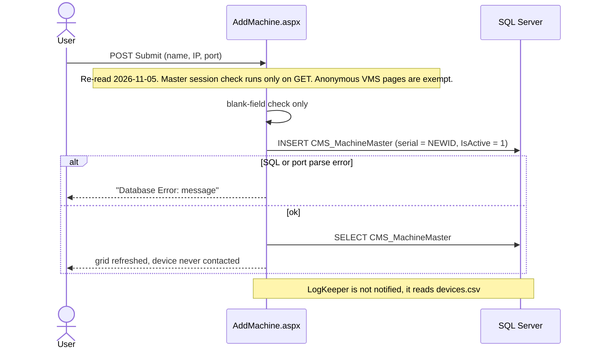
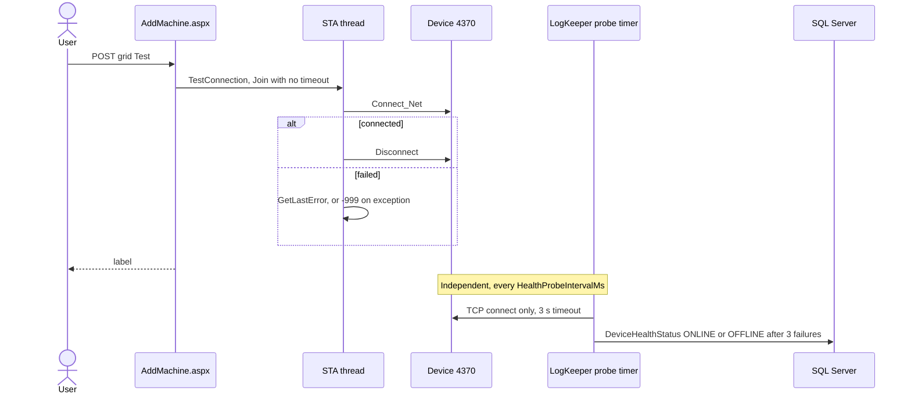
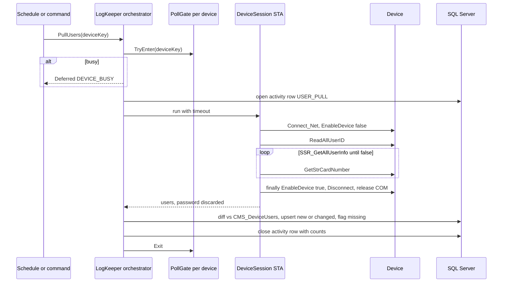
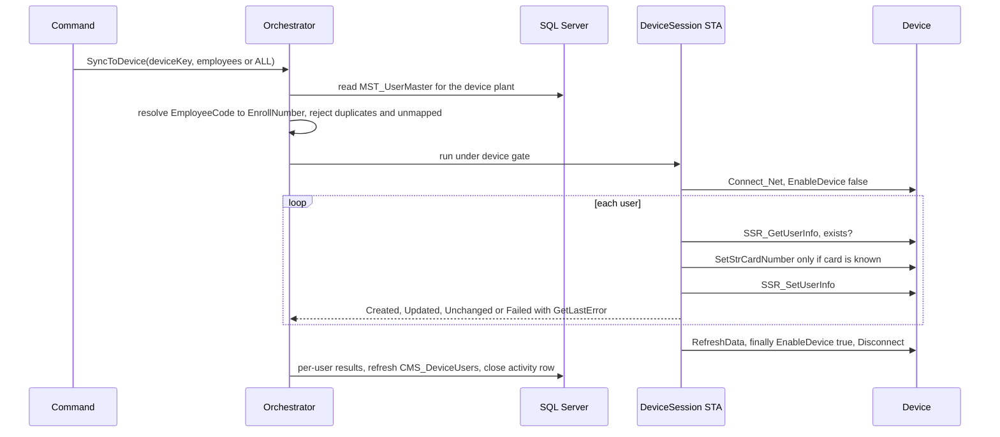
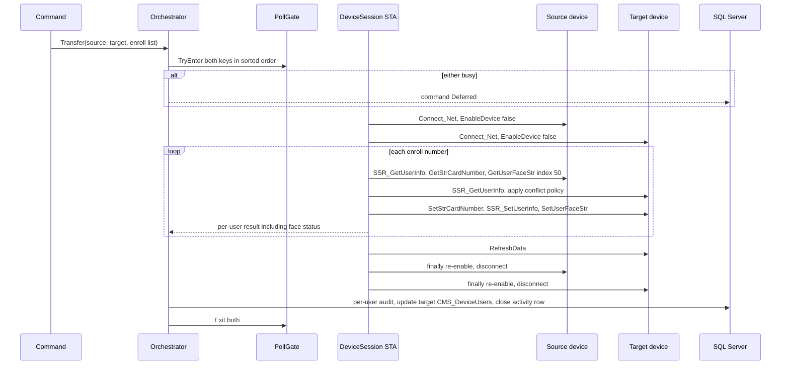
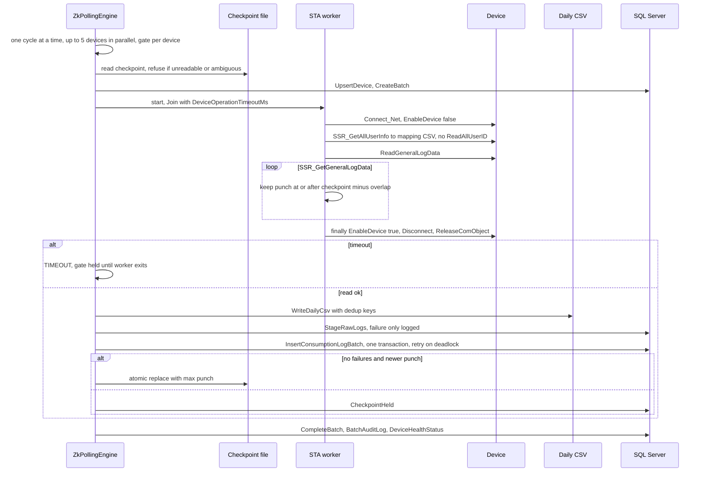
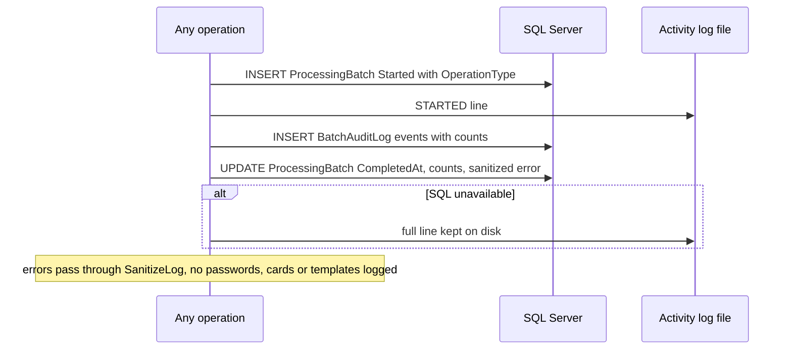

# Biometric Device Integration — Existing Architecture and LogKeeper Enhancement Plan

| Field | Value |
|---|---|
| Date | 2026-11-02 |
| Stage | Stage 1 (read-only investigation) complete. Stage 2 (implementation) not started. |
| Scope | `AnmolDristi/AddMachine.aspx`, `AnmolDristi/DeviceTransfer.aspx`, `AnmolDristi/ZKTecoManager.cs`; LogKeeper Windows Service |
| LogKeeper location | Separate Git repository `D:\PersonalRnD\Biometric\LogKeeper`, `HEAD` `e6ca2a4`, read in place on 2026-11-02. Those citations were not independently revalidated on 2026-11-05. |
| UAT evidence | Read-only metadata (table/column/index definitions) via the AnmolDristi UAT reader, 2026-11-02. No data rows read. No LIVE access. Population counts from that day were not independently revalidated on 2026-11-05 and are omitted from this published copy. |
| Status | Proposal. Grants no approval for any production change. |

## 0. Summary

1. **There is no API.** Both pages are synchronous Web Forms postbacks that run inline SQL and call the ZKTeco COM SDK (`zkemkeeper`) directly inside the IIS worker process. No Web API, route, `.asmx`, `HttpClient`, token, or stored procedure takes part in either flow. The "ERP/application API" assumed by the original brief does not exist in either repository.
2. **Two disconnected device systems.** The web app keeps its own device registry, user snapshot and attendance table (`CMS_MachineMaster`, `CMS_DeviceUsers`, `CMS_RawBiometricLogs`). LogKeeper keeps different ones (`devices.csv` feeding `DeviceMaster`, a per-device `UserMapping_<ip>.csv`, `CMS_RawConsumptionLogs`). Nothing links them.
3. **Most LogKeeper issues listed in the brief were already fixed in the 2026-11-02 reading.** That reading was not independently revalidated on 2026-11-05. The defects that remain are different and are listed in §1.6.
4. **Security.**
   - LogKeeper's working-tree `App.config` (line 6) holds a plaintext `sa` connection string to a public IP. It is uncommitted; `HEAD` has `CHANGE_ME` placeholders. Values are deliberately not reproduced here. Rotate the credential and supply it through the `LOGKEEPER_DB_CONNECTION` environment variable, which `DatabaseHelper.cs` (15–23) already reads.
   - The web app's session check does not run on postbacks (§1.4).
5. **UAT was behind LogKeeper's code in the 2026-11-02 metadata read.** That read was not independently revalidated on 2026-11-05. The LogKeeper tables (`DeviceMaster`, `ProcessingBatch`, `BatchAuditLog`, `RawDeviceLog`, `ErrorLog`, `DeviceHealthStatus`) were not present on UAT. `CMS_RawConsumptionLogs` there had no `WorkCode` column and only the three-column `UX_RawLogs` unique index (§5.1).

## 0.1 Decisions selected by the requester (2026-11-02 working session)

| Topic | Selected |
|---|---|
| Device registry source of truth | `CMS_MachineMaster`, read by LogKeeper through SQL, with `MachineID` as the stable device ID |
| How operators trigger device operations | Web pages write a SQL command row; LogKeeper polls it. Only LogKeeper talks to devices. |
| Biometric templates in device-to-device transfer | Face template only (index 50, as today), held in memory, never stored or logged |
| Activity records | Reuse `ProcessingBatch` with an additive `OperationType` column; widen the `BatchAuditLog` event CHECK constraint |
| UAT access | Read-only metadata lookups permitted (used for §5) |

Still open, and blocking particular phases:
- **Employee ↔ enrollment mapping.** `MST_UserMaster` has no enrollment-number column, so the rule (for example "EnrollNumber equals EmployeeCode") must be decided.
- **Branch identifier source.** `CMS_MachineMaster.PlantID` versus the `devices.csv` BranchID string.
- **Canonical attendance table.** `CMS_RawConsumptionLogs` versus `CMS_RawBiometricLogs`.
- **Consent gating.** Whether a face transfer requires `MST_UserMaster.DPDPConsentGiven = 1`. This is a legal/owner question, not a technical one.

---

## 1. Existing architecture

### 1.1 `AddMachine.aspx` (page heading "Canteen Management System")

Execution chain: browser → full postback → code-behind → inline SQL on `DbConn`, or `ZKTecoManager` → COM `CZKEM` → device over TCP. There is no JavaScript, AJAX, UpdatePanel, service layer or repository.

**Registration** (`btnSave_Click`, `AddMachine.aspx.cs` 40–84):
- Required fields: Machine Name, IP, Port. Checked only server-side, and only for blank values (43–50).
- No IP format check and no duplicate-IP check in code. UAT confirms there is no unique constraint on `IPAddress` either.
- `int.Parse` on the port (64) throws on bad input; the user sees "Database Error: {exception message}".
- INSERT into `CMS_MachineMaster (MachineName, IPAddress, PortNumber, MachineSerialNo, IsActive, CreatedOn)`, with `MachineSerialNo = NEWID()` as a placeholder and `IsActive = 1` (57–58).
- The `PlantID` column exists (UAT) but is never written. No branch, location, machine number, comm key or real serial is captured.
- Connectivity is **not** tested at registration. There is no edit, deactivate or delete UI.

**Grid row commands** (`gvMachines_RowCommand`, 87–226), keyed on DataKeys `MachineID`, `IPAddress`, `PortNumber`:
- **Test:** `TestConnection` runs `Connect_Net`, then `Disconnect`, on an STA thread. The page shows the SDK error code, or `-999` for any exception; the exception itself is discarded.
- **Logs:** `PullLogsSTA` reads the device's entire log buffer every time (no checkpoint) and inserts row by row into `CMS_RawBiometricLogs`.
  - Duplicates are checked by `IF NOT EXISTS` on `(MachineID, EnrollNumber, PunchTime)` only (131–136). There is no transaction, no lock hint, and (UAT) no unique index, so concurrent runs can insert duplicates.
  - VerifyMode, InOutMode and WorkCode are not part of the duplicate check, and WorkCode is dropped. InOutMode is the meal-type key (`ZKTecoManager.cs` 89), so two different meal punches in the same second collapse into one.
  - A failed `ReadGeneralLogData` still reports "no attendance logs", so a read error looks like an empty device.
- **Users:** `PullUsersSTA` calls `ReadAllUserID`, `SSR_GetAllUserInfo`, `GetStrCardNumber` and `GetUserFaceStr` (index 50), then upserts only UserName, Privilege and IsEnabled into `CMS_DeviceUsers` (185–196).
  - The `CardNumber` column exists in `CMS_DeviceUsers` (UAT) but is never written. Password and face template are discarded.
  - Users deleted from a device are never removed from `CMS_DeviceUsers`.
- The page sets `AspCompat="true"` (line 1). `DeviceTransfer.aspx` does not. This has no effect on correctness because `ZKTecoManager` creates its own STA threads.

### 1.2 `DeviceTransfer.aspx`

- **Selecting devices:** source and target dropdowns load from `CMS_MachineMaster WHERE IsActive = 1` (22–45).
- **Listing users:** the grid shows rows from **`CMS_DeviceUsers`**, the database snapshot written by AddMachine's "Users" button, **not the device** (47–85). It is stale unless someone pulled users recently.
- **Compare** (167–223): FULL OUTER JOIN of the two snapshots on EnrollNumber only, giving Synced / Missing in Target / Missing in Source. Checkboxes for Synced and Missing in Source are disabled server-side (226–255).
- **Transfer** (88–165) calls `TransferSpecificUsersSTA` (`ZKTecoManager.cs` 374–456). One STA thread connects to and disables both devices, then for each selected enroll number:
  - Source: `SSR_GetUserInfo` (name, password, privilege, enabled), `GetStrCardNumber`, `GetUserFaceStr(…, 50, …)`. A user missing on the source is skipped silently.
  - Target: `SetStrCardNumber`, then `SSR_SetUserInfo`, which creates or **silently overwrites**, then `SetUserFaceStr`. The return value of `SetUserFaceStr` is ignored, so the user counts as a success even when the face template failed (420–424).
  - Then `RefreshData` on the target, re-enable both devices, disconnect.
- **Transferred:** enroll number, name, password/PIN, privilege, enabled flag, card number, face template index 50.
- **Not transferred:** fingerprint templates (nothing in either codebase calls `ReadAllTemplate`, `SSR_GetUserTmpStr` or `GetUserTmpExStr`), other face indexes, verify style, groups. Attendance logs are not involved.
- **Result reporting:** one label, "x out of y copied". No per-user result, no audit row. `CMS_DeviceUsers` is not updated for the target, so Compare keeps reporting "Missing in Target" until someone pulls users from the target.

### 1.3 `ZKTecoManager.cs` defects

- Re-enable and disconnect are not in `finally` blocks in `PullLogsSTA` (98–100), `PullUsersSTA` (289–290) or `TransferSpecificUsersSTA` (431–434). An exception mid-read leaves the device disabled with its session open. In a transfer where only one device connects, that device is never disconnected (391, 440).
- `thread.Join()` has no timeout, so a hung device blocks the IIS request thread indefinitely.
- `Marshal.ReleaseComObject` is never called. The field `device = new CZKEMClass()` (13) creates a COM object on every instantiation that the STA methods never use.
- `Connect`, `PushUser`, `DeleteUser` and `PushUserWithFaceAndCardSTA` have no callers.
- Machine number is hardcoded to 1. There is no comm-key support (`SetCommPassword` is commented out at line 26).
- Calling `SetStrCardNumber("")` when the source has no card may erase a card already on the target (unverified on a device).

### 1.4 Authentication and authorization

- Re-read on 2026-11-05: `Dristi.Master.cs` `Page_Load` checks `Session["USERID"]` only inside `if (!IsPostBack)` (123–154). Anonymous VMS pages are exempt: the check runs only when `IsAnonymousAccessPage()` is false. Every device operation on these two pages is a postback, so none of them re-checks the session.
- Re-read on 2026-11-05: `Global.asax.cs` `Application_AcquireRequestState` (32–160) still executes and returns early for selected paths. The `USERID` and token checks inside that method are commented out. Both pages inherit `System.Web.UI.Page`, not `BasePage`.
- `PermissionHelper.ApplyUiPermissions` only hides controls that have a `UI.<ID>.View` permission key (`PermissionHelper.cs` 76–95). There is no page-level URL authorization.
- Neither page is linked in the menu, so any logged-in user who knows the URL can register devices and push users onto devices.
- **Not inspected:** `Web.config` `<authorization>`, which `AGENTS.md` §3.4 puts off limits.

### 1.5 How the two systems conflict

| Concern | Web app | LogKeeper |
|---|---|---|
| Device registry | `CMS_MachineMaster` (`MachineID`) | `devices.csv` → `DeviceMaster` (unique `MachineIP`) |
| Attendance | `CMS_RawBiometricLogs` (manual button) | `CMS_RawConsumptionLogs`, plus `RawDeviceLog` staging |
| Device users | `CMS_DeviceUsers` | `Config\UserMapping_<ip>.csv` |
| Same-device guard | none | in-process `PollGate` per device key |

- Registering a machine in AddMachine does not make LogKeeper poll it.
- LogKeeper's guard works only inside its own process. A web Logs/Users/Transfer action against a device LogKeeper is polling can collide with it: one session's `EnableDevice(true)` can unlock a device the other still has locked.

### 1.6 LogKeeper — the brief's seven issues checked against code read on 2026-11-02

The file and line citations in this subsection are historical evidence from that reading. They were not independently revalidated on 2026-11-05.

1. **Mapping CSV column count — not reproducible.** `UpdateUserMappingFile` writes three columns (`FileManager.cs` 197–200), the template is three columns (`Paths.cs` 112–115), and the loader requires at least three (`FileManager.cs` 67). Remaining defects:
   - `SSR_GetAllUserInfo` is called **without `ReadAllUserID`** first (`FileManager.cs` 171, called from `ZkPollingEngine.cs` 418); nothing in LogKeeper calls `ReadAllUserID`. The web app does call it (`ZKTecoManager.cs` 250). Per documented SDK behaviour the user buffer is empty, so the mapping likely never refreshes from the device. Needs one device test.
   - No CSV escaping. A comma in a device user's name truncates the name on reload.
   - The file is truncated and rewritten in place (193–203), not temp-file-and-replace like checkpoints, so a crash mid-write loses HR-edited employee codes.
   - Errors go to `Console.WriteLine` (205–208), which is invisible in a Windows Service.
   - The engine reads `UserMapping_<ip>.csv` (`ZkPollingEngine.cs` 291); the global `Config\UserMapping.csv` that setup seeds is never read during polling.
   - The mapping is keyed by IP while the checkpoint follows the stable DeviceId, so an IP change loses the mapping.
2. **`InsertConsumptionLog` parameter order — no defect.** The method (`DatabaseHelper.cs` 352) uses named SQL parameters consistently and has no callers. The engine calls `InsertConsumptionLogBatch(canonicalBranchId, currentIp, punchRecords)` (`ZkPollingEngine.cs` 618), matching its signature (`DatabaseHelper.cs` 416).
3. **Checkpoint advancing after a SQL failure — fixed.** On rollback the batch resets its counts so every record counts as failed (`DatabaseHelper.cs` 483–495). The engine sets `SQL_PERSIST` (`ZkPollingEngine.cs` 622–626). `CanAdvanceCheckpoint` requires zero failures (`DeviceHealth.cs` 830–838). The checkpoint is written via a temp file and `File.Replace` (`DeviceHealth.cs` 629–657).
   - Remaining gap: failures staging into `RawDeviceLog` (`ZkPollingEngine.cs` 591–600) or writing the CSV backup (`FileManager.cs` 338–341) do not hold the checkpoint. Those two copies can develop permanent gaps once the overlap window passes.
4. **Disconnect and re-enable on every path — LogKeeper yes, web app no.** LogKeeper's `finally` re-enables, disconnects and releases COM (`ZkPollingEngine.cs` 497–507). On timeout, the device guard stays held until the stuck STA thread finishes (513–574). For the web app, see §1.3.
5. **Concurrent writes to a shared mapping file — no longer a risk.** Each device has its own file, only one poll runs per device, and duplicate IPs are rejected (`FileManager.cs` 125–129). The real concurrency risk is the cross-process device contention in §1.5.
6. **Missed punches with identical timestamps — handled in LogKeeper.** Identity is `(MachineIP, EnrollNumber, PunchTime, VerifyMode, InOutMode, WorkCode)` (`DatabaseHelper.cs` 442–448). The checkpoint advances only on a strictly newer punch, and each poll re-reads from the checkpoint minus `CheckpointOverlapMinutes` (default 10), inclusive (`DeviceHealth.cs` 41, 544–552). Remaining edge cases:
   - Legacy rows with NULL WorkCode suppress new rows with any WorkCode (`DeviceHealth.cs` 309–321).
   - A punch older than the checkpoint minus the overlap (for example after a device clock is corrected backwards) is never fetched; LogKeeper's own self-check asserts this (`DeviceHealth.cs` 1255).
   - The web app's `CMS_RawBiometricLogs` does collapse distinct punches (§1.1).
   - On UAT, the three-column `UX_RawLogs` index would collapse distinct punches and is not recognised as an intended duplicate (§5.1).
7. **Hardcoded paths, configuration and credentials:**
   - `App.config` line 6: plaintext `sa` credential (uncommitted).
   - `App.config` line 9: `DeviceIP=<device-ip>`. The recorded seed was in public `192.156.0.0/16` address space, probably a typo for `192.168`. Used only as a seed value.
   - `Paths.cs` 102, 109–110 seed a fake device `192.168.1.200` and `DEFAULT_PLANT` when files are missing, while `App.config` says `Dankuni_Plant`.
   - `CsvExportPath` and `SyncFilePath` are present in `App.config` but never read.
   - Hardcoded: `MaxDeviceParallelism = 5` (`ZkPollingEngine.cs` 18), machine number 1, face index 50. Neither codebase supports a device comm key.
   - Bitness checked from the CLR header flags of the built executables: Debug is x86-only (`0x3`), Release is AnyCPU with Prefer32Bit (`0x20003`). Both run 32-bit, consistent with the x86-only interop assembly.

---

## 2. API and operation inventory

None of the following take part in either flow: HTTP endpoints, Web API controllers, routes, `.asmx`, `HttpClient`, tokens, API keys, base URLs, serialization, retry policies, explicit timeouts, stored procedures. The four `.ashx` handlers and the `[WebMethod]` in `Dristi.Master.cs` (584) do not touch devices. Every operation is a synchronous same-page postback authenticated only by the ASP.NET session cookie; grid DataKeys travel in ViewState; the response is the re-rendered page with a message in `lbl_msg`.

| Operation | Trigger | Inputs | Database | Device SDK calls | Result and error handling |
|---|---|---|---|---|---|
| AddMachine load | GET | — | SELECT `CMS_MachineMaster` | — | Grid; a SQL error is unhandled |
| `btnSave_Click` | POST | name, IP, port | INSERT `CMS_MachineMaster` | — | Raw exception text shown |
| Test | POST (grid) | row index | — | `Connect_Net`, `GetLastError`, `Disconnect` | SDK code, or `-999` |
| Logs | POST (grid) | row index | INSERT `CMS_RawBiometricLogs` row by row | `EnableDevice`, `ReadGeneralLogData`, `SSR_GetGeneralLogData` | Counts; a SQL error mid-loop leaves a partial insert |
| Users | POST (grid) | row index | upsert `CMS_DeviceUsers` | `ReadAllUserID`, `SSR_GetAllUserInfo`, `GetStrCardNumber`, `GetUserFaceStr` | Count only |
| DeviceTransfer load | GET | — | SELECT active machines | — | Dropdowns |
| Source changed | auto-postback | source ID | SELECT `CMS_DeviceUsers` | — | Grid |
| Compare | POST | source and target IDs | FULL OUTER JOIN `CMS_DeviceUsers` | — | Grid with status badges |
| Transfer | POST | IDs, checked enroll numbers | SELECT IP and port | `SSR_GetUserInfo`, `Get/SetStrCardNumber`, `Get/SetUserFaceStr`, `SSR_SetUserInfo`, `RefreshData` | "x of y"; connection flags or exception text on failure |

### 2.1 SDK signatures

Obtained by reflecting `LogKeeper\bin\Debug\Interop.zkemkeeper.dll` (interface `zkemkeeper.IZKEM`, 329 methods) in a 32-bit process.

```
bool Connect_Net(string IPAdd, int Port)              bool SetCommPassword(int CommKey)
bool EnableDevice(int, bool)                          bool RefreshData(int)
bool ReadAllUserID(int)                               void GetLastError(out int)
bool SSR_GetAllUserInfo(int, out string Enroll, out string Name, out string Password, out int Privilege, out bool Enabled)
bool SSR_GetUserInfo(int, string Enroll, out string Name, out string Password, out int Privilege, out bool Enabled)
bool SSR_SetUserInfo(int, string Enroll, string Name, string Password, int Privilege, bool Enabled)
bool SSR_EnableUser(int, string Enroll, bool)         bool SSR_DeleteEnrollData(int, string, int BackupNumber)
bool GetStrCardNumber(out string)                     bool SetStrCardNumber(string)
bool ReadAllTemplate(int)
bool SSR_GetUserTmpStr(int, string, int FingerIndex, out string TmpData, out int TmpLength)
bool SSR_SetUserTmpStr(int, string, int FingerIndex, string TmpData)
bool GetUserTmpExStr(int, string, int FingerIndex, out int Flag, out string TmpData, out int TmpLength)
bool SetUserTmpExStr(int, string, int FingerIndex, int Flag, string TmpData)
bool GetUserFaceStr(int, string, int FaceIndex, out string TmpData, out int TmpLength)
bool SetUserFaceStr(int, string, int FaceIndex, string TmpData, int TmpLength)
bool BeginBatchUpdate(int, int UpdateFlag)  bool BatchUpdate(int)  bool CancelBatchUpdate(int)
bool ReadGeneralLogData(int)  bool ReadNewGLogData(int)
bool SSR_GetGeneralLogData(int, out string, out int Verify, out int InOut, out int Y, M, D, H, Min, S, out int WorkCode)
bool GetSerialNumber(int, out string)  bool GetDeviceInfo(int, int, out int)  bool GetDeviceStatus(int, int, out int)
bool GetFirmwareVersion(int, out string)  bool GetDeviceTime(int, out int x6)  bool ClearData(int, int)  bool ClearGLog(int)
Not present: SSR_SetUserTmpExStr, SSR_GetUserTmpEx
```

Caveats:
- The reflection script marks any by-reference parameter carrying an out flag as `out`. Existing code passes some of these with `ref` (for example `GetUserFaceStr`, `workCode`) and compiles, so those are in/out parameters.
- This reflects the type library registered on the build machine. A production machine with a different `zkemkeeper.dll` must be re-checked; `--check-sdk` only tests that the COM object can be created.
- Firmware support for templates is untested.

---

## 3. Sequence diagrams

Diagrams 1, 2 and 6 show current behaviour. Diagrams 3, 4, 5 and 7 are proposed.

### 3.1 Device registration (current)


### 3.2 Connectivity validation (current: web test and LogKeeper probe)


### 3.3 Pull users from a device (proposed)


### 3.4 ERP to device synchronization (proposed; mapping rule open)


### 3.5 Device-to-device transfer (proposed)


### 3.6 Attendance extraction (current LogKeeper, kept as-is)


### 3.7 Activity logging (proposed)


---

## 4. Existing versus proposed

**Reuse.** These already exist in LogKeeper:
- The STA worker with timeout, `finally` cleanup and late-completion handling (`ZkPollingEngine.cs` 389–574).
- `PollGate`, the device runtime state and health store, and `TcpHealthProbe`.
- `CheckpointFile` and `CheckpointContinuity`.
- `InsertConsumptionLogBatch`.
- `ProcessingBatch`, `BatchAuditLog` and `ErrorLog` as the activity store.
- `SanitizeLog`, `DevicePlanner`, the Topshelf host, the single-instance mutex, and the `--dry-run` and `--health-self-check` modes.

From the web app, reuse `CMS_MachineMaster` as the registry and `CMS_DeviceUsers` (including its unused `CardNumber` column and `UQ_Machine_EnrollNo`) as the user snapshot.

| Suggested component | Existing code |
|---|---|
| DeviceConfigurationService | `DevicePlanner` |
| DeviceConnectionManager | `PollGate` plus the STA worker, to be extracted as `DeviceSession` |
| SyncCheckpointManager | `CheckpointFile`, `CheckpointContinuity` |
| DeviceActivityLogger | batch methods in `DatabaseHelper` |
| DatabaseRepository | `DatabaseHelper` |
| ApiIntegrationService | not needed; no API exists and the decision is SQL |
| DeviceSyncOrchestrator | command loop inside `ZkPollingEngine` |

**Modify:**
- `ZkPollingEngine.cs`: extract the worker into `DeviceSession` so attendance and new operations share one guard, timeout and cleanup path; add the command-poll loop.
- `FileManager.UpdateUserMappingFile`: add `ReadAllUserID`, CSV escaping, atomic write, real logging. **Behaviour change:** mapping starts refreshing from devices, so EmployeeName on new punch rows can change.
- `DevicePlanner.cs`: read `CMS_MachineMaster` (active rows) with a last-good local cache, keeping `devices.csv` as fallback.
- `DatabaseHelper.cs`: registry read, user snapshot upsert, `OperationType`, command claim and complete.
- `Paths.cs`: stop seeding a fake IP.
- `App.config`: remove the plaintext credential; add new settings.
- Web app: `AddMachine.aspx.cs` and `DeviceTransfer.aspx.cs` enqueue commands instead of calling COM.

**Introduce:**
- `DeviceSession.cs` (STA runner: connect, `EnableDevice`, guaranteed cleanup).
- `DeviceUserOps.cs` (pull, push, transfer).
- A command table pair (§5.2).

**Deprecate:**
- Unused `ZKTecoManager` members. After the queue is live, all COM use in IIS.
- `DatabaseHelper.InsertConsumptionLog` (no callers).
- The global `UserMapping.csv` seed, and the `device_ip.txt` / `branch_id.txt` fallback once migrated.
- The unread `App.config` settings.
- The web "Logs" button path into `CMS_RawBiometricLogs`, subject to the canonical-table decision.

**Limitations to plan around:**
- Many ZKTeco firmwares accept one SDK session at a time.
- COM calls cannot be cancelled, so timeouts must keep holding the device guard.
- `SSR_SetUserInfo` overwrites without warning.
- The card buffer is sticky.
- Privilege 14 (administrator) must never be pushed without an explicit flag.
- Face template support varies by firmware.

---

## 5. Database impact

### 5.1 Existing tables (UAT metadata, 2026-11-02)

Population counts recorded on 2026-11-02 were not independently revalidated on 2026-11-05 and are omitted below. Schema shape and table existence from that metadata read are retained.

| Table | Columns relevant here | Keys and indexes |
|---|---|---|
| `CMS_MachineMaster` | MachineID (identity), PlantID int NULL, MachineName varchar(100), IPAddress varchar(15), PortNumber int default 4370, MachineSerialNo varchar(100), IsActive bit default 1, CreatedOn | PK MachineID only; no unique on IP; no FK on PlantID |
| `CMS_DeviceUsers` | DeviceUserID, MachineID, EnrollNumber varchar(50), UserName varchar(100), Privilege, IsEnabled, SyncDateTime, CardNumber varchar(50) | PK; unique `UQ_Machine_EnrollNo (MachineID, EnrollNumber)`; no FK |
| `CMS_RawBiometricLogs` | LogID, MachineID, EnrollNumber, VerifyMode, InOutMode, PunchTime, SyncDateTime | PK only, no unique index |
| `CMS_RawConsumptionLogs` | LogId, EmployeeCode, EnrollNumber, VerifyMode, InOutMode, PunchTime, CreatedOn, BranchID varchar(50), MachineIP varchar(50), EmployeeName — **no WorkCode** | PK; unique `UX_RawLogs (MachineIP, EnrollNumber, PunchTime)` |
| `CMS_ConsumptionLogs` | LogID, UserType, ReferenceID, MachineID (FK `CMS_MachineMaster`), MealTypeID (FK `CMS_MealTypes`), PunchTime, AmountCharged, IsBilledToHost, SyncDateTime | — |
| `MST_Plant` | Id, PlantID_Description, PlantID_ID, SAP_Code | PK Id |
| `MST_UserMaster` | EmployeeCode (PK), EmployeeName, BranchId, PlantId, EmployeeStatus, DPDPConsentGiven, DPDPConsentDate (and others) — **no enrollment number** | PK EmployeeCode |

Not present on UAT: `DeviceMaster`, `LocationMaster`, `ProcessingBatch`, `BatchAuditLog`, `RawDeviceLog`, `ExportRecord`, `ExportDetail`, `ErrorLog`, `DeviceHealthStatus`. Their definitions are in LogKeeper `schema/Enterprise_Tables.sql` and `schema/DeviceHealthStatus.sql`.

Consequences:
- Current LogKeeper code inserts `WorkCode` into `CMS_RawConsumptionLogs`, so on UAT every batch would fail and the checkpoint would be held (a safe failure).
- A duplicate on `UX_RawLogs` is not classified as an intended duplicate (`DeviceHealth.cs` 286, 329–334), so it would roll back the whole batch.
- UAT is in the pre-migration state that LogKeeper's `schema/CMS_RawConsumptionLogs_event_identity.sql` detects and handles. Applying that script is a prerequisite for any UAT test.
- Nothing in either repository writes `CMS_ConsumptionLogs` (canteen billing).
- No stored procedures are involved in any device flow.

### 5.2 Proposed changes

All proposed changes are additive. No SQL has been written, and each item needs explicit approval before a script is produced.

1. **Device identity — no schema change.** LogKeeper reads `CMS_MachineMaster` and uses `cms:{MachineID}` as DeviceId. Checkpoint adoption from existing `sync_<ip>.txt` files is already supported (`DeviceHealth.cs` 690–767). `DeviceMaster` stays as LogKeeper's internal table, populated from the registry.
2. **Branch.** Populate the existing `CMS_MachineMaster.PlantID` from AddMachine (UI change, no schema change), and derive the LogKeeper BranchID from `MST_Plant`. Which `MST_Plant` column becomes the BranchID string is open.
3. **Activity type.** `ALTER TABLE ProcessingBatch ADD OperationType NVARCHAR(30) NOT NULL DEFAULT 'ATTENDANCE'`. Requested activity fields map onto existing columns: ActivityId = BatchID, BranchId = BranchID, MachineIP, ActivityType = OperationType, StartedOn = StartedAt, CompletedOn = CompletedAt, Status, TotalRecords = RecordsRead, SuccessCount = RecordsInserted, FailureCount = RecordsFailed, ErrorMessage.
4. **Audit events.** Widen `CK_AuditLog_Event` (`Enterprise_Tables.sql` 118–122) with new event names such as `UserCreated`, `UserUpdated`, `UserFailed`, `UserMissing`, `Transferred`. This is a drop and re-create of a CHECK constraint: no data is lost, but it is a constraint change. Per-user results go in `BatchAuditLog` with `Detail` holding the enroll number and SDK error, never passwords, cards or templates.
5. **Removed-user detection.** Add nullable `CMS_DeviceUsers.LastSeenOn DATETIME` and `IsPresentOnDevice BIT` instead of deleting rows. Also start writing the existing `CardNumber` column.
6. **Command queue.** New `CMS_DeviceCommand` (CommandId, CommandType, MachineID, TargetMachineID, RequestedBy, RequestedOn, Status, ClaimedOn, CompletedOn, BatchID, ErrorMessage) and `CMS_DeviceCommandItem` (CommandId, EnrollNumber, ResultStatus, ResultDetail). LogKeeper claims rows with `UPDATE … OUTPUT` under `READPAST` so a command is executed once.
7. **Employee mapping.** Depends on the open mapping decision.

---

## 6. Implementation roadmap

Recommended order: Phase 1 → 2 → 7 → 3 → 4 → 5 → 6 → 8. Activity tracking comes before the new operations so every new operation is auditable from day one.

**Prerequisites:**
- Rotate the exposed credential.
- Apply LogKeeper `schema/Enterprise_Tables.sql`, `schema/DeviceHealthStatus.sql` and `schema/CMS_RawConsumptionLogs_event_identity.sql` on UAT (existing scripts; deployment approval needed).

| Phase | Files | Depends on | Main risk | Accepted when |
|---|---|---|---|---|
| 1. Configuration and registry | `DevicePlanner.cs`, `DatabaseHelper.cs`, `Paths.cs`, `App.config` | Branch decision; UAT prerequisites | Polled device set changes or checkpoints reset | `--dry-run` lists the same devices from SQL as from CSV; checkpoints adopted, not re-backfilled; cached list keeps polling when SQL is down |
| 2. Device session | new `DeviceSession.cs`, `ZkPollingEngine.cs`, `FileManager.cs` | Phase 1 | Regression in the live attendance path | `--health-self-check` passes; a test device gives identical counts and checkpoint behaviour; pulling the network mid-read leaves the device re-enabled |
| 7. Activity tracking | `DatabaseHelper.cs`, new additive script under LogKeeper `schema/` | Schema approval (§5.2 items 3–4) | CHECK change on a live table | Each operation writes one batch row plus events; SQL outage falls back to the file log without crashing |
| 3. Pull users | new `DeviceUserOps.cs`, `DatabaseHelper.cs`, `Models.cs` | §5.2 item 5 | Snapshot drift | Count matches the device; a second run changes nothing; passwords never reach logs or SQL |
| 4. ERP to device | `DeviceUserOps.cs`, `DatabaseHelper.cs`, command loop in `ZkPollingEngine.cs` | Mapping rule; §5.2 item 6 | Overwrites or privilege escalation | Create / update / unchanged / duplicate-rejected each give a per-user result; re-run is idempotent |
| 5. Device transfer | `DeviceUserOps.cs`; web `DeviceTransfer.aspx.cs` enqueues | Phase 4 queue; consent decision | Two-device locking, face write failures | Per-user result including face status; target snapshot updated; both devices re-enabled under fault injection |
| 6. Attendance improvements | `ZkPollingEngine.cs`, `FileManager.WriteDailyCsv` returns bool | Canonical table decision | Holding checkpoints on disk faults could stall a device | `IMPLEMENTATION_AUDIT_PLAN.md` §4.2, §4.3 and §9 pass |
| 8. Testing, recovery, deployment | `DeviceHealth.RunSelfCheck`, `DEPLOYMENT.md`, `DEPLOYMENT_CHECKLIST.md` | All prior phases | Rollout to a live branch | Staged one branch at a time; rollback is the previous executable plus config; checkpoint files stay compatible |

Separately recommended for this repository, each needing its own approval:
- Make `ZKTecoManager` cleanup exception-safe and add join timeouts.
- Add a session check that runs on postbacks.
- Restrict `AddMachine.aspx` and `DeviceTransfer.aspx` by permission.

---

## 7. Evidence limits

- No device was contacted. The `ReadAllUserID` requirement, face index 50, card buffer and single-session behaviour come from SDK convention, not observation.
- UAT evidence is metadata only. Production schema was not inspected and may differ.
- `Web.config` was not read (`AGENTS.md` §3.4).
- No build was run.
- LogKeeper's `README.md`, `DEPLOYMENT.md` and `IMPLEMENTATION_AUDIT_PLAN.md` were only skimmed by heading.
- The interop signatures reflect the build machine's registered type library only.
- LogKeeper source citations and the 2026-11-02 UAT population counts were not independently revalidated on 2026-11-05. Those counts are omitted from the published §5.1 table. This correction pass did not reopen LogKeeper and did not rerun the UAT metadata read.
