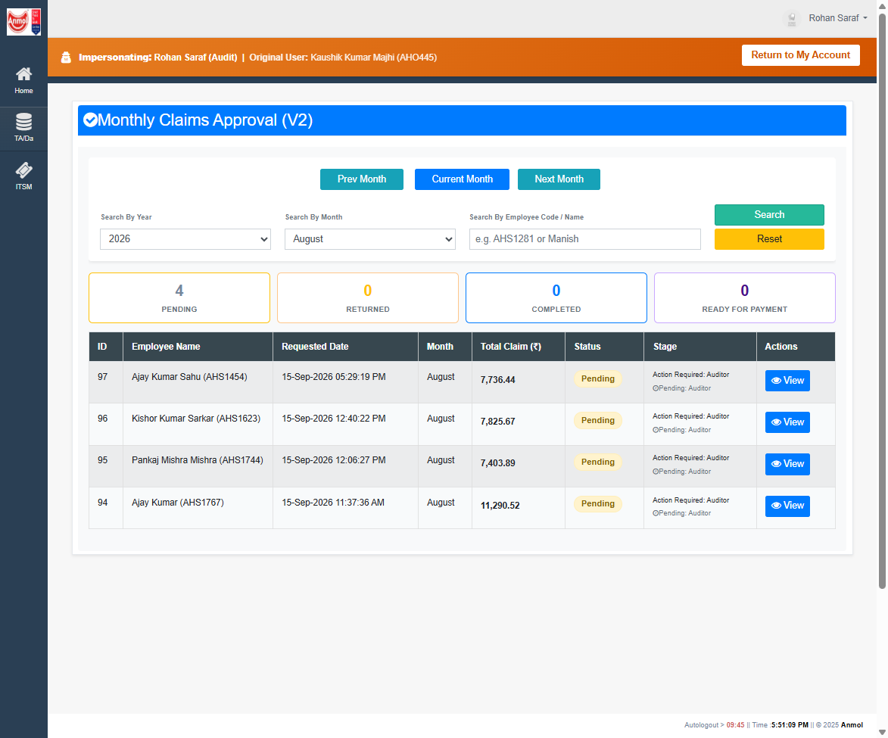
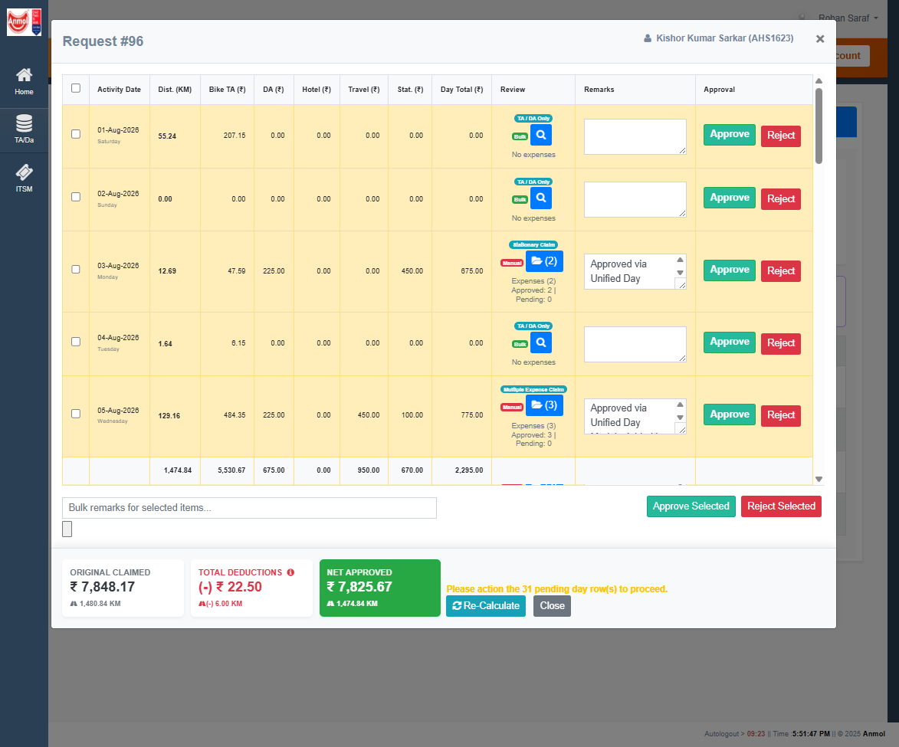
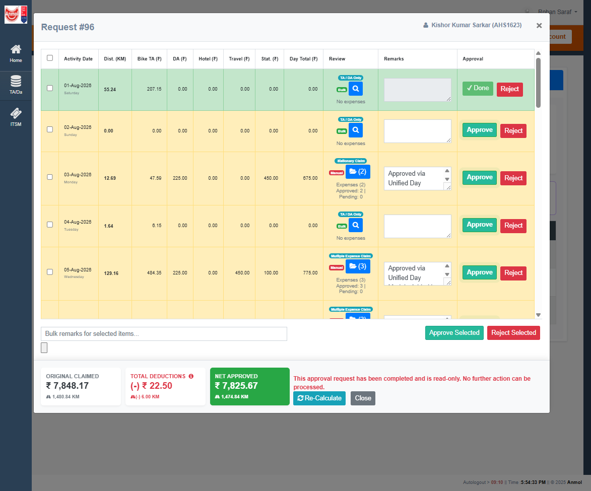
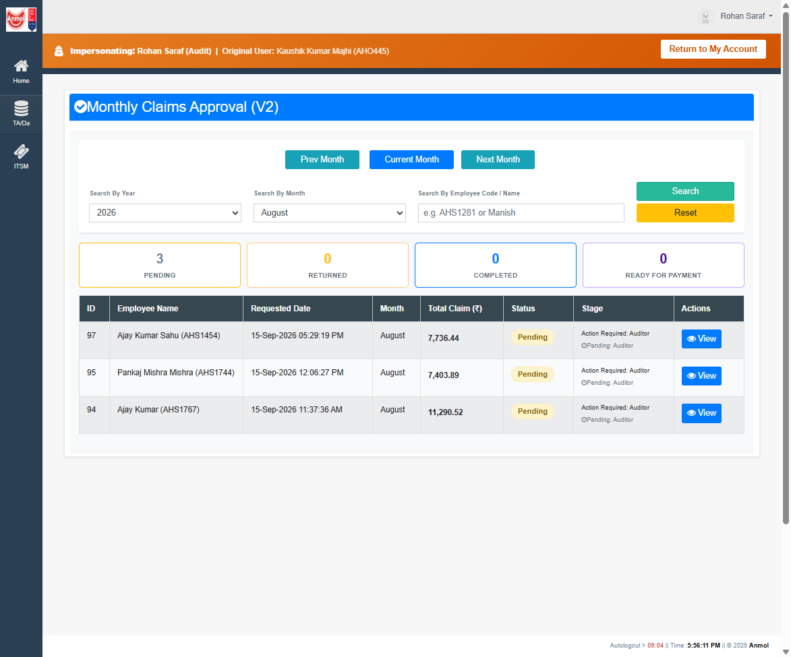

# RC-014A UAT Validation — Auditor Terminal State

**Date:** 2026-09-15  
**SQL:** MCP `anmol_uat` → `AnmolDristiDev`  
**App:** local IIS Express `http://localhost:53713` (RC-014A `AnmolDristi.dll` 17:07:10)  
**Actor:** `Audit` (Rohan Saraf), impersonated from `AHO445`  
**Claim:** Request **96** (Kishor Kumar Sarkar / `AHS1623`, August 2026)

**Overall verdict: FAIL**

The RC-014A procedure **does** write `Completed` + `Final Auditor Approval` history. It does so on the **first** Auditor day approve after L1 Forward, not on the last remaining gatekeeper day. Ready for Payment never appeared. Remaining days then hit the Completed payment lock.

No implementation change was made in this execution pass. Root cause is proven below.

---

## Session

| Item | Evidence |
| --- | --- |
| Site | `http://localhost:53713/ClaimsApproval_v2.aspx` |
| Identity | Banner: Impersonating Rohan Saraf (`Audit`) \| Original: Kaushik Kumar Majhi (`AHO445`) |
| Filter | Year 2026 / Month August |
| Queue before | 4 Pending: 97, **96**, 95, 94 |



---

## Phase 1 — Intermediate proof (one day)

### UI before

Request 96 modal: 31 yellow rows with Approve enabled. Footer: **Please action the 31 pending day row(s) to proceed.** Ready for Payment hidden. No Forward button.



### Action

Clicked **Approve** on **01-Aug-2026** (`ApprovalRequestDetailId` 2755).

### UI after

| Check | Expected | Observed | Result |
| --- | --- | --- | --- |
| Row becomes Done | 01-Aug ✔ Done, green | Yes | PASS |
| Remaining counter decreases | 31 → 30 | Yes (“30 pending day row(s)”) | PASS |
| Header remains Pending | Pending | SQL `Status=Completed` immediately | **FAIL** |
| Ready for Payment hidden | Hidden | Hidden (UI still thought 30 days pending) | PASS (for the wrong reason) |
| No Forward confirm | None | None | PASS |

### SQL — before first approve

**`SalesApprovalRequest`**

| ApprovalRequestId | Status | CurrentApproverLevel | CurrentApproverLoginId |
| --- | --- | --- | --- |
| 96 | Pending | 2 | Audit |

**`SalesApprovalRequestApprover`**

| Level | Login | Role | Status |
| --- | --- | --- | --- |
| 1 | AHS1605 | L1 | Approved |
| 2 | Audit | Auditor | Pending |

Latest details: **31/31** `DetailStatus=Approved`, `DetailApprovedLevel=1` (L1).

History through 680: last row `Pending → Pending`, Remarks `Level 1 completed. Forwarded to Auditor (Audit).`

### SQL — after first approve (01-Aug)

**`SalesApprovalRequest`**

| Column | Before | After |
| --- | --- | --- |
| Status | Pending | **Completed** |
| CurrentApproverLevel | 2 | **NULL** |
| CurrentApproverLoginId | Audit | **NULL** |
| ModifiedBy | AHS1605 | Audit |
| ModifiedOn | 2026-09-15 09:34:32 | 2026-09-15 12:22:04 |

**Auditor row:** Pending → **Approved** (`ActionBy=Audit`).

**01-Aug detail 2755:** `Approved`, `DetailApprovedLevel=2`, `DetailApprovedBy=Audit`.

**Other 30 latest details:** still `Approved` level 1 / `AHS1605`.

**History 685:** `Pending → Completed`, ChangedBy=`Audit`, Remarks=`Final Auditor Approval`.

Phase 1 **FAIL**: header did not stay Pending.

---

## Phase 2 — Terminal proof (remaining days)

Could not approve remaining days. Second click (02-Aug Approve) returned:

> This approval request has been completed and is read-only. No further action can be processed.

Ready for Payment did **not** appear (`btnMarkReadyForPayment` stays `Visible=false` while BindDetailsGrid still sees 30 gatekeeper-pending rows). No Forward confirmation (Auditor is final) — that part held.



| Check | Expected | Observed | Result |
| --- | --- | --- | --- |
| Approve every remaining pending day | Allowed until last day | Payment lock after day 1 | **FAIL** |
| No Forward confirmation | None | None | PASS |
| Header Completed | After last day | After first day | **FAIL** (timing) |
| Ready for Payment appears | After last day | Never | **FAIL** |
| Success notification (Completed) | Yes | Not observed as a Completed toast; first day used the AJAX Done path | **FAIL** |

---

## Phase 3 — Finance proof

**Not executable.** Ready for Payment was never visible, so `usp_MarkRequestReadyForPayment` was not invoked.

| Check | Expected | Observed | Result |
| --- | --- | --- | --- |
| Click Ready for Payment | Success | Button never shown | **FAIL** |
| Header ReadyForPayment | Yes | Still `Completed` | **FAIL** |
| History Completed → ReadyForPayment | Yes | No such row | **FAIL** |
| Leaves Auditor queue | Yes (for ReadyForPayment) | Left queue because header is **Completed** (queue SP is Pending-only) | Partial |
| No “Request not completed” | N/A | Not invoked | **FAIL** |



Request 96 dropped from the Auditor Pending grid (4 → 3). Completed / Ready chips stay **0** because `usp_GetPendingApprovalsForUser_Filters` only returns `Status='Pending'`.

---

## History (request 96)

| HistoryId | OldStatus | NewStatus | ChangedBy | Remarks |
| --- | --- | --- | --- | --- |
| 675 | *(empty)* | Pending | AHS1623 | Initial Submission |
| 676 | Pending | Returned | AHS1605 | Detail 2725 RETURN |
| 677 | Returned | Pending | AHS1623 | Resubmitted after corrections |
| 678 | Pending | Returned | AHS1605 | Unified Day Return |
| 679 | Returned | Pending | AHS1623 | Resubmitted after corrections |
| 680 | Pending | Pending | AHS1605 | Level 1 completed. Forwarded to Auditor (Audit). |
| **685** | **Pending** | **Completed** | **Audit** | **Final Auditor Approval** |

No `Completed → ReadyForPayment` row.

---

## PASS / FAIL matrix

| Phase | Check | Result |
| --- | --- | --- |
| Deploy | `usp_ProcessApprovalAction` `modify_date` 2026-09-15 17:03:03.587 UTC | PASS |
| Deploy | MarkReady still 2026-01-09 | PASS |
| Deploy | Local DLL includes Auditor Completed fallback | PASS |
| 1 | First day Done + counter 31→30 | PASS |
| 1 | Header stays Pending after first Auditor approve | **FAIL** |
| 1 | Ready hidden after first approve | PASS (UI lag vs SQL) |
| 2 | Remaining days approvable until last | **FAIL** (payment lock) |
| 2 | Completed only on last Auditor day | **FAIL** |
| 2 | Ready for Payment appears | **FAIL** |
| 3 | ReadyForPayment + history + no 510-style refuse | **FAIL** |
| Queue | 96 leaves Auditor Pending list | PASS (via Completed, not ReadyForPayment) |

**Final verdict: FAIL**

---

## Root cause (repo + SQL)

Two contracts disagree on what “pending day” means after L1 Forward.

**UI (`ClaimsApproval_v2.aspx.cs` gatekeeper)**  
A latest day with `DetailStatus=Approved` and `DetailApprovedLevel < current Auditor level` is still actionable. Request 96 opened with **31** such rows.

**SP (`usp_ProcessApprovalAction` mixed-state count)**

```sql
@PendingLatestCount = SUM(CASE
    WHEN ISNULL(ld.DetailStatus, '') IN ('', 'Pending', 'Submitted')
        THEN 1 ELSE 0
END)
```

After L1, those rows are already `Approved`, so `@PendingLatestCount = 0` **before** the Auditor finishes the grid. The first Auditor APPROVE therefore takes the RC-014A terminal branch:

- `Status = 'Completed'`
- `CurrentApproverLevel / CurrentApproverLoginId = NULL`
- Auditor approver row `Approved`
- history `Pending → Completed` (`Final Auditor Approval`)

Sprint-2 payment lock then refuses any later day action. BindDetailsGrid still counts 30 gatekeeper days, so `btnMarkReadyForPayment` stays hidden even though MarkReady would now succeed (header is Completed).

Request 96 is left `Completed` with 30 days still Approved only at L1. It cannot finish the intended UI path without a data repair or a procedure change.

**Minimal SP alignment (not implemented in this pass):** when `@CurrentApproverRole = 'Auditor'`, count latest `Approved` rows with `DetailApprovedLevel < @CurrentApproverLevel` as still pending, matching the gatekeeper. Then the terminal branch fires only on the last Auditor-level approve.

---

## Final Auditor terminal-state matrix (observed on #96)

| Step | Header Status | Auditor approver | CurrentApproverLoginId | History | Ready button | MarkReady |
| --- | --- | --- | --- | --- | --- | --- |
| Open forwarded 96 | Pending | Pending | Audit | Forward Pending→Pending | Hidden | Would refuse |
| First Auditor Approve (01-Aug) | **Completed** | **Approved** | **NULL** | **Pending→Completed** | Hidden (UI 30 pending) | Would succeed if clicked |
| Second Auditor Approve (02-Aug) | Completed | Approved | NULL | unchanged | Hidden | — |
| Ready for Payment | **not reached** | | | no ReadyForPayment row | Never shown | Not invoked |

---

## Deploy appendix (unchanged)

| Object | Pre-deploy | Post-deploy |
| --- | --- | --- |
| `usp_ProcessApprovalAction` | create/modify 2026-08-01 10:21:05.590 UTC | modify **2026-09-15 17:03:03.587 UTC** |
| `usp_MarkRequestReadyForPayment` | modify 2026-01-09 17:48:18.727 UTC | unchanged |
| `AnmolDristi.dll` | 2026-09-15 15:58:26 | 2026-09-15 17:07:10, copied to `D:\DeployPackages\bin` |
