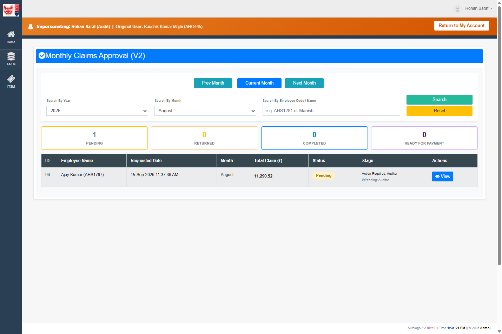
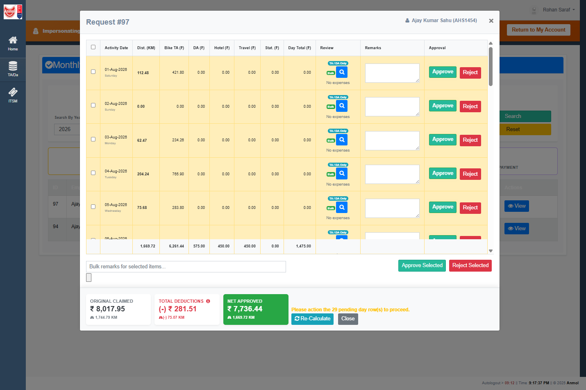
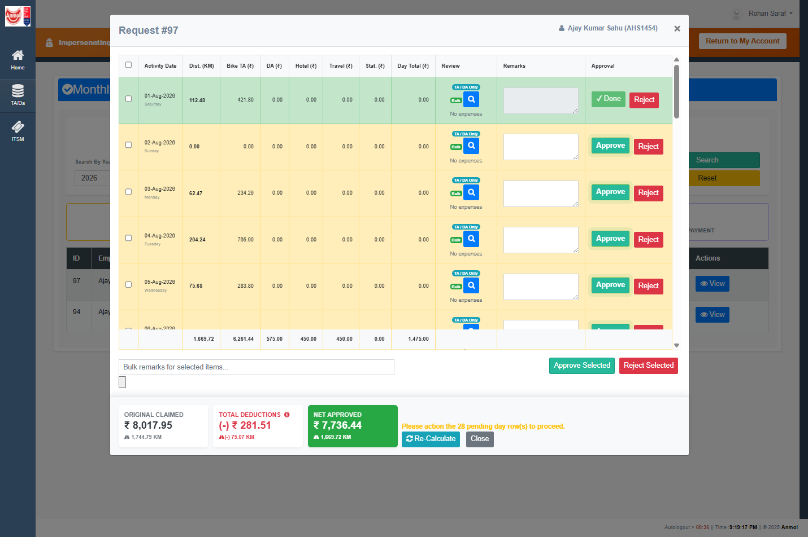
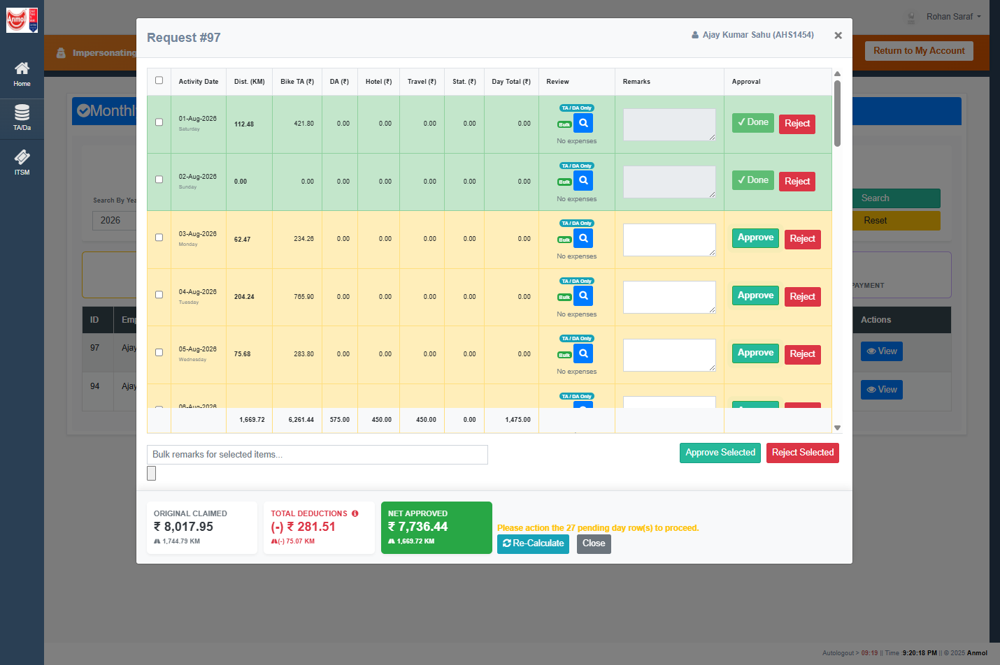
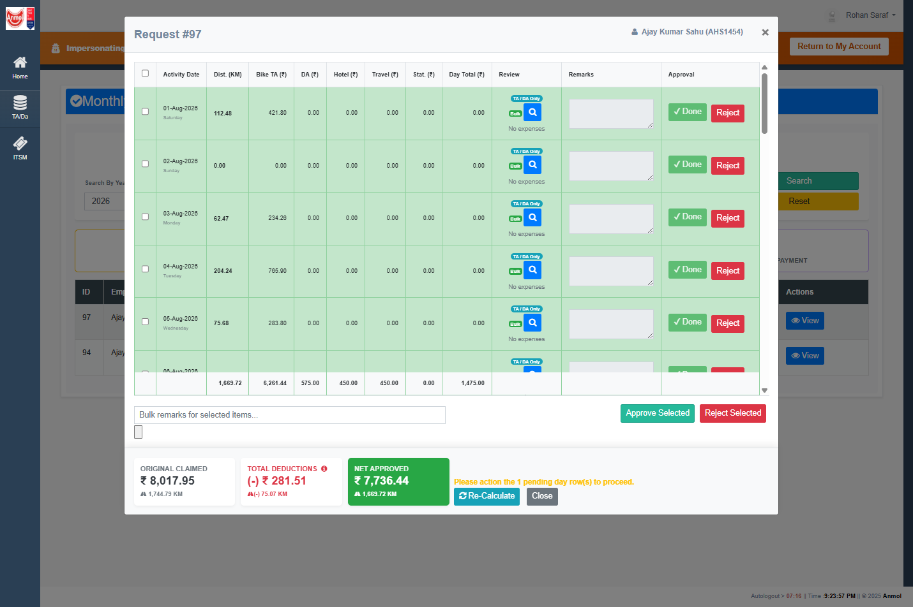
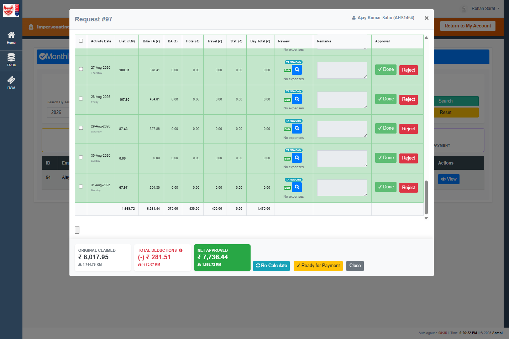
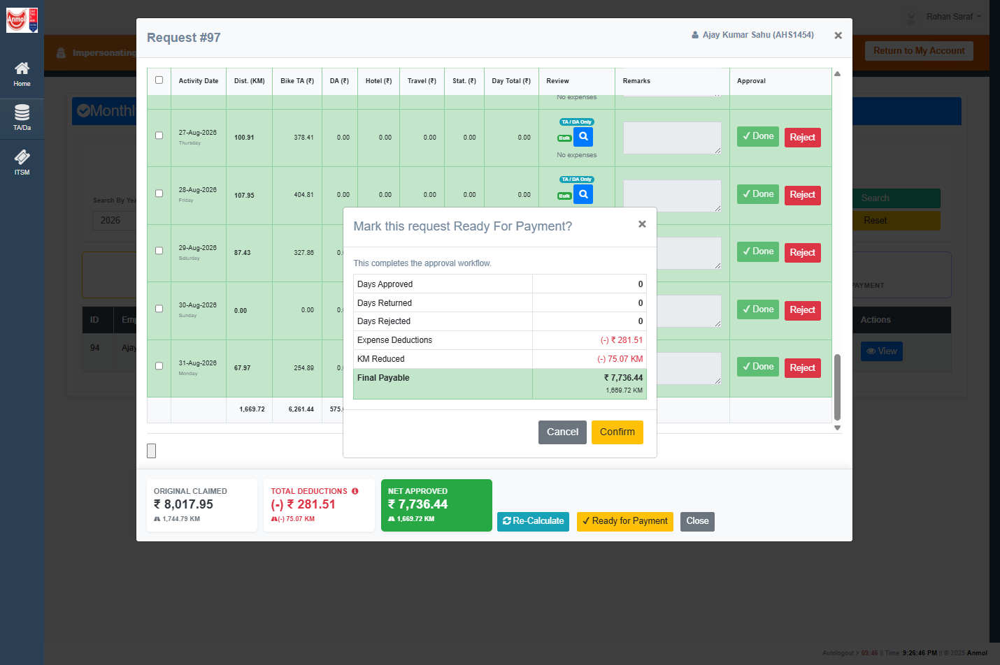

# RC-014B / RC-014D UAT — Request #97

**Date:** 2026-09-15  
**SQL:** parameterized `SELECT` on MCP `anmol_uat` → `AnmolDristiDev` (`execute_query` disabled)  
**App:** local IIS Express `http://localhost:53713`  
**Actor:** `Audit` (Rohan Saraf), impersonated from `AHO445`  
**Claim:** Request **97** (Ajay Kumar Sahu / `AHS1454`, August 2026)  
**Constraint:** no code change, no SQL deploy, no Git during this pass

**Overall verdict: RC-014B PASS · RC-014D FAIL**

The Auditor completion predicate held: header stayed `Pending` through the first, second, and bulk-except-last day, then moved to `Completed` only on the last remaining gatekeeper day, with one `Pending → Completed` history row (`Final Auditor Approval`). Ready for Payment appeared.

Confirming Ready for Payment did **not** persist `ReadyForPayment`. The running IIS Express process threw a closed-connection `ExecuteNonQuery` error before the live `usp_MarkRequestReadyForPayment` body ran. Header remains `Completed`. There is still no `Completed → ReadyForPayment` history row.

---

## Session

| Item | Evidence |
| --- | --- |
| Site | `http://localhost:53713/ClaimsApproval_v2.aspx` |
| Identity | Banner: Impersonating Rohan Saraf (`Audit`) \| Original: Kaushik Kumar Majhi (`AHO445`) |
| Filter | Year 2026 / Month August |
| Live `usp_ProcessApprovalAction` | `modify_date` **2026-09-15 18:04:06** (RC-014B body present) |
| Live `usp_MarkRequestReadyForPayment` | `modify_date` **2026-01-09 17:48:18** (RC-014D named INSERT **not** deployed) |
| Running `AnmolDristi.dll` | **2026-09-15 17:13:50** |
| Repo `ClaimsApproval_v2.aspx.cs` | **2026-09-15 18:42:10** (`con.Open()` restored in source; not in the running DLL) |

Queue after this pass: **1 Pending** — Request **94** only. Request 97 left the Pending-only list after `Completed`. The Completed / Ready for Payment tiles stayed at 0 because this page filters Pending.

---

## Before (baseline)

### UI

Request 97 modal: yellow rows with Approve enabled. Footer: **Please action the 29 pending day row(s) to proceed.** Ready for Payment hidden. Queue behind the modal still showed **97** and **94**.

### SQL

**`SalesApprovalRequest`**

| ApprovalRequestId | Status | CurrentApproverLevel | CurrentApproverLoginId | ModifiedBy | ModifiedOn |
| --- | --- | --- | --- | --- | --- |
| 97 | Pending | 2 | Audit | Audit | 2026-09-15 12:34:51 |

**`SalesApprovalRequestApprover`**

| Level | Login | Role | Status | ActionBy |
| --- | --- | --- | --- | --- |
| 1 | AHS1605 | L1 | Approved | AHS1605 |
| 2 | Audit | Auditor | Pending | (null) |

Latest details: **31/31** `Approved`. **29** at `DetailApprovedLevel=1`, **2** already at level 2. Unresolved-at-Auditor count = **29** (matches the UI footer).

History through **684**: last row `Pending → Pending`, Remarks `Level 1 completed. Forwarded to Auditor (Audit).` No `Completed` row.

---

## After first approve (01-Aug)

### Action

Clicked **Approve** on **01-Aug-2026**.

### UI after

| Check | Expected | Observed | Result |
| --- | --- | --- | --- |
| Row becomes Done | 01-Aug ✔ Done, green | Yes | PASS |
| Remaining counter decreases | 29 → 28 | Yes (“28 pending day row(s)”) | PASS |
| Header remains Pending | Pending | SQL `Status=Pending`, routing still L2/`Audit` | PASS |
| Ready for Payment hidden | Hidden | Hidden | PASS |
| No Forward confirm | None | None | PASS |
| No Completed history | None | No rows after HistoryId 684 | PASS |

### SQL

Header: `Pending`, level 2, `Audit`. Auditor row still `Pending`. Latest: **28** at level 1, **3** at level 2. History: no new rows.

This is the RC-014A failure mode inverted: the first Auditor day no longer completes the claim.

---

## Intermediate (02-Aug, then bulk except last)

### 02-Aug

Clicked **Approve** on **02-Aug-2026**. Footer: **27 pending day row(s).** Ready still hidden.

SQL: `Status=Pending`, Auditor `Pending`, **4** latest rows at level 2.

### Bulk except 31-Aug

Approve Selected on the remaining days except **31-Aug**. Footer: **Please action the 1 pending day row(s) to proceed.** Ready still hidden. Approve Selected still visible.

SQL: `Status=Pending`, Auditor `Pending`, **30** at level 2, **1** still below level 2.

| Check | Expected | Observed | Result |
| --- | --- | --- | --- |
| Header stays Pending until last day | Pending | Pending through 30/31 | PASS |
| Ready hidden while any gatekeeper day remains | Hidden | Hidden | PASS |
| No `Final Auditor Approval` history yet | None | None | PASS |

---

## Final day (31-Aug) — RC-014B terminal

### Action

Clicked **Approve** on **31-Aug-2026**.

### UI after

All 31 rows ✔ Done. Footer cleared. **Ready for Payment** visible. No Forward confirmation (Auditor is final).

### SQL after last approve

**`SalesApprovalRequest`**

| Column | Before last day | After last day |
| --- | --- | --- |
| Status | Pending | **Completed** |
| CurrentApproverLevel | 2 | **NULL** |
| CurrentApproverLoginId | Audit | **NULL** |
| ModifiedBy | Audit | Audit |
| ModifiedOn | 2026-09-15 15:47:58 (first approve) | **2026-09-15 15:55:02** |

**Auditor row:** Pending → **Approved** (`ActionBy=Audit`).

Latest details: **31/31** `Approved`, `DetailApprovedLevel=2`.

**History 687:** `Pending → Completed`, ChangedBy=`Audit`, Remarks=`Final Auditor Approval`. Only new history row after 684.

Queue (Pending filter) dropped #97. Remaining Pending: **94**.

| Check | Expected | Observed | Result |
| --- | --- | --- | --- |
| Header Completed only after last day | Yes | Yes (15:55:02) | PASS |
| Ready for Payment appears | Yes | Yes | PASS |
| No Forward confirmation | None | None | PASS |
| Single Completed history | One `Final Auditor Approval` | HistoryId 687 only | PASS |

---

## Ready for Payment — RC-014D

### Action

Clicked **Ready for Payment**. Confirm dialog: “Mark this request Ready For Payment?” / “This completes the approval workflow.” Clicked **Confirm**.

The confirm summary showed **Days Approved = 0** (and Returned/Rejected = 0) while all 31 rows were already Done. Out of scope for RC-014B/D; noted only.

### UI after Confirm

Footer error (red):

> Error: ExecuteNonQuery requires an open and available Connection. The connection's current state is closed.

Ready for Payment remained visible. Amounts unchanged (Original ₹ 8,017.95 / Net ₹ 7,736.44). No success text.

### SQL after Confirm

Unchanged from the Completed snapshot:

| Check | Expected | Observed | Result |
| --- | --- | --- | --- |
| Header = ReadyForPayment | ReadyForPayment | Still **Completed** | **FAIL** |
| Routing stays NULL | NULL | NULL | n/a (no transition) |
| New history `Completed → ReadyForPayment` | Yes | **None**. Last row remains 687 | **FAIL** |
| No SQL error 213 | No 213 | 213 **not reached**. Client closed-connection error first | **FAIL** (different defect) |
| ModifiedOn advances | Yes | Still **2026-09-15 15:55:02** | **FAIL** |

Live `usp_MarkRequestReadyForPayment` is still the 2026-01-09 positional INSERT. RC-014C proved that body dies with error 213 (`Column name or number of supplied values does not match table definition`) **if** it is invoked. This click never got that far: the running DLL still hits the closed-connection path in `btnMarkReadyForPayment_Click`.

Repo source at 18:42 restored `con.Open()` before `ExecuteNonQuery`. The IIS Express DLL timestamp is 17:13, so this UAT executed the **pre-RC-014D** C# handler. Per the no-deploy rule, the process was not rebuilt.

---

## Verdict matrix

| Phase | Check | Result |
| --- | --- | --- |
| Before | 97 Pending at Auditor, 29 gatekeeper days, history ends at L1 Forward | PASS |
| First approve (01-Aug) | Header stays Pending; Ready hidden; no Completed history | **PASS** (RC-014B) |
| Intermediate (02-Aug + bulk) | Header stays Pending with 1 day left | **PASS** (RC-014B) |
| Last day (31-Aug) | Header Completed; routing NULL; Auditor Approved; History 687; Ready visible | **PASS** (RC-014B) |
| Queue | 97 leaves Pending list; 94 remains | PASS |
| Ready Confirm | Header ReadyForPayment; history Completed→ReadyForPayment; no 213 | **FAIL** (RC-014D) |

**RC-014B is live-proven on Request 97.**  
**RC-014D is not live-proven:** running C# still closed-connection; live SP still undeployed named INSERT. Header is parked at `Completed`, which is the correct input state for a later MarkReady retry after rebuild + SP deploy.

No `usp_ProcessApprovalAction`, Forward, or authorization files were modified in this pass.
