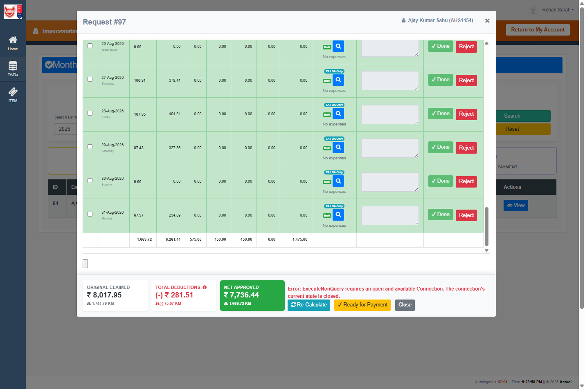
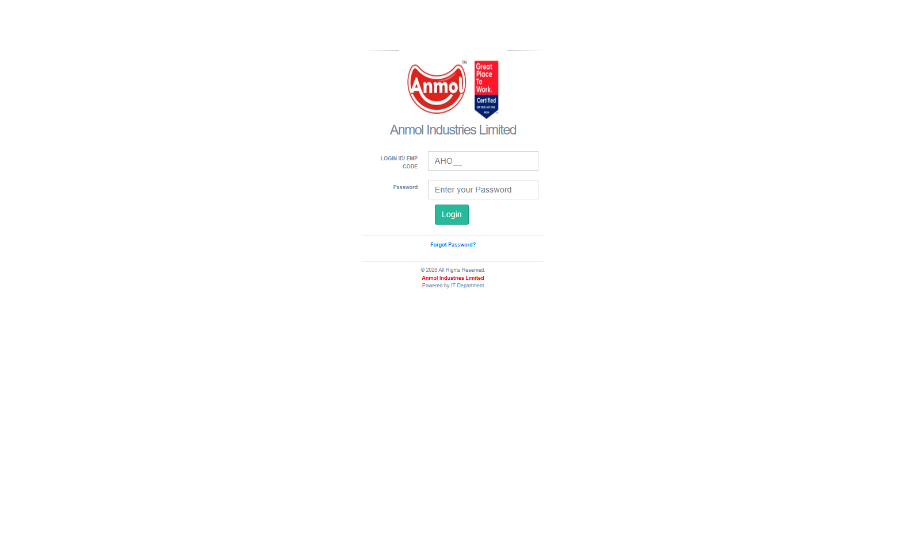
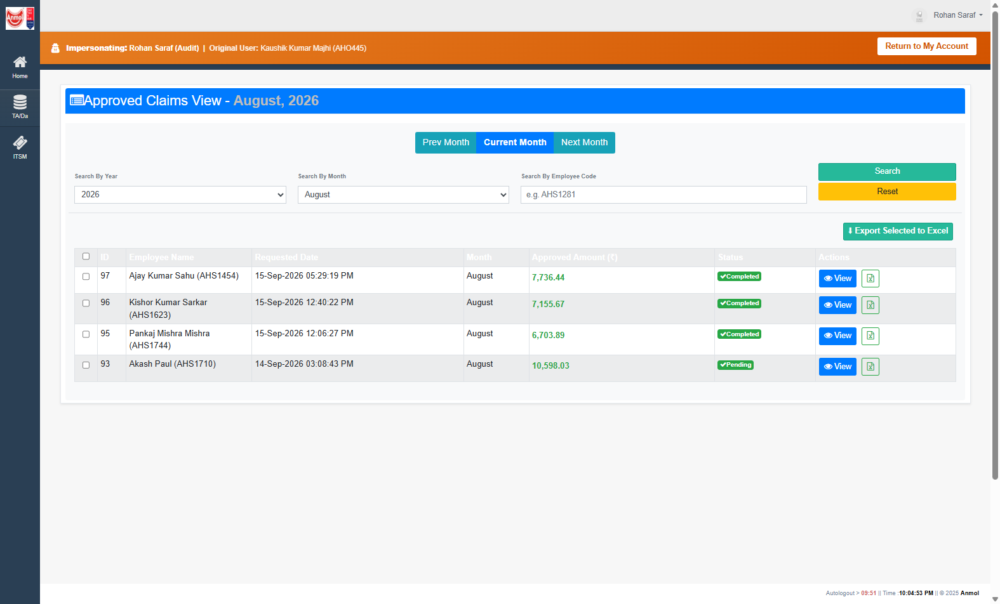
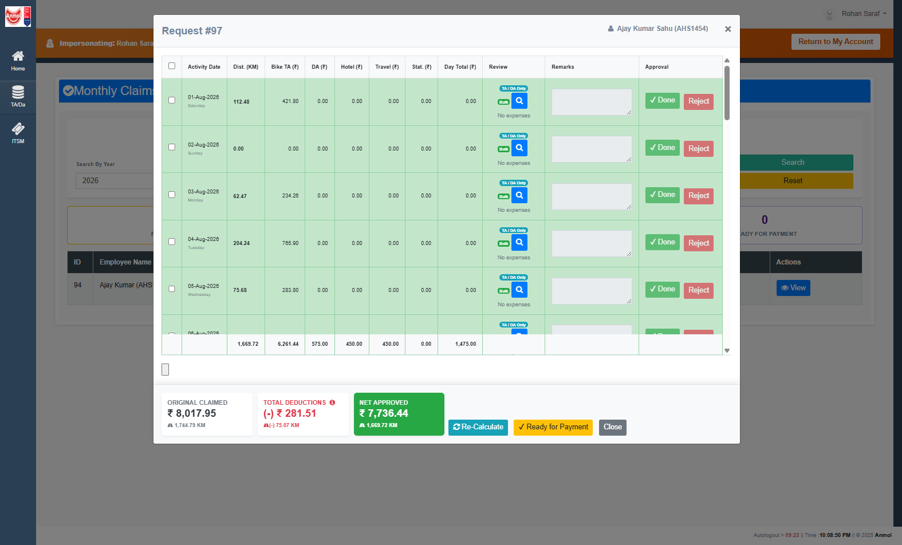
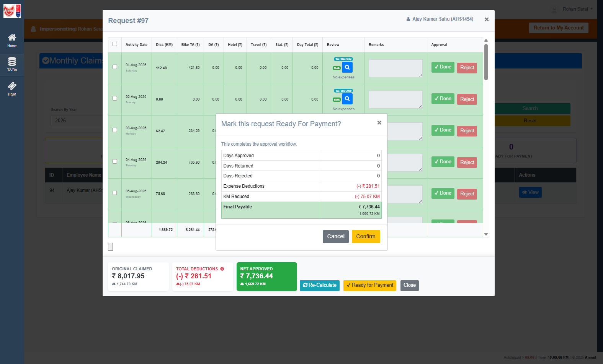
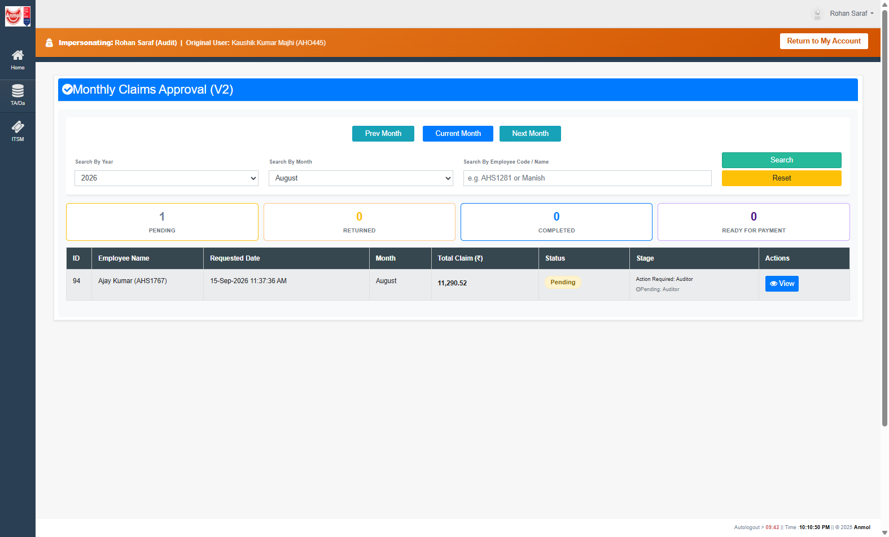
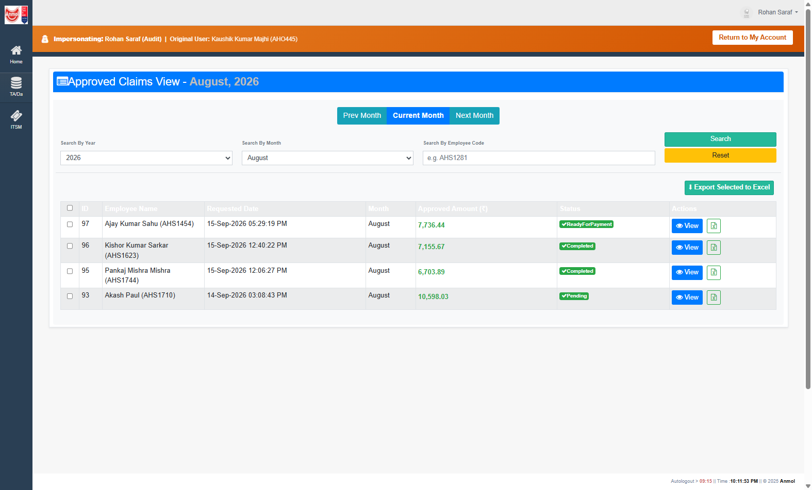

# RC-014D Deployment Validation — Request #97

**Date:** 2026-09-15  
**SQL:** parameterized `SELECT` on MCP `anmol_uat` → `AnmolDristiDev` (`execute_query` disabled)  
**App:** local IIS Express `http://localhost:53713`  
**Actor:** `Audit` (Rohan Saraf), impersonated from `AHO445`  
**Claim:** Request **97** (Ajay Kumar Sahu / `AHS1454`, August 2026)  
**Constraint:** deploy the two existing RC-014D fixes only. No extra repository source edits. No extra Git commits. `usp_ProcessApprovalAction` left untouched.

**Overall verdict: RC-014D PASS**

The previous UAT parked Request 97 at `Completed` because the running DLL still called `ExecuteNonQuery` on a closed connection, and live `usp_MarkRequestReadyForPayment` still used a positional history `INSERT`. After deploying those two artifacts, Confirming Ready for Payment persisted `ReadyForPayment` and wrote history **688**. No closed-connection error. No SQL error 213.

---

## Session

| Item | Evidence |
| --- | --- |
| Site | `http://localhost:53713/ClaimsApproval_v2.aspx` |
| Identity | Banner: Impersonating Rohan Saraf (`Audit`) \| Original: Kaushik Kumar Majhi (`AHO445`) |
| Filter | Year 2026 / Month August |
| Prior UAT | `docs/reviews/L2_Auditor_AsIs/RC014B_RC014D_UAT_Request97.md` — RC-014B PASS, RC-014D FAIL |
| Recycle | IIS Express AppDomain recycled by copying `AnmolDristi.dll` into `AnmolDristi\bin`. Session dropped; login + Switch User repeated. |

---

## Before (undeployed)

From the Request 97 UAT that ended at `Completed`:

| Artifact | Timestamp | State |
| --- | --- | --- |
| Running `AnmolDristi.dll` | **2026-09-15 17:13:50** | `btnMarkReadyForPayment_Click` executed `ExecuteNonQuery` without `con.Open()` |
| Live `usp_MarkRequestReadyForPayment` | **2026-01-09 17:48:18** | positional `INSERT INTO ApprovalRequestStatusHistory VALUES (...)` |
| Live `usp_ProcessApprovalAction` | **2026-09-15 18:04:06** | RC-014B body already live; not in this deploy |

**Header before this pass**

| ApprovalRequestId | Status | CurrentApproverLevel | CurrentApproverLoginId | ModifiedBy | ModifiedOn |
| --- | --- | --- | --- | --- | --- |
| 97 | Completed | NULL | NULL | Audit | 2026-09-15 15:55:02 |

**History before this pass:** last row **687** `Pending → Completed`, Remarks `Final Auditor Approval`. No `Completed → ReadyForPayment` row.

**UI before this pass:** Ready for Payment Confirm threw:

> Error: ExecuteNonQuery requires an open and available Connection. The connection's current state is closed.

Queue after Completed (Pending-only list): **94** only. Request 97 already left View Pending.

---

## After deployment

### Stored procedure

`ALTER PROCEDURE dbo.usp_MarkRequestReadyForPayment` from repo file `Database/Stored Procedures/Approval/usp_MarkRequestReadyForPayment.sql`.

| Check | Observed |
| --- | --- |
| `modify_date` | **2026-09-15 21:50:31** |
| Header comment | `mark_ready_named_history_insert` / 2026-09-15 |
| History write | named columns: `ApprovalRequestId, OldStatus, NewStatus, ChangedBy, Remarks` |
| `usp_ProcessApprovalAction` | still **2026-09-15 18:04:06** (unchanged) |

### DLL

Rebuild of existing `ClaimsApproval_v2.aspx.cs` (`con.Open()` already in source). Intermediate output redirected to `obj\rc014d\` because `obj\Debug` was locked by Visual Studio. Built DLL copied to `AnmolDristi\bin`.

| Check | Observed |
| --- | --- |
| `AnmolDristi\bin\AnmolDristi.dll` | **2026-09-15 21:54:56**, length 3,094,016 |
| IL of `btnMarkReadyForPayment_Click` | `DbConnection::Open()` then `ldstr "dbo.usp_MarkRequestReadyForPayment"` then `ExecuteNonQuery()` |

AppDomain recycle dropped the login session. After re-login and Switch User to Audit:

View Pending still showed **94** only (97 already `Completed`):

View Approved showed **97** still `Completed` before Ready:

---

## Ready-for-Payment execution

Request 97 was opened on `ClaimsApproval_v2` (Recalculate full postback with `hfActionRequestId=97`). Footer showed **Ready for Payment**. Confirm dialog: “Mark this request Ready For Payment?” / “This completes the approval workflow.”

Clicked **Confirm**.

### UI after Confirm

| Check | Expected | Observed | Result |
| --- | --- | --- | --- |
| No closed-connection error | No red `ExecuteNonQuery` / closed connection | None | **PASS** |
| Ready button after success | Hidden (request no longer `Completed`) | Hidden | **PASS** |
| Pending queue | 97 remains absent; 94 still Pending | Yes | **PASS** |
| Approved Claims status | ReadyForPayment | Green `ReadyForPayment` on ID 97 | **PASS** |

The Pending page tiles stayed at 0 Completed / 0 Ready for Payment because `usp_GetPendingApprovalsForUser_Filters` is Pending-only. That is the same filter behavior as the earlier UAT, not a MarkReady failure.

After the header left `Completed`, `SetCurrentUserApproverDetails` no longer treated the Auditor as the current approver, so day rows showed Approve / Return again and the modal success label was rebound empty. Status persistence is proven in SQL and on Approved Claims View; those UI leftovers are outside RC-014D.

### SQL after Confirm

**`SalesApprovalRequest`**

| Column | Before Ready | After Ready |
| --- | --- | --- |
| Status | Completed | **ReadyForPayment** |
| CurrentApproverLevel | NULL | NULL |
| CurrentApproverLoginId | NULL | NULL |
| ModifiedBy | Audit | Audit |
| ModifiedOn | 2026-09-15 15:55:02 | **2026-09-15 16:39:11** (`SYSUTCDATETIME()`) |

**`ApprovalRequestStatusHistory`**

| HistoryId | OldStatus | NewStatus | ChangedBy | ChangedOn | Remarks |
| --- | --- | --- | --- | --- | --- |
| 687 | Pending | Completed | Audit | 2026-09-15 15:55:02 | Final Auditor Approval |
| **688** | **Completed** | **ReadyForPayment** | **Audit** | **2026-09-15 16:39:11** | **Auditor marked Ready for Payment** |

No new `usp_ProcessApprovalAction` history. No error 213.

---

## Verdict matrix

| Check | Result |
| --- | --- |
| DLL updated | **PASS** — `AnmolDristi.dll` 2026-09-15 21:54:56; IL opens the connection before MarkReady |
| SP updated | **PASS** — `usp_MarkRequestReadyForPayment` 2026-09-15 21:50:31 named-column INSERT |
| Connection opens | **PASS** — Confirm no longer throws closed-connection |
| ReadyForPayment succeeds | **PASS** — header Status = `ReadyForPayment` |
| History written | **PASS** — HistoryId **688** `Completed → ReadyForPayment`, ChangedBy=`Audit` |
| Queue cleanup | **PASS** — 97 absent from View Pending; 94 remains Pending; Approved Claims shows 97 `ReadyForPayment` |

`usp_ProcessApprovalAction` was not altered in this pass (`modify_date` still 2026-09-15 18:04:06). No additional repository commits were created during this validation.
