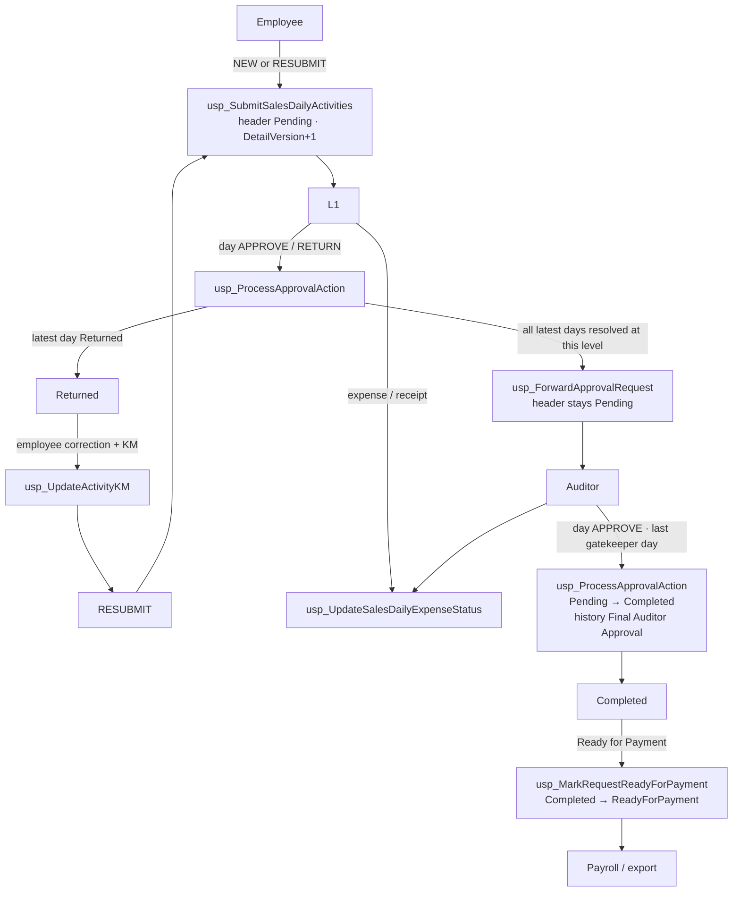

# Post-Go-Live Baseline — TA/DA Claims

**Captured:** 2026-09-15  
**Constraint:** read-only inventory. No application code, SQL, Git, or deployment changes in this task.  
**Sources:** `docs/releases/TA_DA_GoLive_2026/`, `docs/reviews/L2_Auditor_AsIs/`, `Database/Stored Procedures/Approval/`, `Database/Stored Procedures/Submission/`, and the four Web Forms code-behinds named in the kickoff prompt.  
**UAT:** MCP `anmol_uat` → `AnmolDristiDev` (dates already proven in the referenced UAT packs; not re-queried here).

This file is the frozen reference point for all future TA/DA work after RC-001 through RC-014D UAT certification.

---

## 1. Release Baseline

### 1.1 Release identity

| Item | Value |
| --- | --- |
| Branch | `Aug26_AILWorks_AmimnrupSupport` |
| Release commit | `94bc2089c0a43d38619a4df2bfff139269b7598c` |
| Commit subject | `feat(tada): production go-live hardening (RC-001–RC-013)` (2026-09-15 15:51:08 +0530) |
| Local tag | `tada-v1.0-go-live-2026` (not pushed) |
| RC coverage | RC-001 through RC-014D |
| Certification pack | `docs/releases/TA_DA_GoLive_2026/TA_DA_GoLive_Certification.md` (RC-001–RC-013) |
| Auditor close pack | `docs/reviews/L2_Auditor_AsIs/` (RC-014A–D) |

HEAD on the branch equals the release commit. The tagged package is RC-001–RC-013. RC-014B and RC-014D are **UAT-certified in the working tree and on live UAT SQL**, and are **not** in `94bc2089`. That delta is the first item any later freeze/commit must absorb; this baseline does not create that commit.

Working-tree delta vs the tag (do not treat as uncertified product):

| Path | RC | Certified UAT |
| --- | --- | --- |
| `Database/Stored Procedures/Approval/usp_ProcessApprovalAction.sql` | RC-014B | Request 97 last-day `Pending → Completed` |
| `Database/Stored Procedures/Approval/usp_MarkRequestReadyForPayment.sql` | RC-014D | Request 97 `Completed → ReadyForPayment`, HistoryId 688 |
| `AnmolDristi/ClaimsApproval_v2.aspx.cs` | RC-014D | `con.Open()` before MarkReady `ExecuteNonQuery` |

### 1.2 RC register (certified)

| RC | Title | Status | Evidence |
| --- | --- | --- | --- |
| RC-001 | Line-item RESUBMIT | PASS | Go-Live Certification |
| RC-002 | Sequence reserved | PASS | Go-Live Certification |
| RC-003 | My Claims Excel export hardening | PASS | Go-Live Certification |
| RC-004 | Latest-version rendering (Approved Claims) | PASS | Go-Live Certification |
| RC-005 | My Claims paging | PASS | Go-Live Certification |
| RC-006 | Returned visibility (My Claims) | PASS | Go-Live Certification |
| RC-007 | Returned TVP filter (partial RESUBMIT) | PASS | Go-Live Certification |
| RC-008 | Returned editability + KM gate | PASS | Go-Live Certification; `usp_UpdateActivityKM` 2026-09-14 13:51:00 |
| RC-009 | Already Returned UI | PASS | Go-Live Certification |
| RC-010 | Requestor UX polish | PASS | Go-Live Certification |
| RC-011 | L1 commit UX (Return notify, Forward confirm, bulk confirm) | PASS | Smoke Test Execution |
| RC-012 | Latest-version SQL (Forward + expense status) | PASS | Forward 2026-09-15 12:03:54; Expense 2026-09-15 12:03:55 |
| RC-013 | Auto-close details modal after Forward | PASS | Smoke Test Execution |
| RC-014A | Auditor terminal `Completed` (first-day premature) | FAIL (superseded) | `RC014A_UAT_Validation.md` Request 96 |
| RC-014B | Gatekeeper uses `DetailApprovedLevel`; last Auditor day writes `Completed` | PASS | `RC014B_RC014D_UAT_Request97.md`; SP 2026-09-15 18:04:06 |
| RC-014C | MarkReady positional history INSERT (error 213) | FAIL (superseded) | `RC014C_MarkReady_Contract.md` Request 95 |
| RC-014D | Named-column history INSERT + `con.Open()` | PASS | `RC014D_Deployment_Validation.md` Request 97 |

**Product freeze state:** Employee Submit / Return / RESUBMIT / L1 Forward / Auditor complete / Ready for Payment are live-proven. Payroll consumption of `ReadyForPayment` is downstream of this freeze (not UAT-certified in the RC pack).

---

## 2. SQL Inventory

Production-owned mutating procedures for the certified workflow. Latest-version = the consumer addresses the current `SalesApprovalRequestDetail` row per `ActivityId`, not a superseded RESUBMIT snapshot.

| Procedure | Role | Latest-version | UAT `modify_date` | Evidence |
| --- | --- | --- | --- | --- |
| `usp_SubmitSalesDailyActivities` | Submit (NEW + RESUBMIT) | Yes — `LatestDetailSnapshot`; insert `DetailVersion+1` | 2026-07-28 12:39:02 | Go-Live Certification §3 |
| `usp_ProcessApprovalAction` | L1 / Auditor day APPROVE / RETURN | Yes — `MAX(ApprovalRequestDetailId)` per `ActivityId`; unresolved includes `Approved` with `DetailApprovedLevel <` current | **2026-09-15 18:04:06** | RC-014B Request 97 |
| `usp_ForwardApprovalRequest` | Forward (L1 → next; Auditor refused) | Yes — `MAX(DetailVersion)` then `MAX(ApprovalRequestDetailId)` | 2026-09-15 12:03:54 | RC-012A / Go-Live |
| `usp_UpdateActivityKM` | KM (employee, Returned gate) | Yes — `MAX(ISNULL(DetailVersion, 1))` | 2026-09-14 13:51:00 | RC-008 |
| `usp_UpdateSalesDailyExpenseStatus` | Expense / receipt status | Yes — `MAX(DetailVersion)` then `MAX(ApprovalRequestDetailId)` | 2026-09-15 12:03:55 | RC-012B |
| `usp_MarkRequestReadyForPayment` | Payment (Auditor finalize) | Yes — header-only; no detail version predicate | **2026-09-15 21:50:31** | RC-014D named INSERT |

Parameter contracts (unchanged through RC-014D):

| Procedure | Parameters |
| --- | --- |
| `usp_SubmitSalesDailyActivities` | `@Updates TVP_ActivityUpdate`, `@LoginId`, `@Year`, `@Month`, `@Remarks`, `@L1Code`, `@L2Code`, `@L3Code`, `@AuditorCode` |
| `usp_ProcessApprovalAction` | `@ApprovalRequestDetailId`, `@Action`, `@ActionBy`, `@Remarks` |
| `usp_ForwardApprovalRequest` | `@ApprovalRequestId`, `@ActionBy` |
| `usp_UpdateActivityKM` | existing KM signature; Returned gate in-body |
| `usp_UpdateSalesDailyExpenseStatus` | `@ExpenseId`, `@NewStatus`, `@ActionBy`, `@Remarks` |
| `usp_MarkRequestReadyForPayment` | `@ApprovalRequestId`, `@ActionBy` |

### 2.1 Adjacent procedures (called by the four pages; not in the mutating six)

| Procedure | Role | Notes |
| --- | --- | --- |
| `usp_GetPendingApprovalsForUser_Filters` | Queue | Header `Status='Pending'` only |
| `usp_GetApprovalRequestDetails` | Detail bind | Returns **all** versions; C# applies `KeepLatestPerActivity` |
| `usp_GetApprovalRequest` | Header + max level | |
| `usp_GetMyClaims` | Employee list | My Claims |
| `usp_GetApprovedClaimsByUser` | Approved list | Approved Claims |
| `usp_Export_Auditor_Final_Excel` | Export | My Claims / Approved Claims |
| `usp_ProcessSalesApprovalRequestDetail` | Auditor day Reject | **No** latest-version guard (L2-R03) |
| `usp_ReturnClaimToEmployee` | Whole-claim Return | Hidden for Auditor |
| `usp_UpdateActivityKM_WithHistory` | KM from approval modal | Distinct from employee `usp_UpdateActivityKM` |
| `usp_SaveDailyExpense` / `usp_SaveHotelExpense` / `usp_InsertTravel_WithLock` / `usp_SaveActivitiesDraft` / `usp_SaveMonthlyDraftSummary` | Employee draft save | Submission folder |

No table, index, or data-script changes are in the certified packet.

---

## 3. Workflow Diagram

Canonical certified path after RC-014B + RC-014D. Each arrow is owned by one production procedure.

| Transition | From | To | Owning procedure |
| --- | --- | --- | --- |
| Submit | (none) / Returned | Pending | `usp_SubmitSalesDailyActivities` |
| L1 / Auditor day action | Pending | Pending or Returned | `usp_ProcessApprovalAction` |
| Return ↔ RESUBMIT | Returned | Pending (same `ApprovalRequestId`, new `DetailVersion`) | `usp_SubmitSalesDailyActivities` |
| KM on Returned | activity KM | updated KM; snapshot frozen until RESUBMIT | `usp_UpdateActivityKM` |
| Expense / receipt | child `ClaimStatus` | Approved / Rejected / Returned | `usp_UpdateSalesDailyExpenseStatus` |
| Forward | Pending @ L1 | Pending @ Auditor | `usp_ForwardApprovalRequest` |
| Last Auditor approve | Pending | Completed | `usp_ProcessApprovalAction` (RC-014B) |
| Ready for Payment | Completed | ReadyForPayment | `usp_MarkRequestReadyForPayment` (RC-014D) |
| Payroll | ReadyForPayment | consumption (`Processed` is catalog-only; not written by the six) | `usp_Export_Auditor_Final_Excel` / Approved Claims View |

Auditor Forward is refused (`THROW 51012`). MarkReady requires header `Completed` and ApproverRole `Auditor`.

---

## 4. Architecture Snapshot

Reference architecture for future RC work. `.NET Framework 4.8` Web Forms; session identity `Session["USERID"]` / `Session["WORKMAN"]`; parameterized SqlClient only.

### 4.1 Web Forms pages and code-behind owners

| Page | Code-behind | Owner role | Primary SPs |
| --- | --- | --- | --- |
| `SalesMonthlyReview.aspx` | `SalesMonthlyReview.aspx.cs` | Employee month grid, Submit, RESUBMIT, KM, draft expenses | `usp_SubmitSalesDailyActivities`, `usp_UpdateActivityKM`, draft save SPs |
| `ClaimsApproval_v2.aspx` | `ClaimsApproval_v2.aspx.cs` | L1 **and** Auditor (role overlay, not a separate screen) | Process / Forward / MarkReady / Expense / Reject / Return-to-employee |
| `MyClaimsView_v2.aspx` | `MyClaimsView_v2.aspx.cs` | Employee claim list, paging, export | `usp_GetMyClaims`, `usp_GetApprovalRequestDetails`, `usp_Export_Auditor_Final_Excel` |
| `ApprovedClaimsView.aspx` | `ApprovedClaimsView.aspx.cs` | Post-queue view (`UI.SO_TaDa_ViewApproved.View`) | `usp_GetApprovedClaimsByUser`, same detail SP + export |

Shared helper: `SalesApprovalDetailVersionHelper` (`KeepLatestPerActivity`, `LatestDetailWhereForD`). Menu: `Dristi.Master` → TA/DA View Pending / View Approved.

### 4.2 SQL ownership boundaries

| Concern | Owner | Must not |
| --- | --- | --- |
| Create / reset request + versions | `usp_SubmitSalesDailyActivities` | C# must not insert header/detail rows |
| Day APPROVE / RETURN + Auditor terminal `Completed` | `usp_ProcessApprovalAction` | UI must not patch `Status='Completed'` |
| Level handover | `usp_ForwardApprovalRequest` | Must not write `Approved` or `ReadyForPayment` |
| Ready for Payment | `usp_MarkRequestReadyForPayment` | Must not run unless header is `Completed` |
| Expense `ClaimStatus` + latest snapshot rewrite | `usp_UpdateSalesDailyExpenseStatus` | Must not version expenses (version lives on detail) |
| Employee KM | `usp_UpdateActivityKM` | Must not edit frozen non-Returned snapshots |
| Amounts on the page | `ExecuteRecalculationSQL` in `ClaimsApproval_v2` (MAX Id) | Must not change `Status` |
| Queue membership | `usp_GetPendingApprovalsForUser_Filters` | Pending + current-approver only |

### 4.3 Latest-version strategy

Every certified UI consumer shows **one row per `ActivityId`**.

| Layer | Predicate |
| --- | --- |
| C# bind (`KeepLatestPerActivity`) | `DetailVersion DESC`, then `ApprovalRequestDetailId DESC` |
| C# footer / recalc (`LatestDetailWhereForD`) | `MAX(ApprovalRequestDetailId)` per `ActivityId` |
| Forward / Expense SPs | `MAX(DetailVersion)` then `MAX(ApprovalRequestDetailId)` |
| ProcessApprovalAction (UAT RC-014B) | `MAX(ApprovalRequestDetailId)` plus `DetailApprovedLevel` gatekeeper |
| `usp_GetApprovalRequestDetails` | **none** (all versions; UI filters) |

Superseded Returned snapshots stay frozen. RESUBMIT creates a new `DetailVersion` on the same `ApprovalRequestId`. Identity IDs normally move with new versions, so the two predicates usually agree.

### 4.4 Approval-state machine

Header `SalesApprovalRequest.Status` (certified):

| State | Who writes it | Queue |
| --- | --- | --- |
| `Pending` | Submit, RESUBMIT, partial approve, Forward (pointer moves, status stays) | Visible to `CurrentApproverLoginId` |
| `Returned` | `usp_ProcessApprovalAction` RETURN | Drops from L1 and Auditor Pending queues |
| `Completed` | `usp_ProcessApprovalAction` last Auditor gatekeeper day (RC-014B) | Leaves Pending; appears on Approved Claims |
| `ReadyForPayment` | `usp_MarkRequestReadyForPayment` (RC-014D) | Leaves Pending; Approved Claims badge ReadyForPayment |

Detail `DetailStatus`: `Pending` / `Approved` (with `DetailApprovedLevel`) / `Returned` / `Rejected`. Auditor must re-approve L1-approved days (`DetailApprovedLevel <` current). Approver chain: required L1 + optional L2/L3 + required Auditor. RESUBMIT resets **all** approver rows to Pending and points at L1.

Proven UAT anchors: Request **96** (RC-001–013 smoke + RC-014A leftover `Completed`); Request **97** (RC-014B `Completed` + RC-014D `ReadyForPayment`, HistoryId **687** then **688**).

---

## 5. Sprint 3 Prioritized Backlog

Do not implement in this freeze. Prioritize only.

| Priority | Candidate | Objective | Affected files | Estimated impact | Implementation risk |
| --- | --- | --- | --- | --- | --- |
| P1 | Reporting reconciliation | Prove header `Approved*` / latest snapshots / Excel export / ReadyForPayment amounts agree for payroll | `ApprovedClaimsView.aspx.cs`, `MyClaimsView_v2.aspx.cs`, `ClaimsApproval_v2.aspx.cs` (`ExecuteRecalculationSQL`), `usp_Export_Auditor_Final_Excel`, expense SP snapshot totals (Stationary omitted in SP vs included in C# recalc) | Finance-facing. Wrong net pay or duplicate export rows if latest-version is skipped | Medium. Shared export SP; Stationary total split already documented (L2-R06) |
| P1 | Auditor UX polish | After Ready for Payment: close modal, rebind queue, keep Auditor context on `Completed`/`ReadyForPayment`, stop Approve/Return reappearing, fix confirm “Days Approved = 0” | `AnmolDristi/ClaimsApproval_v2.aspx`, `AnmolDristi/ClaimsApproval_v2.aspx.cs` (`btnMarkReadyForPayment_Click`, `SetCurrentUserApproverDetails`, `BindRequestsGrid`, confirm summary JS) | Operator-facing. Observed on Request 97 after RC-014D success | Low–medium if SQL stays frozen. Touches identity lookup that currently keys `Approver.Status='Pending'` |
| P2 | Structured audit telemetry | Fill `ApprovalRequestStatusHistory` extra columns (`ActivityId`, `ApproverLevel`, `ActionType`, `DetailVersion`); stop unified-modal remarks ignoring `txtRowRemark` | `usp_ProcessApprovalAction.sql`, `usp_ForwardApprovalRequest.sql`, `usp_MarkRequestReadyForPayment.sql`, `ClaimsApproval_v2.aspx.cs` (`ActionDayRowSilent`) | Compliance / dispute reconstruction | Medium. Named INSERT must stay named (RC-014D). Do not revert to positional VALUES |
| P2 | Performance review | `usp_GetApprovalRequestDetails` returns every version; C# filters. Large months (31 days × versions) bind and recalc on each action | `Database` retrieval SP for details, `ClaimsApproval_v2.aspx.cs` `BindDetailsGrid`, `SalesApprovalDetailVersionHelper` | Approver wait time; IIS thread time | Medium. Pushing latest-filter into the SP changes every caller of the unfiltered result set |
| P3 | Documentation consolidation | Fold RC-014 into the Go-Live pack; update deployment checklist SP dates and file list so production cannot ship tag-only RC-013 | `docs/releases/TA_DA_GoLive_2026/*`, this baseline, L2 Auditor as-is (terminal path still describes pre-014B Pending) | Operational. Prevents deploying the tagged SHA without RC-014B/D | None (docs only) |

---

## 6. Known Deferred Items

Certified closed in this freeze:

| ID | Item | Closed by |
| --- | --- | --- |
| L2-R01 | Auditor last approve never wrote `Completed` | RC-014B |
| L2-R15 / RC-014C | Positional history INSERT error 213 | RC-014D named columns |
| RC-014D C# | MarkReady `ExecuteNonQuery` on closed connection | `con.Open()` in `btnMarkReadyForPayment_Click` |

Still open (do not treat as in-scope for a hotfix unless Sprint 3 picks them):

| ID | Item |
| --- | --- |
| Git vs runtime | Tag `tada-v1.0-go-live-2026` / commit `94bc2089` is RC-001–RC-013. RC-014B/D are uncommitted. Production checklist still lists `usp_ProcessApprovalAction` 2026-08-01 and does not deploy MarkReady. |
| L2-R03 / R17 | Auditor Reject uses `usp_ProcessSalesApprovalRequestDetail` (no latest-version) instead of ProcessApprovalAction REJECT |
| L2-R04 / R05 | Latest-version predicate split; details retrieval SP unfiltered |
| L2-R08 | Ready for Payment does not close the modal or rebind the Pending grid (unlike RC-013 Forward) |
| L2-R09 | UAT ProcessApprovalAction can auto-forward on last L1 approve in parallel with explicit Forward confirm |
| L2-R10 | Expense SP has no role check; Auditor can Reject an already-Approved receipt |
| L2-R11 | Bulk Reject does not require receipts resolved |
| L2-R12 | Unified Day modal stamps fixed remarks |
| L2-R13 | Pending page chips for Returned / Completed / Ready For Payment stay 0 |
| RC-014D observation | After `ReadyForPayment`, `SetCurrentUserApproverDetails` loses Auditor role; rows show Approve/Return |
| RC-014A leftover | Request 96 was completed on first Auditor day; not a template for new work |
| Payroll | `ClaimStatuses.Processed` is unused by the six production SPs |
| Adjacent SPs | `usp_RollupSalesApprovalRequestAmounts` / `usp_ReopenApprovalRequestByAuditor` / `usp_AdminRollbackApprovalRequest` / `usp_ProcessApprovalRequestDetails_WithRemarks` are not on the v2 click path |

---

**Freeze statement:** RC-001 through RC-014D are UAT-certified. This document is the Sprint 3 starting line. The next change to application code, SQL, or Git is a new RC against this baseline, not an amendment of the go-live tag.
